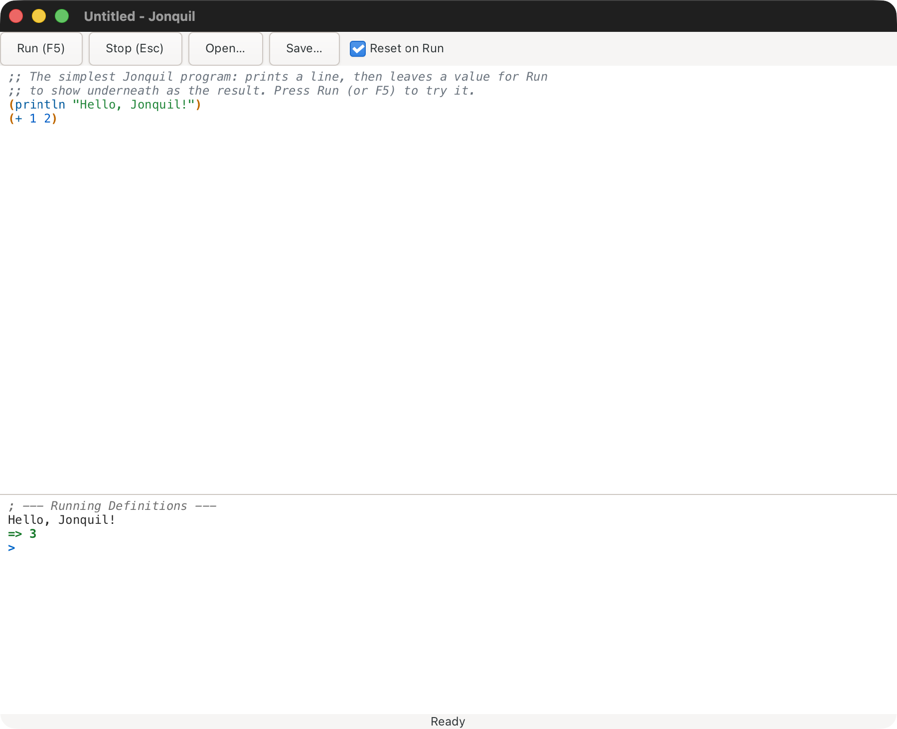
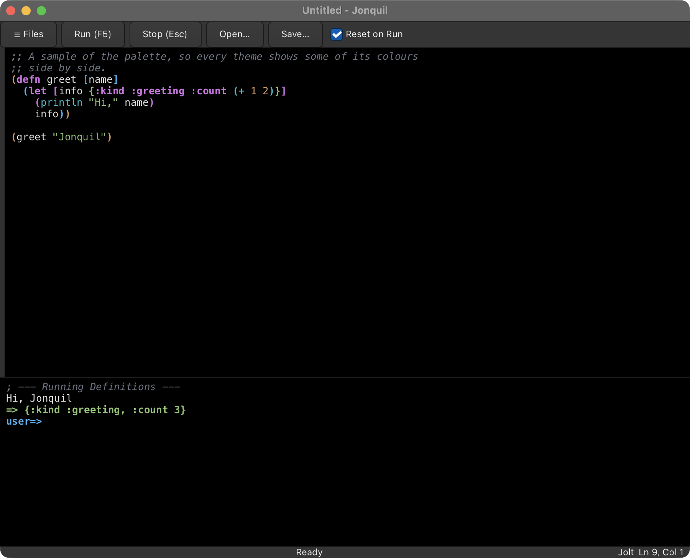
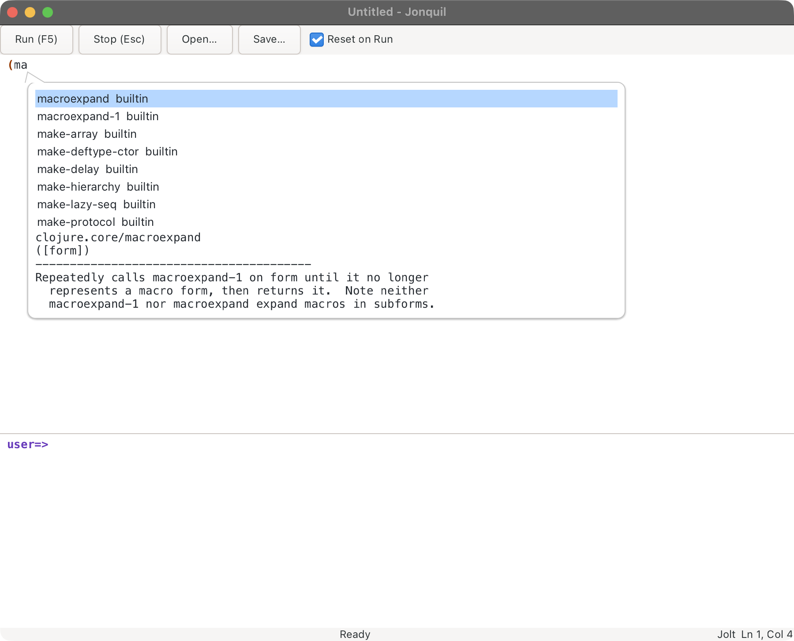

<p align="center"></p>

<h1 align="center">Jonquil</h1>

Jonquil is a DrRacket-style Clojure IDE written in Jolt: a Definitions editor, an Interactions console, Run and a Stop that really stops. It ports the idea of [DrClojure](https://github.com/kimtg/DrClojure-Neo), lifting its pure code for the text-analysis core (tokenizer, brackets, navigation, smart indent, formatter, doc and completion lookup).

**Status: alpha.** The window, editing, Parinfer (off by default), themes (including one that follows macOS light and dark), help, plugins and an MCP server for agents all work. So do these dialects: Jolt in or out of process; JVM Clojure; ClojureDart (experimental); ClojureScript (experimental), attached to a shadow-cljs server you started or launched on node or in a browser tab; any other nREPL server you started, such as babashka or Basilisp; and jank (experimental), which Jonquil launches itself.



See the [guide](docs/guide/index.md), starting with [Using Jonquil](docs/guide/using-jonquil.md), for a full walkthrough: the window layout, Run versus the REPL prompt, stdin, Stop, Reset on Run, editing keys, Parinfer, find and replace, Open and Save, tabs, themes, help, dialects and running Jolt out of process, and the keys.

Jonquil picks a dialect for whatever file is open:

- **Jolt.** A program in a project (a folder with a `deps.edn`) runs out of process over nREPL, so one that calls `System/exit`, crashes or wedges Jolt takes down a separate child, not Jonquil. A loose file runs inline, in Jonquil's own process, and a project's `.jonquil.edn` `{:runtime :in-process}` keeps it there too. Stop, Reset on Run, help, `read-line` and the inspector work the same way across either choice.
- **ClojureDart (experimental).** Rather than starting anything, Jonquil attaches to a ClojureDart app you already have running, over its own nREPL server.
- **JVM Clojure.** It attaches the same way, to a project's own nREPL server, once its `.jonquil.edn` says `{:dialect :clj}`: start a server with `clojure -M:serve` or any server that writes `.nrepl-port`, and Jonquil connects the first time you Run, requiring any namespaces the project lists under `:auto-require` as it does (a Jolt project can list them too).
- **ClojureScript (experimental)** has two runtimes. In a project with a `shadow-cljs.edn`, start your build with `npx shadow-cljs watch <build>` and Jonquil connects to its nREPL server the first time you Run, evaluating in whatever JS runtime has the build loaded. A `.cljs` file anywhere else, a loose file included, runs on node: Jonquil starts ClojureScript for the window on the first Run, which needs the Clojure CLI and `node` (and the launcher's local sockets listen on loopback only).
- **Any other nREPL server** attaches the same way once a project's `.jonquil.edn` says `{:dialect :nrepl}`: babashka (`bb nrepl-server 1667`, then `:nrepl {:port 1667}`), Basilisp, whose `basilisp nrepl-server` writes `.nrepl-port` itself, or a server on another host through `:host`. Features follow what that server offers, and the console says what it can't do.
- **jank (experimental).** Open a `.jank` file and Jonquil starts its own `jank repl` for the window on the first Run (`brew install jank-lang/jank/jank`, or set `JONQUIL_JANK`).

A short list of limits for each runtime is in [Known limits](docs/guide/known-limits.md).

An agent can drive Jonquil too: `jonquil --mcp [DIR]` serves six tools (evaluate, run a file, check brackets, doc, completion, project info) over MCP on stdio, with no window. Add `--window` (`jonquil --mcp --window [DIR]`) and the agent drives a live window instead: twenty tools that open, edit, save and run tabs while you watch, and that let it propose plugins you then accept or reject in the window. A plugin can add tools of its own beside them. To drive a window you already have open, turn on `:mcp-listen? true` in the settings file and point the agent at `jonquil --mcp-attach [DIR]`, which bridges stdio to that window. See [Driving Jonquil from an agent (MCP)](docs/guide/mcp.md).



A collapsible file tree (Cmd/Ctrl+Shift+E) shows the folder you launched on, where a click opens a file in a tab and a right click creates, renames or moves to the Trash. Several files can be open at once, one tab each, over one evaluator and one console, and Jonquil remembers them as they change, so starting it again in the same folder brings the same tabs back. Started from the Dock or Finder, it goes back to the project you quit last. Put `:reopen-tabs? false` in the settings file to turn that off. It also records what each project evaluated and offers it back as a replay script in a new tab, which runs only when you Run it (`:remember-session? false` turns that off). Reset on Run only clears what the running tab created, so a helper namespace in one tab survives a Run of the file that uses it in another.

Ctrl+Space completes as you type, with a documentation preview beside the candidate list, in both the Definitions editor and the console's input line. Ctrl+Q or Shift+F1 shows a symbol's documentation on the spot. F12 or Ctrl+B jumps to where it's defined: in the buffer, in a tab for another of your project's files (Cmd/Ctrl+[ goes back), or in a read-only panel for library code. Shift+F6 or F2 opens a rename popup, and confirming it renames every code use of the symbol. Shift+F10 or a right click reaches all of it from a context menu, and Cmd/Ctrl+Shift+P opens a command palette that lists every command with its keys and runs the one you pick. At the prompt, `*1`, `*2`, `*3` and `*e` hold the last results and the last error, and `doc`, `find-doc`, `apropos`, `dir`, `pprint` and `pp` are there without a `require`, whether Jolt runs in process or out of it. After an error, the palette's "Show the last error's frames and locals" lists the call stack with each frame's locals, on a Jolt that has `jolt.debug`; Retry, Edit and retry, and Define and retry take the failed evaluation from there in every dialect, and Break on error pauses a Jolt evaluation where it throws, before anything unwinds.

Plugin support loads `<id>.clj` files from the settings folder's `plugins/`, whose editor commands and keys work alongside the built-in ones, and whose hooks hear about saves, Runs and errors and can stop a Run before it starts. An agent can propose a plugin too, which waits for you to accept or reject it. The palette's "Show the plugins" entry lists them, so you can disable one, enable it again, open its file, or see its history and revert to an older version. Each version of a plugin that goes live is kept in `plugins/.history/`.



## Lisp Machine ideas, and Emacs

Some of Jonquil's features come from the MIT and Symbolics Lisp Machines, where the whole system was live Lisp that you could inspect and change while it ran. Emacs keeps that idea as an application, and Jonquil heads the same way, so Describe Key, Recent Keys, the command palette, the locations list, switching to a recent tab, timing a form and tracing a function all have an Emacs counterpart. The difference is that your Jolt code runs on the editor's own runtime, which lets the inspector, timing and the debugger work on your program's real values. Later steps brought in more of them: Find Usages in Project, compare with the file on disk or git HEAD, counts of how often each line runs, the Processes and Messages panels, named layouts, Save World, and a replay of the last session's evaluations. [Lisp Machine ideas, and Emacs](docs/guide/lisp-machine.md) explains where each idea comes from.

## Requirements

- [Jolt](https://github.com/jolt-lang/jolt) v0.8.23 or later. It carries the reader fixes from jolt-lang/jolt#1134 and jolt-lang/jolt#1138 that `(read)` from the console needs, the closed-socket fix from jolt-lang/jolt#1183 that the ClojureDart attach connection relies on, the fix from jolt-lang/jolt#1355 that sends `pprint` output to the console, and the fix from jolt-lang/jolt#1389 that makes `pp` print `*1`. Counting how often each line runs needs v0.8.24, which added `jolt.profile`, and so do the debugger's frames, Break on error and breakpoints (`jolt.debug`); each says so on an older Jolt. Tested on v0.8.27
- GTK4 and pango, to build or run from source (the release download bundles them): Homebrew on macOS, your distribution's packages on Linux (`libgtk-4-1`, `libpango-1.0-0` and `adwaita-icon-theme` on Ubuntu; see [Getting started](docs/guide/getting-started.md#linux))
- `git` on `PATH` and a network connection the first time Jolt runs out of process, when Jonquil fetches [jolt-lang/nrepl](https://github.com/jolt-lang/nrepl) v0.4.2 as a git dependency. A checkout at `$JONQUIL_JOLT_NREPL` or `~/dev/jolt-lang/nrepl` is used instead when there is one, and `jolt test:nrepl` needs it
- A ClojureDart fork that adds an nREPL server, only for the ClojureDart dialect: upstream ClojureDart has none for Jonquil to attach to, and the fork is private for now
- Java 17+ and the `clojure` CLI, only for `jolt test:clj` and a JVM project's own server
- A shadow-cljs project (`shadow-cljs.edn`) with a running watch, only for the ClojureScript dialect when it attaches: Jonquil never starts it
- The `clojure` CLI and `node` on `PATH` (or `JONQUIL_CLOJURE`), only for ClojureScript on node: Jonquil starts ClojureScript itself, and the first start can download the Closure Compiler
- A web browser, only for ClojureScript in the browser (`.jonquil.edn {:cljs {:target :browser}}`, which also needs the `clojure` CLI but not `node`): Jonquil opens the page in your default browser
- An nREPL server you started, only for the nREPL dialect (babashka's `bb nrepl-server`, Basilisp's `basilisp nrepl-server`, or any other). Jonquil never starts or stops it, and the server runs whatever it's sent, so keep a remote one on a network you trust or reach it through an ssh tunnel

## Download

On an Apple Silicon Mac with macOS 26 or later, download the notarized `Jonquil-0.1.0-macos-arm64.dmg` (or `.zip`) from the [0.1.0 release](https://github.com/b12n-oss/jonquil/releases/tag/v0.1.0) and drag Jonquil to Applications. GTK is bundled, so it needs no Homebrew; running a project's Jolt out of process still needs `jolt` and `git` (see Requirements). Intel Macs and Linux build from source, below.

## Running

```bash
jolt app:run           # opens an empty window
jolt app:run file.clj  # opens file.clj in the Definitions editor
jolt app:run ~/dev/my-talk  # opens a window on a project folder, with the file tree showing it
```

## Building

```bash
jolt app:build     # writes ./jonquil (gitignored); it loads GTK4 and pango from Homebrew at startup
jolt app:bundle    # builds ./jonquil, then ./Jonquil.app (macOS)
jolt app:install   # the same, then moves it to ~/Applications and registers it (macOS)
                 # on Linux: builds, then installs under ~/.local/share (launcher, icon, MIME types); jolt app:uninstall removes it
```

Jonquil also builds and runs on Linux (tested on Ubuntu 26.04 with GTK 4.22): the same `jolt app:build`, and `jolt app:install` puts a launcher, icon and MIME types under `~/.local/share`. See [Getting started](docs/guide/getting-started.md#linux).

The binary is unsigned on macOS. `jolt app:build` itself prints the fix if you need to hand it to someone else:

```
jolt build: note — on macOS this binary is unsigned; to share it,
  `xattr -d com.apple.quarantine ./jonquil` on the target, or sign it.
```

## What works headless

The core runs without GTK: everything below, plus smaller pure namespaces such as `jonquil.console`, `jonquil.session`, `jonquil.commands`, `jonquil.keymap`, `jonquil.command-registry` and `jonquil.palette` (key bindings, commands and the palette's entries as data), `jonquil.theme` and `jonquil.settings`. Run `jolt test` to verify. As of 2026-11-13, 2159 tests pass (12858 assertions, on macOS).

<details>
<summary><strong>The namespaces, and what each one does</strong></summary>

- `jonquil.syntax`: Tokenization, bracket matching, indentation analysis, formatting and doc lookup.
- `jonquil.paint`: Syntax highlighting plan from tokens and rainbow brackets.
- `jonquil.docs`: Doc strings and completion candidates for an eval namespace, falling back to `user` when that namespace is gone.
- `jonquil.edit`: Pure edit operations (smart enter, auto-pair, indent, rename, etc.).
- `jonquil.eval`: The eval engine with `run-interruptible` Stop, output streaming and REPL history.
- `jonquil.help`: The decisions behind completion, quick doc, jump to definition and rename.
- `jonquil.file-tree`: The file tree as plain data: listing a folder, the ignore rules, the visible rows, and which folder to root at.
- `jonquil.file-ops`: The file tree's disk operations: create, rename and the console sentences for a trash or a hidden new name.
- `jonquil.tabs`: The window's tabs as plain data: labels, the open-file lookup, the runnable-here check, and alert and banner text.
- `jonquil.last-session`: Which tabs are open in each project, kept in `sessions.edn` beside the settings file.
- `jonquil.replay`: What each project evaluated, kept owner-only in `replays/` beside the settings file, and the replay script built from it.
- The Lisp Machine features, each a pure namespace the window draws: `jonquil.changed` (forms changed since they last ran), `jonquil.compare` (the buffer against disk, git HEAD, another tab or its last Run), `jonquil.locations` (the locations list), `jonquil.usages` (Find Usages in Project) and `jonquil.resolve` (which var a symbol names), `jonquil.results` (the console results' verbs), `jonquil.restarts` and `jonquil.debugger` (Retry, and the last error's frames), `jonquil.timing`, `jonquil.line-counts`, `jonquil.world` (Save World), `jonquil.layouts`, `jonquil.messages` and `jonquil.hints` (the key hints in the status bar).
- `jonquil.source`: Where a definition outside the buffer lives and its text, the pure half of the source panel and of jump into a tab.
- `jonquil.project-roots`: A project kept in process: its `deps.edn` `:paths` and `:deps` as Jolt's roots, after Jolt's own.
- `jonquil.dialect`: Dialect profiles and the per-project choice between them, from `.jonquil.edn`, a project marker, the file's extension, or settings.
- `jonquil.evaluator`: The `Evaluator` protocol every dialect's runtime implements, so a window doesn't care which one it's talking to.
- `jonquil.nrepl.*`: Jolt running out of process over nREPL: the child, the wire client and bencode codec, and the evaluator that ties them together. `jolt test:nrepl` runs its live tests separately, since they spawn real Jolt children (see Requirements, above).
- `jonquil.nrepl.middleware-files`, `jonquil.nrepl.inspect-middleware`, `jonquil.nrepl.stdin-middleware` and `jonquil.nrepl.info-middleware`: Jonquil's own nREPL middleware, embedded when Jonquil is compiled, written under `~/.cache/jonquil/nrepl-middleware` and loaded by the Jolt child, which gives out-of-process Jolt the inspector, `read-line` and jump to definition into other files.
- `jonquil.cljd` and `jonquil.nrepl.attach`: the ClojureDart dialect, attached to a running app over its own nREPL server. `jolt test` runs its tests against an in-process fake server, so there's still no child process and nothing outside the repo.
- `jonquil.cljs` and `jonquil.nrepl.shadow`: the ClojureScript dialect (experimental), attached to a shadow-cljs nREPL server you started yourself. `jolt test` runs its tests against an in-process fake server.
- `jonquil.cljs-node`, `jonquil.cljs-node-launch`, `jonquil.nrepl.cljs-node`, `jonquil.nrepl.cljs-child`, `jonquil.nrepl.cljs-node-files` and `jonquil.nrepl.prepl`: ClojureScript on node, or in a browser tab with `{:cljs {:target :browser}}` (experimental). Jonquil launches a `clojure` process per window that serves a prepl on loopback and runs ClojureScript's node REPL, and talks to it over line-delimited EDN. `jolt test` runs these against a fake prepl and `jolt test:cljs-node` runs a live suite against real `clojure` and `node`, plus browser checks that open no tab.
- `jonquil.clj`, `jonquil.nrepl.connection` and `jonquil.nrepl.jvm`: the JVM Clojure dialect, attached to an nREPL server you started yourself. `jonquil.nrepl.connection` is the attach lifecycle shared with ClojureDart's own. `jolt test` runs `jonquil.nrepl.jvm`'s tests against an in-process fake server, and `jolt test:clj` runs a second suite against a real `clojure -M:serve`.
- `jonquil.nrepl.generic`: the nREPL dialect, attached to any nREPL server you started (babashka, Basilisp, one on another host), through the JVM attach evaluator with nothing JVM-specific assumed. `jolt test:bb` and `jolt test:basilisp` run live suites against a real `bb nrepl-server` and `basilisp nrepl-server`.
- `jonquil.plugin` and `jonquil.plugin-*`: plugins. The API a plugin file calls (`plugin`), the checks every version goes through (`plugin-check`, `plugin-protocol`), the live registry and loading (`plugin-registry`, `plugin-loader`, `plugin-hooks`), the throwaway Jolt an agent's proposal is checked in (`plugin-isolated`, `plugin-checker`, `plugin-checker-files`), each plugin's history (`plugin-history`), the list and the review (`plugin-list`, `plugin-review`) and the plugin MCP tools (`plugin-mcp`). `jonquil.gtk.plugin-list-pane`, `jonquil.gtk.plugin-history-pane` and `jonquil.gtk.review-pane` show the list, a plugin's history and a proposal's review.
- `jonquil.mcp` and `jonquil.mcp.*`: the MCP server behind `jonquil --mcp`: the six headless tools (`tools`), the twenty over a live window (`window`), the listener `--mcp-attach` reaches (`listen`), and its JSON (`json`).
- `jonquil.jank`, `jonquil.nrepl.jank-child` and `jonquil.nrepl.jank`: the jank dialect (experimental). Jonquil launches its own `jank repl` per window from a private temp folder and talks to it over nREPL. `jolt test` runs these against an in-process fake server, and `jolt test:jank` runs a live suite against a real jank.

</details>

## Commands

```bash
jolt check                  # require every namespace, exit 0
jolt test                   # all test namespaces; exits 1 on any failure or error
jolt test:nrepl             # live nREPL tests: spawn Jolt children (need the jolt-lang/nrepl checkout)
jolt test:nightly           # test:nrepl against Jolt's nightly build, cached under ~/.cache/jonquil/jolt-nightly (--offline reuses it)
jolt test:clj               # live JVM tests: start a real clojure -M:serve (need Java 17+ and the clojure CLI)
jolt test:jank              # live jank tests: launch a real jank repl (JONQUIL_JANK or jank on PATH; skips without one)
jolt test:bb                # live nREPL-dialect tests: start a real bb nrepl-server (bb on PATH; skips without one)
jolt test:basilisp          # the same against a real basilisp nrepl-server (JONQUIL_BASILISP or basilisp on PATH)
jolt test:plugins           # live isolated plugin checks: run real jolt checker children (skips without jolt)
jolt test:cljs-node         # live ClojureScript-on-node tests: launch a real clojure + node prepl (need the clojure CLI and node; skips without them)
jolt test jonquil.edit-test # one namespace (the TDD loop)
jolt linux:test             # jolt test in a Linux container (local Docker; also linux:selftest, linux:build, linux:vnc; no CI)
jolt gtk:selftest           # real-window self-tests, opens ten windows (don't type while it runs)
jolt docs:shots             # re-capture docs/images/*.png, one process per scene
jolt smoke:binary           # build ./jonquil and drive it with cgevent key --pid (keys go only to its own windows; cgevent is private for now)
jolt smoke:cljd             # drive the built binary against a running ClojureDart app (start your ClojureDart app first; see the development guide)
jolt smoke:cljs             # drive the built binary against a running shadow-cljs app (start its watch and open the app first; see the development guide)
jolt bench:edit             # time editing stalls on large files (opens a real window per size)
jolt mcp:smoke              # the MCP server end to end (also --window and --attach)
jolt clean:tmp              # delete temp dirs earlier test runs left behind
```

`jolt info` prints the full task list grouped by what it's for, including the quality and git-hook tasks below.

## Quality and git hooks

```bash
jolt lint                 # clj-kondo over src, test and dev (report only)
jolt lint:strict          # the same, but exit non-zero if there are any findings
jolt metrics              # jolt-metrics: refactoring queue, hotspots, cleanup (report only)
jolt lsp:format-check     # clojure-lsp format, dry run
jolt lsp:clean-ns-check   # clojure-lsp clean-ns, dry run
jolt lsp:check            # the two dry runs together
jolt verify               # lint (report) + test + test:nrepl (must pass): the pre-commit gate
jolt hooks:install        # a fast pre-commit hook: lint errors + format --dry
jolt hooks:install:full   # the same, plus the test suite (slower)
jolt hooks:uninstall      # remove the git pre-commit hook
```

`.github/workflows/lint.yml` runs the same lint and format check, plus the
metrics gate, on GitHub Actions, and `.github/workflows/site.yml` checks
that the docs build. Both run on every push to `main` and every pull
request. The site itself is [jonquil.b12n.app](https://jonquil.b12n.app).

## Contributing

[Contributing](docs/guide/contributing.md) covers the setup a change needs
and the gates it must pass. Changes written with an LLM's help are welcome
on the same terms as any other: the person who submits a change owns its
quality and correctness. [AI_POLICY.md](AI_POLICY.md) is the full stance.

## The name

A jonquil (*Narcissus jonquilla*) is a small, scented narcissus with several yellow flowers to a stem.

<p align="center"></p>

*Narcissus jonquilla* by Sydenham Edwards, from William Curtis's *Botanical Magazine* (1787). Public domain, via [Wikimedia Commons](https://commons.wikimedia.org/wiki/File:Narcissus_jonquilla_1787.jpg). The logo in `docs/images/logo.svg` was drawn for this project.
