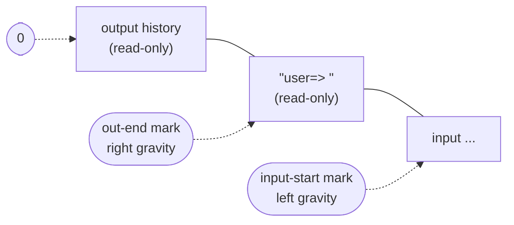
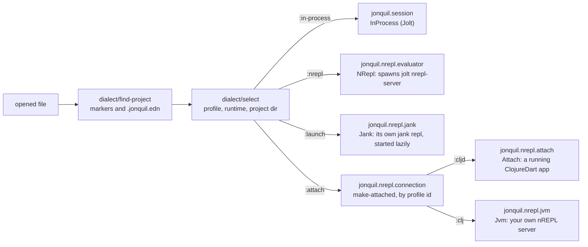
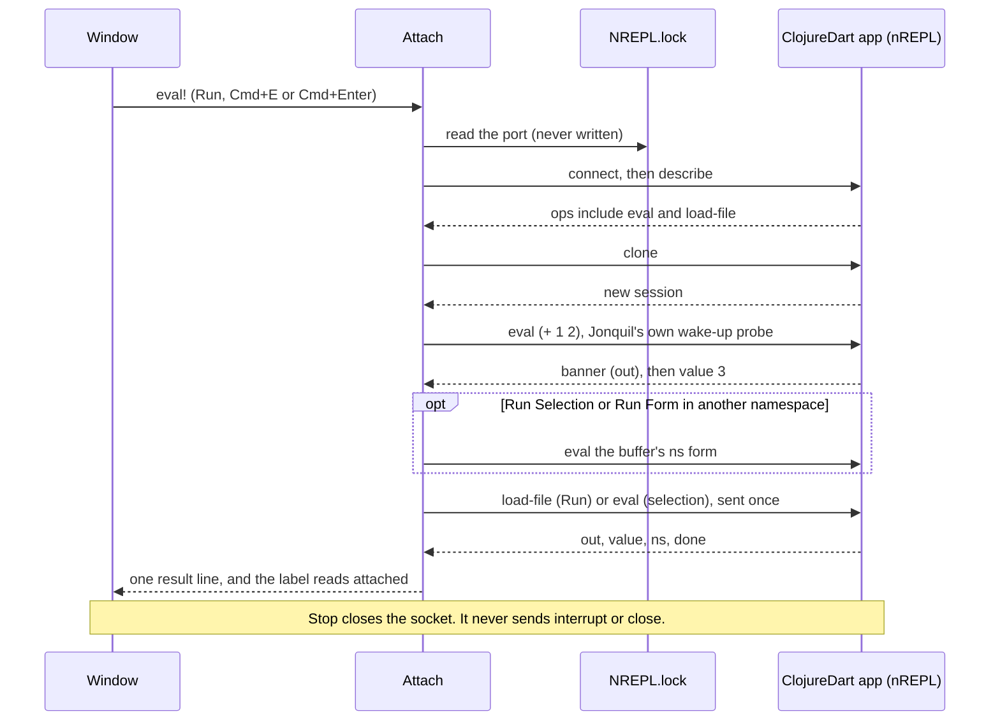
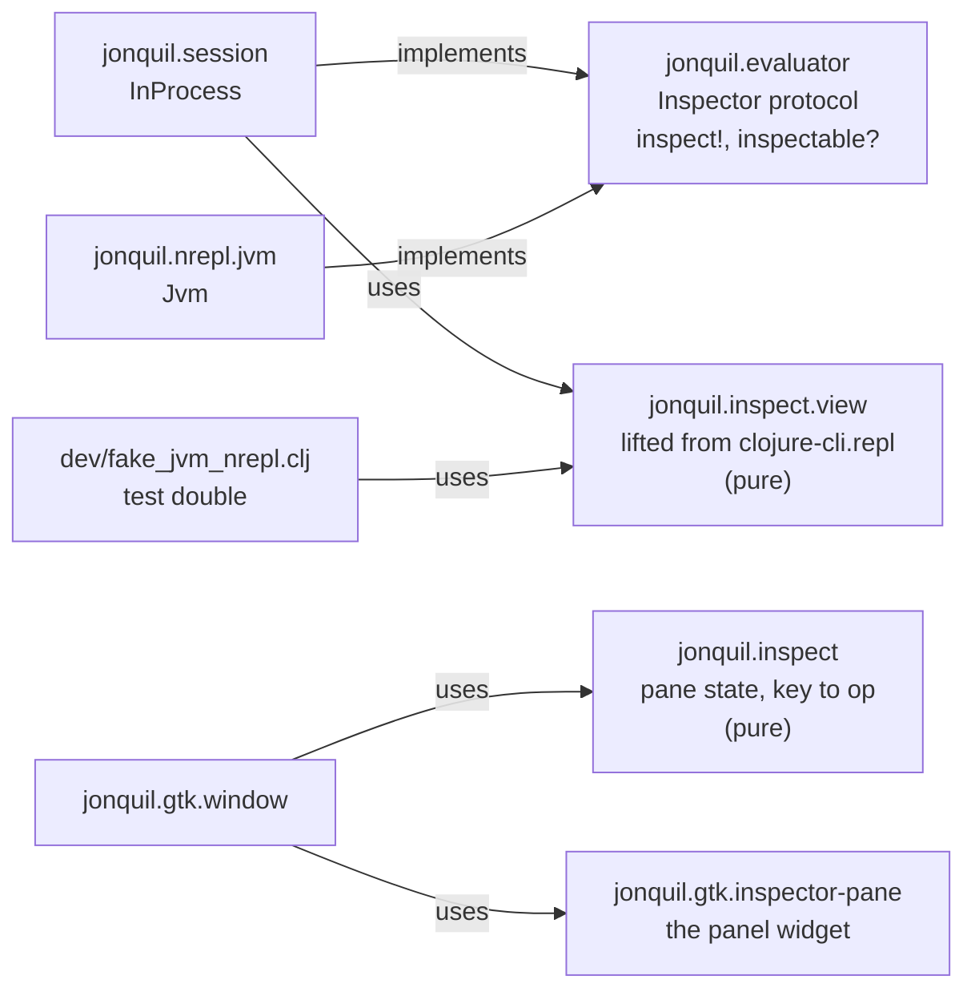

# Jonquil Architecture

## Design

Jonquil is a port of DrClojure's idea to Jolt: a Clojure IDE with a Definitions editor, an Interactions console, Run and Stop that actually stops. The design splits into layers.


Phase 3 and the Themes phase added three more pure namespaces alongside
these:

- `jonquil.commands`: the run-selection text, the form Run Form sends,
  the pre-Run bracket check, next/prev match, replace-current and
  replace-all, the format operations, and the zoom sizes.
- `jonquil.theme`: the four palettes as data, plus `theme`, `next-theme`
  and `code-css`.
- `jonquil.settings`: `settings-path`, `load-settings` (never throws) and
  `save-settings!` (atomic, never throws).

P4 added a fourth: `jonquil.help`, the decisions behind completion, quick
doc, jump to definition and rename, covered in its own section below.

- `jonquil.file-tree`: the file tree's model as plain data: `{:root :expanded :ignore}`, listing one folder (ignore rules, folders first), flattening the expanded tree into rows (a symlink back to an ancestor shows collapsed instead of recursing), `expand-to` for a saved file, the launch root (`root-for`), and a directory's own project selection (`project-selection`, since `dialect/find-project` starts at a path's parent).
- `jonquil.tabs`: the window's tabs as plain data: the strip's labels, finding a file that's already open (compared canonically), whether a tab may run in the window's evaluator (`dialect/selection-key` equality), and the text of the refusal, the unsaved-changes alert and the Run banner.
- `jonquil.source`: where a definition outside the buffer lives and its text, from a lookup's `:file` (an absolute path or a `jar:file:…!/entry` URL, read locally with `java.util.zip.ZipFile`), whether it can be edited (a plain file under the project), line arithmetic, and the source panel's bounded history.

This arc added two more: `jonquil.inspect.view`, the inspector's view
code lifted from clojure-cli.repl (`UPSTREAM.md` carries the provenance
row), and `jonquil.inspect`, the panel's own pane state and its key-to-op
decisions. Both are covered in their own section below, alongside the
`Inspector` protocol.

`jonquil.console` is the console's own pure half: what Return does with
the text at the prompt, how much old output to trim, how a result is
shown, where the last entry starts for Clear Last Output, and a friendlier
message for an unclosed bracket. `jonquil.core` holds only the app's name.

The front-end and the core use plain data to communicate. When the user edits, the GTK TextBuffer sends a snapshot to the core:

```clojure
{:text "..." :caret 42 :sel-start 40 :sel-end 45}
```

An edit operation returns data for the front-end to apply:

```clojure
{:edits [[start end "replacement"] ...]
 :caret 44
 :sel   [44 44]}
```

The front-end applies each edit in reverse order within one `gtk_text_buffer_begin/end_user_action` call, so undo sees one step.

## GTK is not everywhere

GTK4 is required only from `jonquil.main`. All of the pure core (tokenization, parsing, syntax highlighting, edit operations, the eval engine) runs without GTK or any GUI dependencies. This design lets the core be tested independently and potentially reused by a second front-end later.

Nothing enforces this automatically, which is why it is a rule. Jolt's build scanner follows `require` forms statically, so a `jonquil.gtk` namespace required from anywhere else would silently compile GTK into every binary built from that namespace, headless tools included. Phase 2 added the GTK libraries to `:jolt/native` in `deps.edn`.

## The GTK layer

`jonquil.gtk.*` is five namespaces, each with one job:

- `jonquil.gtk.ffi`: the raw GTK4/GLib/GObject/pango bindings, plus the low-level GtkTextIter/mark helpers everything else builds on.
- `jonquil.gtk.callbacks`: the `callable` macro that turns a Clojure function into a retained, `:collect-safe` foreign-callable (GTK invokes callbacks from inside its own blocking main loop, so a collected one would crash it). It also contains every callback: a throw never reaches GTK, where it would end the process, but is reported on stderr while the callback answers a safe value for its return type, or its own `:on-throw` (the editor's dirty-check timer answers 1 to keep running). Handlers people trigger directly also report on the window, the way the editor's and console's key handlers do. The namespace also holds `on-gui!`, the one function safe to call from any thread to hand a thunk to the GTK main thread.
- `jonquil.gtk.editor`: the Definitions editor, a GtkTextView wired to `jonquil.paint` for live syntax highlighting and `jonquil.edit` for smart Enter. Its `handle-key!` dispatches the rest of the editor's key chords, sending edit ops through `apply-op!` so each one lands as a single user action, and every handler yields during IME preedit.
- `jonquil.gtk.find-bar`: the find and replace bar, with its own `handle-key!` and match highlighting through a `search-match` tag.
- `jonquil.gtk.console-view`: the Interactions console, one GtkTextView whose buffer holds read-only output history, an editable prompt and input region, and the key handling for Return, Up/Down and Ctrl/Cmd+D.
- `jonquil.gtk.window`: the toolbar, the paned layout, the window-level key chords (F5, Esc, Cmd/Ctrl+R/O/S), the file dialogs, and the wiring between `jonquil.session` and the two views.

P4 added three more, all built on a shared popover base:

- `jonquil.gtk.popover`: a caret-anchored `GtkPopover`, shared by completion, quick doc and rename.
- `jonquil.gtk.help-popover`: the quick-doc popover and the rename popover, both built on `jonquil.gtk.popover`.
- `jonquil.gtk.completion`: the completion popover, one instance per view (the editor and the console's input line), also built on `jonquil.gtk.popover`.

This arc added one more, outside that popover base: `jonquil.gtk.inspector-pane`, the inspector panel widget, covered in its own section below.

- `jonquil.gtk.file-tree-pane`: the file tree widget: a header (root name, refresh, Open Folder…) over a `GtkListBox` rebuilt from the model's rows on every change. A click or a key decides which path it acts on at once, then rebuilds on the next main-loop turn, because a rebuild removes the very row whose signal is running. The window holds it in an outer horizontal paned left of everything else, and the ☰ Files `GtkToggleButton`'s `toggled` handler is the one place that shows, hides and saves it.
- `jonquil.gtk.tab`: one tab's widgets: an editor with its find bar, the four popovers parented on its view (quick doc, full doc, rename, completion) and the label box the notebook shows. `dispose-popovers!` hides and unparents them before the window removes the tab's page, because removing a page with a popover still parented spins GTK in a warning loop, and unparenting drops a popover's last reference. The window (`jonquil.gtk.window`) keeps the tabs in a vector inside a `GtkNotebook` and resolves the active tab whenever an action runs; closures built per tab capture their own tab.
- `jonquil.gtk.source-pane`: the read-only source panel: a header, a read-only `jonquil.gtk.editor`, Open in window and Close, and a footer for hints, notes and errors. It shares the window's right-hand slot (a vertical GtkBox) with the inspector, one visible at a time. Its editor paints with `paint-async!`, which computes the paint plan on a future and applies it a chunk per main-loop turn, nearest the caret first, so an 8,000-line library file never holds the GTK thread.

### `on-gui!` and the worker-to-GTK-thread path

The eval engine's callbacks (`on-output`, `on-wait-input`, `on-status-change`, `on-complete`) run on the eval worker thread, never the GTK thread. GTK itself may only be touched from its own main thread, so every one of those callbacks follows the same rule: enqueue and return, never call GTK directly, never block. `jonquil.gtk.console-view/append!` queues a `[kind text]` chunk and schedules a drain; `jonquil.gtk.callbacks/on-gui!` queues an arbitrary thunk. Both are safe from any thread for exactly that reason, and both coalesce: several worker-thread calls landing between GTK ticks turn into one drain, so a flood of output doesn't starve the main loop.

### The console buffer layout

The Interactions console is one GtkTextBuffer laid out as



Output history and the prompt carry a read-only tag, which is what stops typing, pasting or Backspace from reaching into old output; GtkTextView's own edit path already refuses edits under that tag. `out-end` is a mark with right gravity: `append!` always inserts at it, so new output lands before the prompt and the mark tracks past it. `input-start` is a mark with left gravity: text typed at it stays after it, and output inserted earlier in the buffer pushes it forward automatically. Committing an entry (Return, when it evaluates or sends stdin) moves both marks explicitly to open a fresh prompt after the old input, rather than relying on gravity for that step. The prompt names the session's namespace (`user=> `, `demo.core=> `): the view keeps its current text, and `set-prompt!` rewrites the region between the two marks in place, keeping the typed input and the caret. The window calls it with the evaluator's `prompt-ns` after every evaluation, when it switches evaluators, and when an attach connection comes or goes.

The console reads its busy/waiting state live from the engine (`:evaluating?`/`:waiting?`, functions supplied at construction) rather than mirroring it into a console-owned atom. A mirror set right after starting an eval could lose a race against a fast eval's own completion clearing it first, stranding the console in a busy state with nothing left to un-strand it.

### `jonquil.session` and the O1 reset rule

`jonquil.session`'s `InProcess` record holds one window's in-process evaluation state: the eval context, the current mode (`:reset` or `:accumulate`), the prompt namespace, and the namespaces each owner created, a map from owner to a set. It's the original, and still the default, implementation of the `Evaluator` protocol described below. Run and the REPL both call through the same `evaluate!` path into `jonquil.eval/eval-async`, so the engine itself never distinguishes them.

The O1 spec decision is that Run resets by default: in `:reset` mode, `run-definitions!` first removes the namespaces its owner created, then the REPL's, then `user`, and recreates a fresh `user` and evaluates into it. Loaded libraries are never owned, so they stay. An owner is whatever `eval!`'s `:owner` option names: the window passes a tab's id for Run, Run Selection, Run Form and Inspect Form, and a console entry falls back to `:repl`. A tab that closes hands its set to `:repl` (`jonquil.evaluator/Owners`, `release-owner!`), so the next Run from any tab clears it. Unchecking the toolbar's Reset on Run checkbox flips the session to `:accumulate`, and Run stops clearing first, building on whatever earlier evaluations already defined, the same way the REPL prompt always does. The out-of-process nREPL runtime applies the identical rule, just over the wire. Around every evaluation it asks the child for its namespaces and loaded libraries (`ops/ns-snapshot-code`, about 1 ms), and its reset form removes the owner's set on the child instead of on this process. The snapshot prints its data and returns the old `*1`, having pre-shifted `*1` and `*2`, so the server's own history shift leaves `*1`, `*2` and `*3` where the user had them, so Reset on Run means the same thing whichever evaluator is running underneath it.

### Self-test harnesses

Three `bb` tasks drive the real GTK front end headlessly, without a human at the keyboard:

- `bb gtk:selftest` now opens seven real GTK windows in turn. The first two run the P2 front-end and full-window self-test rows against them, exercising the same button and key handlers a person would use rather than calling internal functions directly; the third (D2.T4) opens a window against a throwaway project with `{:runtime :nrepl}` in its `.jonquil.edn`, so a real Jolt child runs behind it, and its rows cover starting, running, Stop, help, and closing over that live connection. The fourth (cljd plan P2.T4) opens a window against a throwaway ClojureDart app directory whose `NREPL.lock` names a fake fork server running in this same process (`dev/fake_cljd_nrepl.clj`), so it needs no fork checkout and no real app; its rows cover connecting, a quiet load, Run Selection and Run Form switching the session's namespace, quick doc, completion, and Stop's detach, all over that fake connection. The fifth (clj plan P2.T4) opens a window against a throwaway JVM Clojure project whose `.nrepl-port` names a fake JVM nREPL server running in this same process (`dev/fake_jvm_nrepl.clj`), so it needs no real `clojure -M:serve`; its rows cover connecting, Run moving the prompt, a selection against a namespace the server hasn't loaded, Stop's interrupt, stdin, reconnecting after the server restarts, quick doc, jump to an external definition, full docs and its Escape, and a close that never sends the server a `close` op. The sixth is launched on a directory (`dev/gtk_selftest_tree.clj`). The seventh (`dev/gtk_selftest_jank.clj`, 10 rows) opens a window on a throwaway `.jank` project with `JONQUIL_JANK` naming `dev/fake-jank`, a script that serves a fake jank nREPL in its working directory, so the real launcher starts a real child process and the rows can check its pid and run directory on disk: the first Run, a REPL line, a selection against a namespace jank hasn't loaded, quick doc, F12 inside the buffer, the inspector's unavailable sentence, Stop and Reset each restarting the process, and a quit that kills it.
- `bb docs:shots` self-captures `docs/images/*.png` and one GIF for this guide and the user guide: one fresh `jolt -M:shots <scene>` process per scene, each driving `jonquil.main/start!` through exactly one demo, screenshotting it with `cgevent`, then exiting. A fresh process per scene keeps each screenshot to its own scene's console history.

All three poll a condition against a deadline rather than sleeping, and all three hand any blocking subprocess call (screenshots, GIF recording, the nREPL window's own child) to a `future` so the GTK thread itself never blocks. See [Development](development.md) for how to run these tasks, the split layout of `dev/gtk_selftest_window/`, the binary smoke, and the traps that catch a first run.

### Themes

Applying a theme doesn't rebuild anything: each component's `apply-theme!` retints its existing tags in place, so text, undo history and highlights all survive the switch. The window then reloads its one CSS provider, the same one zoom uses, from `theme/code-css`, and sets `gtk-interface-color-scheme` on GtkSettings to `DARK` or `LIGHT` so GTK's own chrome follows along.

Isolation matters here too: self-tests and `bb docs:shots` pass a temp `:settings-path`, and `bb smoke:binary` and `bb smoke:cljd` set `XDG_CONFIG_HOME` to a temp directory, so none of the harnesses ever touches the user's real settings file.

### Help: completion, quick doc, jump and rename (P4)

`jonquil.help` holds every pure decision behind the four P4 features, the same split `jonquil.commands` and `jonquil.edit` already draw between deciding and doing. It never touches GTK or the running program; it works on the editor's own snapshot shape (`{:text :caret :sel-start :sel-end}`) and on plain data the GTK layer passes in.

Completion's state moves through a small set of functions: `prefix-at` reads the word before the caret (or nil, when there's a selection or nothing to complete), `open-state` turns a prefix plus a candidate list into the popup's state map, `move` steps the selection with clamping, `commit-op` is the edit that replaces the prefix with the chosen candidate, and `still-valid?`/`refine` decide whether an open popup survives the next keystroke or needs to close. `target` is shared by quick doc, jump and rename: the selection when it's exactly one symbol, otherwise the symbol at or around the caret.

Jump to definition is the one place `jonquil.help` overrides upstream's own logic rather than reusing it outright. `jonquil.syntax/find-definition` (lifted unchanged from DrClojure) checks top-level `def*` forms first and only then falls back to a scope-less "last earlier token with this name", which gets a shadowed local wrong: a function parameter or a `let` binding that reuses a top-level name should win, and an unbound name should report nothing rather than landing on an earlier use of it. `jonquil.help/jump-target` fixes this with a real scope search first: it walks the parenthesized forms enclosing the target, innermost first, collecting the names each one binds (`let`/`loop`/`binding`/`when-let`/`when-some`/`when-first`/`if-let`/`if-some`'s own bindings vector, `for`/`doseq`'s bindings vector, `fn`/`defn`/`defn-`/`defmacro` params for every arity, and `letfn`'s names), unpacking vector and map destructuring recursively along the way. Only when that search comes up empty does it call `find-definition` with no position at all, which runs just its top-level half; an external var's documentation is the last fallback. `rename-problem` mirrors `jonquil.edit/rename`'s own nil cases (no symbol at the caret, a blank or invalid new name, the same name, nothing to rename) as a sentence for the rename popover to show instead of applying anything.

`jonquil.docs` resolves lookups in the namespace the user's program actually runs in, not the IDE's own. When that namespace no longer exists, because Reset on Run just removed it, `resolve-ns` falls back to `user` rather than letting `the-ns` throw. Both `symbol-doc` and `candidates` wrap their real lookup in `try`/`catch` and return nil (or `[]` for candidates) on any exception, so a bad lookup never escapes into a key handler. `symbol-doc` also memoises on `[namespace symbol text]`: looking up a name defined only in the buffer costs around 144 ms on a 2,000-line file, too slow for a preview that has to keep up with every arrow key. The cache is cleared after every completed evaluation, Run or REPL alike, from the same `on-complete` callback in `jonquil.gtk.window` that already reports the result; without that, a lookup made before a name existed would go on returning its stale answer forever after, even once the same evaluation had defined it.

The three popover namespaces share `jonquil.gtk.popover` as their base. Its most important fact is where a popover's `GtkWidget` parent actually is: never the `GtkTextView` it's anchored to, always that view's own container (its `GtkScrolledWindow`, in both the editor and the console). Parenting a popover directly to the text view, which is what the P4 spike probes did, hangs a real window close: `GtkTextView`'s own dispose walks its structural children to detach them, doesn't recognise a popover as one of its own, and spins forever logging that the popover isn't a child of the text view, pinning the main thread at 100% CPU. The probes themselves never hit this because every probe process exits without ever destroying its window. A `GtkScrolledWindow` has no such override and tears down cleanly. `jonquil.gtk.window` keeps a registry of every P4 popover a window creates (`register-popover!`), and `close-popovers!` walks it to hide whichever one is open, whether that's Escape's own job or one popover making room for another. At window close, `close-request-fn`'s real-quit branch calls `unparent-registered-popovers!`, which hides an open popover before unparenting it (unparenting first would leave its `:open?` atom reading true against a widget that no longer exists, and a later focus-lost listener would then call `hide!` on it and hit a GTK-CRITICAL) and skips an entry that's already unparented, so the session's popovers detach cleanly instead of leaving `GtkScrolledWindow` still holding a child when it finalizes.

`jonquil.gtk.help-popover` builds the quick-doc popover (autohide off, so it never steals keys from the view, per `jonquil.gtk.popover`'s own autohide note) and the rename popover (autohide on, since its entry needs to receive typing; GTK itself closes it on Escape or a click outside, and a `"closed"` signal handler keeps the popover's `:open?` bit in sync when that happens with no call into this namespace at all). `jonquil.gtk.completion` is one popover per view, a candidate list over a doc preview, built once per view and reused for the rest of the session; `open!`, `refine!` and `commit!` all read `(popover/open? c)` rather than trusting the state atom directly, because a close driven from outside this namespace (the window's registry-wide `close-popovers!`) only ever calls the generic `popover/hide!` and has no idea this namespace's own state atom exists.

The editor's and the console's context menus (Shift+F10, or a right click) come from `gtk_text_view_set_extra_menu`, which appends to GTK's own Cut/Copy/Paste menu rather than replacing it. `install-context-menu!` builds a `GMenu` alongside a matching `GSimpleActionGroup`, inserted on the view under the `"p4"` action-group prefix, with one action per item wired to call the exact same function its keyboard chord calls. Every action's own `"activate"` callback runs inside `try`/`catch`: an uncaught throw from a `GSimpleAction` callback kills the process outright, so this is the one place every menu item, current and future, is guarded at once.

The key-dispatch wrappers carry the same guarantee down at the keyboard level. `jonquil.gtk.editor/dispatch-key!` wraps `handle-key!` in `try`/`catch`, and `jonquil.gtk.window`'s window-level key handler wraps its own `cond` the same way: either throw is reported through the status bar rather than escaping into GTK's signal emission, and the key still counts as consumed (returns 1) instead of falling through into a second, unrelated action or killing the process.

## Dialects and evaluators

`jonquil.dialect` holds every dialect as plain data: a profile names its
file extensions, the `jonquil.syntax` special-forms and builtins sets it
paints and completes against, its project markers, and which runtime keys
it offers. `profiles` lists every known one, `jolt`, `cljd`, `clj` and `jank`
today.
`find-project` walks up from a file to the nearest directory holding
`.jonquil.edn` or a marker, reading and parsing the config along the way
without ever throwing: an unreadable or malformed file becomes a warning,
not a crash. `select` turns a project, a path, and a settings default
into one selection: the profile, the runtime, the project directory (for
anything other than `:in-process`), where the choice came from, and any
warnings the window should show. `selection-key` is what a window
compares before deciding a new file needs a new evaluator: the dialect,
the runtime, and, when the runtime isn't `:in-process`, the project
directory too.

`jonquil.evaluator`'s `Evaluator` protocol is the seam a window is built
against: `start!`, `stop!`, `eval!`, `interrupt!`, completion and lookup,
history and prompt namespace, all independent of whether the code
underneath runs in this process or somewhere else. `jonquil.session`'s
`InProcess` record, described above, is the original implementation and
still the one every window starts with by default. The `make` multimethod
dispatches on a selection's `:runtime`, so requiring a new
implementation's namespace is what registers it; `jonquil.nrepl.
evaluator` is the second one, and every `:attach` runtime is the third:
`ev/make :attach` forwards to `jonquil.nrepl.connection`'s own
`make-attached` multimethod, dispatched a second time on the selection's
profile id, so `jonquil.nrepl.attach` (`:cljd`) and `jonquil.nrepl.jvm`
(`:clj`) each register their own method rather than sharing one `:attach`
implementation.



### `jonquil.nrepl.*`: Jolt out of process

Four namespaces make up the out-of-process runtime:

- `jonquil.nrepl.child` launches `jolt nrepl-server` in the project
  directory, scanning ports `7950`-`7999` for one that binds on both the
  loopback and the wildcard address before trusting the child's own bind
  as the real attempt (a bare TCP connect can't rule out something else
  already listening there). Readiness comes from a log line the child
  itself prints once it's listening, never from the connection alone.
  Ending a child kills only the pid this namespace spawned, in order
  (`SIGTERM`, then `SIGKILL` if it's still alive a second later), and
  restores whatever `.nrepl-port` held before the child started, or
  deletes the file if nothing did.
- `jonquil.nrepl.client` holds one socket and one reader for the whole
  life of a child. Its `connect` bounds the socket connect itself to 5
  seconds by default, so a port that never answers fails with an
  exception instead of waiting on the OS, and a connect that fails
  closes its socket before the exception reaches the caller. The reader decodes every reply
  and dispatches it by `:id` to whichever caller is waiting on it, so an
  interrupt and the eval it's meant to stop can share one connection
  without two readers racing each other for the same bytes.
- `jonquil.nrepl.bencode` is the wire format underneath that: pure
  encode and decode, with a length cap and integer validation, so a
  broken or hostile reply can't hang the process trying to read it.
- `jonquil.nrepl.ops` translates between nREPL's own reply shapes and
  Jonquil's: eval results, completion candidates, doc lookups, and the
  reset form. That form removes every namespace the child has grown
  since it started, except loaded libraries and `user`, then recreates
  `user`, the same rule `jonquil.session`'s reset applies locally, just
  run as code sent over the wire instead.

`jonquil.nrepl.evaluator`'s `NRepl` record ties those three together
behind the `Evaluator` protocol: `start!` spawns and connects lazily, and
refuses to spawn at all once `stop!` has run; `eval!` sends a `load-file`
for Run or an `eval` for the REPL prompt; `stop!` interrupts whatever's
pending and, failing that within about a second, kills and restarts the
child instead. `jonquil.runtime-registry` is a fourth, GTK-free namespace
that every evaluator a window makes joins as soon as it's made, so
`jonquil.main` can stop every one of them, and wait for any still mid-
start to settle, before the process exits. No child outlives Jonquil just
because the window that started it happened to close first.

### jonquil.nrepl.connection: the shared attach lifecycle

`jonquil.nrepl.connection` holds what every attach evaluator needs and
none of them change: the `Attached` protocol (`connected?`,
`on-connection!`), `connect!`, `detach!`, `request!`, and
`stop-requested?`, plus the `make-attached` multimethod shown in the
diagram above. It was split out of `jonquil.nrepl.attach` without
changing any behaviour, so ClojureDart's own attach tests and self-test
rows still pass unchanged against it. A dialect's own namespace supplies
a connect policy (its console sentences, and what `:on-connect` adds to
`:state`) and the pieces that stay dialect-specific: `jonquil.nrepl.
attach` keeps the wake-up probe and the run worker for ClojureDart's own
fork, and `jonquil.nrepl.jvm` (below) keeps the JVM's own run worker,
Stop and help logic. `jonquil.gtk.window` checks `(satisfies?
connection/Attached e)` in place of an `instance?` test on any one
dialect's record, both for the status-bar label (`dialect/label`'s
`:attached`/not-running text) and for printing an attach evaluator's
`limitations` once it connects.

### jonquil.nrepl.attach: ClojureDart, attached

`jonquil.nrepl.attach`'s `Attach` record implements `Evaluator` too, and
it works nothing like the Jolt out-of-process one above: it never
starts anything. Connecting happens on demand, the first
time an evaluation finds no live connection, in the spec's own order:
read `NREPL.lock` for a port, connect, `describe` for the ops the app
offers, then `clone` a session. Each successful connect keeps exactly one
session for the whole life of the connection; a fresh one is only ever
cloned again after a detach.



Run goes through `load-file`, and its result is quiet on purpose: one
`; Loaded <ns> (<n> forms)` line instead of a value per top-level form,
built by `jonquil.cljd/load-result` from however many `:value` replies
actually came back. The session's namespace is tracked from every
reply's own `:ns` rather than asked for separately, and Run Selection
and Run Form pass the buffer as `:ns-source`: when the tracked namespace
doesn't match the buffer's own `ns` form, `run-worker!` evaluates that
form first, ahead of the code the user actually asked to run.

A freshly cloned session gets Jonquil's own probe, `(+ 1 2)`, ahead of
anything the user typed: `wake!` sends it once, and once more if the app
answers nil (a REPL that hasn't woken up yet after a hot restart), but
the user's own code is never sent twice, whatever the probe answers.

There's no interrupt and no close, ever: the fork's own connect skill
says a client-side interrupt wedges the app's watcher. Stop closes the
socket instead (`detach!`), including one that's still mid-handshake
(`connect!` publishes the raw connection as `:connecting` before
`describe` or `clone` can block on it, so Stop has something live to
close at once instead of waiting out either one's own timeout), and the
next evaluation reconnects with a fresh session. `on-connection!`
registers a listener `(f connected?)`, called from whichever thread
noticed the change, for a connection made or lost; the window's
status-bar label is the one thing listening today.

`jonquil.cljd` is this evaluator's pure half: every sentence the console
shows, the buffer's `ns` form, `NREPL.lock`'s port, the wake-up probe's
own verdict, and a load's one-line summary, all as plain functions over
text and reply vectors, with no socket and no GTK anywhere in the
namespace.

### jonquil.nrepl.jvm: JVM Clojure, attached

`jonquil.nrepl.jvm`'s `Jvm` record is the third attach evaluator, built
on the same `jonquil.nrepl.connection` as ClojureDart's, for a project
whose own `.jonquil.edn` says `{:dialect :clj}`. Where ClojureDart's
server ignores a request's `:ns`, a JVM server honours it, so Run
Selection and Run Form send it explicitly instead of switching the
session's namespace first, and Jonquil never sends a buffer's `ns` form
on its own: a namespace the server hasn't loaded yet gets the not-loaded
sentence and nothing else is sent. Run itself stays a plain `load-file`
with no `:ns` at all, the way any nREPL client's load-file works, and a
successful Run moves the prompt to the buffer's own namespace afterward.

On each fresh connection, after the inspect registration and before the
user's own request, `auto-require!` sends one `(require ...)` eval for
the selection's `:auto-require` list (parsed from `.jonquil.edn` by
`dialect/parse-config`, kept on the selection only for `:clj`). The
connect policy's `:on-connect` resets `:auto-required?` to false, so a
reconnect requires again; a failure streams the server's error, prints
`clj/auto-require-failed-message`, and still sends the user's request.

Unlike ClojureDart, this server supports `interrupt` and `stdin`. Stop
marks the running evaluation and, when the server advertises `interrupt`,
sends it and gives the server up to `:interrupt-timeout-ms` (1 s) to
actually end it before Jonquil gives up and detaches instead, printing
`clj/interrupt-failed-message`; without the op, or when it doesn't take
in time, Jonquil detaches the same way. stdin sends a line through the
live session and never closes it: nREPL 1.7.0 fails an empty `stdin` op
with a `ClassCastException` rather than answering EOF, so `send-eof!` is
a no-op (`clj/limitations`, P0.1 in the arc's own spike).

`complete` merges the server's own completions into the offline
candidates, and `lookup` is backed by the server's own `lookup` op, with
a `Defined in <file>:<line>` line (`jonquil.help/location-line`) for a
definition outside the buffer: the server's `lookup` reply carries `file`
and `line` for on-disk code and jar entries alike, unlike ClojureDart's
fork. Both `lookup` and `full-doc` (the `FullDoc` protocol, opened by a
second quick-doc press) resolve their `:ns` through a shared
`resolve-lookup!`: the buffer's own namespace first, falling back once to
the prompt namespace when the server hasn't loaded it, and a not-loaded
result, never a silent "not found" or a hung full-doc request, when
neither answers without an error. `full-doc` runs in a future rather than
on the GTK thread, since it's asked for on demand rather than on every
keystroke: it's backed by clojure-cli.repl's own `doc` op, whose first
call downloads the ClojureDocs export into the server's own config
directory, so `:full-doc-timeout-ms` leaves room for several seconds
there, well past `:help-timeout-ms`'s 300 ms budget for `lookup` and
`complete` on the GTK thread.

`jonquil.clj` is this evaluator's pure half, the same split `jonquil.cljd`
draws for ClojureDart: the console's own sentences, the buffer's `ns`
form, the connect policy, and the reply decisions (`eval-result`,
`ns-not-found?`, `prompt-after-run`, `need-input?`), all as plain
functions over text and reply vectors, with no socket and no GTK
anywhere in the namespace.

The `Evaluator` protocol itself doesn't change for any of this: both
attach evaluators implement the same `start!`, `stop!`, `eval!`,
`interrupt!`, completion and lookup, history and prompt-namespace
surface the in-process and out-of-process runtimes already do.

### jank: `jonquil.jank`, `jonquil.nrepl.jank-child` and `jonquil.nrepl.jank`

jank is the one dialect whose runtime is `:launch`: Jonquil starts the
process, as it does for out-of-process Jolt, but nothing is shared with
`jonquil.nrepl.child`, because jank differs in too many details. Three
namespaces make it up, plus a profile in `jonquil.dialect`.

- `jonquil.jank` is pure: the console's sentences, the code strings sent
  for the find-ns check and for docs, the connect policy, and readers for
  jank's replies. No socket and no GTK.
- `jonquil.nrepl.jank-child` is the launcher. It finds the binary
  (`JONQUIL_JANK`, `PATH`, `/opt/homebrew/bin`, `~/.local/bin`), spawns
  `jank --module-path <dir> repl` directly in a private temp run
  directory, and waits for the `.nrepl-port` jank writes there, so there
  is no port scan and nothing is read or written in the project. The
  spawn keeps its stdin pipe open, because EOF on stdin ends `jank repl`.
  `kill!` signals the whole process tree before closing stdin (the other
  order lets jank exit first and orphans any descendant) and then deletes
  the run directory.
- `jonquil.nrepl.jank` is the evaluator, built on
  `jonquil.nrepl.connection` the way `jonquil.nrepl.jvm` is. The child
  starts lazily on the first evaluation. Connection takes a `:port-file`
  policy key, a function, because the port file lives in a run directory
  the evaluator owns rather than in the project. jank has no interrupt, so
  Stop and a Reset on Run kill the child and the next evaluation starts a
  fresh one. Docs come from an eval of the var's metadata, never the
  `lookup` op, which hangs on current jank. Help is skipped while an
  evaluation runs, since jank serves one request at a time.

`jonquil.runtime-registry` knows about jank too: at quit it waits, within a
deadline, for a launch that is still in flight, so a window closed while
jank starts leaves no process and no run directory behind.

### The inspector: `Inspector`, `jonquil.inspect` and `jonquil.inspect.view`

`jonquil.evaluator` carries a second, optional protocol alongside
`Evaluator` itself: `Inspector`, with `inspect!` (an op, its args, and an
`on-view` callback called exactly once, off the GTK thread) and
`inspectable?`. `jonquil.gtk.window` checks `(satisfies? ev/Inspector e)`
the same way it checks `Attached`, so a Jolt out-of-process evaluator or a
ClojureDart one, neither of which implements it, gets the unavailable
sentence instead of a thrown error.



`jonquil.inspect.view` is the lifted half: `entries`, `preview`, `render`,
the stack operations (`in`, `out`, `page`, `toggle-meta`, `toggle-table`,
`def-as`), and `run-op`, the one function Jonquil added of its own, which
turns any of those into the current view plus a `:note` on a throw.
Every function takes a view map and returns one; nothing here owns a
global atom the way clojure-cli.repl's own server does. `jonquil.
session`'s `InProcess` record calls `run-op` directly, keeping its own
`:inspect-view` atom and the last `:ok` result's value, with `inspect!`
running both in a future. `dev/fake_jvm_nrepl.clj`, the in-process stand-in
`bb test` and the window self-test drive against, answers the real
server's `inspect-*` ops by calling that same `run-op`, so the view logic
under test is identical to what `bb test:clj` later exercises for real.
`jonquil.nrepl.jvm`'s `Jvm` record never touches `jonquil.inspect.view` at
all: its own `inspect!` sends the matching wire op (`inspect-request`'s
mapping) to the real server and parses the `:view` string back with
`jonquil.inspect/parse-view`, so the view code it draws on lives on the
server, not in this process.

`jonquil.inspect` is the panel's own half, shared by both evaluators: the
current view, the selected row, a `:pending` marker naming what a reply
should select once it lands, and `key-step`, which turns a keypress into
either a local move (shown at once) or a request `jonquil.gtk.window`
forwards through `inspect!`. `jonquil.gtk.inspector-pane` renders
whatever state `jonquil.inspect` hands it and never talks to `jonquil.
inspect.view` or a runtime itself; `jonquil.gtk.window` owns the actual
round trip, the one-request-at-a-time guard, and the first-open size
measurement, folding every reply back through `jonquil.inspect/on-reply`.

### The window's evaluator

Each window keeps its evaluator behind one atom, `ev*`, made from
`jonquil.dialect/select`'s first answer for whatever path the window
opened with. An `add-watch` on the window's own path atom re-runs `select`
every time Open or Save As changes it, and `apply-selection!` compares the
new selection's `selection-key` against the old one: an equal key keeps
the running evaluator (opening a second file from the same nREPL project,
say), and a different one swaps it, interrupting and stopping the old
evaluator off to the side while a new one joins the registry and starts.

For an attach evaluator, the status-bar label follows its connection too:
`watch-connection!` registers an `on-connection!` listener the moment
`apply-selection!` makes one, which hands the label update to the GTK
thread through `on-gui!` whenever the connection is made or lost, and
does nothing once the window has moved on to a different evaluator.
`apply-reset-toggle!` keeps Reset on Run in step with the runtime the
same way: insensitive with a tooltip for `:attach`, sensitive with none
for everything else. Run Selection and Run Form both pass the editor's
whole buffer as `:ns-source` in their eval options, which only the
attach evaluator reads, to decide whether it needs to switch namespaces
first.

### Plug points for more dialects

Three more dialects exist now, ClojureDart, JVM Clojure and jank. The first
two prove out two of these seams. `jonquil.paint/paint-plan` takes the active
profile as an argument, so highlighting and completion both draw on each
profile's own `:special-forms` and `:builtins` rather than Jolt's alone.
A profile's `:port-file` is most of what an attach runtime needs:
`jonquil.dialect/cljd` names `NREPL.lock` and `jonquil.dialect/clj`
names `.nrepl-port`, while `jonquil.nrepl.connection` holds the connect,
describe, clone and detach lifecycle both share.

A few seams still carry Jolt's own shape rather than a profile's,
though. `child/start!`'s launch args, its port scan, and the log text it
waits for are all Jolt-specific. The console strings inside `NRepl`
spell out "Jolt" by hand rather than reading a profile's name. The
baseline-namespaces eval `start-runtime!` runs, and the reset form's
`loaded-libs` call, both fail the whole start outright if a future
dialect happens to lack either, rather than degrading gracefully. And
the offline help fallback always resolves against Jolt's own `user`
namespace, whichever dialect actually asked. jank didn't reuse that
launcher: its runtime is `:launch`, with its own `make` method and its
own child namespace (see above).

## The eval engine

Each window has an eval context. Run and REPL both use the same `eval-async` function with an `:ns-name` option. The engine does not distinguish between them. Results carry a `:printed` field: the value printed with `pr-str` under `*print-length*` 1000, inside the interruptible region, so realizing a lazy value can be stopped and its side effects reach the console. The GUI shows `:printed` and never re-prints `:value`.

Stop uses `jolt.host/run-interruptible` with a token. Each Run creates a token and evaluates inside the interruptible region on a worker thread. Stop calls `interrupt!` on the token, which aborts busy loops at back-edges. The engine tracks whether the worker has actually exited before returning `:idle`.

Callbacks (like `on-output` for print statements) run on the worker thread, and `on-status-change` runs while the context's lock is held for its `:running` and `:idle` transitions. The caller rule is simple: a callback enqueues its work and returns. It must never wait on another thread that may itself call `eval-async` or `stop-eval!` on the same context, because that deadlocks. The front-end drains output from a queue on the main thread.

Stop really stops. If a user program is in an infinite loop, Stop interrupts it. If a program is blocked on `read-line` waiting for input, Stop sends an EOF sentinel to the input queue and the `read-line` returns. The engine guarantees that once Stop is pressed, the result will be `:interrupted` no matter what the program then does.
