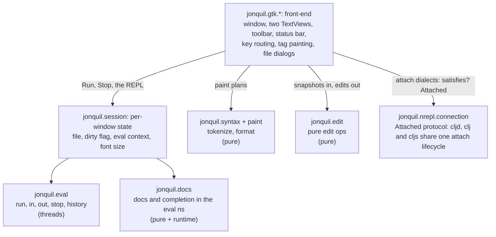
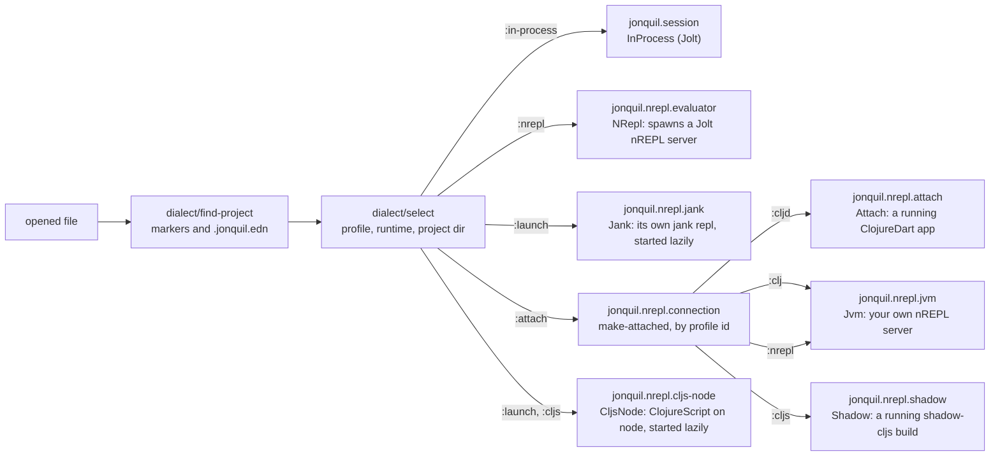
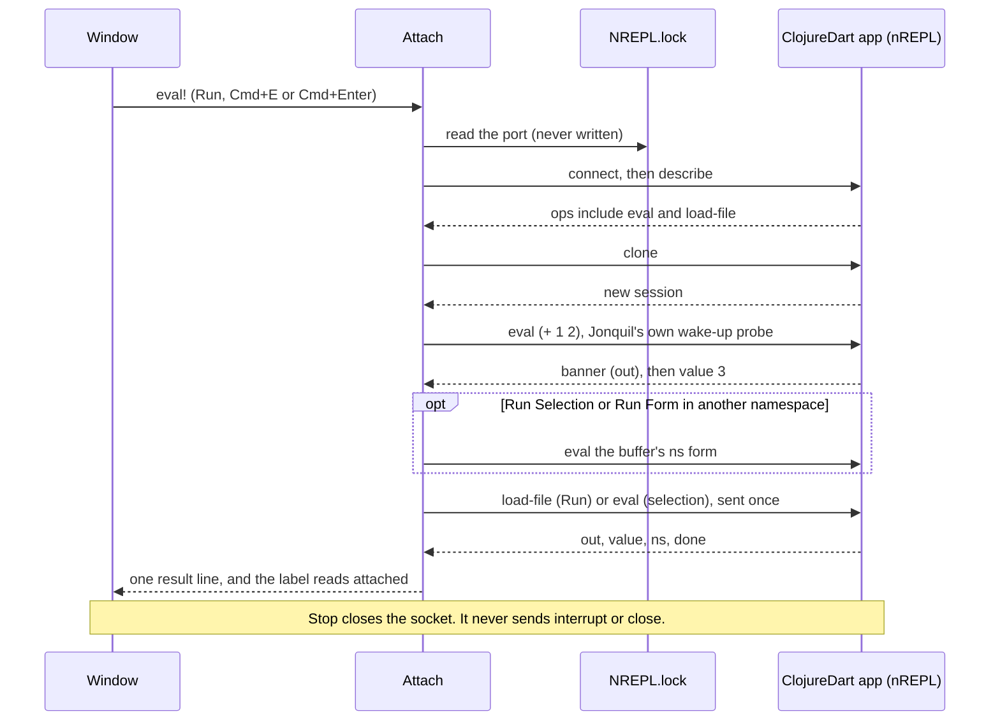
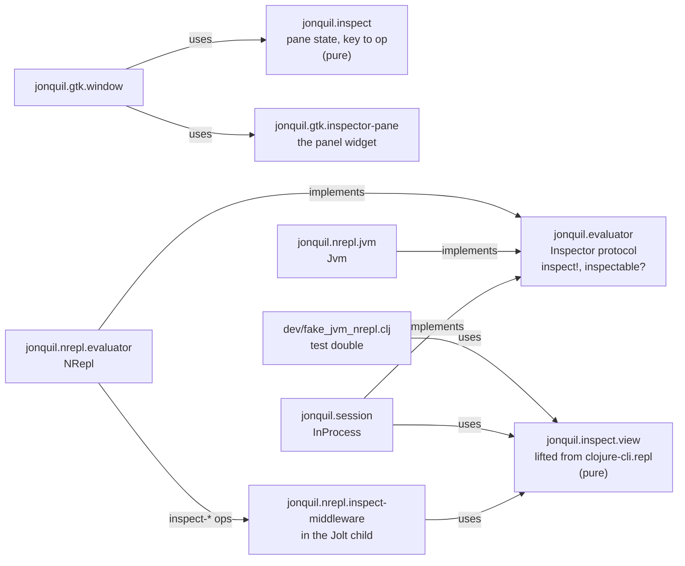

# Jonquil Architecture

## Design

Jonquil is a port of DrClojure's idea to Jolt: a Clojure IDE with a Definitions editor, an Interactions console, Run and Stop that actually stops. The design splits into layers.



Phase 3 and the Themes phase added four more pure namespaces alongside
these:

- `jonquil.commands`: the run-selection text, the form Run Form sends,
  the pre-Run bracket check, next/prev match, replace-current and
  replace-all, the format operations, and the zoom sizes.
- `jonquil.keymap` and `jonquil.command-registry` (plugins Part 1, slice
  S1, 2026-10-24): key bindings and commands as data. `jonquil.keymap`
  matches a lowered keyval and a GDK modifier state against an ordered
  binding vector, first match wins. A binding names `:key` (or `:keys`),
  `:mods` that must be held and `:not` that must be up, with `:cmd`
  meaning Control or Meta on every platform. Anything in neither set is
  ignored. `jonquil.command-registry` maps a command id to a doc line and
  a `(fn [ctx args])`, where ctx is the map the window's key handler
  already receives, so a command is a plain function a test can call. The
  shipped bindings live in `src/jonquil/keymap.edn`, read when Jonquil is
  compiled, because the installed app has no source tree. S1 dispatched
  them through one **slot** clause in `on-window-key`'s cond, first placed
  where the plain chords used to be, so every clause above and below kept
  its precedence. Later slices grew the slot upward until the cond was
  gone. A differential oracle checked the keymap against a
  transcription of the replaced clauses, for every key they named and all
  32 modifier combinations. Slice S2 (2026-10-24) added `:when`: a vector
  of named conditions, all of which must hold. `resolve-binding` asks them
  through a `holds?` fn only once a binding's key and modifiers match, in
  order, stopping at the first false, the short-circuit order of the `and`s
  it replaces. Conditions live beside the commands (`window-conditions`) as
  functions over ctx. `on-window-key` builds a per-key ctx, its own
  argument map plus the active tab's find-bar reads and actions as fns, so
  the registry never touches GTK. S2 moved F3 and Cmd/Ctrl+G (while the
  find bar can navigate), plain F6 and the source panel's
  Cmd/Ctrl+Shift+O into the slot, which then sat right below the bare
  Escape clause. Its oracle crossed every key and modifier set with each
  combination of the three states those clauses read. Slice S3
  (2026-10-24) gave commands an outcome: `:handled` (the key is used up),
  `:to-gtk` (stop here and let GTK have it) or `:next` (not mine after
  all, try the next matching binding). A binding can name a fixed
  `:outcome` instead of a command. `dispatch` walks the matching bindings
  and runs each command until one answers `:handled` or `:to-gtk`, and
  says `:unmatched` when it runs out. That let the whole Escape chain move
  into the keymap, in its old order: the find bar (whose own 0, an IME
  composing, is `:to-gtk` and never reaches Stop), popovers (`:next` when
  none was open), the inspector, the source panel, the tree menu, the
  tree, Stop while evaluating, and a bare `:to-gtk`. The slot then sat
  right after F5, and its oracle crossed Escape with all eight states the
  chain reads. Slice S4 (2026-10-24) retired the cond. F5 became the
  first binding and the two Cmd/Ctrl+[ back clauses the last, the jump
  back answering `:next` when there's nothing to go back from. The rename
  guard (while the rename popover's entry has focus, every key but Escape
  is the entry's; since S8's follow-up the command palette's entry too)
  covers a class of keys, so it stays a fixed stage ahead of the
  keymap, as the spec keeps the editor's preedit yield, and asks the named
  condition `:rename-focused`. `window-answer` holds that stage and the
  dispatch and answers 1 or 0. It is the whole of `on-window-key` now,
  and the oracle drove it over the full handler's transcription. Slice
  S5 (2026-10-25) started on the editor. Its eleven chords, Ctrl+Space
  through F2 (completion, comment, the two formats, redo, quick doc, jump
  and rename), are an `:editor` scope with its own `editor-commands` and
  `editor-conditions`, dispatched from one slot in the editor's
  `handle-key!` between plain Return and the typing clauses. Two matcher
  forms came with it. `:exact #{...}` needs exactly that set among Shift,
  Alt, Control and Meta, ignoring Super, for Shift+F1, Shift+F6, F12 and
  F2. `:physical? true` lets a binding also match through dispatch's
  `:physical` option, the key the hardware keycode names. That's the
  macOS Cmd+Option+F/L case, where Option turns the keyval into another
  character (`jonquil.gtk.editor/physical-key`). It is opt-in per binding,
  so no other chord picks it up. The editor ctx holds thunks, so each
  command reads the editor's state when it runs, and the slice's oracle
  crossed every key the clauses named with three keycodes, both
  platforms, all 32 modifier sets and every command answer. Slice S6
  (2026-10-25) finished the editor, and its cond is gone.
  Cmd/Ctrl+Enter (Run Form) is the first `:editor` binding, Return or
  KP_Enter with `:cmd`, always used up so no newline goes in.
  `editor-answer` runs the spec's pipeline and answers 1 or 0: the preedit
  yield asks the named condition `:preedit-active`, then the completion
  popup gets first look through a thunk, then the keymap, and only an
  unmatched key reaches the typing stages (smart enter, auto-pairs,
  Backspace, Tab), the editor's private `typing-key!`. Plain Return moved
  from above the chords to the head of those stages, which is safe because
  no shipped binding can match a plain Return. A second oracle proved it,
  comparing the whole of `handle-key!` against its old cond over every
  stage answer. Slice S7 (2026-10-25) moved the context menus
  onto the registry. `editor-menu` and `console-menu` list each item's
  label, its action name and the command it runs, and `menu-items` turns
  a menu and a ctx into the items `install-context-menu!` takes, so an item
  and its chord run one command. Indent, Unindent and the console's
  Complete became commands with no binding. A menu oracle compared both
  menus with the literal vectors they replaced. The file tree's menu stays
  a file-operations popover, since its items act on a path picked when it
  opens and aren't commands anywhere else. Slice S8 (2026-10-25) added
  the command palette, Part 1's one new piece of UI, on Cmd/Ctrl+Shift+P.
  `jonquil.palette` builds its entries from the registry and the keymap
  (doc line, chords per platform, source), filters them and moves the
  selection, all pure. `run-command-in` runs a picked command with the
  ctx of its own scope, and the two per-key ctxs are named functions now
  (`window-key-ctx`, `editor/key-ctx`), so a palette run builds the same
  ctx its key would. Commands that only work inside the key chain that
  guards them carry `:palette? false` and stay out of the list. Slice S9
  (2026-10-25) closed Part 1 by deleting the oracles, as the spec plans,
  once every slice had merged with its oracle green and every self-test
  row unchanged. The shipped keymap is now pinned by `keymap_shipped_test`
  (every binding names a registered command and condition, what each
  window chord runs with its Shift forms ahead of the plain ones, that no
  window binding takes an editor chord and no editor binding takes a plain
  Return, Run Form's chords, F5, the Escape chain's order and conditions,
  the palette chord, and each context-menu item's command) and by the
  window self-test rows.
- `jonquil.plugin` and `jonquil.plugin-check` (plugins Part 2, slice P1,
  2026-10-25): the plugin API's first piece and the validator, both pure,
  with nothing loaded from disk yet. `jonquil.plugin/defplugin` records a
  plugin file's definition, with its line, while a load binds
  `*definitions*`, and throws at any other time. `plugin-check/validate`
  takes plain data (the definitions, the file's id, the registered commands
  as `{id {:scope :passes?}}`, the condition ids, the shipped keymap and
  the OS) and answers `{:ok? :problems :warnings}`, one sentence each, never
  throwing, so the isolated check can send the same request to a
  throwaway Jolt as EDN. It checks the definition, the id, the effects, the
  commands and the hooks. It refuses a binding that would take a key you
  type (a printable key, Return, Tab or Backspace with neither Ctrl nor
  Meta held, in either scope, since the window sees keys first) and an
  `:editor` binding the window always takes first. A chord a built-in
  uses, or one the window takes only sometimes, is a warning naming that
  command. `:passes? true` on the three window commands that can hand the
  key on (`:popover/close-all`, `:source/jump-back`, `:find/bar-key`) is
  how it tells the two apart.
- `jonquil.theme`: the four palettes as data, the five choices
  (`choice-names`, `choice?`), `resolve-choice` (which turns `auto` into
  light or dark), `theme`, `next-theme` and `code-css`.
- `jonquil.settings`: `settings-path`, `load-settings` (never throws) and
  `save-settings!` (atomic, never throws).
- `jonquil.last-session`: the tabs to reopen, kept per tree root in
  `sessions.edn` beside the settings file. It's a separate file because
  `settings.edn` is hand-edited and may be a dotfiles symlink, while this one
  changes whenever the tabs do. `load-sessions` and `save-sessions!` never
  throw, and `remember` and `entry-for` are pure. When no file was named,
  startup picks the entry (and re-roots the tree) before the window is
  shown. `reopen-later!` then waits for the window's first painted frame
  (the frame clock's `after-paint`, or one second if no frame comes) and
  opens them all in one main-loop turn, so the window appears without
  waiting for them and nothing the user does can land between two of
  them. A quit before then cancels it and saves nothing, since the tabs
  open are only part of the list. After the reopen the window saves as the tabs
  change:
  `refresh-labels!` (every open, close and path change) and `on-switch!` call
  `session-changed!`, which writes only when the `{:root :tabs :active}`
  snapshot differs from the last one written. It does nothing until
  startup's own reopen is done, since the first Untitled tab would otherwise
  overwrite the list it's about to reopen, and the state startup ends in is
  only recorded, not written, so a launch on one file leaves the folder's
  list alone until a tab changes. The real-quit
  branch of the close-request handler turns that off, then saves once more,
  next to the tree's width. Each saved path goes through the same
  `open-file!` as Open, and a path that fails, or throws, is named on the
  console instead of stopping the rest.

P4 added a fourth: `jonquil.help`, the decisions behind completion, quick
doc, jump to definition and rename, covered in its own section below.

- `jonquil.file-tree`: the file tree's model as plain data: `{:root :expanded :ignore}`, listing one folder (ignore rules, folders first), flattening the expanded tree into rows (a symlink back to an ancestor shows collapsed instead of recursing), `expand-to` for a saved file, the launch root (`root-for`), and a directory's own project selection (`project-selection`, since `dialect/find-project` starts at a path's parent).
- `jonquil.save-path`: where a save really writes and the temp file it writes through, as plain `java.nio.file` calls. `resolve-target` follows symlinks by hand, each relative link against its parent's real location, because `.getCanonicalPath` on this Jolt returns a dangling link's own path and a rename onto that path would replace the link; it gives up after 40 hops, so a link loop fails. `create-temp!` creates the temp file owner-only when the target exists, so new content never sits in a file wider than the owner's. `jonquil.gtk.window`'s `save-to!` writes the editor text into a temp file in the resolved target's directory, copies the target's permissions onto it, then renames it over the target with `ATOMIC_MOVE`, so a failed write never leaves a half-written file and a symlink is updated rather than replaced. The tab counts as saved only once the rename succeeds; any failure deletes the temp file and prints an error naming the user's own path.
- `jonquil.tabs`: the window's tabs as plain data: the strip's labels, finding a file that's already open (compared canonically), whether a tab may run in the window's evaluator (`runnable-here?`: the same `dialect/selection-key`, or a Jolt file outside any project in any Jolt window), whether a lone tab keeps the window's Jolt instead of switching it (`keeps-window-jolt?`), and the text of the refusal, the unsaved-changes alert and the Run banner.
- `jonquil.source`: where a definition outside the buffer lives and its text, from a lookup's `:file` (an absolute path or a `jar:file:…!/entry` URL, read locally with `java.util.zip.ZipFile`), whether it can be edited (a plain file under the project), line arithmetic, and the source panel's bounded history.

This arc added two more: `jonquil.inspect.view`, the inspector's view
code lifted from clojure-cli.repl (`UPSTREAM.md` carries the provenance
row), and `jonquil.inspect`, the panel's own pane state and its key-to-op
decisions. Both are covered in their own section below, alongside the
`Inspector` protocol.

`jonquil.console` is the console's own pure half: what Return does with
the text at the prompt, how much old output to trim, how a result is
shown, where the last entry starts for Clear Last Output, and a friendlier
message for an unclosed bracket. `jonquil.core` holds only the app's name.

The front-end and the core use plain data to communicate. When the user edits, the GTK TextBuffer sends a snapshot to the core:

```clojure
{:text "..." :caret 42 :sel-start 40 :sel-end 45}
```

An edit operation returns data for the front-end to apply:

```clojure
{:edits [[start end "replacement"] ...]
 :caret 44
 :sel   [44 44]}
```

The front-end applies each edit in reverse order within one `gtk_text_buffer_begin/end_user_action` call, so undo sees one step.

## MCP: `jonquil --mcp`

Three namespaces for the headless server, none of which requires a `jonquil.gtk` one, so the headless
entry never opens a window:

- `jonquil.mcp.json` is the JSON codec (`decode`, `encode`, string keys both
  ways) over `org.clojure/data.json`, plus the small pre-pass that reads
  surrogate-pair escapes.
- `jonquil.mcp` is the protocol. `handle-message` turns one decoded request
  into a response map or nil, and `serve!` loops over a line reader and a line
  writer it is handed, skipping blank lines and guarding every message so one
  bad request never ends the loop or mislabels its error.
- `jonquil.mcp.tools` holds the six tool definitions and `make-tools`, which
  keeps one evaluator per project selection (the same `.jonquil.edn` choice the
  window makes) and registers each with `jonquil.runtime-registry`, so
  `registry/stop-all!` stops them. An evaluation that passes its deadline is
  interrupted, and a dead one can't wedge its project.

**Window mode.** `jonquil.mcp.window` sits beside these and builds the fifteen
tools for `jonquil --mcp --window`. It never requires `jonquil.gtk.window`:
it receives the window's `ui` map (the `:on-ready` map) and touches it only
through `gui-call`, a thunk handed to the GTK thread with a bounded deref, so
the serve thread never calls GTK itself. The window gives it three notifying
hooks, `do-run!` (with an optional `notify`), `mcp-eval!` and
`mcp-run-selection!`. Each takes a `notify` function and calls it exactly once
with `{:refused msg}`, `{:busy warning}`, `{:problem text}`, `{:none s}` or,
from the eval worker, `{:done {:result r :output s}}`, and returns a reader
`(fn [] output-so-far)`. A `notify` callback only delivers a promise, so a
slow or abandoned call can't block the worker. The window keeps its one
evaluator; the tools never stop or swap it. The stdout rule below holds in
window mode unchanged.

**Listener and bridge.** `jonquil.mcp.listen` lets a window that has
`:mcp-listen? true` serve those same fifteen tools to a socket client. It binds
127.0.0.1 on an OS-picked port, accepts one connection at a time and runs
`serve!` over it, and it records the port in a per-window registry file
(`<settings-dir>/mcp/<pid>.edn`) that `stop!` removes and that startup
housekeeping reaps when the pid is dead. `jonquil --mcp-attach [DIR]` is the
other half: `discover` picks the live entry whose folder matches `DIR` (or the
only live one), and `bridge!` copies lines between stdio and the socket without
re-encoding them. Neither side touches `jonquil.gtk`.

**The stdout rule.** JSON-RPC owns the real stdout, and nothing else may write
to it. `jonquil.main/-main` branches on `mcp-args` before `start!`, saves the
real `*out*`, then points the root `*out*` at `*err*` with `alter-var-root`, so
a `println` from any runtime thread lands on stderr. Only the `:write-line`
function passed to `serve!` rebinds `*out*` to the saved writer, prints one
line and flushes. The shutdown hook that calls `registry/stop-all!` covers this
path as well as the window's.

## GTK is not everywhere

GTK4 is required only from `jonquil.main`. All of the pure core (tokenization, parsing, syntax highlighting, edit operations, the eval engine) runs without GTK or any GUI dependencies. This design lets the core be tested independently and potentially reused by a second front-end later.

Nothing enforces this automatically, which is why it is a rule. Jolt's build scanner follows `require` forms statically, so a `jonquil.gtk` namespace required from anywhere else would silently compile GTK into every binary built from that namespace, headless tools included. Phase 2 added the GTK libraries to `:jolt/native` in `deps.edn`.

## The GTK layer

`jonquil.gtk.*` started as six namespaces, each with one job:

- `jonquil.gtk.ffi`: the raw GTK4/GLib/GObject/pango bindings, plus the low-level GtkTextIter/mark helpers everything else builds on.
- `jonquil.gtk.callbacks`: the `callable` macro that turns a Clojure function into a retained, `:collect-safe` foreign-callable (GTK invokes callbacks from inside its own blocking main loop, so a collected one would crash it). It also contains every callback: a throw never reaches GTK, where it would end the process, but is reported on stderr while the callback answers a safe value for its return type, or its own `:on-throw` (the editor's dirty-check timer answers 1 to keep running). Handlers people trigger directly also report on the window, the way the editor's and console's key handlers do. The namespace also holds `on-gui!`, the one function safe to call from any thread to hand a thunk to the GTK main thread.
- `jonquil.gtk.editor`: the Definitions editor, a GtkTextView wired to `jonquil.paint` for live syntax highlighting and `jonquil.edit` for smart Enter. Its repaint after an edit keeps a baseline of what its tags show now (`:painted`). On a future, off the GTK thread, it computes the new plan and `paint/plan-diff` against that baseline, then applies only the changed range a chunk per main-loop turn, nearest the caret first. With no baseline it falls back to a full `paint-async!`. `dirty?` compares lengths before it copies the buffer, and `jonquil.syntax/tokenize` reuses its last result when it gets the identical string again, so a 20,000-line file stays responsive while typing. Its `handle-key!` dispatches the rest of the editor's keys through `jonquil.command-registry/editor-answer` (see `jonquil.keymap` above): the preedit yield, the completion popup, the `:editor` keymap, then its typing stages, sending edit ops through `apply-op!` so each one lands as a single user action, and every handler yields during IME preedit.
- `jonquil.gtk.find-bar`: the find and replace bar, with its own `handle-key!` and match highlighting through a `search-match` tag.
- `jonquil.gtk.console-view`: the Interactions console, one GtkTextView whose buffer holds read-only output history, an editable prompt and input region, and the key handling for Return, Up/Down and Ctrl/Cmd+D.
- `jonquil.gtk.window`: the toolbar, the paned layout, the window-level key chords (all of them through `jonquil.command-registry/window-answer` and the keymap, see `jonquil.keymap` above), the file dialogs, and the wiring between `jonquil.session` and the two views.

P4 added three more, all built on a shared popover base:

- `jonquil.gtk.popover`: a caret-anchored `GtkPopover`, shared by completion, quick doc, full doc, rename and the command palette.
- `jonquil.gtk.help-popover`: the quick-doc popover, the full-doc popover a second quick-doc press opens, and the rename popover, all built on `jonquil.gtk.popover`.
- `jonquil.gtk.palette`: the command palette popover, one per tab, built on `jonquil.gtk.popover` like rename: an entry over a list of `jonquil.palette` entries. It hides before it runs the picked command, then gives the editor focus back once GTK has finished closing it, unless the command focused something of its own.
- `jonquil.gtk.completion`: the completion popover, one instance per view (the editor and the console's input line), also built on `jonquil.gtk.popover`.

This arc added one more, outside that popover base: `jonquil.gtk.inspector-pane`, the inspector panel widget, covered in its own section below.

- `jonquil.gtk.file-tree-pane`: the file tree widget: a header (root name, refresh, Open Folder…) over a `GtkListBox` rebuilt from the model's rows on every change. A click or a key decides which path it acts on at once, then rebuilds on the next main-loop turn, because a rebuild removes the very row whose signal is running. The window holds it in an outer horizontal paned left of everything else, and the ☰ Files `GtkToggleButton`'s `toggled` handler is the one place that shows, hides and saves it.
- File operations in the tree: `jonquil.file-ops` is the disk side, where every function returns `{:error ...}` rather than throwing (new file, new folder, rename that never overwrites and allows a case-only change, the name checks, `trash-message` and `hidden-message`). `jonquil.gtk.trash` calls `g_file_trash`, so the system Trash is the only way anything leaves the tree and nothing is deleted permanently. The pane's right-click menu is one `GtkPopover` parented on the pane's root box, not on the list. `jonquil.gtk.popover` records a GtkTextView hanging at dispose over a foreign child, and a plain GtkBox parent was measured to destroy cleanly. It swaps between the item list and a name entry, and its target lives only in that popover's state. The window does the work: it retargets open tabs to a renamed path (the same `:path` reset Save As does), refreshes the tree after any failure since the disk may have changed partway, and writes the trash and hidden-name lines to the console.
- `jonquil.gtk.tab`: one tab's widgets: an editor with its find bar, the four popovers parented on its view (quick doc, full doc, rename, completion) and the label box the notebook shows. `dispose-popovers!` hides and unparents them before the window removes the tab's page, because removing a page with a popover still parented spins GTK in a warning loop, and unparenting drops a popover's last reference. The window (`jonquil.gtk.window`) keeps the tabs in a vector inside a `GtkNotebook` and resolves the active tab whenever an action runs; closures built per tab capture their own tab.
- `jonquil.gtk.source-pane`: the read-only source panel: a header, a read-only `jonquil.gtk.editor`, Open in window and Close, and a footer for hints, notes and errors. Since 2026-10-19 it shows only jar entries and files outside the project: a jump to a project file goes to its tab instead (`jonquil.gtk.window/open-in-tab!`, with `jump-back!` on Cmd/Ctrl+[ walking a window-wide stack of where each such jump started). It shares the window's right-hand slot (a vertical GtkBox) with the inspector, one visible at a time. Its editor paints with `paint-async!`, which computes the paint plan on a future and applies it a chunk per main-loop turn, nearest the caret first, so an 8,000-line library file never holds the GTK thread.

### `on-gui!` and the worker-to-GTK-thread path

The eval engine's callbacks (`on-output`, `on-wait-input`, `on-status-change`, `on-complete`) run on the eval worker thread, never the GTK thread. GTK itself may only be touched from its own main thread, so every one of those callbacks follows the same rule: enqueue and return, never call GTK directly, never block. `jonquil.gtk.console-view/append!` queues a `[kind text]` chunk and schedules a drain; `jonquil.gtk.callbacks/on-gui!` queues an arbitrary thunk. Both are safe from any thread for exactly that reason, and both coalesce: several worker-thread calls landing between GTK ticks turn into one drain, so a flood of output doesn't starve the main loop.

### The console buffer layout

The Interactions console is one GtkTextBuffer laid out as


Output history and the prompt carry a read-only tag, which is what stops typing, pasting or Backspace from reaching into old output; GtkTextView's own edit path already refuses edits under that tag. `out-end` is a mark with right gravity: `append!` always inserts at it, so new output lands before the prompt and the mark tracks past it. `input-start` is a mark with left gravity: text typed at it stays after it, and output inserted earlier in the buffer pushes it forward automatically. Committing an entry (Return, when it evaluates or sends stdin) moves both marks explicitly to open a fresh prompt after the old input, rather than relying on gravity for that step. The prompt names the session's namespace (`user=> `, `demo.core=> `): the view keeps its current text, and `set-prompt!` rewrites the region between the two marks in place, keeping the typed input and the caret. The window calls it with the evaluator's `prompt-ns` after every evaluation, when it switches evaluators, and when an attach connection comes or goes.

The console reads its busy/waiting state live from the engine (`:evaluating?`/`:waiting?`, functions supplied at construction) rather than mirroring it into a console-owned atom. A mirror set right after starting an eval could lose a race against a fast eval's own completion clearing it first, stranding the console in a busy state with nothing left to un-strand it.

### `jonquil.session` and the O1 reset rule

`jonquil.session`'s `InProcess` record holds one window's in-process evaluation state: the eval context, the current mode (`:reset` or `:accumulate`), the prompt namespace, and the namespaces each owner created, a map from owner to a set. It's the original, and still the default, implementation of the `Evaluator` protocol described below. Run and the REPL both call through the same `evaluate!` path into `jonquil.eval/eval-async`, so the engine itself never distinguishes them. Making one also points Jolt at the window's project: `jonquil.project-roots/use-project!` adds the project's `deps.edn` `:paths`, made absolute, after the roots Jolt started with (so a project can't shadow the IDE's own namespaces in this shared process; captured once, so a switch replaces rather than piles up), through `jolt.host/set-source-roots!`, the same seam `jolt.main` uses; a Run of a file in another in-process project switches the session's project instead, since the window keeps one evaluator for those, and the next evaluation's roots follow it. Without it, a project kept in process couldn't require its own namespaces, and with absolute roots Jolt records an absolute `:file`, which jump to definition opens. That call sets `:paths` only, which needs no network. Each evaluation then resolves the whole `deps.edn` on its worker, through `eval-async`'s `:before-eval` hook (`use-project-deps!`, `jolt.deps/resolve-project`, the CLI's own resolver), so a first fetch of a git or Maven dependency never holds the GTK thread; the answer is cached per edit of `deps.edn` or the user `deps.edn` (a `:local/root` dependency's own `deps.edn` isn't watched), a failure for 30 s only, so a network blip heals on a later Run; a failure leaves the roots at `:paths` with a line on the console, and a Stop during a fetch stops the evaluation rather than counting as a failure. A REPL entry uses the project the last Run used. A Run itself evaluates the buffer's text with `load-string`, where Jolt turns the reader's file off on purpose, so its vars get a line but no file; a Run of a file whose text on disk is exactly the buffer's snapshots the program's vars first (every namespace that isn't a loaded library) and gives the file to each var whose metadata the Run replaced and that has a line and no file (`mark-run-file!`), so F12 from another tab opens it. The marking runs in `jonquil.eval/eval-async`'s `:before-idle` hook, on the Run's worker before the context goes idle, so no REPL entry can define a var in between. A var a REPL entry defined earlier keeps its metadata and isn't marked; a buffer with unsaved edits isn't marked at all, since its lines don't match the file.

The O1 spec decision is that Run resets by default: in `:reset` mode, `run-definitions!` first removes the namespaces its owner created, then the REPL's, then `user`, and recreates a fresh `user` and evaluates into it. Loaded libraries are never owned, so they stay. An owner is whatever `eval!`'s `:owner` option names: the window passes a tab's id for Run, Run Selection, Run Form and Inspect Form, and a console entry falls back to `:repl`. A tab that closes hands its set to `:repl` (`jonquil.evaluator/Owners`, `release-owner!`), so the next Run from any tab clears it. Unchecking the toolbar's Reset on Run checkbox flips the session to `:accumulate`, and Run stops clearing first, building on whatever earlier evaluations already defined, the same way the REPL prompt always does. The out-of-process nREPL runtime applies the identical rule, just over the wire. Around every evaluation it asks the child for its namespaces and loaded libraries (`ops/ns-snapshot-code`, about 1 ms), and its reset form removes the owner's set on the child instead of on this process. The snapshot prints its data and returns the old `*1`, having pre-shifted `*1` and `*2`, so the server's own history shift leaves `*1`, `*2` and `*3` where the user had them. The same eval refers `doc`, `find-doc`, `apropos`, `dir`, `pprint` and `pp` into the session's namespace, inside its own `try`, the way the in-process engine does. So Reset on Run, the history vars and the helpers mean the same thing whichever evaluator is running underneath them.

### Self-test harnesses

Three `bb` tasks drive the real GTK front end headlessly, without a human at the keyboard:

- `bb gtk:selftest` opens ten real GTK windows in turn, one per group: the front end, the full window, out-of-process Jolt, ClojureDart, JVM Clojure, the file tree, jank, launch arguments, shadow-cljs and ClojureScript on node. Each drives the same button and key handlers a person would use, against a fake server or a fake child where the real one would need a toolchain. [Development](development.md#self-test-and-docs-ten-windows-one-binary-one-camera) describes every group and its rows.
- `bb docs:shots` self-captures `docs/images/*.png` and one GIF for this guide and the user guide: one fresh `jolt -M:shots <scene>` process per scene, each driving `jonquil.main/start!` through exactly one demo, screenshotting it with `cgevent`, then exiting. A fresh process per scene keeps each screenshot to its own scene's console history.

All three poll a condition against a deadline rather than sleeping, and all three hand any blocking subprocess call (screenshots, GIF recording, the nREPL window's own child) to a `future` so the GTK thread itself never blocks. See [Development](development.md) for how to run these tasks, the split layout of `dev/gtk_selftest_window/`, the binary smoke, and the traps that catch a first run.

### Themes

Applying a theme doesn't rebuild anything: each component's `apply-theme!` retints its existing tags in place, so text, undo history and highlights all survive the switch. The window then reloads its one CSS provider, the same one zoom uses, from `theme/code-css`, and sets `gtk-interface-color-scheme` on GtkSettings to `DARK` or `LIGHT` so GTK's own chrome follows along.

The window keeps two atoms for this. `theme-name` is the palette on screen (always one of the four), and `theme-choice` is what the person picked (one of the five, and the one that gets saved). Every path that changes the choice goes through `apply-choice!`, which resolves it with `theme/resolve-choice` and applies the result. When the choice is `auto`, the answer comes from `jonquil.gtk.appearance/system-dark?`. GTK reports no system preference on macOS (`gtk-interface-color-scheme` reads 0, unsupported), so that namespace asks AppKit through the Objective-C runtime for `NSApplication`'s `effectiveAppearance` name and treats a name containing "Dark" as dark. It returns nil on any failure and off macOS, which resolves to light.

A 1-second GLib timeout runs only while the choice is `auto`. What's installed is the poll callback built in `activate!`, and it calls `poll-tick!`, which re-asks `system-dark?` and applies the palette only if it differs from `theme-name`. A failed read (nil) during the poll leaves the palette as it is. The tick doesn't touch the status bar or the settings file. Picking another choice doesn't stop the timeout directly: its next tick, within about a second, returns 0 and GLib drops it. In the real app the window followed a macOS flip to Light and back to Dark, each within 0.87 s.

Isolation matters here too: self-tests and `bb docs:shots` pass a temp `:settings-path`, and `bb smoke:binary`, `bb smoke:cljd` and `bb smoke:cljs` set `XDG_CONFIG_HOME` to a temp directory, so none of the harnesses ever touches the user's real settings file.

### Help: completion, quick doc, jump and rename (P4)

`jonquil.help` holds every pure decision behind the four P4 features, the same split `jonquil.commands` and `jonquil.edit` already draw between deciding and doing. It never touches GTK or the running program; it works on the editor's own snapshot shape (`{:text :caret :sel-start :sel-end}`) and on plain data the GTK layer passes in.

Completion's state moves through a small set of functions: `prefix-at` reads the word before the caret (or nil, when there's a selection or nothing to complete), `open-state` turns a prefix plus a candidate list into the popup's state map, `move` steps the selection with clamping, `commit-op` is the edit that replaces the prefix with the chosen candidate, and `still-valid?`/`refine` decide whether an open popup survives the next keystroke or needs to close. `target` is shared by quick doc, jump and rename: the selection when it's exactly one symbol, otherwise the symbol at or around the caret.

Jump to definition is the one place `jonquil.help` overrides upstream's own logic rather than reusing it outright. `jonquil.syntax/find-definition` (lifted unchanged from DrClojure) checks top-level `def*` forms first and only then falls back to a scope-less "last earlier token with this name", which gets a shadowed local wrong: a function parameter or a `let` binding that reuses a top-level name should win, and an unbound name should report nothing rather than landing on an earlier use of it. `jonquil.help/jump-target` fixes this with a real scope search first: it walks the parenthesized forms enclosing the target, innermost first, collecting the names each one binds (`let`/`loop`/`binding`/`when-let`/`when-some`/`when-first`/`if-let`/`if-some`'s own bindings vector, `for`/`doseq`'s bindings vector, `fn`/`defn`/`defn-`/`defmacro` params for every arity, and `letfn`'s names), unpacking vector and map destructuring recursively along the way. Only when that search comes up empty does it call `find-definition` with no position at all, which runs just its top-level half; an external var's documentation is the last fallback. `rename-problem` mirrors `jonquil.edit/rename`'s own nil cases (no symbol at the caret, a blank or invalid new name, the same name, nothing to rename) as a sentence for the rename popover to show instead of applying anything.

`jonquil.docs` resolves lookups in the namespace the user's program actually runs in, not the IDE's own. When that namespace no longer exists, because Reset on Run just removed it, `resolve-ns` falls back to `user` rather than letting `the-ns` throw. Both `symbol-doc` and `candidates` wrap their real lookup in `try`/`catch` and return nil (or `[]` for candidates) on any exception, so a bad lookup never escapes into a key handler. `symbol-doc` also memoises on `[namespace symbol text]`: looking up a name defined only in the buffer costs around 144 ms on a 2,000-line file, too slow for a preview that has to keep up with every arrow key. The cache is cleared after every completed evaluation, Run or REPL alike, from the same `on-complete` callback in `jonquil.gtk.window` that already reports the result; without that, a lookup made before a name existed would go on returning its stale answer forever after, even once the same evaluation had defined it.

The three popover namespaces share `jonquil.gtk.popover` as their base. Its most important fact is where a popover's `GtkWidget` parent is: never the `GtkTextView` it's anchored to, always that view's own container (its `GtkScrolledWindow`, in both the editor and the console). Parenting a popover directly to the text view, which is what the P4 spike probes did, hangs a real window close: `GtkTextView`'s own dispose walks its structural children to detach them, doesn't recognise a popover as one of its own, and spins forever logging that the popover isn't a child of the text view, pinning the main thread at 100% CPU. The probes themselves never hit this because every probe process exits without ever destroying its window. A `GtkScrolledWindow` has no such override and tears down cleanly. `jonquil.gtk.window` keeps a registry of every P4 popover a window creates (`register-popover!`), and `close-popovers!` walks it to hide whichever one is open, whether that's Escape's own job or one popover making room for another. At window close, `close-request-fn`'s real-quit branch calls `unparent-registered-popovers!`, which hides an open popover before unparenting it (unparenting first would leave its `:open?` atom reading true against a widget that no longer exists, and a later focus-lost listener would then call `hide!` on it and hit a GTK-CRITICAL) and skips an entry that's already unparented, so the session's popovers detach cleanly instead of leaving `GtkScrolledWindow` still holding a child when it finalizes.

`jonquil.gtk.help-popover` builds the quick-doc popover (autohide off, so it never steals keys from the view, per `jonquil.gtk.popover`'s own autohide note) and the rename popover (autohide on, since its entry needs to receive typing; GTK itself closes it on Escape or a click outside, and a `"closed"` signal handler keeps the popover's `:open?` bit in sync when that happens with no call into this namespace at all). `jonquil.gtk.completion` is one popover per view, a candidate list over a doc preview, built once per view and reused for the rest of the session; `open!`, `refine!` and `commit!` all read `(popover/open? c)` rather than trusting the state atom directly, because a close driven from outside this namespace (the window's registry-wide `close-popovers!`) only ever calls the generic `popover/hide!` and has no idea this namespace's own state atom exists.

The editor's and the console's context menus (Shift+F10, or a right click) come from `gtk_text_view_set_extra_menu`, which appends to GTK's own Cut/Copy/Paste menu rather than replacing it. `install-context-menu!` builds a `GMenu` alongside a matching `GSimpleActionGroup`, inserted on the view under the `"p4"` action-group prefix, with one action per item. The items come from `jonquil.command-registry/menu-items`, so each one runs the same command its keyboard chord runs. Every action's own `"activate"` callback runs inside `try`/`catch`: an uncaught throw from a `GSimpleAction` callback kills the process outright, so this is the one place every menu item, current and future, is guarded at once.

None of these ask a server on the GTK thread. An evaluator whose help asks one implements `ev/ServerHelp` (every attach evaluator, out-of-process Jolt and jank), and the window asks it through `ev/ask-help!`: the request runs on a worker with `ev/*help-timeout-ms*` bound to 3000 ms in place of the evaluator's own 300 ms, and the GTK thread waits only `ev/help-grace-ms` (25 ms) for it. An answer in that time is used exactly as the synchronous path always did, so a local server behaves as before, single-candidate commit included. A later one goes to a callback that hands it to `on-gui!`. For completion that's `arrived!`: the popup opened at once on `offline-candidates` (`help/waiting-state`, which stays open with no names and is never single), and the late list merges in through `help/arrive`, keeping the selected name, but only while it's still the newest request (`:gen`), from the window's current evaluator, for an open popup whose editor still exists and whose text and caret haven't moved. The doc preview does the same under its own `:doc-gen`. Quick doc, jump and the source panel's jump go through `jonquil.gtk.window/ask-lookup!`, which shows "Looking up X..." and acts on a late answer only while the caret is still on that symbol in a live, active tab (or a showing source panel), placed against the text as it is then. Jump checks the buffer first (`help/jump-target` with no doc), so a definition in the file never waits. A request that a newer one superseded before it went out is skipped, and a throw inside one comes back as `{::error message}` (`ev/help-error`) so the window can say so. In-process Jolt doesn't implement `ServerHelp` and is asked directly, as before.

The key-dispatch wrappers carry the same guarantee down at the keyboard level. `jonquil.gtk.editor/dispatch-key!` wraps `handle-key!` in `try`/`catch`, and `jonquil.gtk.window`'s window-level key handler wraps its `window-answer` call the same way: either throw is reported through the status bar rather than escaping into GTK's signal emission, and the key still counts as consumed (returns 1) instead of falling through into a second, unrelated action or killing the process.

## Dialects and evaluators

`jonquil.dialect` holds every dialect as plain data: a profile names its
file extensions, the `jonquil.syntax` special-forms and builtins sets it
paints and completes against, its project markers, and which runtime keys
it offers. `profiles` lists every known one, `jolt`, `cljd`, `clj`, `jank`, `cljs` and `nrepl`
today.
`find-project` walks up from a file to the nearest directory holding
`.jonquil.edn` or a marker, reading and parsing the config along the way
without ever throwing: an unreadable or malformed file becomes a warning,
not a crash. `select` turns a project, a path, and a settings default
into one selection: the profile, the runtime, the project directory (for
anything other than `:in-process`), where the choice came from, and any
warnings the window should show. The runtime is `.jonquil.edn`'s
`:runtime` when the profile offers it; otherwise the profile's
`:project-evaluator` when the project holds one of that profile's own
markers (Jolt's is `:nrepl`, for a `deps.edn` folder), else its
`:evaluator` (Jolt's is `:in-process`). So a Jolt project runs out of
process by default and a loose file in process. `selection-key` is what a window
compares before deciding a new file needs a new evaluator: the dialect,
the runtime, and, when the runtime isn't `:in-process`, the project
directory too.

Every window talks to its runtime through `jonquil.evaluator`'s
`Evaluator` protocol: `start!`, `stop!`, `eval!`, `interrupt!`, completion and lookup,
history and prompt namespace, all independent of whether the code
underneath runs in this process or somewhere else. `jonquil.session`'s
`InProcess` record, described above, is the original implementation and
still the one every window starts with by default. The `make` multimethod
dispatches on a selection's `:runtime`, so requiring a new
implementation's namespace is what registers it; `jonquil.nrepl.
evaluator` is the second one, `jonquil.nrepl.jank` registers `:launch` as
the third, and every `:attach` runtime is another:
`ev/make :attach` forwards to `jonquil.nrepl.connection`'s own
`make-attached` multimethod, dispatched a second time on the selection's
profile id, so `jonquil.nrepl.attach` (`:cljd`), `jonquil.nrepl.jvm`
(`:clj`, and `:nrepl` for the nREPL dialect, on the same record) and
`jonquil.nrepl.shadow` (`:cljs`) each register their own method rather
than sharing one `:attach` implementation.



### `jonquil.nrepl.*`: Jolt out of process

Four namespaces make up the out-of-process runtime, with Jonquil's own
nREPL middleware (below, under the inspector) loaded into each child:

- `jonquil.nrepl.child` launches Jolt's nREPL server in the project
  directory (`jolt -e` calling `jolt.nrepl/start` with `{:port-file nil}`,
  wrapped the way `jolt nrepl-server` wraps it, so no `.nrepl-port` is
  written), with its middleware from `middleware-source`: a jolt-lang/nrepl
  checkout (`$JONQUIL_JOLT_NREPL` or `~/dev/jolt-lang/nrepl`), else a git
  dependency on jolt-lang/nrepl v0.4.0 (`nrepl-git-coord`), else none (a
  plain server); Jonquil's own middleware folder joins it either way, scanning ports `7950`-`7999` for one that binds on both the
  loopback and the wildcard address before trusting the child's own bind
  as the real attempt (a bare TCP connect can't rule out something else
  already listening there). Readiness comes from a log line the child
  itself prints once it's listening, never from the connection alone.
  Ending a child kills only the pid this namespace spawned, in order
  (`SIGTERM`, then `SIGKILL` if it's still alive a second later).
  Jonquil never reads or writes the project's `.nrepl-port` for its own
  child: it knows the port it picked. The child's stdin is a pipe Jonquil
  holds open, and a thread in the child exits it when the pipe ends, so a
  crash or SIGKILL of Jonquil, which runs no hook, still takes the child
  with it.
- `jonquil.nrepl.client` holds one socket and one reader for the whole
  life of a child. Its `connect` bounds the socket connect itself to 5
  seconds by default, so a port that never answers fails with an
  exception instead of waiting on the OS, and a connect that fails
  closes its socket before the exception reaches the caller. The reader decodes every reply
  and dispatches it by `:id` to whichever caller is waiting on it, so an
  interrupt and the eval it's meant to stop can share one connection
  without two readers racing each other for the same bytes.
- `jonquil.nrepl.bencode` is the wire format underneath that: pure
  encode and decode, with a length cap and integer validation, so a
  broken or hostile reply can't hang the process trying to read it.
- `jonquil.nrepl.ops` translates between nREPL's own reply shapes and
  Jonquil's: eval results, completion candidates, doc lookups, and the
  reset form. That form removes the running owner's namespaces and the
  REPL's, the ones the snapshots recorded, then removes and recreates
  `user`. It's the same rule `jonquil.session`'s reset applies locally,
  just run as code sent over the wire instead. Both the reset form and
  the namespace snapshot go through `keeping-history`, so the server's
  own `*1`/`*2`/`*3` shift after these bookkeeping evals leaves the
  user's history where it was.

`jonquil.nrepl.evaluator`'s `NRepl` record ties those four together
behind the `Evaluator` protocol: `start!` spawns and connects lazily, and
refuses to spawn at all once `stop!` has run; `eval!` sends a `load-file`
for Run or an `eval` for the REPL prompt; `stop!` interrupts whatever's
pending and, failing that within about a second, kills and restarts the
child instead. `jonquil.runtime-registry` is a fourth, GTK-free namespace
that every evaluator a window makes joins as soon as it's made, so
`jonquil.main` can stop every one of them, and wait for any still mid-
start to settle, before the process exits. No child outlives Jonquil just
because the window that started it happened to close first. `stop-all!`
also runs from a `jolt.host` shutdown hook that `jonquil.main/-main`
registers, so SIGTERM, SIGHUP and SIGINT stop the children too. A crash or
SIGKILL can't run a hook and still leaves them running.

### jonquil.nrepl.connection: the shared attach lifecycle

`jonquil.nrepl.connection` holds what every attach evaluator needs and
none of them change: the `Attached` protocol (`connected?`,
`on-connection!`), `connect!`, `detach!`, `request!`, and
`stop-requested?`, plus the `make-attached` multimethod shown in the
diagram above. It was split out of `jonquil.nrepl.attach` without
changing any behaviour, so ClojureDart's own attach tests and self-test
rows still pass unchanged against it. A dialect's own namespace supplies
a connect policy (its console sentences, and what `:on-connect` adds to
`:state`) and the pieces that stay dialect-specific: `jonquil.nrepl.
attach` keeps the wake-up probe and the run worker for ClojureDart's own
fork, and `jonquil.nrepl.jvm` (below) keeps the JVM's own run worker,
Stop and help logic. `jonquil.gtk.window` checks `(satisfies?
connection/Attached e)` in place of an `instance?` test on any one
dialect's record, both for the status-bar label (`dialect/label`'s
`:attached`/not-running text) and for printing an attach evaluator's
`limitations` once it connects.

### jonquil.nrepl.attach: ClojureDart, attached

`jonquil.nrepl.attach`'s `Attach` record implements `Evaluator` too, and
it works nothing like the Jolt out-of-process one above: it never
starts anything. Connecting happens on demand, the first
time an evaluation finds no live connection, in the spec's own order:
read `NREPL.lock` for a port, connect, `describe` for the ops the app
offers, then `clone` a session. Each successful connect keeps exactly one
session for the whole life of the connection; a fresh one is only ever
cloned again after a detach.



Run goes through `load-file`, and its result is quiet on purpose: one
`; Loaded <ns> (<n> forms)` line instead of a value per top-level form,
built by `jonquil.cljd/load-result` from however many `:value` replies
came back. The session's namespace is tracked from every
reply's own `:ns` rather than asked for separately, and Run Selection
and Run Form pass the buffer as `:ns-source`: when the tracked namespace
doesn't match the buffer's own `ns` form, `run-worker!` evaluates that
form first, ahead of the code the user asked to run.

A freshly cloned session gets Jonquil's own probe, `(+ 1 2)`, ahead of
anything the user typed: `wake!` sends it once, and once more if the app
answers nil (a REPL that hasn't woken up yet after a hot restart), but
the user's own code is never sent twice, whatever the probe answers.

There's no interrupt and no close, ever: the fork's own connect skill
says a client-side interrupt wedges the app's watcher. Stop closes the
socket instead (`detach!`), including one that's still mid-handshake
(`connect!` publishes the raw connection as `:connecting` before
`describe` or `clone` can block on it, so Stop has something live to
close at once instead of waiting out either one's own timeout), and the
next evaluation reconnects with a fresh session. `on-connection!`
registers a listener `(f connected?)`, called from whichever thread
noticed the change, for a connection made or lost; the window's
status-bar label is the one thing listening today.

`jonquil.cljd` is this evaluator's pure half: every sentence the console
shows, the buffer's `ns` form, `NREPL.lock`'s port, the wake-up probe's
own verdict, and a load's one-line summary, all as plain functions over
text and reply vectors, with no socket and no GTK anywhere in the
namespace.

### jonquil.nrepl.jvm: JVM Clojure, attached

`jonquil.nrepl.jvm`'s `Jvm` record is the third attach evaluator, built
on the same `jonquil.nrepl.connection` as ClojureDart's, for a project
whose own `.jonquil.edn` says `{:dialect :clj}`. Where ClojureDart's
server ignores a request's `:ns`, a JVM server honours it, so Run
Selection and Run Form send it explicitly instead of switching the
session's namespace first, and Jonquil never sends a buffer's `ns` form
on its own: a namespace the server hasn't loaded yet gets the not-loaded
sentence and nothing else is sent. Run itself stays a plain `load-file`
with no `:ns` at all, the way any nREPL client's load-file works, and a
successful Run moves the prompt to the buffer's own namespace afterward.

On each fresh connection, after the inspect registration and before the
user's own request, `auto-require!` sends one `(require ...)` eval for
the selection's `:auto-require` list (parsed from `.jonquil.edn` by
`dialect/parse-config`, kept on the selection only for `:clj` and
`:jolt`). The connect policy's `:on-connect` resets `:auto-required?` to
false, so a reconnect requires again; a failure streams the server's
error, prints `clj/auto-require-failed-message`, and still sends the
user's request. Jolt does the same in two places: out of process,
`jonquil.nrepl.evaluator`'s `auto-require!` flags the `:runtime` map,
which every child start replaces; in process, `jonquil.session/auto-require!`
runs in `eval-async`'s `:before-eval` after `use-project-deps!`, once per
session, for the window's own project only.

Unlike ClojureDart, this server supports `interrupt` and `stdin`. Stop
marks the running evaluation and, when the server advertises `interrupt`,
sends it and gives the server up to `:interrupt-timeout-ms` (1 s) to
end it before Jonquil gives up and detaches instead, printing
`clj/interrupt-failed-message`; without the op, or when it doesn't take
in time, Jonquil detaches the same way. stdin sends a line through the
live session. `connect!` reads the server's nREPL version from `describe`
and keeps it in the evaluator state, and `send-eof!` sends an empty
`stdin` op only when that version is 1.8.0 or later and a read is
waiting. The waiting rule matters because 1.8.0 queues an EOF that
arrives early and would end the next read with it. nREPL 1.7.0 fails an
empty `stdin` op with a `ClassCastException`, so an older server, or one
that reports no version, gets nothing sent and the console prints a note
once per connection (`clj/limitations`, P0.1 in the arc's own spike).

`complete` merges the server's own completions into the offline
candidates, and `lookup` is backed by the server's own `lookup` op, with
a `Defined in <file>:<line>` line (`jonquil.help/location-line`) for a
definition outside the buffer: the server's `lookup` reply carries `file`
and `line` for on-disk code and jar entries alike, unlike ClojureDart's
fork. Both `lookup` and `full-doc` (the `FullDoc` protocol, opened by a
second quick-doc press) resolve their `:ns` through a shared
`resolve-lookup!`: the buffer's own namespace first, falling back once to
the prompt namespace when the server hasn't loaded it, and a not-loaded
result, never a silent "not found" or a hung full-doc request, when
neither answers without an error. `full-doc` runs in a future rather than
on the GTK thread, since it's asked for on demand rather than on every
keystroke: it's backed by clojure-cli.repl's own `doc` op, whose first
call downloads the ClojureDocs export into the server's own config
directory, so `:full-doc-timeout-ms` leaves room for several seconds
there, well past the 3 s a late `lookup` or `complete` answer is given
(`ev/ask-help!`, off the GTK thread).

`jonquil.clj` is this evaluator's pure half, the same split `jonquil.cljd`
draws for ClojureDart: the console's own sentences, the buffer's `ns`
form, the connect policy, and the reply decisions (`eval-result`,
`ns-not-found?`, `prompt-after-run`, `need-input?`), all as plain
functions over text and reply vectors, with no socket and no GTK
anywhere in the namespace.

The `Evaluator` protocol itself doesn't change for any of this: all
attach evaluators implement the same `start!`, `stop!`, `eval!`,
`interrupt!`, completion and lookup, history and prompt-namespace
surface the in-process and out-of-process runtimes already do.

### jonquil.nrepl.generic: any nREPL server, attached

The nREPL dialect (`{:dialect :nrepl}`) is the same `Jvm` record:
`connection/make-attached :nrepl` makes one, because everything JVM-specific
in it already degrades by the server's ops. `jonquil.nrepl.generic` holds
what differs, all pure:

- `endpoint` and `port-file` read `.jonquil.edn`'s `:nrepl` map (validated
  in `dialect/parse-config`); `connect-policy` gives `connection/connect!`
  an `:endpoint` and sentences that name the host. `connect!` now takes an
  explicit port before the port file and connects through
  `client/connect-to host port`, and `selection-key` carries the endpoint,
  so a changed host or port gets a new connection.
- `limitations` comes from the server's ops once connected (no `interrupt`,
  no `stdin`, no completion, neither `lookup` nor `info`) instead of the
  JVM's fixed list. `stdin-notice` is said before a Run or entry that reads
  stdin on a server without the op, and names the two behaviours measured:
  babashka's read blocks until Stop, Basilisp's reads the server process's
  own stdin.
- `with-prefix` trims cider `complete` replies, which the record now asks
  when a server has no builtin `completions` (babashka's are fuzzy), and
  `local-file?` drops a lookup's `:file` that isn't on this disk (babashka
  names one under its own working directory after a `load-file`, and a
  remote server's paths are its own disk's).

Quick docs pick their op in `jonquil.nrepl.jvm/lookup-op`: `lookup`, else
cider's `info`, which Basilisp offers instead (`ops/doc-info` reads both
reply shapes). `info` answers a namespace it doesn't know with a bare done
rather than an error, so `resolve-lookup!` retries a miss there in the
prompt namespace once, as it already did for `lookup`'s error.

Two changes reach every dialect through `jonquil.nrepl.ops`: `doc-info`
drops a blank `:file`, and `error-message` handles eval-errors with no
`clojure.main` header. When `:ex` is a class, the line is the last `:err`
line naming it, so babashka's `java.lang.ArithmeticException: Divide by
zero …` reads as that rather than the bare class. When it isn't, Basilisp's
shapes come next: the exception line of a Python traceback in `:err` (the
first unindented line after `Traceback (most recent call last):`), then the
`message:` line of Basilisp's compiler error block, then a traceback in
`:ex`. Each needs its literal marker, so other servers fall through to the
old first-line rule.

### jonquil.nrepl.shadow: ClojureScript, attached

`jonquil.nrepl.shadow`'s `Shadow` record is the newest attach evaluator,
built on the same `jonquil.nrepl.connection`, for `.cljs` files and any
project whose `.jonquil.edn` says `{:dialect :cljs}`. It connects to the
shadow-cljs nREPL server the user started, found through
`.shadow-cljs/nrepl.port`, and never starts, stops or signals it. A fresh
session is Clojure, so the first evaluation after a connect (and after
`:repl/quit` or `:cljs/quit`) sends
`(shadow.cljs.devtools.api/nrepl-select :build)`, which moves the session to
ClojureScript. The build is resolved on every connect from `.jonquil.edn`'s
`:cljs :shadow-build` or the only build in `shadow-cljs.edn`.

Run is one eval of the whole buffer with no `:ns`, since the buffer's own
`ns` form decides. Shadow answers one `:value` per form and keeps going after
a throw, so a Run never fails on per-form errors: it ends with a summary
line and the errors have already streamed to the console. Run Selection, Run
Form and a REPL entry send an explicit `:ns`, and a throw there comes back as
the `:repl/exception!` value, whose `:err` text becomes the error line.
Stop detaches, as for ClojureDart: shadow-cljs's `interrupt` stops nothing,
because the work is in the JS runtime. Completion (`complete`) and
lookup (`eldoc`) use the server's cider ops when `describe` lists them, and
the offline tables otherwise.

`jonquil.cljs` is the pure half, the same split `jonquil.cljd` and
`jonquil.clj` draw: the console's sentences, the build choice, the select
form, and the reply decisions, as plain functions with no socket and no GTK.

### ClojureScript on node: `jonquil.cljs-node` and friends

`.cljs` outside a shadow-cljs project is the second `:launch` runtime. The
dialect profile has two runtimes: `:attach` (`jonquil.nrepl.shadow`), the
default in a project with `shadow-cljs.edn` through the profile's
`:project-evaluator`, and `:launch` for everything else, which
`.jonquil.edn {:runtime ...}` can override. `ev/make-launched` dispatches on
the profile id, so `jonquil.nrepl.cljs-node` registers `:cljs` beside jank.

Five namespaces and one launcher make it up:

- `jonquil.cljs-node` is the pure half: the console's sentences, the
  `clojure` arguments (ClojureScript 1.12.42 is added with `-Sdeps` only when
  `deps.edn` doesn't name `org.clojure/clojurescript`), the ready line and
  the readers for prepl replies.
- `jonquil.cljs-node-launch` is JVM Clojure that runs inside the child. Jolt
  never loads it: `jonquil.nrepl.cljs-node-files` embeds its text when Jonquil
  is compiled and writes it under the cache folder. It serves a prepl
  (`cljs.server.node/prepl`) on a loopback port the OS picks, prints
  `jonquil-cljs-prepl <port> stdin:<path>`, and exits when its stdin ends,
  which is how a crashed Jonquil takes the child down. The `stdin:` token
  names a FIFO (`mkfifo`) the launcher makes in its own temp folder
  (`stdin:none` when that failed), and the stdin watcher doubles as the
  relay: each line Jonquil writes goes into the FIFO, through a `"rw"`
  open, which never blocks on a FIFO where a write-only open would wait
  for `read-line`'s first reader. ClojureScript's `node_repl.js` listens
  on every interface, so the launcher serves a patched copy of it through a
  classloader: the one line `.listen(PORT);` becomes a listen on port 0 at
  `127.0.0.1`, and if a ClojureScript version doesn't contain that line the
  launcher exits with an error. node then writes the port the OS gave it to
  `port-<PORT>` in the copy's folder (through a rename), with `PORT` now a
  per-env token rather than a port. The launcher replaces
  `cljs.repl.node/create-socket`, which `setup` calls every 50 ms until node
  answers, with one that reads that file, connects to the port in it and
  deletes it; a missing file throws like a refused connect, so `setup` just
  tries again. ClojureScript's own way, a port picked in the JVM and bound
  later by node, left a gap in which another process could take the port, and
  `setup` would then connect to that process. The function's arglists are
  checked first, as for the browser's `cljs.repl.server/start`. The copy
  lives in a temp folder that `deleteOnExit` removes.
- `jonquil.nrepl.cljs-child` finds `clojure` (`JONQUIL_CLOJURE`, else the
  login shell's `PATH`), starts the launcher in the project directory with
  stdin held open, waits for the ready line (60 s, since a first run
  downloads), and kills the process tree on stop.
- `jonquil.nrepl.prepl` is the client for ClojureScript's prepl: line-
  delimited EDN over a socket, one reader thread, replies delivered to a
  handler that drops anything after `:closed`.
- `jonquil.nrepl.leftovers` removes what children leave in the temp folder:
  a run dir kept for its log (`jonquil-cljs-run-`), a Jolt start's kept log
  (`jonquil-nrepl-<n>.log`), and whatever a SIGKILL left behind
  (`jonquil-cljs-`, `jonquil-jank-run-`). Every Jolt, ClojureScript and jank
  start calls `prune!`, which deletes the ones untouched for a day, the same
  age as `prune-old!`'s. With no project a child runs inside its run dir, so
  each run dir holds a `pid` file (the launcher writes its own) and a folder
  whose pid is still running is skipped at any age. A folder with no `pid`
  file (an older Jonquil's) waits a week instead, since its compile output
  sits in subfolders the age check doesn't read. Symlinks are never
  touched.
- `jonquil.nrepl.cljs-node` is the `Evaluator`. A prepl has no request ids,
  so each evaluation sends its forms followed by a sentinel form and reads
  replies until the sentinel's `:ret`. Input that ends inside a form is
  refused before sending, since the reader would wait for the rest. Stop,
  Reset on Run and a close kill the child, because nothing can interrupt it.
  Completion merges the offline candidates with the analyzer's: the first
  completion after an evaluation sends `(cljs.repl/apropos #"")` through
  the same exchange (a macro, so the compiler answers and the runtime
  returns a literal; 1,302 symbols, 28 KB, 23-44 ms measured), capped at
  20,000 symbols, under the quick-doc budget and the same `:helping`
  guard. The evaluation itself only marks the cache stale: a fetch riding
  after an evaluation held up the browser's closed-tab fail-fast (8 s
  measured) and made quick docs answer busy. An evaluation arriving while
  a fetch or doc lookup is in flight cancels it (the exchange's sentinel
  drains as on a timeout), so a Run never waits a help budget out. Pure code
  (`cljs-node/analyzer-candidates`, `cljd/buffer-ns-refs`) spells each
  qualified name the way the buffer can use it.
  `read-line` rides the FIFO: after the `(require 'cljs.repl)` setup, a
  second sentinel exchange defines `cljs.core/read-line` (via `in-ns` +
  `declare`, so plain `(read-line)` compiles warning-free anywhere) as a
  blocking FIFO read bracketed by two `*print-err-fn*` marker lines, which
  the prepl tags `:err` and `dispatch!` strips while flipping
  `:waiting-input?` (a raw fd 2 write vanishes: the node child's stderr is
  pumped nowhere, measured). `send-input!` and `send-eof!` are gated: one
  swap turning `:waiting-input?` false picks a single writer, so a line
  that lost the race against completion is dropped, as Jolt's middleware
  drops one. EOF is a dedicated marker line the reader answers nil for,
  freeing one read while the pipe stays open. When the launcher announces
  `stdin:none`, or the reader setup fails, `read-line` is defined to throw
  a clear message and the console says so once; the session is otherwise
  unchanged.
  A setup that fails or times out kills the child with `:keep-log? true`,
  which leaves the run dir, so the message's "The log: <path>" still points
  at a file; every other kill removes it. A kept run dir, like a failed
  start's, stays until `jonquil.nrepl.leftovers` prunes it (below). Help evaluates `cljs.repl/doc` only while idle; a help that times out
  leaves its sentinel in `:drain`, and replies up to that `:ret` are dropped
  before the next evaluation's are read.

Both listeners (the prepl and node's socket) are unauthenticated and
loopback-only, the same exposure as the Jolt nREPL child.

#### Browser mode

`.jonquil.edn {:cljs {:target :browser}}` makes `jonquil.dialect` return
`:cljs-target :browser` for a launched ClojureScript (node otherwise; an
unknown value warns and uses node, and the key is ignored with a warning when
the runtime attaches). The same evaluator, child and launcher serve both:

- The launcher takes `browser <http-port>`. It pre-binds that port on
  `127.0.0.1` and exits 3 with a `jonquil-cljs-http-port-taken` marker if it
  is busy (the evaluator then picks another port once and retries), and exits
  2 with a usage line when the port argument is missing. ClojureScript's
  `cljs.repl.server/start` listens on every interface, so the launcher
  replaces it with the same body bound to loopback, taking the pre-bound
  socket the first time, and exits 2 if the function's arglists differ. The
  prepl is `cljs.server.browser/prepl` with `:launch-browser false`, and the
  ready line carries the page URL.
- The page holds a connection open that the server answers with the next
  form. `cljs.repl.server/connection` checks only `.isClosed`, which the
  page closing its end doesn't change, so after the tab closed an evaluation
  went into a dead socket and waited until Stop. The launcher replaces it
  (arglists checked the same way) with one that drops a queued connection
  whose read ends or fails instead of timing out after 1 ms. When that
  leaves none, it waits 2 s for a page, since a Run pressed right after a
  reload races the reloaded page's first post, then throws "the page is
  gone ... reload <url>", which the prepl answers as an error. With nothing
  queued from the start, as during the setup, it waits as before.
- That socket check alone isn't enough in Chrome, which keeps a page's open
  connection for about a minute after the page leaves (measured: 56 s from
  a navigation to `about:blank` until the socket reached `CLOSE_WAIT`). So
  the page says goodbye itself. The launcher wraps the `:ready` handler,
  which each page that connects (a reload included) posts first, and
  `send-for-eval`, so the setup that handler sends carries a `pagehide`
  listener. The same setup, unless the launcher was started with
  `no-console` (`{:cljs {:forward-console? false}}`), wraps the page's
  `console.log`, `info`, `warn`, `error` and `debug`: each still calls the browser's own, then queues its
  arguments, joined by spaces, for `clojure.browser.repl/repl-print`, the
  path `println` takes to the prepl's `:out`. The queue goes out as one
  `repl-print` every 100 ms, at most 100,000 characters of it, with a note
  counting the rest. Every print is its own numbered post, and after
  `:ready` the server starts from whichever number arrives first, so a
  print that beat the setup's own `:result` would leave that result, and
  the page's connection, unhandled until a reload; the delay keeps the
  first console send well behind it. Batching also keeps a page that logs
  in a loop to a few posts a second, since a post that fails all of the
  client's 10 retries leaves a gap the server's ordering never gets past.
  `println` has both races in ClojureScript's own client, unchanged here. A
  `busy` flag stops a console call made synchronously while forwarding
  (inside `pr-str`, say) from forwarding again. On `pagehide` (tab closed, reloaded or navigated away) the
  listener sends `navigator.sendBeacon` with `{:type :jonquil/bye :gen N}`,
  N being that page's number. A `:jonquil/bye` handler for the current page
  closes the queued connections, marks the page gone, and completes an
  evaluation still waiting for that page's answer with the same error. A
  goodbye from an earlier page is ignored, so a reload's late beacon can't
  close the new page's connection. The same setup carries a keep-fresh
  ping: the page POSTs `{:type :jonquil/ping}` (every five seconds while
  healthy, once a second for the first thirty after the server stops
  answering, giving up after ~750 failures, about an hour in a foreground
  tab; a non-200 answer counts as a failure, so a later owner rejecting
  POST / doesn't keep the loop alive), a handler
  answers the process's generation (a UUID picked at launcher start,
  prefixed `jonquil-gen:`), and a different prefixed answer means a new
  process owns the port, so the page reloads itself; the fresh page
  carries the new generation, so there is no loop, and an unprefixed 200
  (another program owns the port now) ends the loop. The page URL carries
  a per-window token (`/?t=<uuid>`, minted once per window by the
  evaluator, passed as the launcher's `token:` argument): the launcher
  prepends one `:get` handler to `cljs.repl.server/handlers` that answers
  a request for `/` or `/index.html` bearing ANOTHER window's `t` with a
  script-free "close this tab" page, so an orphan tab's reload can't join
  a new session on its recycled port, while a bare request (a hand-typed
  URL) falls through and serves. A launcher started without a `token:`
  argument installs no gate. This closes the reload path; the client's
  own bounded POST retries remain a seconds-wide residual (ROADMAP). A
  page busy running a form can't fire
  `pagehide` until the form finishes, so a tab closed during a long
  evaluation still leaves it waiting until Stop.
- `jonquil.nrepl.cljs-node` picks the HTTP port once per window and keeps it
  across restarts. On a launch it announces the page (`open-url!`: `open`,
  `xdg-open` or `JONQUIL_OPEN_URL`) before the setup form, because the
  browser REPL's setup blocks until a page connects, so the wait is bounded
  by `:page-timeout-ms` (60 s) rather than the ordinary eval timeout. When it
  times out, the setup stays pending, the console names the URL and the next
  Run waits for it. ClojureScript's "Waiting for browser to connect" line is
  dropped. Stop and Reset on Run kill the child, wait for the kill to finish
  (`await-kills!`, so the port is free) and ask for a reload.
- `jonquil.cljs-node` holds the browser-specific sentences and
  `browser-limitations`; the dialect label reads `ClojureScript (browser)`.

Both listeners (the prepl and the page server) are unauthenticated and
loopback-only.

### jank: `jonquil.jank`, `jonquil.nrepl.jank-child` and `jonquil.nrepl.jank`

jank is the one dialect whose runtime is `:launch`: Jonquil starts the
process, as it does for out-of-process Jolt, but nothing is shared with
`jonquil.nrepl.child`, because jank differs in too many details. Three
namespaces make it up, plus a profile in `jonquil.dialect`.

- `jonquil.jank` is pure: the console's sentences, the code strings sent
  for the find-ns check and for docs, the connect policy, and readers for
  jank's replies. No socket and no GTK.
- `jonquil.nrepl.jank-child` is the launcher. It finds the binary
  (`JONQUIL_JANK`, `PATH`, `/opt/homebrew/bin`, `~/.local/bin`), spawns
  `jank --module-path <dir> repl` directly in a private temp run
  directory, and waits for the `.nrepl-port` jank writes there, so there
  is no port scan and nothing is read or written in the project. The
  spawn keeps its stdin pipe open, because EOF on stdin ends `jank repl`.
  `kill!` signals the whole process tree before closing stdin (the other
  order lets jank exit first and orphans any descendant) and then deletes
  the run directory.
- `jonquil.nrepl.jank` is the evaluator, built on
  `jonquil.nrepl.connection` the way `jonquil.nrepl.jvm` is. The child
  starts lazily on the first evaluation. Connection takes a `:port-file`
  policy key, a function, because the port file lives in a run directory
  the evaluator owns rather than in the project. jank has no interrupt, so
  Stop and a Reset on Run kill the child and the next evaluation starts a
  fresh one. Stop's kill runs in the background, so the window doesn't
  block while jank dies; `:killing` counts kills in flight and the
  evaluator isn't settled until they end, so quitting still waits for
  them. Docs come from an eval of the var's metadata, never the
  `lookup` op, which hangs on current jank. Help is skipped while an
  evaluation runs, since jank serves one request at a time.

`jonquil.runtime-registry` knows about jank too: at quit it waits, within a
deadline, for a launch that is still in flight, so a window closed while
jank starts leaves no process and no run directory behind.

## The macOS app: PATH and Open With

The same machinery serves Linux; the section after this one covers what
differs there.

A Finder or Dock launch has a bare `PATH`, and Open With hands the app files
through GApplication rather than argv. Three small namespaces and a build
script cover both.

- `jonquil.tool-path` is pure. It knows the four well-known folders, decides
  whether a `PATH` needs a lookup (`needs-lookup?`: none of the folders is an
  entry), builds the probe's argv (the login, interactive shell printing
  `PATH` between two markers, so an rc file's banner can't be mistaken for
  the answer), parses the last marker pair, appends the existing well-known
  folders for the fallback, and resolves a program name against a `PATH`
  string. Anything that touches the disk arrives as an `exists?` argument.
- `jonquil.login-path` runs the lookup. `jonquil.main/-main` calls `start!`,
  which either records the process `PATH` or starts the shell in a future,
  once per process (a second call changes nothing). The shell's stdout goes
  to a temp file, so a single deadline (5 s) covers its whole run, where a
  pipe would also wait for every process still holding it open. On timeout,
  or once the output passes 1 MB, the process tree is killed and whatever it
  printed is still parsed. The tree's members are listed before the TERM and
  any still alive 300 ms later get KILL, since a `.zshrc` that ignores TERM
  passes that on to its children. The result is cached in a promise, and
  `answer` waits for it at most the deadline plus 1.5 s, long enough for that
  kill to finish. Nothing in it throws out. `console-line` turns the
  result into the sentence the window appends to the console from a future
  (through `on-gui!`), so the wait never sits on the GTK thread.
- Children don't trust their own lookup of bare names: `jolt.process`
  resolves a bare program name against Jonquil's own `PATH`, not against
  `:extra-env`. So `jonquil.nrepl.child` resolves `jolt` to an absolute path
  with `tool-path/resolve-program` over the login `PATH`, and both it and
  `jonquil.nrepl.jank-child` pass that `PATH` as `:extra-env {"PATH" ...}` so
  the programs the child itself starts see it too.
- Open With and Dock drops arrive as GApplication's `open` signal, which
  needs `G_APPLICATION_HANDLES_OPEN`. The application keeps
  `G_APPLICATION_NON_UNIQUE` so a second launch starts its own process
  instead of handing its activation to the running one over D-Bus.
  `on-app-open!` turns the `GFile**` array into local paths (a file with no
  local path is reported as not local and skipped), builds the window first
  if GTK hasn't yet, and calls the window's `:open-paths!`. That function
  re-roots and shows the tree for a directory (the same `folder-result!` as
  Open Folder) and sends a file through `open-file!`, the function behind
  Open, so tab rules are identical. A failure is written to the status line
  per file, so with several failures only the last remains visible.
- `dev/app_bundle.clj` builds `Jonquil.app`: `info-plist` is a pure function
  of the version, build number and extensions, and `replaceable?` is the
  rule install uses to replace only a Jonquil bundle. The bundle isn't
  re-signed because `jolt build` appends the program image after the
  launcher's Mach-O, and `codesign --force` then fails strict validation;
  the linker's ad-hoc signature on the launcher is
  what macOS checks, and the build task verifies it exists.

## Linux

The GTK layer is the same code on both systems. Four places differ, and the
install is a separate script.

### File arguments go through `open`

`jonquil.main/-main` no longer picks a file or folder out of the arguments.
It builds `argv` with `gtk-argv` (`"jonquil"`, then every argument made
absolute against the working directory) and `window/start!` hands that to
`g_application_run` through `run-application!`, as a NULL-terminated `char**`.
With more than the program name in it, GApplication emits `open` with the
files and not `activate`, which is how a terminal launch reaches the same
handler as Open With. With no arguments `argv` is not passed and `activate`
fires as before.

Absolute paths are the point. GApplication's option parser sees every
argument that starts with `-`, so a file named `-x.clj` would be taken for an
option and `--help` would print GTK's usage. A `--` isn't a separator here;
it arrives as a file called `--`. An absolute path never starts with a dash.
`gtk-argv` checks nothing on disk and canonicalises nothing, so an argument
that names nothing still reaches the `open` handler, which reports it on the
status line the way it reports a missing file from Finder.

When the `open` is what started the app, `launch-split` makes the first path
the window's launch option, a folder as `:dir` and anything else as `:file`,
exactly what the single command-line argument did before. The remaining
paths go to `open-paths` as tabs. Once a window exists, every path goes to
`open-paths`.

Linux sets the program name too. On X11 GTK writes `WM_CLASS` from it, and the
launcher's `StartupWMClass` is the app id, so `run-application!` calls
`g_set_prgname("net.b12n.jonquil")` before the loop starts. macOS keeps what
`g_application_run` derives from `argv[0]`.

### Which thread is GTK's

`gtk-thread?` in `dev/gtk_async.clj` used to call `pthread_main_np`, which
exists only on macOS, where `g_application_run` runs on the process's main
thread. It now asks GLib instead: `g_main_context_is_owner` on
`g_main_context_default`. That is 0 before `g_application_run` and 1 inside
the `open` handler, on both systems.

### The passwd lookup

With `SHELL` unset, `jonquil.tool-path/default-shell` decides which shell the
`PATH` lookup runs. On macOS it is `/bin/zsh`. Elsewhere `passwd-shell` finds
the line of `/etc/passwd` whose third field equals the process's uid
(`getuid()`), and takes its seventh field; a missing line, a blank shell or
a short line gives `/bin/sh`. It matches by uid because Jolt on Linux has no
`user.name` property. The file is read directly, with no `getent`, so a user
who exists only in LDAP or NSS gets `/bin/sh`.

### The keycode fallback

The Alt chords for format selection have a fallback on physical key codes for
macOS, where Option changes the keyval GDK reports (`MAC-KEYCODE-F`, 3, and
`MAC-KEYCODE-L`, 37). `keycode-fallback?` takes the OS name and is true only
on `"Mac OS X"`, because on Linux X11 keycode 37 is Left Control.

### `dev/app_linux.clj`: the install

`app-bundle/-main` dispatches to the `app-linux` namespace on Linux, which
leaves `dev/app_bundle.clj` unchanged in shape. `app-linux` keeps the pure
parts apart from the file work. `install-paths` names the four files for a
home directory, `desktop-entry` and `mime-xml` produce the launcher and the
shared-mime-info package, and `replaceable?` is the rule that an existing
launcher is replaced only when it carries the line `X-Jonquil-Install=1`. The
`Exec` line quotes the binary path by the Desktop Entry rules, with `%F` so a
file manager can pass files.

`install!` writes the MIME package, the icon and the launcher first and the
binary last, through a temp name and a rename so a running copy is replaced
rather than overwritten. A failed step removes the temp file and names what
was already written. Then it runs `update-mime-database` and
`update-desktop-database` when they are on `PATH`, and a note replaces each
that isn't. `uninstall!` deletes the four files and then `~/.local/share/jonquil`,
the only recursive delete. Both refuse a launcher that isn't Jonquil's.
`jonquil.app-linux-test` covers the pure parts and the file work against a
temp home.

### The inspector: `Inspector`, `jonquil.inspect` and `jonquil.inspect.view`

`jonquil.evaluator` carries a second, optional protocol alongside
`Evaluator` itself: `Inspector`, with `inspect!` (an op, its args, and an
`on-view` callback called exactly once, off the GTK thread) and
`inspectable?`. `jonquil.gtk.window` checks `(satisfies? ev/Inspector e)`
the same way it checks `Attached`, so a ClojureDart evaluator, which
doesn't implement it, gets the unavailable sentence instead of a thrown
error.



`jonquil.inspect.view` is the lifted half: `entries`, `preview`, `render`,
the stack operations (`in`, `out`, `page`, `toggle-meta`, `toggle-table`,
`def-as`), and `run-op`, the one function Jonquil added of its own, which
turns any of those into the current view plus a `:note` on a throw.
Every function takes a view map and returns one; nothing here owns a
global atom the way clojure-cli.repl's own server does. `jonquil.
session`'s `InProcess` record calls `run-op` directly, keeping its own
`:inspect-view` atom and the last `:ok` result's value, with `inspect!`
running both in a future. `dev/fake_jvm_nrepl.clj`, the in-process stand-in
`bb test` and the window self-test drive against, answers the real
server's `inspect-*` ops by calling that same `run-op`, so the view logic
under test is identical to what `bb test:clj` later exercises for real.
`jonquil.nrepl.jvm`'s `Jvm` record never touches `jonquil.inspect.view` at
all: its own `inspect!` sends the matching wire op (`jonquil.inspect/request`'s
mapping) to the real server and parses the `:view` string back with
`jonquil.inspect/parse-view`, so the view code it draws on lives on the
server, not in this process.

Out-of-process Jolt answers those same ops from its own child.
`jonquil.nrepl.inspect-middleware` is nREPL middleware over
`jonquil.inspect.view/run-op`. Nothing in Jonquil requires it: `jonquil.
nrepl.middleware-files` embeds its text and `view.clj`'s with a macro when
Jonquil is compiled (the installed binary has no source tree to read), and
`ensure-root!` writes the four files (the stdin and info middleware are
the others, below) under `$XDG_CACHE_HOME/jonquil/nrepl-middleware/<hash>` or
`~/.cache/...`, through a temp sibling and a rename. Each start marks its
folder used and removes other hash-named folders untouched for a day
(`prune-old!`), never following a symlink. `jonquil.
nrepl.child` then adds that folder as a `:local/root` dep and puts the
middleware last in `:nrepl/middleware`, after jolt-lang/nrepl's, or alone
on a plain server. They're middleware ops rather than evals on purpose:
`jolt.nrepl/evaluate` shifts the global `*1 *2 *3` after every successful
eval, and an op leaves the user's history alone. `inspect-start` reads
that global `*1`, and `inspect-def` takes the prompt namespace in `ns`.
Each op is answered on a future of its own, one at a time, because jolt
calls a handler on the connection's reader thread and rendering a view
realises part of `*1`. The view state is one atom per child, shared by
every client of it, as clojure-cli.repl's server shares its own; a second
editor attached through `.nrepl-port` would see the same panel state.
If the child can't load the middleware (jolt requires every middleware
namespace before it binds), `jonquil.nrepl.evaluator` starts it again
without Jonquil's middleware and names jolt's error in the start lines.

The same folder carries `jonquil.nrepl.stdin-middleware`, which goes first
in `:nrepl/middleware`, outside jolt-lang/nrepl's. That position is the
whole trick: the session middleware starts each session's worker thread
with `bound-fn` while it handles `clone`, and `jolt.nrepl/evaluate` rebinds
`*out*` and `*err*` but not `*in*`, so binding `*in*` around the clone
gives every eval in that session Jonquil's reader. The reader speaks JVM
nREPL's protocol, the one `jonquil.nrepl.jvm` already uses: with nothing
buffered it sends `need-input` on the session's current eval and blocks on
a queue that `stdin` ops feed, `""` ending one read only. A read blocked on
that queue isn't one of Chez's safe points, so the middleware also sees
`interrupt` and wakes a waiting read, which throws the
`{:jolt/interrupted true}` the session reports as interrupted. `NRepl`'s
`send-input!` and `send-eof!` send the `stdin` op; a plain server gets the
inspector alone, since it evaluates on the reader thread a waiting read
would block.
`NRepl`'s `inspect!` shares `jonquil.inspect/request` with `Jvm`, so both
send the same wire ops.

`jonquil.nrepl.info-middleware` goes last, beside the inspector's, so a
plain server has it too. Its `jonquil-info` op is what lets jump to
definition leave the buffer: jolt-lang/nrepl's `lookup` answers a var's
doc and arglists but no file or line. It reads the var's own metadata,
which Jolt records as it loads a file. On v0.8.23 a project var's
`:file` is `./src/...`, relative to the directory jolt started in (the
project, for the child), and becomes that file's canonical path; a jar
dependency's `jar:file:` URL is kept as it is; a var built into Jolt has
no `:file`, so it has no line either. Jolt's main branch from 2026-10-19
(jolt-lang/jolt f714b0ed, not yet released) records the classpath name
instead (`demo/util.clj`, as JVM Clojure does), and the handler resolves
that with `io/resource` on the child's classpath: an existing `file:`
URL gives its path, a `jar:file:` URL is kept. A bare name is never
resolved against the directory, where a file of the same name could be an
unrelated one. In process, `jonquil.source/resolve-file` does the same on
the roots `jonquil.project-roots` set. The handler answers on the reader thread, since
a metadata read never waits. jolt-lang/nrepl ships cider's `info`
middleware, which answers the same and more, but loading orchard for it
took a child's start from 0.30 s to 0.92 s (measured 2026-10-18), so
Jonquil reads the metadata itself. `NRepl`'s `lookup` asks `jonquil-info`
when the child's `describe` lists it and `lookup` otherwise, and the
"Jump to definition stays in this buffer" limit line shows only when a
live child doesn't offer it.

`jonquil.inspect` is the panel's own half, shared by both evaluators: the
current view, the selected row, a `:pending` marker naming what a reply
should select once it lands, and `key-step`, which turns a keypress into
either a local move (shown at once) or a request `jonquil.gtk.window`
forwards through `inspect!`. `jonquil.gtk.inspector-pane` renders
whatever state `jonquil.inspect` hands it and never talks to `jonquil.
inspect.view` or a runtime itself; `jonquil.gtk.window` owns the actual
round trip, the one-request-at-a-time guard, and the first-open size
measurement, folding every reply back through `jonquil.inspect/on-reply`.

### The window's evaluator

Each window keeps its evaluator behind one atom, `ev*`, made from
`jonquil.dialect/select`'s first answer for whatever path the window
opened with. An `add-watch` on the window's own path atom re-runs `select`
every time Open or Save As changes it, and `apply-selection!` compares the
new selection's `selection-key` against the old one: an equal key keeps
the running evaluator (opening a second file from the same nREPL project,
say), and a different one swaps it: the old evaluator is interrupted and
stopped off to the side while a new one joins the registry and starts. A
loose Jolt file in a Jolt window is the exception and keeps the window's
Jolt (`tabs/keeps-window-jolt?`). A swap hides the inspector and source
panels, and when focus was inside one of them it moves to the active
tab's editor.

For an attach or jank evaluator, the status-bar label follows its connection too:
`watch-connection!` registers an `on-connection!` listener the moment
`apply-selection!` makes one, which hands the label update to the GTK
thread through `on-gui!` whenever the connection is made or lost, and
does nothing once the window has moved on to a different evaluator.
`apply-reset-toggle!` keeps Reset on Run in step with the runtime the
same way: insensitive with a tooltip for `:attach`, sensitive with none
for everything else. Run Selection and Run Form both pass the editor's
whole buffer as `:ns-source` in their eval options. The attach, JVM
Clojure and jank evaluators read it to decide which namespace to
evaluate in, and the Jolt ones ignore it.

### Plug points for more dialects

Five more dialects exist now: ClojureDart, JVM Clojure, ClojureScript,
jank, and the nREPL dialect (any nREPL server, on JVM Clojure's evaluator). The
attach ones already use two of these plug points. `jonquil.paint/paint-plan` takes the active
profile as an argument, so highlighting and completion both draw on each
profile's own `:special-forms` and `:builtins` rather than Jolt's alone.
A profile's `:port-file` is most of what an attach runtime needs:
`jonquil.dialect/cljd` names `NREPL.lock` and `jonquil.dialect/clj`
names `.nrepl-port`, `jonquil.dialect/cljs` names `.shadow-cljs/nrepl.port`
and `jonquil.dialect/nrepl` names `.nrepl-port` too (overridable from
`.jonquil.edn`), while `jonquil.nrepl.connection` holds the connect,
describe, clone and detach lifecycle all four share.

A few places are still written for Jolt rather than read from a
profile, though. `child/start!`'s launch args, its port scan, and the log text it
waits for are all Jolt-specific. The console strings inside `NRepl`
spell out "Jolt" by hand rather than reading a profile's name. The
namespace snapshot calls `loaded-libs`, and a dialect without it would
make every snapshot fail. That doesn't stop an evaluation, but its
namespaces would go unowned, so Reset on Run would stop clearing them. And
the offline help fallback always resolves against Jolt's own `user`
namespace, whichever dialect asked. jank didn't reuse that
launcher: its runtime is `:launch`, with its own `make` method and its
own child namespace (see above).

## The eval engine

Each window has an eval context. Run and REPL both use the same `eval-async` function with an `:ns-name` option. The engine does not distinguish between them. Results carry a `:printed` field: the value printed with `pr-str` under `*print-length*` 1000, inside the interruptible region, so realizing a lazy value can be stopped and its side effects reach the console. The GUI shows `:printed` and never re-prints `:value`.

Stop uses `jolt.host/run-interruptible` with a token. Each Run creates a token and evaluates inside the interruptible region on a worker thread. Stop calls `interrupt!` on the token, which aborts busy loops at back-edges. The engine tracks whether the worker has exited before returning `:idle`.

Callbacks (like `on-output` for print statements) run on the worker thread, and `on-status-change` runs while the context's lock is held for its `:running` and `:idle` transitions. The caller rule is simple: a callback enqueues its work and returns. It must never wait on another thread that may itself call `eval-async` or `stop-eval!` on the same context, because that deadlocks. The front-end drains output from a queue on the main thread.

Stop really stops. If a user program is in an infinite loop, Stop interrupts it. If a program is blocked on `read-line` waiting for input, Stop sends an EOF sentinel to the input queue and the `read-line` returns. The engine guarantees that once Stop is pressed, the result will be `:interrupted` no matter what the program then does.
