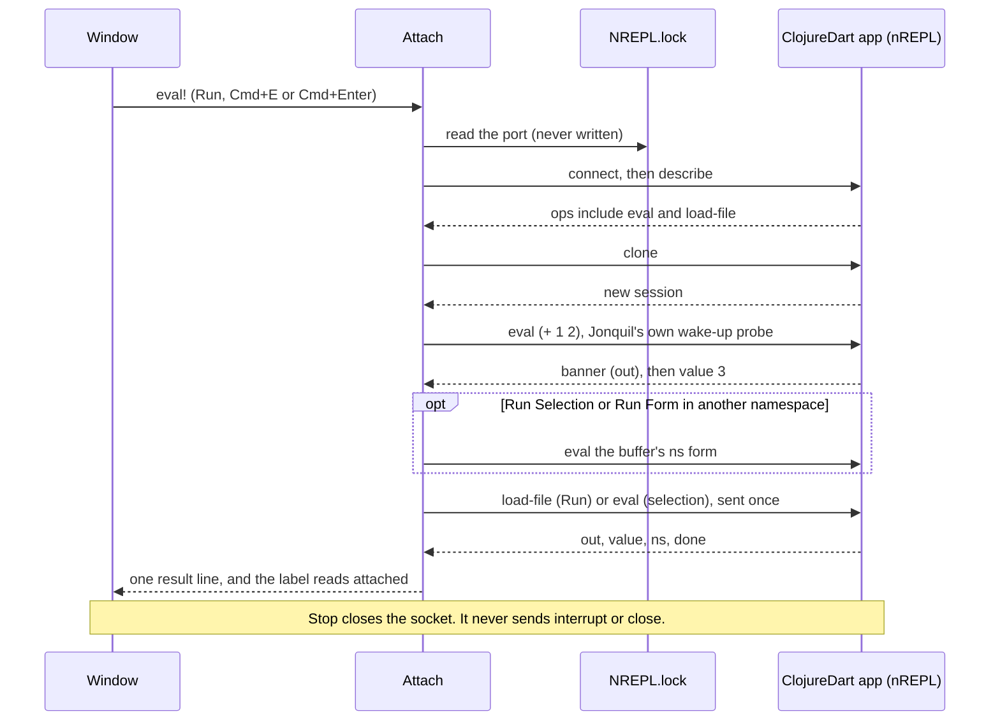

# Attached runtimes

Part of the [architecture notes](index.md): Jolt out of process, the shared attach lifecycle, and the evaluators that attach to a server you started. The dialect selection they plug into is in [Dialects and evaluators](dialects.md).

The full design record, with the reasoning and what was ruled out, is kept in `docs/history/architecture/attached-runtimes.md`.

## `jonquil.nrepl.*`: Jolt out of process

- `jonquil.nrepl.child` launches Jolt's nREPL server in the project directory on a port it scans for. It writes no `.nrepl-port` and never reads the project's. Readiness comes from a log line the child prints, never from the connection alone. Ending a child kills only the pid Jonquil spawned. The child exits when its stdin pipe closes, so even a crash of Jonquil takes it along.
- `jonquil.nrepl.client` keeps one socket and one reader per child. The reader dispatches replies by `:id`, so an interrupt and the eval it stops share a connection.
- `jonquil.nrepl.bencode` is the pure wire format, with a length cap so a hostile reply can't hang the process.
- `jonquil.nrepl.ops` translates nREPL replies to Jonquil's shapes and builds the reset form, which applies `jonquil.session`'s reset rule over the wire. Bookkeeping evals go through `keeping-history`, so the user's `*1`/`*2`/`*3` stay put.

`jonquil.nrepl.evaluator`'s `NRepl` record implements `Evaluator` on top: `start!` spawns and connects lazily (and refuses after `stop!`), `eval!` sends `load-file` for Run (with `file-path` only when the file on disk holds exactly the buffer's text, `session/saved-file`, since the child records it as the vars' `:file`; the same path binds `*file*`, so a Run of an unsaved or edited buffer has no `*file*` in the Jolt child, unlike the JVM child) or `eval` for the prompt, and `stop!` interrupts, then kills and restarts the child if that fails.

Every evaluator joins `jonquil.runtime-registry` when made. `jonquil.main` stops them all before exit, and `stop-all!` also runs from a shutdown hook for SIGTERM, SIGHUP and SIGINT. SIGKILL runs no hook; the stdin pipe covers that case.

## jonquil.nrepl.connection: the shared attach lifecycle

This namespace holds what every attach evaluator needs: the `Attached` protocol (`connected?`, `on-connection!`), `connect!`, `detach!`, `request!`, `stop-requested?`, and the `make-attached` multimethod (see the diagram in [Dialects and evaluators](dialects.md)). Each dialect supplies a connect policy (console sentences and what `:on-connect` adds to `:state`) and keeps its own run worker. The window tests `(satisfies? connection/Attached e)`, never a dialect's record.

## jonquil.nrepl.attach: ClojureDart, attached

`Attach` never starts anything. On first use it reads `NREPL.lock`, connects, calls `describe`, and clones one session, kept for the life of the connection.

- Run uses `load-file` and prints one `; Loaded <ns> (<n> forms)` line.
- The session namespace is tracked from replies' `:ns`. If it differs from the buffer's `ns` form, Run Selection and Run Form evaluate that form first.
- A fresh session gets a `(+ 1 2)` probe (retried once on nil) before user code. User code is never sent twice.
- Invariant: never send `interrupt` or `close`; a client-side interrupt wedges the app's watcher. Stop closes the socket, even mid-handshake, and the next eval reconnects.

`jonquil.cljd` is the pure half: console sentences, the `ns` form, the lock-file port, the probe verdict and the load summary, with no socket or GTK.

## jonquil.nrepl.jvm: JVM Clojure, attached

`Jvm` serves `{:dialect :clj}`. A JVM server honours `:ns`, so Run Selection and Run Form send it explicitly and Jonquil never sends the buffer's `ns` form; an unloaded namespace gets the not-loaded sentence. Run is a plain `load-file`, then the prompt moves to the buffer's namespace.

- **Auto-require:** on each fresh connection, `auto-require!` sends one `(require ...)` for the `:auto-require` list from `.jonquil.edn` (kept for `:clj` and `:jolt`). A failure is reported and the user's request still goes out. Jolt does the same, out of process and in process.
- **Stop:** sends `interrupt` if the server advertises it and waits up to `:interrupt-timeout-ms` (1 s); it detaches only if the evaluation hasn't ended by then, or the server lacks the op.
- **stdin:** `send-eof!` sends an empty `stdin` op only on nREPL 1.8.0 or later with a read waiting. Older servers get nothing, and the console says so once.
- **Help:** `complete` merges server and offline candidates. `lookup` uses the server's op and adds a `Defined in <file>:<line>` line. `lookup` and `full-doc` resolve `:ns` through `resolve-lookup!` (buffer namespace, then prompt namespace). `full-doc` runs off the GTK thread with a longer `:full-doc-timeout-ms`, because the first call downloads the ClojureDocs export.

`jonquil.clj` is the pure half: console sentences, the `ns` form, the connect policy and the reply decisions.

## jonquil.nrepl.generic: any nREPL server, attached

`{:dialect :nrepl}` reuses `Jvm` (`make-attached :nrepl`), because everything JVM-specific already degrades by the server's ops. `jonquil.nrepl.generic` holds the pure differences:

- `endpoint` and `port-file` read `.jonquil.edn`'s `:nrepl` map, and `selection-key` includes the endpoint, so a new host or port means a new connection.
- `limitations` is derived from the server's ops once connected, and `stdin-notice` warns before a Run that reads stdin on a server without the op.
- `with-prefix` trims cider `complete` replies, and `local-file?` drops lookup paths that aren't on this disk.
- Quick docs use `lookup`, else cider's `info`; `resolve-lookup!` retries a miss in the prompt namespace.
- `ops/error-message` extracts an error line from servers that send no `clojure.main` header, falling through to the first-line rule.

## jonquil.nrepl.shadow: ClojureScript, attached

`Shadow` serves `{:dialect :cljs}`. It connects to the shadow-cljs server you started (`.shadow-cljs/nrepl.port`) and never starts or signals it.

- A fresh session is Clojure, so the first eval after a connect sends `(shadow.cljs.devtools.api/nrepl-select :build)`. The build comes from `:cljs :shadow-build`, else the only build in `shadow-cljs.edn`.
- Run evals the whole buffer with no `:ns`. Shadow continues after a throw, so Run ends with a summary line, with errors already streamed.
- Run Selection, Run Form and REPL entries send `:ns`; a throw comes back as `:repl/exception!`.
- Stop detaches, since `interrupt` can't stop work in the JS runtime.
- `complete` and `eldoc` use the server's cider ops when listed, else the offline tables.

`jonquil.cljs` is the pure half.
