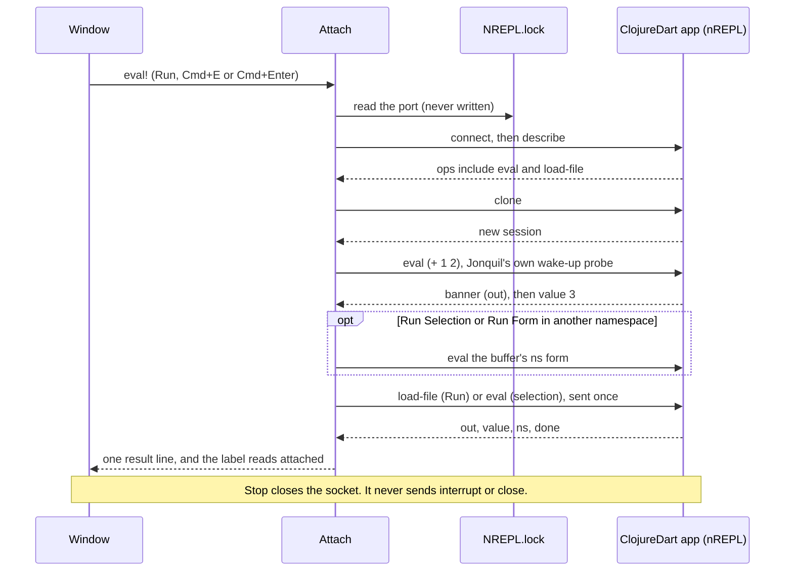

# Attached runtimes

Part of the [architecture notes](index.md): Jolt out of process, the shared attach lifecycle, and the evaluators that attach to a server you started. The dialect selection they plug into is in [Dialects and evaluators](dialects.md).

## `jonquil.nrepl.*`: Jolt out of process

Four namespaces make up the out-of-process runtime, with Jonquil's own
nREPL middleware (below, under the inspector) loaded into each child:

- `jonquil.nrepl.child` launches Jolt's nREPL server in the project
  directory (`jolt -e` calling `jolt.nrepl/start` with `{:port-file nil}`,
  wrapped the way `jolt nrepl-server` wraps it, so no `.nrepl-port` is
  written), with its middleware from `middleware-source`: a jolt-lang/nrepl
  checkout (`$JONQUIL_JOLT_NREPL` or `~/dev/jolt-lang/nrepl`), else a git
  dependency on jolt-lang/nrepl v0.4.0 (`nrepl-git-coord`), else none (a
  plain server); Jonquil's own middleware folder joins it either way, scanning ports `7950`-`7999` for one that binds on both the
  loopback and the wildcard address before trusting the child's own bind
  as the real attempt (a bare TCP connect can't rule out something else
  already listening there). Readiness comes from a log line the child
  itself prints once it's listening, never from the connection alone.
  Ending a child kills only the pid this namespace spawned, in order
  (`SIGTERM`, then `SIGKILL` if it's still alive a second later).
  Jonquil never reads or writes the project's `.nrepl-port` for its own
  child: it knows the port it picked. The child's stdin is a pipe Jonquil
  holds open, and a thread in the child exits it when the pipe ends, so a
  crash or SIGKILL of Jonquil, which runs no hook, still takes the child
  with it.
- `jonquil.nrepl.client` holds one socket and one reader for the whole
  life of a child. Its `connect` bounds the socket connect itself to 5
  seconds by default, so a port that never answers fails with an
  exception instead of waiting on the OS, and a connect that fails
  closes its socket before the exception reaches the caller. The reader decodes every reply
  and dispatches it by `:id` to whichever caller is waiting on it, so an
  interrupt and the eval it's meant to stop can share one connection
  without two readers racing each other for the same bytes.
- `jonquil.nrepl.bencode` is the wire format underneath that: pure
  encode and decode, with a length cap and integer validation, so a
  broken or hostile reply can't hang the process trying to read it.
- `jonquil.nrepl.ops` translates between nREPL's own reply shapes and
  Jonquil's: eval results, completion candidates, doc lookups, and the
  reset form. That form removes the running owner's namespaces and the
  REPL's, the ones the snapshots recorded, then removes and recreates
  `user`. It's the same rule `jonquil.session`'s reset applies locally,
  just run as code sent over the wire instead. Both the reset form and
  the namespace snapshot go through `keeping-history`, so the server's
  own `*1`/`*2`/`*3` shift after these bookkeeping evals leaves the
  user's history where it was.

`jonquil.nrepl.evaluator`'s `NRepl` record ties those four together
behind the `Evaluator` protocol: `start!` spawns and connects lazily, and
refuses to spawn at all once `stop!` has run; `eval!` sends a `load-file`
for Run or an `eval` for the REPL prompt; `stop!` interrupts whatever's
pending and, failing that within about a second, kills and restarts the
child instead. `jonquil.runtime-registry` is a further GTK-free namespace
that every evaluator a window makes joins as soon as it's made, so
`jonquil.main` can stop every one of them, and wait for any still mid-
start to settle, before the process exits. No child outlives Jonquil just
because the window that started it happened to close first. `stop-all!`
also runs from a `jolt.host` shutdown hook that `jonquil.main/-main`
registers, so SIGTERM, SIGHUP and SIGINT stop the children too. A crash or
SIGKILL can't run a hook and still leaves them running.

## jonquil.nrepl.connection: the shared attach lifecycle

`jonquil.nrepl.connection` holds what every attach evaluator needs and
none of them change: the `Attached` protocol (`connected?`,
`on-connection!`), `connect!`, `detach!`, `request!`, and
`stop-requested?`, plus the `make-attached` multimethod shown in the
diagram above. It was split out of `jonquil.nrepl.attach` without
changing any behaviour, so ClojureDart's own attach tests and self-test
rows still pass unchanged against it. A dialect's own namespace supplies
a connect policy (its console sentences, and what `:on-connect` adds to
`:state`) and the pieces that stay dialect-specific: `jonquil.nrepl.
attach` keeps the wake-up probe and the run worker for ClojureDart's own
fork, and `jonquil.nrepl.jvm` (below) keeps the JVM's own run worker,
Stop and help logic. `jonquil.gtk.window` checks `(satisfies?
connection/Attached e)` in place of an `instance?` test on any one
dialect's record, both for the status-bar label (`dialect/label`'s
`:attached`/not-running text) and for printing an attach evaluator's
`limitations` once it connects.

## jonquil.nrepl.attach: ClojureDart, attached

`jonquil.nrepl.attach`'s `Attach` record implements `Evaluator` too, and
it works nothing like the Jolt out-of-process one above: it never
starts anything. Connecting happens on demand, the first
time an evaluation finds no live connection, in the spec's own order:
read `NREPL.lock` for a port, connect, `describe` for the ops the app
offers, then `clone` a session. Each successful connect keeps exactly one
session for the whole life of the connection; a fresh one is only ever
cloned again after a detach.

Run goes through `load-file`, and its result is quiet on purpose: one
`; Loaded <ns> (<n> forms)` line instead of a value per top-level form,
built by `jonquil.cljd/load-result` from however many `:value` replies
came back. The session's namespace is tracked from every
reply's own `:ns` rather than asked for separately, and Run Selection
and Run Form pass the buffer as `:ns-source`: when the tracked namespace
doesn't match the buffer's own `ns` form, `run-worker!` evaluates that
form first, ahead of the code the user asked to run.

A freshly cloned session gets Jonquil's own probe, `(+ 1 2)`, ahead of
anything the user typed: `wake!` sends it once, and once more if the app
answers nil (a REPL that hasn't woken up yet after a hot restart), but
the user's own code is never sent twice, whatever the probe answers.

There's no interrupt and no close, ever: the fork's own connect skill
says a client-side interrupt wedges the app's watcher. Stop closes the
socket instead (`detach!`), including one that's still mid-handshake
(`connect!` publishes the raw connection as `:connecting` before
`describe` or `clone` can block on it, so Stop has something live to
close at once instead of waiting out either one's own timeout), and the
next evaluation reconnects with a fresh session. `on-connection!`
registers a listener `(f connected?)`, called from whichever thread
noticed the change, for a connection made or lost; the window's
status-bar label is the one thing listening today.

`jonquil.cljd` is this evaluator's pure half: every sentence the console
shows, the buffer's `ns` form, `NREPL.lock`'s port, the wake-up probe's
own verdict, and a load's one-line summary, all as plain functions over
text and reply vectors, with no socket and no GTK anywhere in the
namespace.

## jonquil.nrepl.jvm: JVM Clojure, attached

`jonquil.nrepl.jvm`'s `Jvm` record is the third attach evaluator, built
on the same `jonquil.nrepl.connection` as ClojureDart's, for a project
whose own `.jonquil.edn` says `{:dialect :clj}`. Where ClojureDart's
server ignores a request's `:ns`, a JVM server honours it, so Run
Selection and Run Form send it explicitly instead of switching the
session's namespace first, and Jonquil never sends a buffer's `ns` form
on its own: a namespace the server hasn't loaded yet gets the not-loaded
sentence and nothing else is sent. Run itself stays a plain `load-file`
with no `:ns` at all, the way any nREPL client's load-file works, and a
successful Run moves the prompt to the buffer's own namespace afterward.

On each fresh connection, after the inspect registration and before the
user's own request, `auto-require!` sends one `(require ...)` eval for
the selection's `:auto-require` list (parsed from `.jonquil.edn` by
`dialect/parse-config`, kept on the selection only for `:clj` and
`:jolt`). The connect policy's `:on-connect` resets `:auto-required?` to
false, so a reconnect requires again; a failure streams the server's
error, prints `clj/auto-require-failed-message`, and still sends the
user's request. Jolt does the same in two places: out of process,
`jonquil.nrepl.evaluator`'s `auto-require!` flags the `:runtime` map,
which every child start replaces; in process, `jonquil.session/auto-require!`
runs in `eval-async`'s `:before-eval` after `use-project-deps!`, once per
session, for the window's own project only.

Unlike ClojureDart, this server supports `interrupt` and `stdin`. Stop
marks the running evaluation and, when the server advertises `interrupt`,
sends it and gives the server up to `:interrupt-timeout-ms` (1 s) to
end it before Jonquil gives up and detaches instead, printing
`clj/interrupt-failed-message`; without the op, or when it doesn't take
in time, Jonquil detaches the same way. stdin sends a line through the
live session. `connect!` reads the server's nREPL version from `describe`
and keeps it in the evaluator state, and `send-eof!` sends an empty
`stdin` op only when that version is 1.8.0 or later and a read is
waiting. The waiting rule matters because 1.8.0 queues an EOF that
arrives early and would end the next read with it. nREPL 1.7.0 fails an
empty `stdin` op with a `ClassCastException`, so an older server, or one
that reports no version, gets nothing sent and the console prints a note
once per connection (`clj/limitations`, P0.1 in the arc's own spike).

`complete` merges the server's own completions into the offline
candidates, and `lookup` is backed by the server's own `lookup` op, with
a `Defined in <file>:<line>` line (`jonquil.help/location-line`) for a
definition outside the buffer: the server's `lookup` reply carries `file`
and `line` for on-disk code and jar entries alike, unlike ClojureDart's
fork. Both `lookup` and `full-doc` (the `FullDoc` protocol, opened by a
second quick-doc press) resolve their `:ns` through a shared
`resolve-lookup!`: the buffer's own namespace first, falling back once to
the prompt namespace when the server hasn't loaded it, and a not-loaded
result, never a silent "not found" or a hung full-doc request, when
neither answers without an error. `full-doc` runs in a future rather than
on the GTK thread, since it's asked for on demand rather than on every
keystroke: it's backed by clojure-cli.repl's own `doc` op, whose first
call downloads the ClojureDocs export into the server's own config
directory, so `:full-doc-timeout-ms` leaves room for several seconds
there, well past the 3 s a late `lookup` or `complete` answer is given
(`ev/ask-help!`, off the GTK thread).

`jonquil.clj` is this evaluator's pure half, the same split `jonquil.cljd`
draws for ClojureDart: the console's own sentences, the buffer's `ns`
form, the connect policy, and the reply decisions (`eval-result`,
`ns-not-found?`, `prompt-after-run`, `need-input?`), all as plain
functions over text and reply vectors, with no socket and no GTK
anywhere in the namespace.

The `Evaluator` protocol itself doesn't change for any of this: all
attach evaluators implement the same `start!`, `stop!`, `eval!`,
`interrupt!`, completion and lookup, history and prompt-namespace
surface the in-process and out-of-process runtimes already do.

## jonquil.nrepl.generic: any nREPL server, attached

The nREPL dialect (`{:dialect :nrepl}`) is the same `Jvm` record:
`connection/make-attached :nrepl` makes one, because everything JVM-specific
in it already degrades by the server's ops. `jonquil.nrepl.generic` holds
what differs, all pure:

- `endpoint` and `port-file` read `.jonquil.edn`'s `:nrepl` map (validated
  in `dialect/parse-config`); `connect-policy` gives `connection/connect!`
  an `:endpoint` and sentences that name the host. `connect!` now takes an
  explicit port before the port file and connects through
  `client/connect-to host port`, and `selection-key` carries the endpoint,
  so a changed host or port gets a new connection.
- `limitations` comes from the server's ops once connected (no `interrupt`,
  no `stdin`, no completion, neither `lookup` nor `info`) instead of the
  JVM's fixed list. `stdin-notice` is said before a Run or entry that reads
  stdin on a server without the op, and names the two behaviours measured:
  babashka's read blocks until Stop, Basilisp's reads the server process's
  own stdin.
- `with-prefix` trims cider `complete` replies, which the record now asks
  when a server has no builtin `completions` (babashka's are fuzzy), and
  `local-file?` drops a lookup's `:file` that isn't on this disk (babashka
  names one under its own working directory after a `load-file`, and a
  remote server's paths are its own disk's).

Quick docs pick their op in `jonquil.nrepl.jvm/lookup-op`: `lookup`, else
cider's `info`, which Basilisp offers instead (`ops/doc-info` reads both
reply shapes). `info` answers a namespace it doesn't know with a bare done
rather than an error, so `resolve-lookup!` retries a miss there in the
prompt namespace once, as it already did for `lookup`'s error.

Two changes reach every dialect through `jonquil.nrepl.ops`: `doc-info`
drops a blank `:file`, and `error-message` handles eval-errors with no
`clojure.main` header. When `:ex` is a class, the line is the last `:err`
line naming it, so babashka's `java.lang.ArithmeticException: Divide by
zero …` reads as that rather than the bare class. When it isn't, Basilisp's
shapes come next: the exception line of a Python traceback in `:err` (the
first unindented line after `Traceback (most recent call last):`), then the
`message:` line of Basilisp's compiler error block, then a traceback in
`:ex`. Each needs its literal marker, so other servers fall through to the
old first-line rule.

## jonquil.nrepl.shadow: ClojureScript, attached

`jonquil.nrepl.shadow`'s `Shadow` record is the newest attach evaluator,
built on the same `jonquil.nrepl.connection`, for `.cljs` files and any
project whose `.jonquil.edn` says `{:dialect :cljs}`. It connects to the
shadow-cljs nREPL server the user started, found through
`.shadow-cljs/nrepl.port`, and never starts, stops or signals it. A fresh
session is Clojure, so the first evaluation after a connect (and after
`:repl/quit` or `:cljs/quit`) sends
`(shadow.cljs.devtools.api/nrepl-select :build)`, which moves the session to
ClojureScript. The build is resolved on every connect from `.jonquil.edn`'s
`:cljs :shadow-build` or the only build in `shadow-cljs.edn`.

Run is one eval of the whole buffer with no `:ns`, since the buffer's own
`ns` form decides. Shadow answers one `:value` per form and keeps going after
a throw, so a Run never fails on per-form errors: it ends with a summary
line and the errors have already streamed to the console. Run Selection, Run
Form and a REPL entry send an explicit `:ns`, and a throw there comes back as
the `:repl/exception!` value, whose `:err` text becomes the error line.
Stop detaches, as for ClojureDart: shadow-cljs's `interrupt` stops nothing,
because the work is in the JS runtime. Completion (`complete`) and
lookup (`eldoc`) use the server's cider ops when `describe` lists them, and
the offline tables otherwise.

`jonquil.cljs` is the pure half, the same split `jonquil.cljd` and
`jonquil.clj` draw: the console's sentences, the build choice, the select
form, and the reply decisions, as plain functions with no socket and no GTK.
