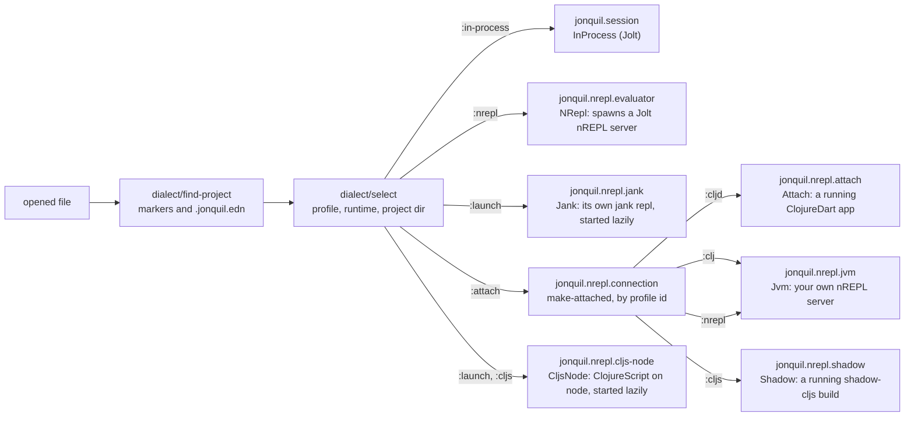

# Dialects and evaluators

Part of the [architecture notes](index.md). The runtimes themselves are in [Attached runtimes](attached-runtimes.md) and [Launched runtimes](launched-runtimes.md).

The full design record, with the reasoning and what was ruled out, is kept in `docs/history/architecture/dialects.md`.

`jonquil.dialect` holds every dialect as plain data: file extensions, the special-forms and builtins used for painting and completion, project markers, and the runtime keys offered. Profiles: `jolt`, `cljd`, `clj`, `jank`, `cljs`, `nrepl`.

- `find-project` walks up from a file to the nearest `.jonquil.edn` or marker. It never throws; a bad config becomes a warning.
- `select` returns the profile, runtime, project directory, where the choice came from, and warnings. The runtime is `.jonquil.edn`'s `:runtime` if offered, else the profile's `:project-evaluator` when a marker is present (Jolt: `:nrepl`), else its `:evaluator` (Jolt: `:in-process`).
- `selection-key` (dialect, runtime, project directory unless `:in-process`) tells a window whether a new file needs a new evaluator.

Windows talk to runtimes only through `jonquil.evaluator`'s `Evaluator` protocol. The `make` multimethod dispatches on `:runtime`, so requiring an implementation's namespace registers it. `:attach` forwards to `connection/make-attached`, dispatched again on profile id.

## The window's evaluator

A window keeps its evaluator in the atom `ev*`. When the path changes (Open, Save As), `apply-selection!` re-runs `select` and compares `selection-key`s. Equal keys keep the evaluator. Different keys interrupt and stop the old one off to the side while a new one registers and starts, and the inspector and source panels hide. A loose Jolt file in a Jolt window keeps the window's Jolt (`tabs/keeps-window-jolt?`).

For attach and jank evaluators, `watch-connection!` updates the status-bar label on the GTK thread via `on-gui!`. `apply-reset-toggle!` makes Reset on Run insensitive for `:attach`. Run Selection and Run Form pass the whole buffer as `:ns-source`; attach, JVM and jank evaluators use it to pick the namespace, Jolt ignores it.

## Plug points for more dialects

`jonquil.paint/paint-plan` takes the profile, so highlighting and completion are per dialect. A profile's `:port-file` (`NREPL.lock`, `.nrepl-port`, `.shadow-cljs/nrepl.port`) is most of what an attach runtime needs.

Still hardcoded for Jolt:

- `child/start!`'s launch args, port scan and log text, and the "Jolt" strings in `NRepl`.
- The namespace snapshot calls `loaded-libs`; without it, namespaces go unowned and Reset on Run stops clearing them.
- The offline help fallback always resolves against Jolt's `user` namespace.

jank has its own `:launch` runtime (see [Launched runtimes](launched-runtimes.md)).
