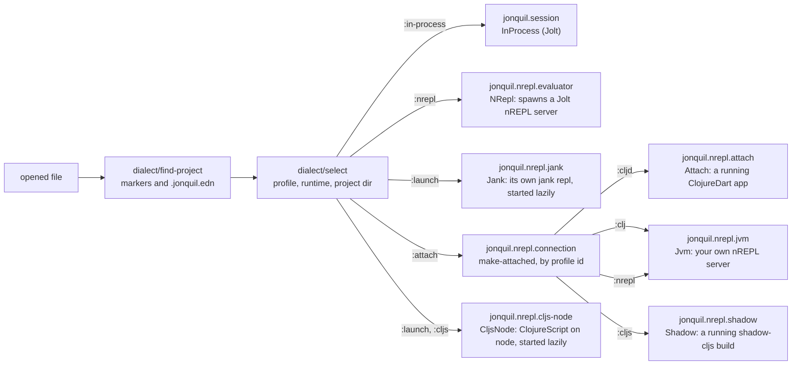

# Dialects and evaluators

Part of the [architecture notes](index.md). The runtimes themselves are in [Attached runtimes](attached-runtimes.md) and [Launched runtimes](launched-runtimes.md).

`jonquil.dialect` holds every dialect as plain data: a profile names its
file extensions, the `jonquil.syntax` special-forms and builtins sets it
paints and completes against, its project markers, and which runtime keys
it offers. `profiles` lists every known one, `jolt`, `cljd`, `clj`, `jank`, `cljs` and `nrepl`
today.
`find-project` walks up from a file to the nearest directory holding
`.jonquil.edn` or a marker, reading and parsing the config along the way
without ever throwing: an unreadable or malformed file becomes a warning,
not a crash. `select` turns a project, a path, and a settings default
into one selection: the profile, the runtime, the project directory (for
anything other than `:in-process`), where the choice came from, and any
warnings the window should show. The runtime is `.jonquil.edn`'s
`:runtime` when the profile offers it; otherwise the profile's
`:project-evaluator` when the project holds one of that profile's own
markers (Jolt's is `:nrepl`, for a `deps.edn` folder), else its
`:evaluator` (Jolt's is `:in-process`). So a Jolt project runs out of
process by default and a loose file in process. `selection-key` is what a window
compares before deciding a new file needs a new evaluator: the dialect,
the runtime, and, when the runtime isn't `:in-process`, the project
directory too.

Every window talks to its runtime through `jonquil.evaluator`'s
`Evaluator` protocol: `start!`, `stop!`, `eval!`, `interrupt!`, completion and lookup,
history and prompt namespace, all independent of whether the code
underneath runs in this process or somewhere else. `jonquil.session`'s
`InProcess` record, described in the [architecture notes](index.md#jonquilsession-and-the-o1-reset-rule), is the original implementation and
still the one every window starts with by default. The `make` multimethod
dispatches on a selection's `:runtime`, so requiring a new
implementation's namespace is what registers it; `jonquil.nrepl.
evaluator` is the second one, `jonquil.nrepl.jank` registers `:launch` as
the third, and every `:attach` runtime is another:
`ev/make :attach` forwards to `jonquil.nrepl.connection`'s own
`make-attached` multimethod, dispatched a second time on the selection's
profile id, so `jonquil.nrepl.attach` (`:cljd`), `jonquil.nrepl.jvm`
(`:clj`, and `:nrepl` for the nREPL dialect, on the same record) and
`jonquil.nrepl.shadow` (`:cljs`) each register their own method rather
than sharing one `:attach` implementation.

## The window's evaluator

Each window keeps its evaluator behind one atom, `ev*`, made from
`jonquil.dialect/select`'s first answer for whatever path the window
opened with. An `add-watch` on the window's own path atom re-runs `select`
every time Open or Save As changes it, and `apply-selection!` compares the
new selection's `selection-key` against the old one: an equal key keeps
the running evaluator (opening a second file from the same nREPL project,
say), and a different one swaps it: the old evaluator is interrupted and
stopped off to the side while a new one joins the registry and starts. A
loose Jolt file in a Jolt window is the exception and keeps the window's
Jolt (`tabs/keeps-window-jolt?`). A swap hides the inspector and source
panels, and when focus was inside one of them it moves to the active
tab's editor.

For an attach or jank evaluator, the status-bar label follows its connection too:
`watch-connection!` registers an `on-connection!` listener the moment
`apply-selection!` makes one, which hands the label update to the GTK
thread through `on-gui!` whenever the connection is made or lost, and
does nothing once the window has moved on to a different evaluator.
`apply-reset-toggle!` keeps Reset on Run in step with the runtime the
same way: insensitive with a tooltip for `:attach`, sensitive with none
for everything else. Run Selection and Run Form both pass the editor's
whole buffer as `:ns-source` in their eval options. The attach, JVM
Clojure and jank evaluators read it to decide which namespace to
evaluate in, and the Jolt ones ignore it.

## Plug points for more dialects

Besides Jolt there are five more dialects: ClojureDart, JVM Clojure, ClojureScript,
jank, and the nREPL dialect (any nREPL server, on JVM Clojure's evaluator). The
attach ones already use two of these plug points. `jonquil.paint/paint-plan` takes the active
profile as an argument, so highlighting and completion both draw on each
profile's own `:special-forms` and `:builtins` rather than Jolt's alone.
A profile's `:port-file` is most of what an attach runtime needs:
`jonquil.dialect/cljd` names `NREPL.lock` and `jonquil.dialect/clj`
names `.nrepl-port`, `jonquil.dialect/cljs` names `.shadow-cljs/nrepl.port`
and `jonquil.dialect/nrepl` names `.nrepl-port` too (overridable from
`.jonquil.edn`), while `jonquil.nrepl.connection` holds the connect,
describe, clone and detach lifecycle all four share.

A few places are still written for Jolt rather than read from a
profile, though. `child/start!`'s launch args, its port scan, and the log text it
waits for are all Jolt-specific. The console strings inside `NRepl`
spell out "Jolt" by hand rather than reading a profile's name. The
namespace snapshot calls `loaded-libs`, and a dialect without it would
make every snapshot fail. That doesn't stop an evaluation, but its
namespaces would go unowned, so Reset on Run would stop clearing them. And
the offline help fallback always resolves against Jolt's own `user`
namespace, whichever dialect asked. jank didn't reuse that
launcher: its runtime is `:launch`, with its own `make` method and its
own child namespace (see [Launched runtimes](launched-runtimes.md)).
