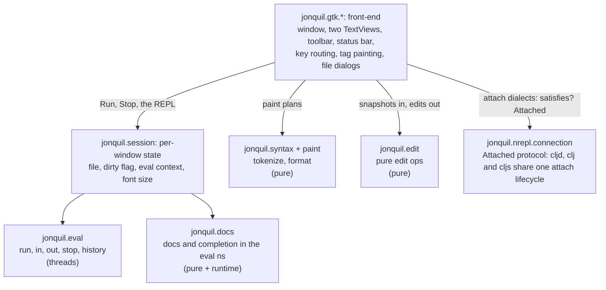
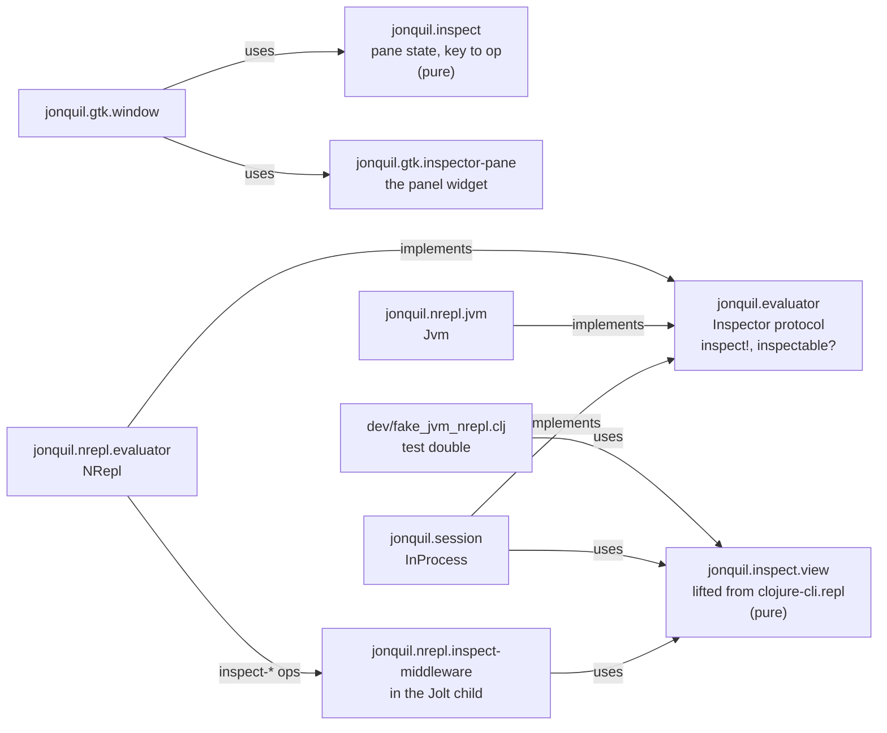

# Jonquil Architecture

## Design

Jonquil is a port of DrClojure's idea to Jolt: a Clojure IDE with a Definitions editor, an Interactions console, Run and Stop that actually stops. The design splits into layers.



Phase 3, the Themes phase and the later arcs added these pure namespaces alongside
these:

- `jonquil.commands`: the run-selection text, the form Run Form sends,
  the pre-Run bracket check, next/prev match, replace-current and
  replace-all, the format operations, and the zoom sizes.
- `jonquil.keymap`, `jonquil.command-registry` and the `jonquil.plugin*`
  namespaces: see [Commands, keys and plugins](commands-keys-plugins.md),
  below.
- `jonquil.theme`: the four palettes as data, the five choices
  (`choice-names`, `choice?`), `resolve-choice` (which turns `auto` into
  light or dark), `theme`, `next-theme` and `code-css`.
- `jonquil.settings`: `settings-path`, `load-settings` (never throws) and
  `save-settings!` (atomic, never throws).
- `jonquil.last-session`: the tabs to reopen, kept per tree root in
  `sessions.edn` beside the settings file. It's a separate file because
  `settings.edn` is hand-edited and may be a dotfiles symlink, while this one
  changes whenever the tabs do. `load-sessions` and `save-sessions!` never
  throw, and `remember` and `entry-for` are pure. When no file was named,
  startup picks the entry (and re-roots the tree) before the window is
  shown. `reopen-later!` then waits for the window's first painted frame
  (the frame clock's `after-paint`, or one second if no frame comes) and
  opens them all in one main-loop turn, so the window appears without
  waiting for them and nothing the user does can land between two of
  them. A quit before then cancels it and saves nothing, since the tabs
  open are only part of the list. After the reopen the window saves as the tabs
  change:
  `refresh-labels!` (every open, close and path change) and `on-switch!` call
  `session-changed!`, which writes only when the `{:root :tabs :active}`
  snapshot differs from the last one written. It does nothing until
  startup's own reopen is done, since the first Untitled tab would otherwise
  overwrite the list it's about to reopen, and the state startup ends in is
  only recorded, not written, so a launch on one file leaves the folder's
  list alone until a tab changes. The real-quit
  branch of the close-request handler turns that off, then saves once more,
  next to the tree's width. Each saved path goes through the same
  `open-file!` as Open, and a path that fails, or throws, is named on the
  console instead of stopping the rest.

P4 added `jonquil.help`, the decisions behind completion, quick
doc, jump to definition and rename, covered in its own section below.

- `jonquil.file-tree`: the file tree's model as plain data: `{:root :expanded :ignore}`, listing one folder (ignore rules, folders first), flattening the expanded tree into rows (a symlink back to an ancestor shows collapsed instead of recursing), `expand-to` for a saved file, the launch root (`root-for`), and a directory's own project selection (`project-selection`, since `dialect/find-project` starts at a path's parent).
- `jonquil.save-path`: where a save really writes and the temp file it writes through, as plain `java.nio.file` calls. `resolve-target` follows symlinks by hand, each relative link against its parent's real location, because `.getCanonicalPath` on this Jolt returns a dangling link's own path and a rename onto that path would replace the link; it gives up after 40 hops, so a link loop fails. `create-temp!` creates the temp file owner-only when the target exists, so new content never sits in a file wider than the owner's. `jonquil.gtk.window`'s `save-to!` writes the editor text into a temp file in the resolved target's directory, copies the target's permissions onto it, then renames it over the target with `ATOMIC_MOVE`, so a failed write never leaves a half-written file and a symlink is updated rather than replaced. The tab counts as saved only once the rename succeeds; any failure deletes the temp file and prints an error naming the user's own path.
- `jonquil.tabs`: the window's tabs as plain data: the strip's labels, finding a file that's already open (compared canonically), whether a tab may run in the window's evaluator (`runnable-here?`: the same `dialect/selection-key`, or a Jolt file outside any project in any Jolt window), whether a lone tab keeps the window's Jolt instead of switching it (`keeps-window-jolt?`), and the text of the refusal, the unsaved-changes alert and the Run banner.
- `jonquil.source`: where a definition outside the buffer lives and its text, from a lookup's `:file` (an absolute path or a `jar:file:…!/entry` URL, read locally with `java.util.zip.ZipFile`), whether it can be edited (a plain file under the project), line arithmetic, and the source panel's bounded history.

The inspector arc added two more: `jonquil.inspect.view`, the inspector's view
code lifted from clojure-cli.repl (`UPSTREAM.md` carries the provenance
row), and `jonquil.inspect`, the panel's own pane state and its key-to-op
decisions. Both are covered in their own section below, alongside the
`Inspector` protocol.

`jonquil.console` is the console's own pure half: what Return does with
the text at the prompt, how much old output to trim, how a result is
shown, where the last entry starts for Clear Last Output, and a friendlier
message for an unclosed bracket. `jonquil.core` holds only the app's name.

The front-end and the core use plain data to communicate. When the user edits, the GTK TextBuffer sends a snapshot to the core:

```clojure
{:text "..." :caret 42 :sel-start 40 :sel-end 45}
```

An edit operation returns data for the front-end to apply:

```clojure
{:edits [[start end "replacement"] ...]
 :caret 44
 :sel   [44 44]}
```

The front-end applies each edit in reverse order within one `gtk_text_buffer_begin/end_user_action` call, so undo sees one step.

## GTK is not everywhere

The GTK layer is required only from `jonquil.main` and `jonquil.mcp.window` (which takes just `gtk.callbacks`, `gtk.editor` and `gtk.ffi`, never `gtk.window`). All of the pure core (tokenization, parsing, syntax highlighting, edit operations, the eval engine) runs without GTK or any GUI dependencies. This design lets the core be tested independently and potentially reused by a second front-end later.

Nothing enforces this automatically, which is why it is a rule. Jolt's build scanner follows `require` forms statically, so a `jonquil.gtk` namespace required from anywhere else would silently compile GTK into every binary built from that namespace, headless tools included. Phase 2 added the GTK libraries to `:jolt/native` in `deps.edn`.

## The GTK layer

`jonquil.gtk.*` started as six namespaces, each with one job:

- `jonquil.gtk.ffi`: the raw GTK4/GLib/GObject/pango bindings, plus the low-level GtkTextIter/mark helpers everything else builds on.
- `jonquil.gtk.callbacks`: the `callable` macro that turns a Clojure function into a retained, `:collect-safe` foreign-callable (GTK invokes callbacks from inside its own blocking main loop, so a collected one would crash it). It also contains every callback: a throw never reaches GTK, where it would end the process, but is reported on stderr while the callback answers a safe value for its return type, or its own `:on-throw` (the editor's dirty-check timer answers 1 to keep running). Handlers people trigger directly also report on the window, the way the editor's and console's key handlers do. The namespace also holds `on-gui!`, the one function safe to call from any thread to hand a thunk to the GTK main thread.
- `jonquil.gtk.editor`: the Definitions editor, a GtkTextView wired to `jonquil.paint` for live syntax highlighting and `jonquil.edit` for smart Enter. Its repaint after an edit keeps a baseline of what its tags show now (`:painted`). On a future, off the GTK thread, it computes the new plan and `paint/plan-diff` against that baseline, then applies only the changed range a chunk per main-loop turn, nearest the caret first. With no baseline it falls back to a full `paint-async!`. `dirty?` compares lengths before it copies the buffer, and `jonquil.syntax/tokenize` reuses its last result when it gets the identical string again, so a 20,000-line file stays responsive while typing. Its `handle-key!` dispatches the rest of the editor's keys through `jonquil.command-registry/editor-answer` (see `jonquil.keymap` above): the preedit yield, the completion popup, the `:editor` keymap, then its typing stages, sending edit ops through `apply-op!` so each one lands as a single user action, and every handler yields during IME preedit.
- `jonquil.gtk.find-bar`: the find and replace bar, with its own `handle-key!` and match highlighting through a `search-match` tag.
- `jonquil.gtk.console-view`: the Interactions console, one GtkTextView whose buffer holds read-only output history, an editable prompt and input region, and the key handling for Return, Up/Down and Ctrl/Cmd+D.
- `jonquil.gtk.window`: the toolbar, the paned layout, the window-level key chords (all of them through `jonquil.command-registry/window-answer` and the keymap, see `jonquil.keymap` above), the file dialogs, and the wiring between `jonquil.session` and the two views.

P4 added these, and the command palette joined them in plugins S8, all built on a shared popover base:

- `jonquil.gtk.popover`: a caret-anchored `GtkPopover`, shared by completion, quick doc, full doc, rename and the command palette.
- `jonquil.gtk.help-popover`: the quick-doc popover, the full-doc popover a second quick-doc press opens, and the rename popover, all built on `jonquil.gtk.popover`.
- `jonquil.gtk.palette`: the command palette popover, one per tab, built on `jonquil.gtk.popover` like rename: an entry over a list of `jonquil.palette` entries. It hides before it runs the picked command, then gives the editor focus back once GTK has finished closing it, unless the command focused something of its own.
- `jonquil.gtk.completion`: the completion popover, one instance per view (the editor and the console's input line), also built on `jonquil.gtk.popover`.

This arc added one more, outside that popover base: `jonquil.gtk.inspector-pane`, the inspector panel widget, covered in its own section below.

- `jonquil.gtk.file-tree-pane`: the file tree widget: a header (root name, refresh, Open Folder…) over a `GtkListBox` rebuilt from the model's rows on every change. A click or a key decides which path it acts on at once, then rebuilds on the next main-loop turn, because a rebuild removes the very row whose signal is running. The window holds it in an outer horizontal paned left of everything else, and the ☰ Files `GtkToggleButton`'s `toggled` handler is the one place that shows, hides and saves it.
- File operations in the tree: `jonquil.file-ops` is the disk side, where every function returns `{:error ...}` rather than throwing (new file, new folder, rename that never overwrites and allows a case-only change, the name checks, `trash-message` and `hidden-message`). `jonquil.gtk.trash` calls `g_file_trash`, so the system Trash is the only way anything leaves the tree and nothing is deleted permanently. The pane's right-click menu is one `GtkPopover` parented on the pane's root box, not on the list. `jonquil.gtk.popover` records a GtkTextView hanging at dispose over a foreign child, and a plain GtkBox parent was measured to destroy cleanly. It swaps between the item list and a name entry, and its target lives only in that popover's state. The window does the work: it retargets open tabs to a renamed path (the same `:path` reset Save As does), refreshes the tree after any failure since the disk may have changed partway, and writes the trash and hidden-name lines to the console.
- `jonquil.gtk.tab`: one tab's widgets: an editor with its find bar, the four popovers parented on its view (quick doc, full doc, rename, completion) and the label box the notebook shows. `dispose-popovers!` hides and unparents them before the window removes the tab's page, because removing a page with a popover still parented spins GTK in a warning loop, and unparenting drops a popover's last reference. The window (`jonquil.gtk.window`) keeps the tabs in a vector inside a `GtkNotebook` and resolves the active tab whenever an action runs; closures built per tab capture their own tab.
- `jonquil.gtk.source-pane`: the read-only source panel: a header, a read-only `jonquil.gtk.editor`, Open in window and Close, and a footer for hints, notes and errors. Since 2026-10-19 it shows only jar entries and files outside the project: a jump to a project file goes to its tab instead (`jonquil.gtk.window/open-in-tab!`, with `jump-back!` on Cmd/Ctrl+[ walking a window-wide stack of where each such jump started). It shares the window's right-hand slot (a vertical GtkBox) with the inspector, one visible at a time. Its editor paints with `paint-async!`, which computes the paint plan on a future and applies it a chunk per main-loop turn, nearest the caret first, so an 8,000-line library file never holds the GTK thread.

### `on-gui!` and the worker-to-GTK-thread path

The eval engine's callbacks (`on-output`, `on-wait-input`, `on-status-change`, `on-complete`) run on the eval worker thread, never the GTK thread. GTK itself may only be touched from its own main thread, so every one of those callbacks follows the same rule: enqueue and return, never call GTK directly, never block. `jonquil.gtk.console-view/append!` queues a `[kind text]` chunk and schedules a drain; `jonquil.gtk.callbacks/on-gui!` queues an arbitrary thunk. Both are safe from any thread for exactly that reason, and both coalesce: several worker-thread calls landing between GTK ticks turn into one drain, so a flood of output doesn't starve the main loop.

### The console buffer layout

The Interactions console is one GtkTextBuffer laid out as


Output history and the prompt carry a read-only tag, which is what stops typing, pasting or Backspace from reaching into old output; GtkTextView's own edit path already refuses edits under that tag. `out-end` is a mark with right gravity: `append!` always inserts at it, so new output lands before the prompt and the mark tracks past it. `input-start` is a mark with left gravity: text typed at it stays after it, and output inserted earlier in the buffer pushes it forward automatically. Committing an entry (Return, when it evaluates or sends stdin) moves both marks explicitly to open a fresh prompt after the old input, rather than relying on gravity for that step. The prompt names the session's namespace (`user=> `, `demo.core=> `): the view keeps its current text, and `set-prompt!` rewrites the region between the two marks in place, keeping the typed input and the caret. The window calls it with the evaluator's `prompt-ns` after every evaluation, when it switches evaluators, and when an attach connection comes or goes.

The console reads its busy/waiting state live from the engine (`:evaluating?`/`:waiting?`, functions supplied at construction) rather than mirroring it into a console-owned atom. A mirror set right after starting an eval could lose a race against a fast eval's own completion clearing it first, stranding the console in a busy state with nothing left to un-strand it.

### `jonquil.session` and the O1 reset rule

`jonquil.session`'s `InProcess` record holds one window's in-process evaluation state: the eval context, the current mode (`:reset` or `:accumulate`), the prompt namespace, and the namespaces each owner created, a map from owner to a set. It's the original, and still the default, implementation of the `Evaluator` protocol described below. Run and the REPL both call through the same `evaluate!` path into `jonquil.eval/eval-async`, so the engine itself never distinguishes them. Making one also points Jolt at the window's project: `jonquil.project-roots/use-project!` adds the project's `deps.edn` `:paths`, made absolute, after the roots Jolt started with (so a project can't shadow the IDE's own namespaces in this shared process; captured once, so a switch replaces rather than piles up), through `jolt.host/set-source-roots!`, the same seam `jolt.main` uses; a Run of a file in another in-process project switches the session's project instead, since the window keeps one evaluator for those, and the next evaluation's roots follow it. Without it, a project kept in process couldn't require its own namespaces, and with absolute roots Jolt records an absolute `:file`, which jump to definition opens. That call sets `:paths` only, which needs no network. Each evaluation then resolves the whole `deps.edn` on its worker, through `eval-async`'s `:before-eval` hook (`use-project-deps!`, `jolt.deps/resolve-project`, the CLI's own resolver), so a first fetch of a git or Maven dependency never holds the GTK thread; the answer is cached per edit of `deps.edn` or the user `deps.edn` (a `:local/root` dependency's own `deps.edn` isn't watched), a failure for 30 s only, so a network blip heals on a later Run; a failure leaves the roots at `:paths` with a line on the console, and a Stop during a fetch stops the evaluation rather than counting as a failure. A REPL entry uses the project the last Run used. A Run itself evaluates the buffer's text with `load-string`, where Jolt turns the reader's file off on purpose, so its vars get a line but no file; a Run of a file whose text on disk is exactly the buffer's snapshots the program's vars first (every namespace that isn't a loaded library) and gives the file to each var whose metadata the Run replaced and that has a line and no file (`mark-run-file!`), so F12 from another tab opens it. The marking runs in `jonquil.eval/eval-async`'s `:before-idle` hook, on the Run's worker before the context goes idle, so no REPL entry can define a var in between. A var a REPL entry defined earlier keeps its metadata and isn't marked; a buffer with unsaved edits isn't marked at all, since its lines don't match the file.

The O1 spec decision is that Run resets by default: in `:reset` mode, `run-definitions!` first removes the namespaces its owner created, then the REPL's, then `user`, and recreates a fresh `user` and evaluates into it. Loaded libraries are never owned, so they stay. An owner is whatever `eval!`'s `:owner` option names: the window passes a tab's id for Run, Run Selection, Run Form and Inspect Form, and a console entry falls back to `:repl`. A tab that closes hands its set to `:repl` (`jonquil.evaluator/Owners`, `release-owner!`), so the next Run from any tab clears it. Unchecking the toolbar's Reset on Run checkbox flips the session to `:accumulate`, and Run stops clearing first, building on whatever earlier evaluations already defined, the same way the REPL prompt always does. The out-of-process nREPL runtime applies the identical rule, just over the wire. Around every evaluation it asks the child for its namespaces and loaded libraries (`ops/ns-snapshot-code`, about 1 ms), and its reset form removes the owner's set on the child instead of on this process. The snapshot prints its data and returns the old `*1`, having pre-shifted `*1` and `*2`, so the server's own history shift leaves `*1`, `*2` and `*3` where the user had them. The same eval refers `doc`, `find-doc`, `apropos`, `dir`, `pprint` and `pp` into the session's namespace, inside its own `try`, the way the in-process engine does. So Reset on Run, the history vars and the helpers mean the same thing whichever evaluator is running underneath them.

### Self-test harnesses

Two `bb` tasks drive the real GTK front end from inside the process, without a human at the keyboard:

- `bb gtk:selftest` opens ten real GTK windows in turn, one per group: the front end, the full window, out-of-process Jolt, ClojureDart, JVM Clojure, the file tree, jank, launch arguments, shadow-cljs and ClojureScript on node. Each drives the same button and key handlers a person would use, against a fake server or a fake child where the real one would need a toolchain. [Development](../development.md#self-test-and-docs-ten-windows-one-binary-one-camera) describes every group and its rows.
- `bb docs:shots` self-captures `docs/images/*.png` and one GIF for this guide and the user guide: one fresh `jolt -M:shots <scene>` process per scene, each driving `jonquil.main/start!` through exactly one demo, screenshotting it with `cgevent`, then exiting. A fresh process per scene keeps each screenshot to its own scene's console history.

Both poll a condition against a deadline rather than sleeping, and both hand any blocking subprocess call (screenshots, GIF recording, the nREPL window's own child) to a `future` so the GTK thread itself never blocks. See [Development](../development.md) for how to run these tasks, the split layout of `dev/gtk_selftest_window/`, the binary smoke, and the traps that catch a first run.

`bb smoke:binary`, `bb smoke:cljd` and `bb smoke:cljs` drive a built `./jonquil` from outside instead, sending real key events with `cgevent`; [Development](../development.md) describes them.

### Themes

Applying a theme doesn't rebuild anything: each component's `apply-theme!` retints its existing tags in place, so text, undo history and highlights all survive the switch. The window then reloads its one CSS provider, the same one zoom uses, from `theme/code-css`, and sets `gtk-interface-color-scheme` on GtkSettings to `DARK` or `LIGHT` so GTK's own chrome follows along.

The window keeps two atoms for this. `theme-name` is the palette on screen (always one of the four), and `theme-choice` is what the person picked (one of the five, and the one that gets saved). Every path that changes the choice goes through `apply-choice!`, which resolves it with `theme/resolve-choice` and applies the result. When the choice is `auto`, the answer comes from `jonquil.gtk.appearance/system-dark?`. GTK reports no system preference on macOS (`gtk-interface-color-scheme` reads 0, unsupported), so that namespace asks AppKit through the Objective-C runtime for `NSApplication`'s `effectiveAppearance` name and treats a name containing "Dark" as dark. It returns nil on any failure and off macOS, which resolves to light.

A 1-second GLib timeout runs only while the choice is `auto`. What's installed is the poll callback built in `activate!`, and it calls `poll-tick!`, which re-asks `system-dark?` and applies the palette only if it differs from `theme-name`. A failed read (nil) during the poll leaves the palette as it is. The tick doesn't touch the status bar or the settings file. Picking another choice doesn't stop the timeout directly: its next tick, within about a second, returns 0 and GLib drops it. In the real app the window followed a macOS flip to Light and back to Dark, each within 0.87 s.

Isolation matters here too: self-tests and `bb docs:shots` pass a temp `:settings-path`, and `bb smoke:binary`, `bb smoke:cljd` and `bb smoke:cljs` set `XDG_CONFIG_HOME` to a temp directory, so none of the harnesses ever touches the user's real settings file.

### Help: completion, quick doc, jump and rename (P4)

`jonquil.help` holds every pure decision behind the four P4 features, the same split `jonquil.commands` and `jonquil.edit` already draw between deciding and doing. It never touches GTK or the running program; it works on the editor's own snapshot shape (`{:text :caret :sel-start :sel-end}`) and on plain data the GTK layer passes in.

Completion's state moves through a small set of functions: `prefix-at` reads the word before the caret (or nil, when there's a selection or nothing to complete), `open-state` turns a prefix plus a candidate list into the popup's state map, `move` steps the selection with clamping, `commit-op` is the edit that replaces the prefix with the chosen candidate, and `still-valid?`/`refine` decide whether an open popup survives the next keystroke or needs to close. `target` is shared by quick doc, jump and rename: the selection when it's exactly one symbol, otherwise the symbol at or around the caret.

Jump to definition is the one place `jonquil.help` overrides upstream's own logic rather than reusing it outright. `jonquil.syntax/find-definition` (lifted unchanged from DrClojure) checks top-level `def*` forms first and only then falls back to a scope-less "last earlier token with this name", which gets a shadowed local wrong: a function parameter or a `let` binding that reuses a top-level name should win, and an unbound name should report nothing rather than landing on an earlier use of it. `jonquil.help/jump-target` fixes this with a real scope search first: it walks the parenthesized forms enclosing the target, innermost first, collecting the names each one binds (`let`/`loop`/`binding`/`when-let`/`when-some`/`when-first`/`if-let`/`if-some`'s own bindings vector, `for`/`doseq`'s bindings vector, `fn`/`defn`/`defn-`/`defmacro` params for every arity, and `letfn`'s names), unpacking vector and map destructuring recursively along the way. Only when that search comes up empty does it call `find-definition` with no position at all, which runs just its top-level half; an external var's documentation is the last fallback. `rename-problem` mirrors `jonquil.edit/rename`'s own nil cases (no symbol at the caret, a blank or invalid new name, the same name, nothing to rename) as a sentence for the rename popover to show instead of applying anything.

`jonquil.docs` resolves lookups in the namespace the user's program actually runs in, not the IDE's own. When that namespace no longer exists, because Reset on Run just removed it, `resolve-ns` falls back to `user` rather than letting `the-ns` throw. Both `symbol-doc` and `candidates` wrap their real lookup in `try`/`catch` and return nil (or `[]` for candidates) on any exception, so a bad lookup never escapes into a key handler. `symbol-doc` also memoises on `[namespace symbol text]`: looking up a name defined only in the buffer costs 6.5 ms on a 2,000-line file and 26 ms on 8,000 (measured 2026-10-20), too slow to repeat on every arrow key, which is why a hit (0.01 ms) matters. The cache is cleared after every completed evaluation, Run or REPL alike, from the same `on-complete` callback in `jonquil.gtk.window` that already reports the result; without that, a lookup made before a name existed would go on returning its stale answer forever after, even once the same evaluation had defined it.

The three popover namespaces share `jonquil.gtk.popover` as their base. Its most important fact is where a popover's `GtkWidget` parent is: never the `GtkTextView` it's anchored to, always that view's own container (its `GtkScrolledWindow`, in both the editor and the console). Parenting a popover directly to the text view, which is what the P4 spike probes did, hangs a real window close: `GtkTextView`'s own dispose walks its structural children to detach them, doesn't recognise a popover as one of its own, and spins forever logging that the popover isn't a child of the text view, pinning the main thread at 100% CPU. The probes themselves never hit this because every probe process exits without ever destroying its window. A `GtkScrolledWindow` has no such override and tears down cleanly. `jonquil.gtk.window` keeps a registry of every P4 popover a window creates (`register-popover!`), and `close-popovers!` walks it to hide whichever one is open, whether that's Escape's own job or one popover making room for another. At window close, `close-request-fn`'s real-quit branch calls `unparent-registered-popovers!`, which hides an open popover before unparenting it (unparenting first would leave its `:open?` atom reading true against a widget that no longer exists, and a later focus-lost listener would then call `hide!` on it and hit a GTK-CRITICAL) and skips an entry that's already unparented, so the session's popovers detach cleanly instead of leaving `GtkScrolledWindow` still holding a child when it finalizes.

`jonquil.gtk.help-popover` builds the quick-doc popover (autohide off, so it never steals keys from the view, per `jonquil.gtk.popover`'s own autohide note) and the rename popover (autohide on, since its entry needs to receive typing; GTK itself closes it on Escape or a click outside, and a `"closed"` signal handler keeps the popover's `:open?` bit in sync when that happens with no call into this namespace at all). `jonquil.gtk.completion` is one popover per view, a candidate list over a doc preview, built once per view and reused for the rest of the session; `open!`, `refine!` and `commit!` all read `(popover/open? c)` rather than trusting the state atom directly, because a close driven from outside this namespace (the window's registry-wide `close-popovers!`) only ever calls the generic `popover/hide!` and has no idea this namespace's own state atom exists.

The editor's and the console's context menus (Shift+F10, or a right click) come from `gtk_text_view_set_extra_menu`, which appends to GTK's own Cut/Copy/Paste menu rather than replacing it. `install-context-menu!` builds a `GMenu` alongside a matching `GSimpleActionGroup`, inserted on the view under the `"p4"` action-group prefix, with one action per item. The items come from `jonquil.command-registry/menu-items`, so each one runs the same command its keyboard chord runs. Every action's own `"activate"` callback runs inside `try`/`catch`: an uncaught throw from a `GSimpleAction` callback kills the process outright, so this is the one place every menu item, current and future, is guarded at once.

None of these ask a server on the GTK thread. An evaluator whose help asks one implements `ev/ServerHelp` (every attach evaluator, out-of-process Jolt and jank), and the window asks it through `ev/ask-help!`: the request runs on a worker with `ev/*help-timeout-ms*` bound to 3000 ms in place of the evaluator's own 300 ms, and the GTK thread waits only `ev/help-grace-ms` (25 ms) for it. An answer in that time is used exactly as the synchronous path always did, so a local server behaves as before, single-candidate commit included. A later one goes to a callback that hands it to `on-gui!`. For completion that's `arrived!`: the popup opened at once on `offline-candidates` (`help/waiting-state`, which stays open with no names and is never single), and the late list merges in through `help/arrive`, keeping the selected name, but only while it's still the newest request (`:gen`), from the window's current evaluator, for an open popup whose editor still exists and whose text and caret haven't moved. The doc preview does the same under its own `:doc-gen`. Quick doc, jump and the source panel's jump go through `jonquil.gtk.window/ask-lookup!`, which shows "Looking up X..." and acts on a late answer only while the caret is still on that symbol in a live, active tab (or a showing source panel), placed against the text as it is then. Jump checks the buffer first (`help/jump-target` with no doc), so a definition in the file never waits. A request that a newer one superseded before it went out is skipped, and a throw inside one comes back as `{::error message}` (`ev/help-error`) so the window can say so. In-process Jolt doesn't implement `ServerHelp` and is asked directly, as before.

The key-dispatch wrappers carry the same guarantee down at the keyboard level. `jonquil.gtk.editor/dispatch-key!` wraps `handle-key!` in `try`/`catch`, and `jonquil.gtk.window`'s window-level key handler wraps its `window-answer` call the same way: either throw is reported through the status bar rather than escaping into GTK's signal emission, and the key still counts as consumed (returns 1) instead of falling through into a second, unrelated action or killing the process.

## The inspector: `Inspector`, `jonquil.inspect` and `jonquil.inspect.view`

`jonquil.evaluator` carries a second, optional protocol alongside
`Evaluator` itself: `Inspector`, with `inspect!` (an op, its args, and an
`on-view` callback called exactly once, off the GTK thread) and
`inspectable?`. `jonquil.gtk.window` checks `(satisfies? ev/Inspector e)`
the same way it checks `Attached`, so a ClojureDart evaluator, which
doesn't implement it, gets the unavailable sentence instead of a thrown
error.



`jonquil.inspect.view` is the lifted half: `entries`, `preview`, `render`,
the stack operations (`in`, `out`, `page`, `toggle-meta`, `toggle-table`,
`def-as`), and `run-op`, the one function Jonquil added of its own, which
turns any of those into the current view plus a `:note` on a throw.
Every function takes a view map and returns one; nothing here owns a
global atom the way clojure-cli.repl's own server does. `jonquil.
session`'s `InProcess` record calls `run-op` directly, keeping its own
`:inspect-view` atom and the last `:ok` result's value, with `inspect!`
running both in a future. `dev/fake_jvm_nrepl.clj`, the in-process stand-in
`bb test` and the window self-test drive against, answers the real
server's `inspect-*` ops by calling that same `run-op`, so the view logic
under test is identical to what `bb test:clj` later exercises for real.
`jonquil.nrepl.jvm`'s `Jvm` record never touches `jonquil.inspect.view` at
all: its own `inspect!` sends the matching wire op (`jonquil.inspect/request`'s
mapping) to the real server and parses the `:view` string back with
`jonquil.inspect/parse-view`, so the view code it draws on lives on the
server, not in this process.

Out-of-process Jolt answers those same ops from its own child.
`jonquil.nrepl.inspect-middleware` is nREPL middleware over
`jonquil.inspect.view/run-op`. Nothing in Jonquil requires it: `jonquil.
nrepl.middleware-files` embeds its text and `view.clj`'s with a macro when
Jonquil is compiled (the installed binary has no source tree to read), and
`ensure-root!` writes the four files (the stdin and info middleware are
the others, below) under `$XDG_CACHE_HOME/jonquil/nrepl-middleware/<hash>` or
`~/.cache/...`, through a temp sibling and a rename. Each start marks its
folder used and removes other hash-named folders untouched for a day
(`prune-old!`), never following a symlink. `jonquil.
nrepl.child` then adds that folder as a `:local/root` dep and puts the
middleware last in `:nrepl/middleware`, after jolt-lang/nrepl's, or alone
on a plain server. They're middleware ops rather than evals on purpose:
`jolt.nrepl/evaluate` shifts the global `*1 *2 *3` after every successful
eval, and an op leaves the user's history alone. `inspect-start` reads
that global `*1`, and `inspect-def` takes the prompt namespace in `ns`.
Each op is answered on a future of its own, one at a time, because jolt
calls a handler on the connection's reader thread and rendering a view
realises part of `*1`. The view state is one atom per child, shared by
every client of it, as clojure-cli.repl's server shares its own; a second
editor attached through `.nrepl-port` would see the same panel state.
If the child can't load the middleware (jolt requires every middleware
namespace before it binds), `jonquil.nrepl.evaluator` starts it again
without Jonquil's middleware and names jolt's error in the start lines.

The same folder carries `jonquil.nrepl.stdin-middleware`, which goes first
in `:nrepl/middleware`, outside jolt-lang/nrepl's. That position is the
whole trick: the session middleware starts each session's worker thread
with `bound-fn` while it handles `clone`, and `jolt.nrepl/evaluate` rebinds
`*out*` and `*err*` but not `*in*`, so binding `*in*` around the clone
gives every eval in that session Jonquil's reader. The reader speaks JVM
nREPL's protocol, the one `jonquil.nrepl.jvm` already uses: with nothing
buffered it sends `need-input` on the session's current eval and blocks on
a queue that `stdin` ops feed, `""` ending one read only. A read blocked on
that queue isn't one of Chez's safe points, so the middleware also sees
`interrupt` and wakes a waiting read, which throws the
`{:jolt/interrupted true}` the session reports as interrupted. `NRepl`'s
`send-input!` and `send-eof!` send the `stdin` op; a plain server gets the
inspector alone, since it evaluates on the reader thread a waiting read
would block.
`NRepl`'s `inspect!` shares `jonquil.inspect/request` with `Jvm`, so both
send the same wire ops.

`jonquil.nrepl.info-middleware` goes last, beside the inspector's, so a
plain server has it too. Its `jonquil-info` op is what lets jump to
definition leave the buffer: jolt-lang/nrepl's `lookup` answers a var's
doc and arglists but no file or line. It reads the var's own metadata,
which Jolt records as it loads a file. On v0.8.23 a project var's
`:file` is `./src/...`, relative to the directory jolt started in (the
project, for the child), and becomes that file's canonical path; a jar
dependency's `jar:file:` URL is kept as it is; a var built into Jolt has
no `:file`, so it has no line either. Jolt's main branch from 2026-10-19
(jolt-lang/jolt f714b0ed, not yet released) records the classpath name
instead (`demo/util.clj`, as JVM Clojure does), and the handler resolves
that with `io/resource` on the child's classpath: an existing `file:`
URL gives its path, a `jar:file:` URL is kept. A bare name is never
resolved against the directory, where a file of the same name could be an
unrelated one. In process, `jonquil.source/resolve-file` does the same on
the roots `jonquil.project-roots` set. The handler answers on the reader thread, since
a metadata read never waits. jolt-lang/nrepl ships cider's `info`
middleware, which answers the same and more, but loading orchard for it
took a child's start from 0.30 s to 0.92 s (measured 2026-10-18), so
Jonquil reads the metadata itself. `NRepl`'s `lookup` asks `jonquil-info`
when the child's `describe` lists it and `lookup` otherwise, and the
"Jump to definition stays in this buffer" limit line shows only when a
live child doesn't offer it.

`jonquil.inspect` is the panel's own half, shared by both evaluators: the
current view, the selected row, a `:pending` marker naming what a reply
should select once it lands, and `key-step`, which turns a keypress into
either a local move (shown at once) or a request `jonquil.gtk.window`
forwards through `inspect!`. `jonquil.gtk.inspector-pane` renders
whatever state `jonquil.inspect` hands it and never talks to `jonquil.
inspect.view` or a runtime itself; `jonquil.gtk.window` owns the actual
round trip, the one-request-at-a-time guard, and the first-open size
measurement, folding every reply back through `jonquil.inspect/on-reply`.

## The eval engine

Each window has an eval context. Run and REPL both use the same `eval-async` function with an `:ns-name` option. The engine does not distinguish between them. Results carry a `:printed` field: the value printed with `pr-str` under `*print-length*` 1000, inside the interruptible region, so realizing a lazy value can be stopped and its side effects reach the console. The GUI shows `:printed` and never re-prints `:value`.

Stop uses `jolt.host/run-interruptible` with a token. Each Run creates a token and evaluates inside the interruptible region on a worker thread. Stop calls `interrupt!` on the token, which aborts busy loops at back-edges. The engine tracks whether the worker has exited before returning `:idle`.

Callbacks (like `on-output` for print statements) run on the worker thread, and `on-status-change` runs while the context's lock is held for its `:running` and `:idle` transitions. The caller rule is simple: a callback enqueues its work and returns. It must never wait on another thread that may itself call `eval-async` or `stop-eval!` on the same context, because that deadlocks. The front-end drains output from a queue on the main thread.

Stop really stops. If a user program is in an infinite loop, Stop interrupts it. If a program is blocked on `read-line` waiting for input, Stop sends an EOF sentinel to the input queue and the `read-line` returns. The engine guarantees that once Stop is pressed, the result will be `:interrupted` no matter what the program then does.
