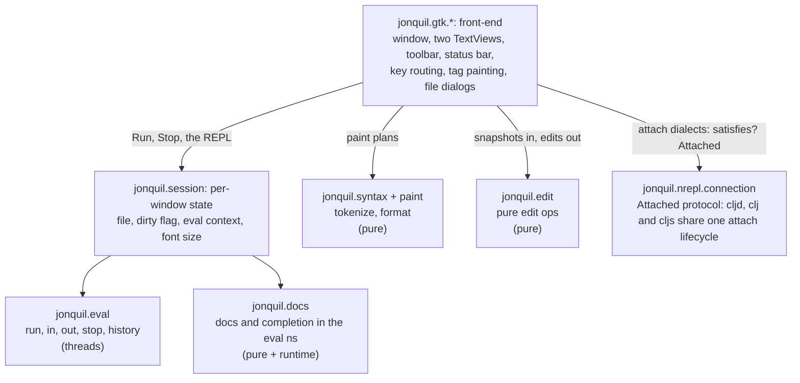
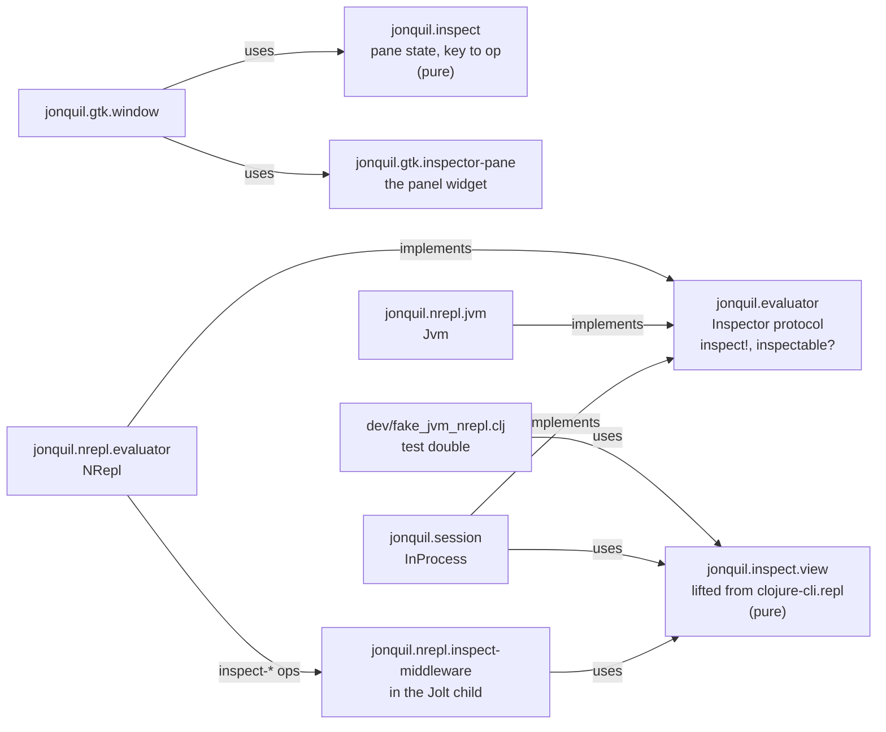

# Jonquil Architecture

Part of the architecture guide. This page covers the layering, the GTK front-end, the inspector and the eval engine.

The full design record, with the reasoning and what was ruled out, is kept in `docs/history/architecture/index.md`.

## Design

Jonquil is a port of DrClojure's idea to Jolt: a Clojure IDE with a Definitions editor, an Interactions console, and Run and Stop that actually stop.



Other pure namespaces, one line each:

- `jonquil.commands`: run-selection text, Run Form's form, the pre-Run bracket check, find/replace steps, format operations, zoom sizes.
- `jonquil.keymap`, `jonquil.command-registry`, `jonquil.plugin*`: see [Commands, keys and plugins](commands-keys-plugins.md).
- `jonquil.theme`: the four palettes as data, the five choices, `resolve-choice` (turns `auto` into light or dark), `code-css`.
- `jonquil.settings`: `load-settings` and `save-settings!` (atomic); neither throws.
- `jonquil.last-session`: tabs to reopen, per tree root, in `sessions.edn` (kept apart from the hand-edited `settings.edn`).
- `jonquil.help`: the pure decisions behind completion, quick doc, jump and rename.
- `jonquil.console`: what Return does at the prompt, output trimming, result display, the unclosed-bracket message.
- `jonquil.file-tree`: the tree's model as plain data, `{:root :expanded :ignore}`, flattened to rows.
- `jonquil.tabs`: tab labels, finding an open file, and `runnable-here?` (whether a tab may run in the window's evaluator).
- `jonquil.source`: where a definition outside the buffer lives and its text (a path or a `jar:file:…!/entry` URL), plus the source panel's history.
- `jonquil.save-path`: where a save really writes, and its temp file.

The front-end and core exchange plain data. An edit sends a snapshot and gets edits back:

```clojure
{:text "..." :caret 42 :sel-start 40 :sel-end 45}

{:edits [[start end "replacement"] ...]
 :caret 44
 :sel   [44 44]}
```

The front-end applies the edits in reverse order inside one `gtk_text_buffer_begin/end_user_action`, so undo sees one step.

- Saves write a temp file in the resolved target's directory, copy the target's permissions, then rename with `ATOMIC_MOVE`. A failed write never leaves a half-written file, a symlink is updated rather than replaced, and the tab counts as saved only after the rename. `resolve-target` follows symlinks by hand because `.getCanonicalPath` on this Jolt returns a dangling link's own path.
- Reopening tabs waits for the window's first painted frame, then opens every saved path in one main-loop turn through the same `open-file!` as Open. A path that fails is named on the console and the rest still open. A quit before the reopen saves nothing.

## GTK is not everywhere

The GTK layer is required only from `jonquil.main` and `jonquil.mcp.window` (which takes `gtk.callbacks`, `gtk.editor` and `gtk.ffi`, never `gtk.window`). The pure core runs without GTK, so it can be tested alone and reused by another front-end.

Nothing enforces this automatically. Jolt's build scanner follows `require` forms statically, so a `jonquil.gtk` namespace required from anywhere else would compile GTK into every binary built from that namespace, headless tools included.

## The GTK layer

One job per `jonquil.gtk.*` namespace:

- `ffi`: raw GTK4/GLib/GObject/pango bindings and the GtkTextIter and mark helpers.
- `callbacks`: the `callable` macro (retained, `:collect-safe` foreign-callables), every callback, and `on-gui!`. A throw never reaches GTK, where it would end the process: it is reported on stderr and the callback answers a safe value.
- `editor`: the Definitions editor. `handle-key!` yields during IME preedit, then dispatches through `command-registry/editor-answer`. Edit ops go through `apply-op!` so each is one user action. Repaints diff against what the tags show now and apply only the changed range, a chunk per main-loop turn.
- `find-bar`, `console-view`, `window`: the find bar; the console (below); and the toolbar, layout, window-level chords (through `window-answer`), file dialogs and the wiring to `jonquil.session`.
- `tab`: one tab's widgets. `dispose-popovers!` must run before the window removes the page, or GTK spins in a warning loop.
- `popover`, `help-popover`, `palette`, `completion`: caret-anchored `GtkPopover`s on a shared base.
- `file-tree-pane`: a `GtkListBox` rebuilt from the model on every change. A click decides its target at once and rebuilds on the next main-loop turn, because a rebuild removes the row whose signal is running.
- `source-pane`: the read-only panel for jar entries and files outside the project (a project file opens in its tab; Cmd/Ctrl+[ walks the jump stack). It shares the right-hand slot with the inspector. It paints with `paint-async!`, which keeps an 8,000-line file off the GTK thread.
- `inspector-pane`: the inspector widget.

Tree file operations (`jonquil.file-ops`) return `{:error ...}` instead of throwing, rename never overwrites, and `jonquil.gtk.trash` uses `g_file_trash`, so nothing is deleted permanently.

### `on-gui!` and the worker-to-GTK-thread path

The eval engine's callbacks run on the worker thread, and GTK may only be touched from its main thread. So a callback enqueues and returns: never call GTK directly, never block. `console-view/append!` queues an output chunk and `callbacks/on-gui!` queues any thunk. Both are safe from any thread and coalesce, so a flood of output becomes one drain per tick.

### The console buffer layout


- History and the prompt carry a read-only tag, which stops typing, pasting or Backspace from reaching old output.
- `out-end` has right gravity, so `append!` inserts at it and new output lands before the prompt. `input-start` has left gravity, so output inserted earlier pushes it forward. Committing an entry moves both marks explicitly.
- `set-prompt!` rewrites the prompt in place (keeping input and caret) with the evaluator's `prompt-ns`, after every evaluation, on an evaluator switch, and when an attach connection comes or goes.
- The console reads busy and waiting state live from the engine rather than mirroring it, because a mirror could lose a race against a fast eval's completion and strand the console busy.

### `jonquil.session` and the O1 reset rule

`InProcess` holds one window's in-process state: the eval context, the mode (`:reset` or `:accumulate`), the prompt namespace, and a map from owner to the namespaces it created. It is the default `Evaluator`. Run and the REPL both go through `evaluate!` into `jonquil.eval/eval-async`.

- Project roots: `jonquil.project-roots/use-project!` appends the project's absolute `deps.edn` `:paths` after Jolt's own roots, so a project can't shadow the IDE's namespaces in this shared process. Absolute roots make `:file` absolute, which jump to definition opens.
- Dependencies resolve on the eval worker (`:before-eval`), so a first fetch never holds the GTK thread. A failure leaves the roots at `:paths` with a console line.
- Run evaluates with `load-string`, so vars get a line but no file. When the file on disk matches the buffer, `mark-run-file!` (in `:before-idle`, before any REPL entry can interleave) gives the file to vars the Run redefined, so F12 works from another tab.
- Reset: in `:reset` mode `run-definitions!` removes the namespaces its owner created, then the REPL's, then `user`, and evaluates into a fresh `user`. Loaded libraries are never owned, so they stay.
- An owner is the `:owner` option: a tab's id for Run, Run Selection, Run Form and Inspect Form, and `:repl` for console entries. A closing tab hands its set to `:repl` (`release-owner!`).
- Unchecking Reset on Run switches to `:accumulate`, and Run stops clearing.
- The out-of-process nREPL runtime applies the same rule over the wire, snapshotting the child's namespaces around each evaluation and restoring `*1`, `*2` and `*3`, and it refers `doc`, `find-doc`, `apropos`, `dir`, `pprint` and `pp` into the session namespace. So Reset on Run, the history vars and the helpers behave alike under either evaluator.

### Self-test harnesses

`bb gtk:selftest` drives the real GTK front end from inside the process (ten windows, against fakes where a toolchain would be needed), and `bb docs:shots` captures `docs/images/*` with one fresh process per scene. Both poll against a deadline instead of sleeping and hand blocking subprocess calls to a `future`. The smoke tasks (`smoke:binary`, `smoke:cljd`, `smoke:cljs`) drive a built `./jonquil` with `cgevent`. All use temp settings (`:settings-path` or `XDG_CONFIG_HOME`), never the user's. See [Development](../development.md#self-test-and-docs-ten-windows-one-binary-one-camera).

### Themes

Applying a theme rebuilds nothing: each component's `apply-theme!` retints its tags in place, so text and undo survive, and the window reloads its one CSS provider and sets `gtk-interface-color-scheme`. `theme-name` is the palette on screen; `theme-choice` is the saved pick (including `auto`). Every change goes through `apply-choice!`. For `auto`, `jonquil.gtk.appearance/system-dark?` asks AppKit for the effective appearance (GTK reports none on macOS) and returns nil off macOS or on failure, which resolves to light. A 1-second timeout polls only while the choice is `auto` and dies on its next tick otherwise.

### Help: completion, quick doc, jump and rename

`jonquil.help` never touches GTK or the running program; it works on the editor snapshot shape. `target` (the selection if exactly one symbol, else the symbol at the caret) is shared by quick doc, jump and rename.

- Jump to definition: `help/jump-target` does a scope search first (enclosing `let`-family, `for`/`doseq`, `fn`/`defn`/`defmacro` params and `letfn`, with destructuring), because upstream's `find-definition` gets shadowed locals wrong. Only then does it fall back to top-level `def*` forms, then to an external var's docs.
- `jonquil.docs` resolves in the namespace the program runs in, falling back to `user` when Reset on Run removed it. Lookups catch every exception and return nil or `[]`. The `symbol-doc` memo is cleared after every completed evaluation.
- Popovers are parented on the view's `GtkScrolledWindow`, never the `GtkTextView`, which hangs on window close. The window registers every popover and unparents them on real quit, hiding an open one first.
- Context menus come from `command-registry/menu-items`, so each item runs its chord's command. Every action callback is wrapped in `try`/`catch`, since a throw from a `GSimpleAction` kills the process.
- `editor/dispatch-key!` and the window key handler catch throws, report them in the status bar and still consume the key.
- Server help (`ev/ServerHelp`: attach evaluators, out-of-process Jolt, jank) never blocks the GTK thread. `ev/ask-help!` waits `ev/help-grace-ms` (25 ms) and a late answer arrives through `on-gui!`. It applies only if it is the newest request (`:gen`), the evaluator is unchanged and the text and caret haven't moved. Jump checks the buffer first, so a local definition never waits.

## The inspector: `Inspector`, `jonquil.inspect` and `jonquil.inspect.view`

`jonquil.evaluator` has a second, optional protocol, `Inspector`: `inspect!` (an op, its args, and an `on-view` callback called exactly once, off the GTK thread) and `inspectable?`. The window checks `(satisfies? ev/Inspector e)` as it does `Attached`, so a ClojureDart evaluator gets the unavailable sentence.



- `inspect.view` is lifted from clojure-cli.repl (`UPSTREAM.md` has the provenance). Every function takes a view map and returns one; `run-op`, Jonquil's own addition, wraps any of them and adds a `:note` on a throw. Nothing owns a global atom.
- `InProcess` and the test double call `run-op` directly. `Jvm` and `NRepl` send wire ops (`jonquil.inspect/request`) and parse the `:view` string back, so the view code lives on the server.
- `jonquil.inspect` is the shared pane state: the view, the selected row, a `:pending` marker, and `key-step`, which makes a keypress either a local move or a request. `inspector-pane` only renders. The window owns the round trip, the one-request-at-a-time guard, and folds replies back through `on-reply`.

### Middleware in the out-of-process Jolt child

Three nREPL middleware namespaces run in the child. Jonquil embeds their text at compile time (the installed binary has no source tree) and writes them to a hash-named folder under `$XDG_CACHE_HOME/jonquil/nrepl-middleware` (or `~/.cache`), which `jonquil.nrepl.child` adds as a `:local/root` dep. If the child can't load them, it restarts without them and the start lines name jolt's error.

- `inspect-middleware` (last): middleware ops rather than evals, because `jolt.nrepl/evaluate` shifts `*1 *2 *3` after every eval. Ops are answered one at a time on their own future, and view state is one atom per child, shared by its clients.
- `stdin-middleware` (first): binds `*in*` around `clone` so every eval in the session reads Jonquil's stdin reader, which sends `need-input` and blocks on a queue the `stdin` op feeds. It also wakes a blocked read on `interrupt`. A plain server gets the inspector alone.
- `info-middleware` (last): the `jonquil-info` op reads a var's metadata (file and line), which jolt-lang/nrepl's `lookup` lacks, so jump to definition can leave the buffer. A bare file name is never resolved against the directory. The "Jump to definition stays in this buffer" limit shows only when a live child doesn't offer the op.

## The eval engine

Each window has an eval context. Run and the REPL both use `eval-async` with an `:ns-name` option; the engine doesn't distinguish them. Results carry `:printed`: the value under `pr-str` with `*print-length*` 1000, printed inside the interruptible region so a lazy value can be stopped. The GUI shows `:printed` and never re-prints `:value`.

- Stop uses `jolt.host/run-interruptible` with a token. `interrupt!` aborts busy loops at back-edges, and the engine tracks worker exit before returning `:idle`.
- A program blocked on `read-line` gets an EOF sentinel on the input queue. Once Stop is pressed the result is `:interrupted` whatever the program then does.
- Callbacks run on the worker, and `on-status-change` runs under the context's lock. A callback must enqueue and return, never wait on a thread that may call `eval-async` or `stop-eval!` on the same context, because that deadlocks.
