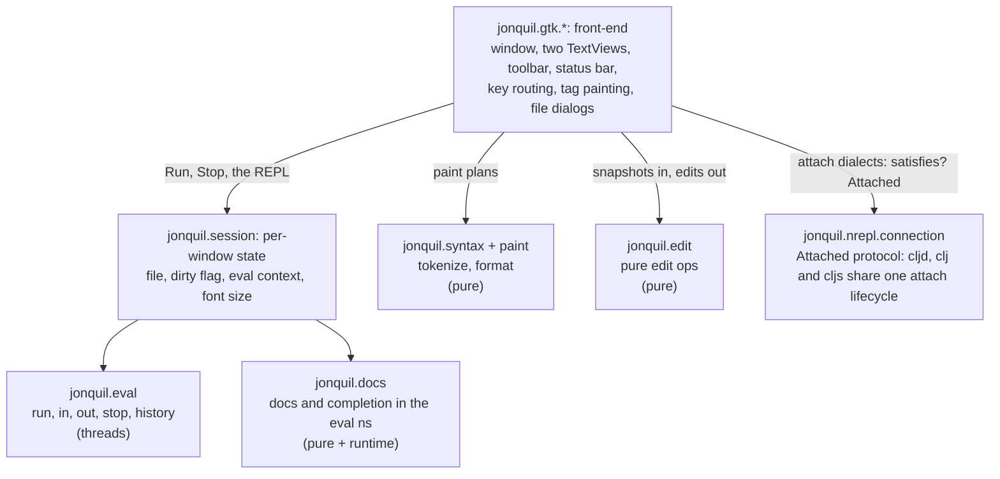
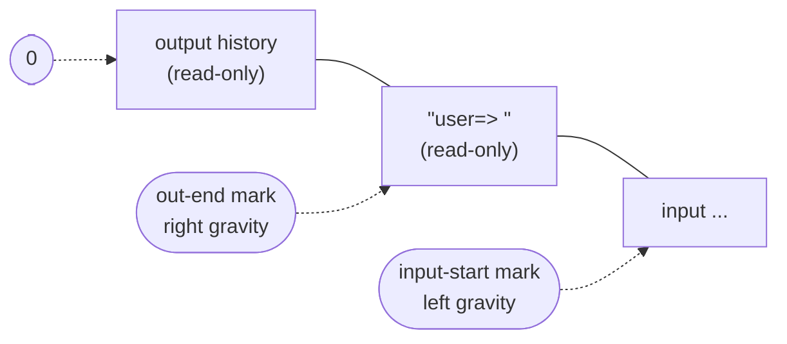
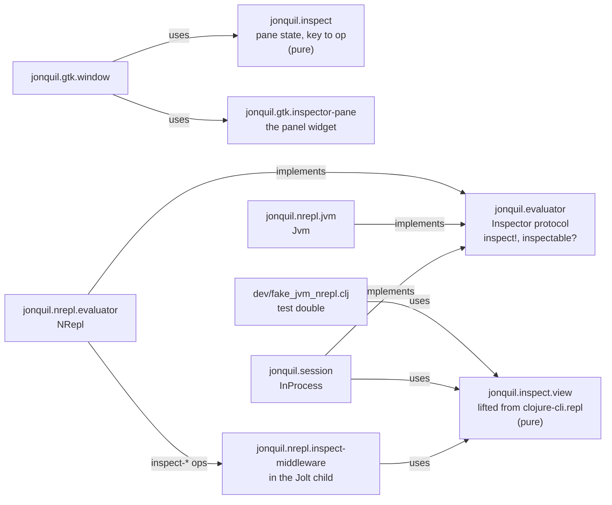

# Jonquil Architecture

Part of the architecture guide. This page covers the layering, the GTK front-end, the inspector and the eval engine.

The full design record, with the reasoning and what was ruled out, is kept in `docs/history/architecture/index.md`.

## Design

Jonquil is a port of DrClojure's idea to Jolt: a Clojure IDE with a Definitions editor, an Interactions console, and Run and Stop that actually stop.



Other pure namespaces, one line each:

- `jonquil.commands`: run-selection text, Run Form's form, the pre-Run bracket check, find/replace steps, format operations, zoom sizes.
- `jonquil.keymap`, `jonquil.command-registry`, `jonquil.plugin*`: see [Commands, keys and plugins](commands-keys-plugins.md).
- `jonquil.theme`: the four palettes as data, the five choices, `resolve-choice` (turns `auto` into light or dark), `code-css`.
- `jonquil.settings`: `load-settings` and `save-settings!` (atomic); neither throws.
- `jonquil.last-session`: tabs to reopen, per tree root, in `sessions.edn` (kept apart from the hand-edited `settings.edn`), and `write-atomically!`, the temp-file-and-rename write it shares with the replay's record.
- `jonquil.replay`: the last session's record per project (`{:version 1 :previous [...] :current [...] :history [...]}` in `replays/<folder>-<hash>.edn`), turning one evaluation into entries, compacting them into files, definitions and other forms, and writing the replay script. Pure apart from `load-record` and `save-record!`.
- `jonquil.help`: the pure decisions behind completion, quick doc, jump and rename.
- `jonquil.console`: what Return does at the prompt, output trimming, result display, the unclosed-bracket message.
- `jonquil.file-tree`: the tree's model as plain data, `{:root :expanded :ignore}`, flattened to rows.
- `jonquil.tabs`: tab labels, finding an open file, and `runnable-here?` (whether a tab may run in the window's evaluator).
- `jonquil.source`: where a definition outside the buffer lives and its text (a path or a `jar:file:…!/entry` URL), plus the source panel's history.
- `jonquil.save-path`: where a save really writes, and its temp file.

The front-end and core exchange plain data. An edit sends a snapshot and gets edits back:

```clojure
{:text "..." :caret 42 :sel-start 40 :sel-end 45}

{:edits [[start end "replacement"] ...]
 :caret 44
 :sel   [44 44]}
```

The front-end applies the edits in reverse order inside one `gtk_text_buffer_begin/end_user_action`, so undo sees one step.

- Saves write a temp file in the resolved target's directory, copy the target's permissions, then rename with `ATOMIC_MOVE`. A failed write never leaves a half-written file, a symlink is updated rather than replaced, and the tab counts as saved only after the rename. `resolve-target` follows symlinks by hand because `.getCanonicalPath` on this Jolt returns a dangling link's own path.
- The replay's recorder hangs off `hooked-opts`' completion chain in `jonquil.gtk.window.run`, so only evaluations that started are seen, and only the call sites that build a `:record` map (never MCP's). The tree root is read when the evaluation is submitted, and the recorder itself runs on the GTK thread through `on-gui!`, so it never races `open-root!`. Writes are coalesced to one per 300 ms and flushed on quit and before a re-root. The record is written owner-only: the temp file is created `rw-------` and filled with `Files/write`, since on Linux Jolt's `spit` replaces the file and drops its mode.
- Reopening tabs waits for the window's first painted frame, then opens every saved path in one main-loop turn through the same `open-file!` as Open. A path that fails is named on the console and the rest still open. A quit before the reopen saves nothing.

## GTK is not everywhere

The GTK layer is required only from `jonquil.main` and `jonquil.mcp.window` (which takes `gtk.callbacks`, `gtk.editor` and `gtk.ffi`, never `gtk.window`). The pure core runs without GTK, so it can be tested alone and reused by another front-end.

Nothing enforces this automatically. Jolt's build scanner follows `require` forms statically, so a `jonquil.gtk` namespace required from anywhere else would compile GTK into every binary built from that namespace, headless tools included.

## The GTK layer

One job per `jonquil.gtk.*` namespace:

- `ffi`: raw GTK4/GLib/GObject/pango bindings and the GtkTextIter and mark helpers.
- `callbacks`: the `callable` macro (retained, `:collect-safe` foreign-callables), every callback, and `on-gui!`. A throw never reaches GTK, where it would end the process: it is reported on stderr and the callback answers a safe value.
- `editor`: the Definitions editor. `handle-key!` yields during IME preedit, then dispatches through `command-registry/editor-answer`. Edit ops go through `apply-op!` so each is one user action. Repaints diff against what the tags show now and apply only the changed range, a chunk per main-loop turn.
- `find-bar`, `console-view`, `window`: the find bar; the console (below); and the toolbar, layout and the wiring to `jonquil.session`. The window-level chords (through `window-answer`) and the context menus live in `jonquil.gtk.window.keys`. The file dialogs and opening and saving files live in `jonquil.gtk.window.files`. Quick doc, jump and the source panel, rename and completion live in `jonquil.gtk.window.help`. The tabs (switching, opening a file into one, closing one, and wire-tab!, which connects a tab to the window) live in `jonquil.gtk.window.tabs`. wire-tab! runs as named steps, one per thing it connects. The file tree's New File, New Folder, Rename and Move to Trash live in `jonquil.gtk.window.tree-ops`, and reopening the last session's tabs at startup in `jonquil.gtk.window.reopen`. The status bar is built and placed in `jonquil.gtk.window.status-bar`, and the console with its completion in `jonquil.gtk.window.console`.
- `tab`: one tab's widgets. `dispose-popovers!` must run before the window removes the page, or GTK spins in a warning loop.
- `popover`, `help-popover`, `palette`, `completion`: caret-anchored `GtkPopover`s on a shared base.
- `file-tree-pane`: a `GtkListBox` rebuilt from the model on every change. A click decides its target at once and rebuilds on the next main-loop turn, because a rebuild removes the row whose signal is running.
- `source-pane`: the read-only panel for jar entries and files outside the project (a project file opens in its tab; Cmd/Ctrl+[ walks the jump stack). It shares the right-hand slot with the inspector. It paints with `paint-async!`, which keeps an 8,000-line file off the GTK thread.
- `inspector-pane`: the inspector widget.

Tree file operations (`jonquil.file-ops`) return `{:error ...}` instead of throwing, rename never overwrites, and `jonquil.gtk.trash` uses `g_file_trash`, so nothing is deleted permanently.

### `on-gui!` and the worker-to-GTK-thread path

The eval engine's callbacks run on the worker thread, and GTK may only be touched from its main thread. So a callback enqueues and returns: never call GTK directly, never block. `console-view/append!` queues an output chunk and `callbacks/on-gui!` queues any thunk. Both are safe from any thread and coalesce, so a flood of output becomes one drain per tick.

### The console buffer layout



- History and the prompt carry a read-only tag, which stops typing, pasting or Backspace from reaching old output.
- `out-end` has right gravity, so `append!` inserts at it and new output lands before the prompt. `input-start` has left gravity, so output inserted earlier pushes it forward. Committing an entry moves both marks explicitly.
- `set-prompt!` rewrites the prompt in place (keeping input and caret) with the evaluator's `prompt-ns`, after every evaluation, on an evaluator switch, and when an attach connection comes or goes.
- The console reads busy and waiting state live from the engine rather than mirroring it, because a mirror could lose a race against a fast eval's completion and strand the console busy.

### `jonquil.session` and the O1 reset rule

`InProcess` holds one window's in-process state: the eval context, the mode (`:reset` or `:accumulate`), the prompt namespace, and a map from owner to the namespaces it created. It is the default `Evaluator`. Run and the REPL both go through `evaluate!` into `jonquil.eval/eval-async`.

- Project roots: `jonquil.project-roots/use-project!` appends the project's absolute `deps.edn` `:paths` after Jolt's own roots, so a project can't shadow the IDE's namespaces in this shared process. Absolute roots make `:file` absolute, which jump to definition opens.
- Dependencies resolve on the eval worker (`:before-eval`), so a first fetch never holds the GTK thread. A failure leaves the roots at `:paths` with a console line.
- When the file on disk matches the buffer, a Run evaluates it as that file: `jolt.host/eval-string` takes the path as its source (`:source-path`, on a Jolt with jolt-lang/jolt#1476), so the vars get the file and line from the reader and `*file*` is the path. On an older Jolt the evaluated text has no file, so `mark-run-file!` (in `:before-idle`, before any REPL entry can interleave) gives the file to vars the Run redefined instead. Either way F12 works from another tab.
- Reset: in `:reset` mode `run-definitions!` removes the namespaces its owner created, then the REPL's, then `user`, and evaluates into a fresh `user`. Loaded libraries are never owned, so they stay.
- An owner is the `:owner` option: a tab's id for Run, Run Selection, Run Form and Inspect Form, and `:repl` for console entries. A closing tab hands its set to `:repl` (`release-owner!`).
- Unchecking Reset on Run switches to `:accumulate`, and Run stops clearing.
- The out-of-process nREPL runtime applies the same rule over the wire, snapshotting the child's namespaces around each evaluation and restoring `*1`, `*2` and `*3`, and it refers `doc`, `find-doc`, `apropos`, `dir`, `pprint` and `pp` into the session namespace. So Reset on Run, the history vars and the helpers behave alike under either evaluator.

### Self-test harnesses

`bb gtk:selftest` drives the real GTK front end from inside the process (ten windows, against fakes where a toolchain would be needed), and `bb docs:shots` captures `docs/images/*` with one fresh process per scene. Both poll against a deadline instead of sleeping and hand blocking subprocess calls to a `future`. The smoke tasks (`smoke:binary`, `smoke:cljd`, `smoke:cljs`) drive a built `./jonquil` with `cgevent`. All use temp settings (`:settings-path` or `XDG_CONFIG_HOME`), never the user's. See [Development](../development.md#self-test-and-docs-ten-windows-one-binary-one-camera).

### Themes

Applying a theme rebuilds nothing: each component's `apply-theme!` retints its tags in place, so text and undo survive, and the window reloads its one CSS provider and sets `gtk-interface-color-scheme`. `theme-name` is the palette on screen; `theme-choice` is the saved pick (including `auto`). Every change goes through `apply-choice!`. For `auto`, `jonquil.gtk.appearance/system-dark?` asks AppKit for the effective appearance (GTK reports none on macOS) and returns nil off macOS or on failure, which resolves to light. A 1-second timeout polls only while the choice is `auto` and dies on its next tick otherwise.

### Help: completion, quick doc, jump and rename

`jonquil.help` never touches GTK or the running program; it works on the editor snapshot shape. `target` (the selection if exactly one symbol, else the symbol at the caret) is shared by quick doc, jump and rename.

- Jump to definition: `help/jump-target` does a scope search first (enclosing `let`-family, `for`/`doseq`, `fn`/`defn`/`defmacro` params and `letfn`, with destructuring), because upstream's `find-definition` gets shadowed locals wrong. Only then does it fall back to top-level `def*` forms, then to an external var's docs.
- `jonquil.docs` resolves in the namespace the program runs in, falling back to `user` when Reset on Run removed it. Lookups catch every exception and return nil or `[]`. The `symbol-doc` memo is cleared after every completed evaluation.
- Popovers are parented on the view's `GtkScrolledWindow`, never the `GtkTextView`, which hangs on window close. The window registers every popover and unparents them on real quit, hiding an open one first.
- Context menus come from `command-registry/menu-items`, so each item runs its chord's command. Every action callback is wrapped in `try`/`catch`, since a throw from a `GSimpleAction` kills the process.
- `editor/dispatch-key!` and the window key handler catch throws, report them in the status bar and still consume the key.
- Server help (`ev/ServerHelp`: attach evaluators, out-of-process Jolt, jank) never blocks the GTK thread. `ev/ask-help!` waits `ev/help-grace-ms` (25 ms) and a late answer arrives through `on-gui!`. It applies only if it is the newest request (`:gen`), the evaluator is unchanged and the text and caret haven't moved. Jump checks the buffer first, so a local definition never waits.

## Window parts

A window feature that owns its own state, commands and startup work is a part, so it doesn't have to grow `jonquil.gtk.window`. A part has two namespaces:

- `jonquil.parts.<name>` is GTK-free and holds `spec`: `{:id :<name> :commands {cmd-id {:doc "..." :scope :window :call [ctx-key & args]}} :panels [{:id :<panel> :label "..."}] :bindings {:window [binding ...] :editor [binding ...]}}`. A command names its context function as data (`:call`), never as a `:run` fn, so a spec needs nothing from `jonquil.command-registry`, which requires it. `:panels` and `:bindings` are optional. A panel's label is what Switch to panel shows, and a binding has the shape of an entry in `keymap.edn`.
- `jonquil.gtk.parts.<name>` holds `part`, an install fn tagged `^{:part/id :<name>}`. `(part wctx)` returns `{:fns :ui :hooks :exports}`.

`jonquil.parts/specs` and `jonquil.gtk.parts/installs` list the parts in install order, and a test checks that both name the same ones. A part may read another part's `:exports` only if that part comes earlier.

`command_registry`'s public tables are the core commands plus every spec's commands. An id claimed twice, in any scope, throws when the registry loads and names the id and both owners.

`wctx` gives a part the core's bindings by name: `:win :status-label :cv :ev* :sel* :tabs :active-tab :settings-path* :tab-ctx* :tab-by-id :select-tab! :new-tab! :set-status! :right :tree-pane :tree-paned :paned :files-btn :panel-focus-fn :showing-panel :show-right-panel! :hide-right-panel! :alert-pending? :show-alert! :make-eval-opts :refuse-foreign!`. `:set-status!` takes one argument, the text. A part never requires the window namespace. It reads `:tab-ctx*` when it runs, not when it installs, since the tab map doesn't exist yet at install time.

The contribution keys:

- `:fns` are context functions the spec's `:call` entries name (`:replay-open-fn`).
- `:ui` are entries in the window's `ui` map, which the self-tests and MCP read.
- `:exports` are values for parts installed later.
- `:panels` is `{panel-id {:root :focus! :open!}}` for a right-hand panel, and every id must be declared in the part's own spec `:panels` (a panel the spec doesn't declare is refused). `:root` is the panel's widget, which the window appends to the right-hand slot, hidden, and treats like the core panels when it shows and hides them. `:focus!` is a function of no arguments that puts the keyboard focus inside the panel once it is showing. `:open!` is a function of no arguments that opens it, called when the panel isn't showing (a panel already showing is focused instead). The spec's `panel/<id>` command reaches both through `[:panel-focus-fn :<id>]`.
- `:hooks` maps a hook kind to a function. The kinds that exist are `:on-start` (once, when startup finishes), `:on-reroot` (Open Folder, before the new root opens, called with `{:path p}`) and `:on-quit` (a real quit only). Three tab kinds run once per tab, called with `[ctx tab]` in part order: `:on-tab-removed`, `:on-tab-wired` and `:on-switch`. See Tab hooks below.

`jonquil.parts/install` merges strictly. A duplicate `:fns`, `:ui` or `:exports` key throws and names both owners, and a key already in the core's tables is refused the same way. A part whose install throws contributes nothing, and the status bar says `; part <id>: <message>`. Hooks run in part order, and one that throws is reported the same way while the rest still run.

Spec bindings are appended after every binding in `keymap.edn` (`km/shipped` does it), so a shipped key always wins over a spec key. A broad shipped binding can also shadow a spec one: the Cmd+digit tab bindings ignore Alt, and spec bindings always come after the shipped ones, so a spec binding on Cmd+Alt+digit is always shadowed by them. `unreachable-bindings` finds these, and a test runs it over the merged keymap, so a shadowed spec binding fails `bb test`. A binding that uses Alt needs `:physical? true` to fire on macOS, because Option changes the key's value (Option+P types another character), and that check can't see it. The names `:review` and `:history` are core panel ids with no palette label, so a spec can't take them, and a panel id two specs share throws when the registry loads.

`jonquil.parts.extra` exists only so the window self-test can add a probe part (`dev/gtk_selftest_window/probe_part.clj`) to `specs` and `installs` before they load. Production never touches it, and it stays empty. The probe is the proof that a feature adds a command, a panel, a key, a `ui` entry and a quit hook without a change to `window.clj` or `command_registry.clj`.

The parts install in this order: Messages, disk polling, layouts, worlds, Time Form, Processes, Trace, live results, Locations, the debugger, the command palette, the file tree, plugins, replay. Messages goes first because it registers the status log, so a status said while the other parts install still reaches Messages. It answers the log function as `:log-entry!`, and disk polling reads that export, so it refuses to install without it. Messages holds the pane and the log, fills in the unread count (the core still builds that label and places it in the status bar) and handles its click. Disk polling has no commands and holds the 2 s timer that makes open tabs follow their files. Trace holds the Trace panel, its handlers and the refresh after each evaluation. Live results holds the four result verbs, the right-click caret move and the click-to-inspect gesture. Locations holds the Locations list and Compare with disk or HEAD, with their state. The debugger holds the Frames panel, the break and the failure restarts, and the gutter's line counts. It retries a failure through the core service `:rerun-failure!` in the window ctx, because the evaluation machinery stays in the window core, in `jonquil.gtk.window.run`. The command palette holds the palette's entries, the console's `!` line and the describe-keys commands, with the pending flag and the recent keys that the window's key handler reads from its context. The file tree holds Show/Hide Files, the tree's saved width and visibility, its Escape keys' context, the highlight of the active tab's file and the width save at quit. The tree's widgets, its root loading, Open Folder and the re-root stay in `window.clj`. The core calls the part's `:tree-start!` function at startup, and a window whose file-tree part failed shows no tree: the files button stays but nothing is connected to it. The plugins part holds the behaviour of the review, plugin list and history panels, the three `:plugins/*` commands (review, list and reload), the plugin `ui` and MCP entries and the plugin effects. The three panes stay in `window.clj`, and the pending label is made in `jonquil.gtk.window.status-bar`'s `build`, and the process-global state (the agent and the console and reviews callbacks) lives in `jonquil.gtk.window.plugin-agent`. The save hook, `on-saved`, lives in `jonquil.gtk.window.files`, and the part sets it. The core calls the part's `:plugins-start!` function where the startup block used to be, which points the console, the reviews callback, the effects and the save hook at this window and loads the user's plugins, so the window that started last owns them. A window whose plugins part failed loads no plugins. Layouts (LM8) holds the saved-layout commands and their timer. Worlds (LM7) holds Save World and Restore World with the helpers they share. Time Form holds the timed-form command and its confirmation, and puts `:time-ask*` and `:time-confirmed?` in `ui` for the self-test. Processes (LM4) holds the Processes panel, its two palette commands and its refresh timer, and is the first part to contribute a panel. Its panel key stays in `keymap.edn`. Replay goes last because its re-root hook loads the new root's record and its quit hook flushes it, and both have to run after every other part's hooks.

### The window core

The code that stays in `jonquil.gtk.window` is being split into `jonquil.gtk.window.*` namespaces. Eighteen exist so far: `jonquil.gtk.window.status` (the status line and the Messages log it feeds), `jonquil.gtk.window.alerts` (the alert dialogs and the one pending-alert guard), `jonquil.gtk.window.files` (the file dialogs, opening and saving, and the window title), `jonquil.gtk.window.plugin-agent` (the plugin agent and its hooks), `jonquil.gtk.window.right-slot` (the right-hand panel slot), `jonquil.gtk.window.theme` (theme and zoom), `jonquil.gtk.window.runtime` (picking a file's dialect and runtime, and starting and switching the evaluator), `jonquil.gtk.window.session` (saving the open tabs for the next launch), `jonquil.gtk.window.quit` (closing the window, Save All and the real quit), `jonquil.gtk.window.run` (Run and Stop, a console entry and its history, Run Selection, Run Form and Run Changed, and the MCP server's notifying Run and eval), `jonquil.gtk.window.keys` (the window's key handler and the per-key context, the focus checks, the context menus, F6 and the console clears), `jonquil.gtk.window.inspector` (the inspector panel, Inspect Last Result and Inspect Form), `jonquil.gtk.window.help` (the popover registry, quick doc, jump and the source panel, rename and completion), `jonquil.gtk.window.tabs` (the tabs: switching, opening a file into one, closing one, and wiring a tab's editor to the window, which `wire-tab!` does as named steps), `jonquil.gtk.window.reopen` (reopening the last session's tabs once the window is up), `jonquil.gtk.window.tree-ops` (the file tree's New File, New Folder, Rename and Move to Trash), `jonquil.gtk.window.status-bar` (the status bar's labels, the key hints toggle, the Parinfer mode and label, and the row they sit in) and `jonquil.gtk.window.console` (the console and its completion). `right-slot`, `theme`, `run`, `inspector`, `help`, `tabs`, `tree-ops`, `status-bar` and `console` also hold builders: functions that take a map of the window bindings they read and return it with theirs added, which `activate!` calls where those bindings used to be. `quit`'s `connect!` holds two of `activate!`'s statements, the close-request connect and the quit action, and `status-bar`'s `place!` the status bar's placement, each in its old place, as the builders hold bindings. They are internal to the window. None of them requires `jonquil.gtk.window`, and each loads after the ones it calls, which `window_layers_test` checks.

### Tab hooks

A tab hook is called as `(f ctx tab)` for every tab, the first one included, and `jonquil.parts/run-tab-hooks!` runs the parts' hooks of a kind in part order. A throwing hook is reported on the status line and the work around it goes on.

- `:on-tab-removed` runs as the first step of `remove-tab!`, while the tab is still in the tab list and its buffer is alive, so a part can delete its marks from the buffer.
- `:on-tab-wired` runs as the first statement of `wire-tab!`. A hook's buffer "changed" handler therefore connects after the core editor's and the find bar's, and before the changed-form gutter's.
- `:on-switch` runs in `on-switch!`, after the open popovers close and before the title, Ln/Col label and focus follow the new tab. It runs when a tab is shown, including a neighbour that becomes active when a tab closes. The file tree uses it to highlight the active tab's file.

Replay (the last session's record, LM7) is the worked example: `jonquil.parts.replay` holds the two palette commands, and `jonquil.gtk.parts.replay` holds the recorder, the record's state, the offer at open, and the three hooks that load the record at start and re-root and flush it at quit.

## The inspector: `Inspector`, `jonquil.inspect` and `jonquil.inspect.view`

`jonquil.evaluator` has a second, optional protocol, `Inspector`: `inspect!` (an op, its args, and an `on-view` callback called exactly once, off the GTK thread) and `inspectable?`. The window checks `(satisfies? ev/Inspector e)` as it does `Attached`, so a ClojureDart evaluator gets the unavailable sentence.



- `inspect.view` is lifted from clojure-cli.repl (`UPSTREAM.md` has the provenance). Every function takes a view map and returns one; `run-op`, Jonquil's own addition, wraps any of them and adds a `:note` on a throw. Nothing owns a global atom.
- `InProcess` and the test double call `run-op` directly. `Jvm` and `NRepl` send wire ops (`jonquil.inspect/request`) and parse the `:view` string back, so the view code lives on the server.
- `jonquil.inspect` is the shared pane state: the view, the selected row, a `:pending` marker, and `key-step`, which makes a keypress either a local move or a request. `inspector-pane` only renders. The window owns the round trip, the one-request-at-a-time guard, and folds replies back through `on-reply`.

### Middleware in the out-of-process Jolt child

Four nREPL middleware namespaces run in the child. Jonquil embeds their text at compile time (the installed binary has no source tree) and writes them to a hash-named folder under `$XDG_CACHE_HOME/jonquil/nrepl-middleware` (or `~/.cache`), which `jonquil.nrepl.child` adds as a `:local/root` dep. If the child can't load them, it restarts without them and the start lines name jolt's error.

- `inspect-middleware` (last): middleware ops rather than evals, because `jolt.nrepl/evaluate` shifts `*1 *2 *3` after every eval. Ops are answered one at a time on their own future, and view state is one atom per child, shared by its clients.
- `stdin-middleware` (first): binds `*in*` around `clone` so every eval in the session reads Jonquil's stdin reader, which sends `need-input` and blocks on a queue the `stdin` op feeds. It also wakes a blocked read on `interrupt`. A plain server gets the inspector alone.
- `break-middleware` (first, beside stdin's): Break on error. It binds `jolt.nrepl/*eval-wrapper*` to a per-session wrapper around `clone`, so the session's worker runs each evaluation's thunk through it inside `evaluate`'s own `try`, where the break sees a throw first; only an eval the client marks with `jonquil-break` can pause, and the pause goes out on that eval's reply. A Jolt without the hook can't pause, and `jonquil-break-check` says so. `inspect-middleware` also answers the Frames panel's ops (`jonquil-frames`, `jonquil-frame-eval`, `inspect-local`, `jonquil-debug-mode`) over the child's `*e`.
- `info-middleware` (last): the `jonquil-info` op reads a var's metadata (file and line), which jolt-lang/nrepl's `lookup` lacks, so jump to definition can leave the buffer. A bare file name is never resolved against the directory. The "Jump to definition stays in this buffer" limit shows only when a live child doesn't offer the op.

## The debugger

`jonquil.debugger` holds the Frames panel's data and has no GTK, so the Jolt child loads it too. `frames-data` reads a throwable's frames through `jolt.debug/frames`, cut where the evaluator's own frames start, and says so when none is the user's; `eval-in-frame` compiles a form as a fn of the frame's locals in the frame's namespace. Its break (`break-wrapper`) runs an evaluation under `jolt.debug/call-with-break-handler`: on a throw, the handler publishes the pause and serves a queue on the throwing thread (evaluate in a frame, Continue, Stop) until it ends. The in-process session passes it to the engine as `:wrap-eval`; in the child, `break-middleware` does. `jonquil.restarts` decides which restarts a failure offers, and the window records failures from `hooked-opts`. A JVM server gets frames from `jonquil.nrepl.jvm-frames`, a template evaluated there that prints the stack trace's Clojure frames.

## The eval engine

Each window has an eval context. Run and the REPL both use `eval-async` with an `:ns-name` option; the engine doesn't distinguish them. Results carry `:printed`: the value under `pr-str` with `*print-length*` 1000, printed inside the interruptible region so a lazy value can be stopped. The GUI shows `:printed` and never re-prints `:value`.

- Stop uses `jolt.host/run-interruptible` with a token. `interrupt!` aborts busy loops at back-edges, and the engine tracks worker exit before returning `:idle`.
- A program blocked on `read-line` gets an EOF sentinel on the input queue. Once Stop is pressed the result is `:interrupted` whatever the program then does.
- Callbacks run on the worker, and `on-status-change` runs under the context's lock. A callback must enqueue and return, never wait on a thread that may call `eval-async` or `stop-eval!` on the same context, because that deadlocks.
