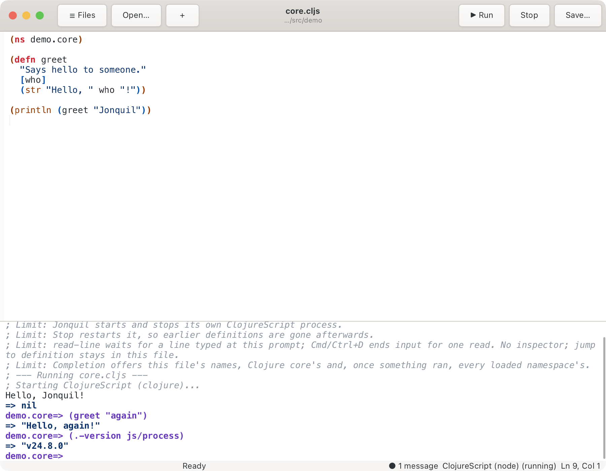
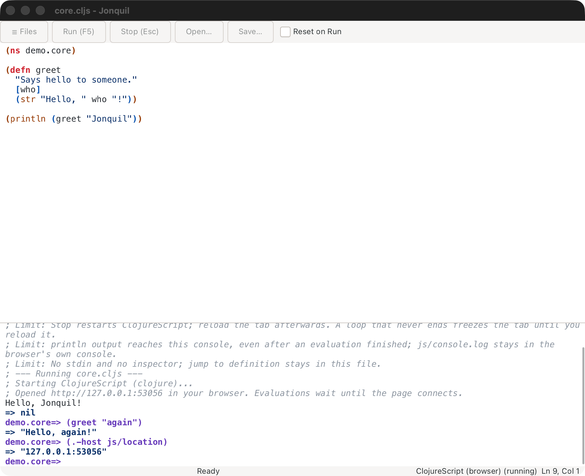
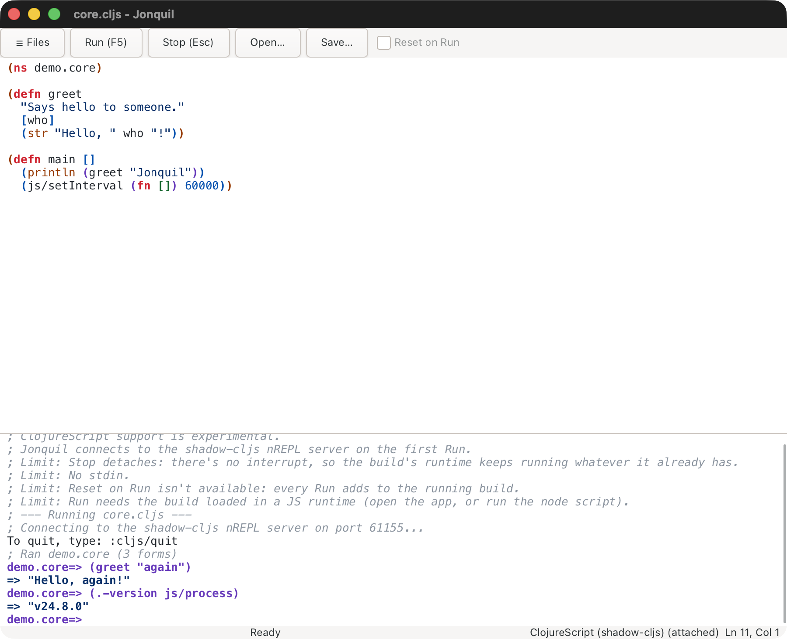

# ClojureScript (experimental)

Part of [Dialects and runtimes](index.md). Jonquil runs ClojureScript three ways: on node, in a browser tab, or attached to a shadow-cljs build you started.

## ClojureScript (experimental): running on node

A `.cljs` file outside a shadow-cljs project (see
[Choosing a dialect](index.md#choosing-a-dialect)) runs on node. Jonquil
starts the runtime itself on the window's first Run, so there's nothing to
start. The status bar reads `ClojureScript (node) (not running)` until then.



- **Needs** the Clojure CLI (`clojure`, or set `JONQUIL_CLOJURE`) and `node`
  on the login shell's `PATH`. Jonquil adds ClojureScript 1.12.42 unless the
  project's `deps.edn` already names `org.clojure/clojurescript`. The first
  start can download dependencies, so it waits 60 seconds.
- **Run** evaluates every top-level form in order and streams output. A
  JavaScript exception prints one error line and the session carries on.
  Input that ends inside a form is refused rather than sent.
- **Stop and Reset on Run** restart the process, so earlier definitions are
  gone. Reset on Run starts unticked here for that reason.
- **Completion** covers the buffer, Clojure core and the namespaces the
  session loaded. Quick docs work while the process is idle. F12 stays in
  the buffer. There is no inspector.
- **`read-line`** works as on Jolt: the status shows `Waiting for input`,
  your next line answers it, Cmd/Ctrl+D ends it.
- **Security**: the prepl and node's socket listen on `127.0.0.1` only and
  are unauthenticated, so any local user could send code while the window
  is open.

## ClojureScript (experimental): running in the browser

Node stays the default. For a browser tab, put this in the project's
`.jonquil.edn`:

```clojure
{:cljs {:target :browser}}
```

It needs a project (a loose `.cljs` file stays on node), and a project with
a `shadow-cljs.edn` ignores it with a warning. An unknown `:target` warns
and uses node. The status bar reads `ClojureScript (browser) (not running)`
until the first Run.



On the first Run, Jonquil starts ClojureScript and opens the page in your
default browser (`open`, `xdg-open`, or the command in `JONQUIL_OPEN_URL`).
It waits up to 60 seconds for the page to connect; if none does, the console
gives the URL to open yourself.

- Each window has its own `127.0.0.1` URL with a token, so an old tab can't
  join a new session.
- Stop and Reset on Run restart ClojureScript, and the tab reloads itself.
  A frozen or closed tab needs a reload by hand.
- `println` and `js/console.log` both reach Jonquil's console. To keep
  `console.log` in devtools only, set `:forward-console? false` in the
  `:cljs` map.
- No stdin or inspector; F12 stays in the buffer. The same loopback-only,
  unauthenticated exposure as node applies.

See [Known limits](../known-limits.md) for the rest.

## ClojureScript (experimental): attaching to a shadow-cljs build

Jonquil never starts shadow-cljs or a JS runtime. You start them:

1. Run `npx shadow-cljs watch <build>` in the project.
2. Open the app in a browser, or run the node script the build writes.
3. Open a `.cljs` file in the project and press Run.

Jonquil reads the port from `.shadow-cljs/nrepl.port` (never writing it),
connects on the first Run, and selects the build with `nrepl-select`.
`:cljs/quit` or `:repl/quit` leaves the ClojureScript session.



A `.cljs` file picks this dialect by extension and by the `shadow-cljs.edn`
marker; `{:dialect :cljs}` in `.jonquil.edn` forces it. The build is
`{:cljs {:shadow-build :app}}` in `.jonquil.edn`, or else the only build in
`shadow-cljs.edn`:

```clojure
;; .jonquil.edn
{:cljs {:shadow-build :app}}
```

With several builds and none named, Run ends with a notice listing them.
Reopen the file after editing `.jonquil.edn`, since the edit takes effect
then.

<details>
<summary><strong>What the console says when it can't connect</strong></summary>

- No server: "; No shadow-cljs server here. Start one in `<dir>` with npx
  shadow-cljs watch app."
- Stale `nrepl.port`, or a port that isn't a shadow-cljs nREPL server: the
  message names the port and says nothing usable answers there.
- Server up but build not loaded: "; The build isn't loaded in any JS
  runtime. Open the app (or run the node script) and Run again."
- A file outside any project, with `{:runtime :attach}` forced: save it
  inside the project that has `shadow-cljs.edn`.

</details>

- **Run** sends the whole buffer as one evaluation and ends with a
  "; Ran <ns> (N forms)" line. An error in one form doesn't stop the rest;
  the summary counts the errors.
- **Stop** detaches (the shadow-cljs interrupt stops nothing, since the
  work runs in the JS runtime). The app and watch are untouched, and the
  next evaluation reconnects. Reset on Run is greyed out.
- **Completion and docs** use the server's cider ops when present, and
  Jonquil's offline tables otherwise. Jump to definition stays in the
  buffer.
- **Differences from a JVM habit**: `js/console.log` goes to the JS
  runtime's console, not Jonquil's (`println` does reach Jonquil). Requiring a
  namespace the build doesn't include compiles but throws a ReferenceError
  on first use, so keep a Run file's requires within the build.
