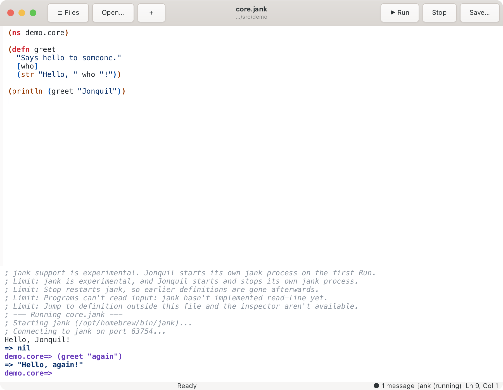

# jank (experimental)

Part of [Dialects and runtimes](index.md).

Jonquil supports jank as an experimental dialect. Unlike ClojureDart and JVM Clojure, you don't start
anything yourself: Jonquil launches a `jank repl` for the window.

A window picks jank when the open file is a `.jank` file, or when the
project's `.jonquil.edn` says `{:dialect :jank}`. There is no project
marker for it. The status bar reads `jank (not running)` until the first
evaluation, then `jank (running)`.

## Installing jank

Install jank with `brew install jank-lang/jank/jank`, or point the
`JONQUIL_JANK` environment variable at a jank binary you already have.
Jonquil looks for the binary in this order: `JONQUIL_JANK`, `jank` on your
`PATH`, `/opt/homebrew/bin/jank`, then `~/.local/bin/jank`. With none of
them present, the first Run says so, naming both ways to fix it.

## How it runs

Jonquil starts one jank per window, on the first evaluation, and not when
the window opens. It runs `jank repl` from a private temporary folder with
`--module-path <project>/src`, or the project folder when there's no
`src`. For a loose file with no project, the module path is the folder its
`ns` implies: `talk.core` saved as `…/src/talk/core.jank` gives `…/src`, so
a sibling such as `talk.util` loads. A file whose `ns` doesn't match its
path falls back to its own folder. jank
writes its `.nrepl-port` into that private folder, so your project's
`.nrepl-port`, if it has one, is never touched. Closing the window, or
quitting while jank is still starting, stops the process and removes the
folder.

Run sends the whole file as a `load-file`, and the prompt then moves to the
file's namespace. A REPL line evaluates in the prompt's namespace. Run
Selection and Run Form evaluate in the buffer's namespace, and when jank
hasn't loaded it yet they say "; demo.core isn't loaded in jank yet. Run
the file first." rather than running the code in `user`.

jank has no interrupt, so Stop kills the process and starts a fresh one:
"; Stopped. jank restarted, so earlier definitions are gone." Reset on
Run is on by default here, as it is for Jolt. With it ticked, a
Run restarts jank first ("; Reset: restarted jank."), but only when the
process has already served a request: the first Run just starts jank and
prints no Reset line. Uncheck it and Run builds on whatever the process
already has.

<strong>A loose file whose first evaluation isn't a Run</strong>

One caveat for a loose `.jank` file with no project: when the first
evaluation is a REPL line or Run Selection rather than Run, jank starts
without that module path, so a `require` of a sibling namespace fails. It lasts until a Run starts jank: a Run after a Stop, or any
Run with Reset on Run ticked. Stop alone doesn't help, because a REPL line
still starts jank without the path. Run the file first to avoid it.

## Docs and completion

Quick documentation reads the var's own metadata, through an ordinary
eval, because nREPL's `lookup` op hangs on current jank. Jonquil never
sends it. While an evaluation is running there are no docs, since jank
answers one request at a time: the popover says "No docs while jank is
running."

Completion merges jank's own candidates with the offline ones. Homebrew's
jank 0.1 lists only the prompt namespace's own vars and the builtins, not
the vars a namespace referred from another one, so those names come from
the words in your buffer instead.

## Limits

The console prints these when a jank window opens:

- jank is experimental, and Jonquil starts and stops its own jank process.
- Stop restarts jank, so earlier definitions are gone afterwards.
- Programs can't read input: jank hasn't implemented read-line yet.
- Jump to definition outside this file and the inspector aren't available.

Jonquil can't attach to a jank you started yourself yet, and F12 works
only inside the buffer.

jank also holds a program's printed output until the evaluation ends, so a
`println` inside a long loop shows nothing while it runs, and an evaluation
you Stop never shows its output at all. While something runs, the status
bar reads "Running…"; that's the signal to watch before pressing Stop.

Some loops don't compile in jank yet: `(loop [] (recur))`, and a `recur`
that follows a `when` in the loop body, fail with
`codegen/internal-failure`. Writing every `recur` inside an `if` branch
works, for example
`(loop [i 0] (if (< i n) (recur (inc i)) i))`.
