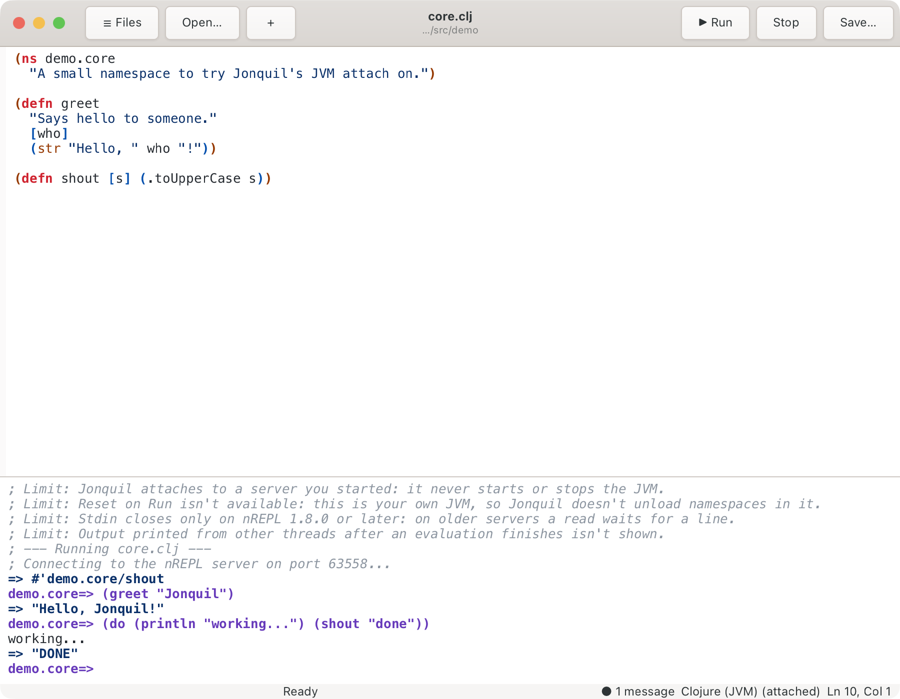
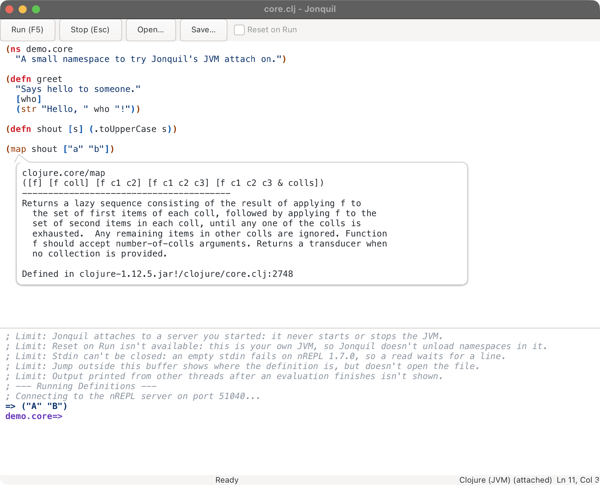
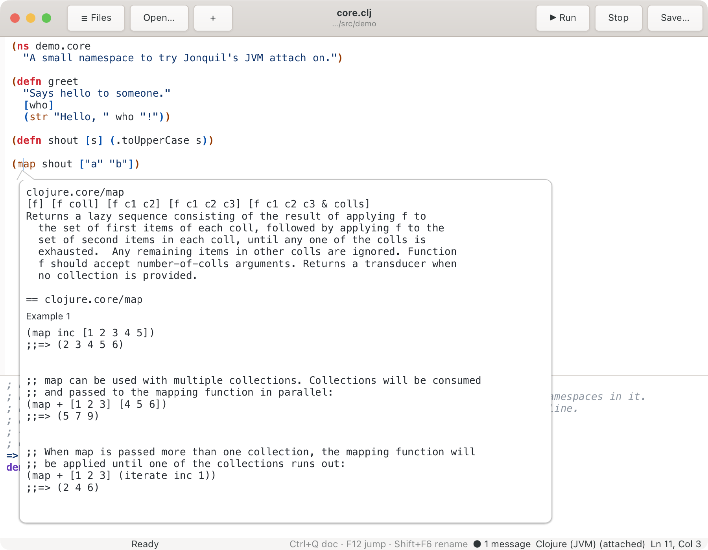

# JVM Clojure: attaching to your own nREPL server

Part of [Dialects and runtimes](index.md).

Jonquil never starts a JVM Clojure server; it connects to one you run.

1. Start any nREPL server that writes `.nrepl-port` in the project
   directory. The simplest is [clojure-cli.repl](https://github.com/clojure/clojure-cli.repl)'s
   `:serve` alias (Java 17+ and the `clojure` CLI):

   ```clojure
   ;; deps.edn
   {:paths ["src"]
    :aliases {:serve {:extra-deps {io.github.clojure/clojure-cli.repl-server {:mvn/version "0.1.0"}}
                      :main-opts ["-m" "clojure-cli.repl.server"]}}}
   ```

   Then `clojure -M:serve`, and wait for `nREPL server listening on port N`.
2. Put `{:dialect :clj}` in the project's `.jonquil.edn`. Nothing else
   picks this dialect (see [Choosing a dialect](index.md#choosing-a-dialect)).
3. Open a `.clj` or `.cljc` file and press Run.

Ctrl+C on the server removes `.nrepl-port`; the status bar shows
`(not running)` until you restart it and Run again. Jonquil only reads
`.nrepl-port`, never writes it. If it can't connect, the console says
whether nothing is listening, the port file is stale, or the port isn't
nREPL.



## Auto-require

List namespaces to load on every connect, so the first prompt line can
call into them:

```clojure
;; .jonquil.edn
{:dialect :clj
 :auto-require [my.app.core my.app.dev]}
```

Jonquil prints `; auto-require: ...` and sends one `require` before your
first Run or REPL entry, and again after each reconnect. The same key works
for Jolt projects (without `:dialect`): out of process it's required in the
child at start and restart, in process once per window after `:deps` load.
Reset on Run keeps these namespaces.

A failed require shows the server's error and "auto-require failed", and
your own line still runs. The value must be a vector of namespace symbols,
or it's ignored with a console note. Edits take effect in a new window.

## Run, Stop, stdin and docs

- **Run** sends the whole pane as a `load-file`; the file's `ns` decides
  where it evaluates, and the prompt moves there.
- **REPL entries** run in the prompt's namespace, which follows `in-ns`.
- **Run Selection and Run Form** (Cmd/Ctrl+E, Cmd/Ctrl+Enter) run in the buffer's namespace.
  If the server hasn't loaded it: "Run the file first."
- **Stop** sends `interrupt` and waits up to a second. If the evaluation
  doesn't end, Jonquil detaches and the next evaluation uses a fresh
  session.
- **stdin**: type at the prompt while the status bar reads "Waiting for
  input". Cmd/Ctrl+D ends input on nREPL 1.8.0 or later.
- **Show the last error's frames and locals** lists the error's stack
  frames, each opening its file; the JVM keeps no locals (see
  [the last error's frames](../help-and-inspector.md#the-last-errors-frames)).
- **Completion and quick doc** ask the server. Ctrl+Space merges its
  candidates with offline ones; Ctrl+Q or Shift+F1 shows the docstring and
  a `Defined in` line, and F12 opens the source.

`clojure-cli.repl-server` 0.1.0 brings nREPL 1.7.0, which can't send
end-of-input. For 1.8.0, add `nrepl/nrepl {:mvn/version "1.8.0"}` to the
`:serve` alias's `:extra-deps`.



Press Ctrl+Q or Shift+F1 a second time for the full ClojureDocs entry,
examples included. The first request downloads ClojureDocs' export (a few
megabytes), which can take several seconds.



More in [Known limits](../known-limits.md).
