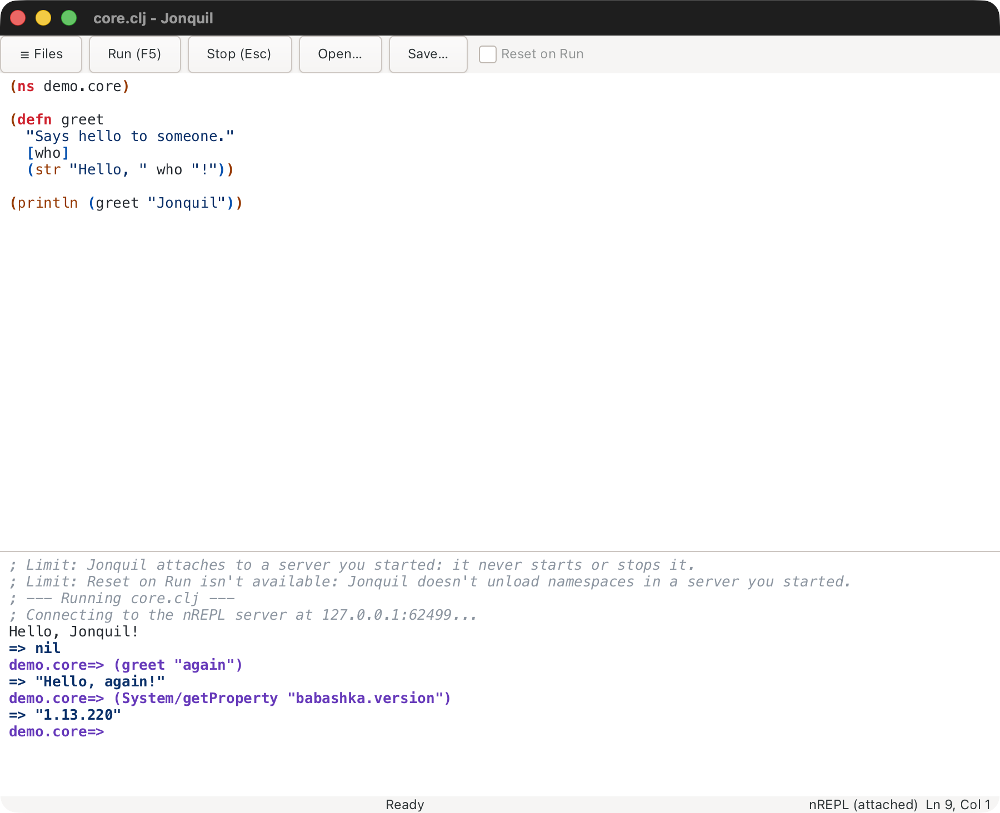

# Any nREPL server: babashka, other Clojures, other hosts

Part of [Dialects and runtimes](index.md).

`{:dialect :nrepl}` in a project's `.jonquil.edn` attaches to an nREPL
server you started, whatever language it runs: babashka, Basilisp (Clojure
on Python), or a server on another machine. Jonquil connects on the
first Run and never starts or stops the server. It assumes nothing about
the server beyond what its `describe` reply says, so a feature works when
the server offers the op behind it and the start lines say which ones it
lacks.

`:nrepl` in the same file says where to connect:

```clojure
{:dialect :nrepl :nrepl {:port 1667}}                 ; this machine
{:dialect :nrepl :nrepl {:host "box" :port 1667}}     ; another one
{:dialect :nrepl :nrepl {:port-file "tmp/nrepl.port"}} ; read the port from a file
```

With no `:port`, Jonquil reads the port from `:port-file`, or from
`.nrepl-port` in the project when that's left out too. The host is
`127.0.0.1` unless `:host` names another. A value Jonquil can't use, such
as a port outside 1-65535 or an absolute `:port-file`, is a warning in the
console, and that key falls back to its default.

For babashka, start the server in the project and name its port, since
`bb nrepl-server` writes no port file:

```bash
bb nrepl-server 1667
```



<details>
<summary><strong>What to expect from babashka</strong></summary>

Measured against babashka's server, here's what to expect. Run, the REPL,
quick docs and completion all work (Jonquil keeps only completion names
that start with what you typed, since babashka's matching is looser). Its server has no `interrupt` op, so Stop
can't end a running evaluation: it disconnects instead, the evaluation
keeps running inside babashka, and the next Run connects a fresh session.
It has no `stdin` op either, so a `read-line` waits until Stop; the console
says so before the evaluation starts. Jump to definition stays in the
buffer for library functions, because babashka names a file that isn't on
this disk, and Jonquil only follows a `:file` it can open.

</details>

Basilisp's server writes `.nrepl-port` in the folder you start it in, so
start it in the project and `{:dialect :nrepl}` is all `.jonquil.edn`
needs:

```bash
basilisp nrepl-server
```

<details>
<summary><strong>What to expect from Basilisp</strong></summary>

Measured against Basilisp 0.5.1: Run, the REPL and completion work, and
the error line is the exception Python names last
(`ZeroDivisionError: Fraction(1, 0)`), or the message of a compile error.
Quick docs come from its `info` op, since it has no `lookup`, and for
Basilisp's core functions they name its own `core.lpy` on this disk. Like
babashka it has no `interrupt` op, so Stop disconnects. It has no `stdin`
op either, but its `read-line` reads the server's own stdin, so type the
line in the terminal you started the server in. The console says that
too, before the evaluation starts.

</details>

A server on another host is the same unauthenticated code execution as
one on this machine, now reachable over the network. Keep it on a network
you trust, or tunnel it: `ssh -L 1667:localhost:1667 box`, then
`{:port 1667}` here.

Over a slow link, completion and quick docs arrive a moment after you ask
rather than holding up typing (see [Completion](../help-and-inspector.md#completion)). A babashka
server on a distant host measured 300 to 400 ms a round trip through an
ssh tunnel: the popup opened in about 30 ms on the names Jonquil knew, and
the server's own names followed. Run, the REPL, errors and Stop worked the
same there as on this machine.
