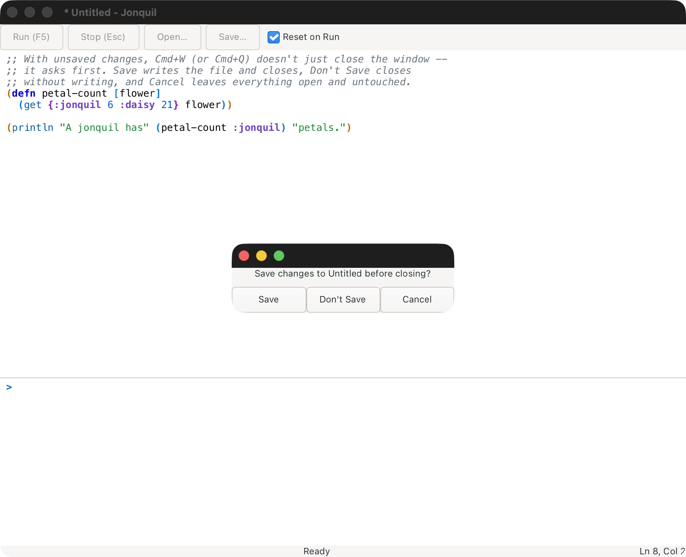
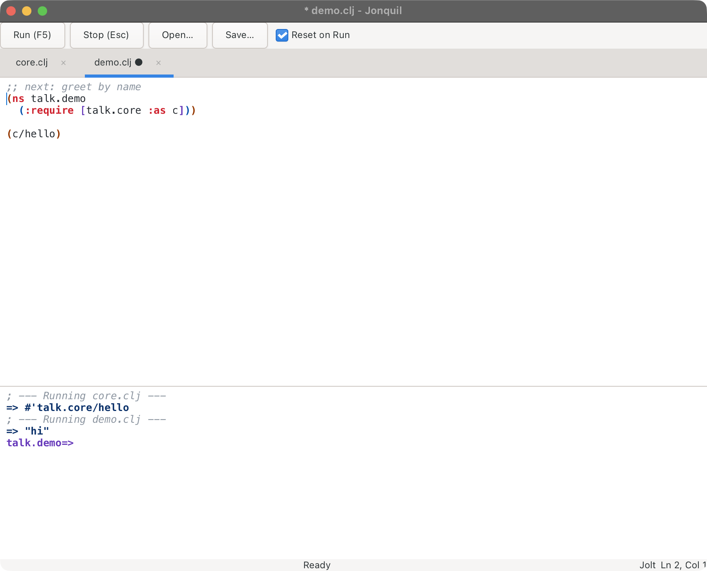
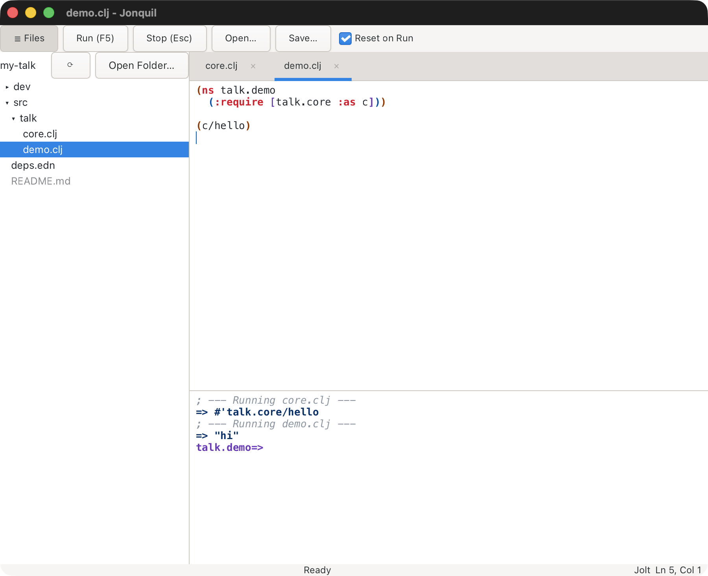

# Files and tabs

Opening and saving files, tabs, opening from Finder and the Dock, and the file tree.

## Open and Save

Cmd/Ctrl+O opens a file in a new tab, next to the one you're in (see
[Tabs](#tabs), below). Nothing you've typed is ever replaced by an Open.
The one exception is a fresh, empty Untitled tab: Open fills that tab
instead of leaving it behind. A file that's already open in a tab, even
when you pick it through a symlink, just brings that tab forward.

Opening a file that isn't valid UTF-8 doesn't fail either. Bytes that
can't be decoded turn into the replacement character, and the console
warns in grey: "This file isn't valid UTF-8; unreadable bytes show as �
and saving will replace them." The file on disk is left untouched until
you save.

Cmd/Ctrl+S saves to the file's remembered path, or opens a Save dialog if
there isn't one yet. Cmd/Ctrl+Shift+S always opens the Save dialog, even
for a file that already has a path.

<details>
<summary><strong>How a save stays safe: atomic writes, symlinks and permissions</strong></summary>

Either way, the save itself is atomic:
Jonquil writes to a hidden temporary file next to the target first, then
renames it into place, so a crash or a full disk mid-write can't leave a
half-written file behind. Saving through a symlink follows the link and
updates the file it points to, leaving the link itself in place. That
holds even when the link points at nothing yet: the save creates the file
the link names, and a relative link is resolved against the real location
of its folder. A chain of more than 40 links prints "; save: too many
levels of symbolic links". When the file already exists, the temporary
file is created private (mode 600) before the new text goes in and only
then gets the file's own permissions, so a private file's content is never
written into a more open file.

</details>



Closing with unsaved changes asks first, however you close: Cmd/Ctrl+W on
the last tab, the window's own close button, Cmd+Q, Dock → Quit, or
logging out all raise the same prompt, offering Save, Don't Save and
Cancel. With several tabs holding unsaved changes you get one prompt that
names them all, and its first button is Save All. Cancel, or dismissing
the prompt any other way, leaves everything open and untouched. If a save
fails or you cancel partway through, the window stays open and the tab
that didn't save comes to the front, so a failed save never closes a tab
that still has unsaved work in it. `docs/demos/close-prompt.clj` is there to
try it on: make an edit, then close the window.

## Tabs



One window holds as many files as you like, one per tab. Cmd/Ctrl+T opens
an empty Untitled tab, and Open puts each file in a tab of its own. The
tab strip only appears once there are two tabs, so a one-file session
looks exactly as it always did. A second Untitled tab is labelled
`Untitled 2`, and so on. A tab's label carries a dot while it has
unsaved changes. When two open files share a name, each label adds its
folder (`core.clj · talk`). Cmd/Ctrl+Shift+] and Cmd/Ctrl+Shift+[ step
through the tabs, wrapping round at either end, and Cmd/Ctrl+1 to 8 jump
straight to a tab, with Cmd/Ctrl+9 for the last. Cmd/Ctrl+W, or a tab's
×, closes that tab, asking first when it has unsaved changes.

Every tab shares the window's one evaluator and its one console, the way
a project REPL in CIDER or Calva does. So `demo.clj` can call what
`core.clj` defined, and the prompt follows whichever tab ran last.

<details>
<summary><strong>Reset on Run with several tabs</strong></summary>

Reset on Run works per tab. Each tab owns the namespaces its own Runs
created, and a Run with the box ticked removes only that tab's
namespaces, plus anything you created at the prompt, plus `user`.
Running `demo.clj` leaves `talk.core` alone. Closing a tab hands its
namespaces back to the prompt's pile, so the next Run from any tab
clears them. Two things follow from sharing one session, and they're
worth knowing:

- Running `core.clj` again removes and recreates `talk.core`, but
  `talk.demo` still holds its alias to the old namespace until you run
  `demo.clj` again too. That's ordinary Clojure reloading. Tabs just make
  it come up more often.
- Every Run still starts from a fresh `user`, so two Untitled tabs without
  an `ns` form overwrite each other's definitions.

</details>

<details>
<summary><strong>Files from another project, and loose Jolt files</strong></summary>

A window belongs to one project, the one its first file came from. Open a
file from somewhere else and it still gets a tab you can edit and save,
but Run, Run Selection, Run Form and Inspect Form refuse in that tab, and
the console says which project the file belongs to and which one the
window runs. A Jolt file outside any project is the exception: it runs in
whatever Jolt the window has, so a scratch file opened next to a `deps.edn`
project's tabs runs in that project's Jolt process, with its classpath,
and a relative path or `load` in it resolves from the project folder
rather than the file's own.
With only one tab open, opening a file from another project switches the
window over as it always did, and closing tabs until the one left belongs
elsewhere switches it too. A loose Jolt file keeps the window's Jolt even
on its own: when tabs close down to it, and when the only tab is saved
under a new name outside any project.

</details>

### Tabs from last time

Jonquil remembers which files have tabs in the window, in order, and
which one is selected. It saves that list each time you open, close or
switch a tab, and again when you quit, so a crash or a force quit
doesn't lose it. It keeps that list per project folder,
the folder the file tree is rooted at, for the 20 most recent folders.
Start Jonquil again in the same folder without naming a file (`jonquil`
from that folder, or `jonquil` with the folder as its argument) and those
tabs come back, with the selected one selected again. The window shows
straight away and the tabs open into it. A start from the
Dock or Finder has no folder of its own, so it goes back to the project
you quit most recently and roots the file tree there.

<details>
<summary><strong>What isn't reopened, and turning it off</strong></summary>

Only files are remembered. Untitled tabs, and text you didn't save, are
not: quitting already asks about those, and a file you chose not to save
reopens as it is on disk. Naming a file at launch (`jonquil core.clj`)
opens just that file. A remembered file that's been deleted or moved is
skipped, and the console names it: `; Couldn't reopen notes.clj from last
time.`, or `; Couldn't reopen 3 files from last time:` followed by their
names. If `sessions.edn` itself can't be read, the console says `;
Couldn't read sessions.edn, so no tabs were reopened.` The list lives in `sessions.edn`, next to `settings.edn` (see
[Themes](using-jonquil.md#themes) for where that is). To turn the whole thing off, put
`:reopen-tabs? false` in `settings.edn`; Jonquil then neither saves nor
reopens anything.

</details>

## Opening from Finder and the Dock

With the macOS app installed (see [Getting started](getting-started.md#the-macos-app)),
Open With on a Clojure file in Finder, or dropping files on Jonquil's Dock
icon, opens each file in a tab. On Linux, a file manager's Open With on an
installed Jonquil does the same (see [Linux](getting-started.md#linux)), and
so does giving several files on the command line: `jonquil a.clj b.clj` opens
two tabs on either system.

<details>
<summary><strong>Tab rules, folders, and files that can't be opened</strong></summary>

The usual tab rules apply: a file that's
already open just selects its tab, an untouched Untitled tab is filled
first, and a file from another project than the window's gets an editable
tab that refuses Run (see [Tabs](#tabs)). A folder, from Open With, a
drop or the command line, roots the file tree there and shows it, even if
you'd hidden it. When a command line mixes a folder and files, the first
argument sets the window's project the way a single argument always has, and
the others open as tabs. A file manager on Linux doesn't offer Jonquil for
folders, because the MIME package has no `inode/directory` entry. Pass the
folder on the command line instead, to `~/.local/share/jonquil/jonquil` or
to `gtk4-launch net.b12n.jonquil <folder>` (from `libgtk-4-bin`).

A file Jonquil can't honour says so on the status line: a path it can't read
is named with the reason, and a file that isn't local (a URI) is reported as
"not a local file". The rest of a batch still opens. When several fail, only
the last failure stays on the status line.

</details>

## File tree



Launch Jonquil on a folder and you get a tree of it on the left:

```bash
jonquil ~/dev/my-talk          # the built binary
bb app:run ~/dev/my-talk       # from a checkout
```

The window then runs that folder's project (its `deps.edn`, `pubspec.yaml`
or `.jonquil.edn` decides the dialect, as it would for a file inside it)
and reopens the tabs you had there last time (see
[Tabs from last time](#tabs-from-last-time)), or starts with one empty
Untitled tab when there are none. Launched on a file instead, the
tree is rooted at that file's project folder, or at the file's own folder
when it isn't in a project. With no argument from a terminal it's the
current directory. From Finder or the Dock there's no useful current
directory, so the tree starts empty and offers **Open Folder…**.

**☰ Files** in the toolbar, or Cmd/Ctrl+Shift+E, shows and hides it.
Hidden, the window looks exactly as it does without a tree. The tree
starts shown when you launched on a folder and hidden otherwise; after
that, whatever you last chose is remembered in the settings file, along
with the tree's width (drag its edge).

A click on a folder opens or closes it. A click on a file opens it in a
tab, or brings forward the tab that already has it. With the tree focused,
the arrow keys move, Right and Left open and close a folder, Return opens,
and Escape hands focus back to the editor. The active tab's file is
highlighted when its row is showing. Switching tabs never opens folders by
itself, but saving a file somewhere under the root, or opening one into a
tab, does: a new file you just saved shows up in the tree right away.

<details>
<summary><strong>What the tree hides, and refreshing it</strong></summary>

Dotfiles and dot-folders (`.git`, `.cpcache`, `.clj-kondo`…) and the
folders `target` and `node_modules` are hidden, along with whatever the root's `.gitignore`
names, as long as the line is a plain name (`out`), a `*` pattern (`*.log`)
or a folder (`classes/`). Lines with `!`, `**` or a `/` in them are left
out rather than half-applied, and nested `.gitignore` files aren't read.
Folders come first, then files, alphabetically. Anything that isn't a
Clojure-family file (`.clj`, `.cljc`, `.cljs`, `.cljd`, `.edn`, `.bb`) is
dimmed, but still opens. A symlinked folder opens like any other, and a
link that loops back to one of its own parents shows up but won't open
into itself.

The tree doesn't watch the disk. ⟳ in its header re-reads every open
folder, and opening a folder always reads it fresh. **Open Folder…**, also
in the header, roots the tree somewhere else; it doesn't open or close any
tab, and only changes which project the window runs while the window holds
nothing but one empty Untitled tab.

</details>

### Files and folders

Right-click a row for **New File…**, **New Folder…**, **Rename…** and **Move to
Trash**. Right-click the empty space under the rows for the first two, which
then go in the tree's root folder. With a row selected, Shift+F10 or the Menu
key opens the same menu. On a file row, New File and New Folder go in the
folder that file is listed in. The "(can't read)" row has no menu.

F2 renames the selected row. Delete, or Cmd+Backspace (Ctrl+Backspace on
Linux), moves it to the Trash. Return still opens a file or toggles a folder.

<details>
<summary><strong>Naming rules, open tabs after a rename, and the Trash</strong></summary>

The menu swaps to a name box. Return accepts the name, while Escape or a
click outside cancels. Escape on the menu itself closes it. Rename pre-selects the
part of the name before the extension. A name that won't do keeps the box open
and says why: it's blank, contains `/` or a NUL character, is `.` or `..`, is already used in
that folder, or is held by an open tab (a tab can outlive its file after a
trip to the Trash). Rename never overwrites anything. Changing only the case
of a name (core.clj to Core.clj) works.

Open tabs follow a rename: a tab on the renamed file, or on a file under a
renamed folder, now points at the new path, and its unsaved text and dirty
mark stay as they were. Expanded folders stay expanded. On a link, Rename and
Move to Trash act on the link itself, the way Finder does, and leave whatever
it points to alone.

Move to Trash always asks first, with Cancel as the default button, and uses
the system Trash (`~/.Trash` on macOS, the freedesktop trash on Linux).
Nothing is ever deleted permanently, so the Trash is the undo. If the move
fails, the console says so and nothing is deleted. Tabs on a trashed file
stay open with their text, and the console tells you that Save writes the file
back. For a trashed folder it says to use Save As instead, because Save can't
recreate the folder.

A new file whose name the tree hides (a dotfile, or a `.gitignore` match) is
still created and opened, and the console says it's hidden. Dragging rows to
move them isn't supported yet.

</details>
