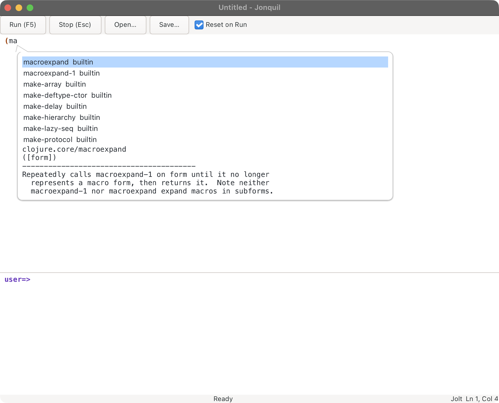
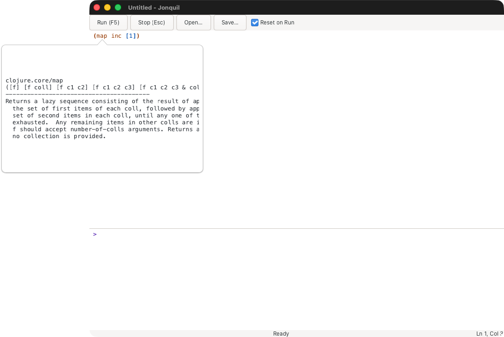
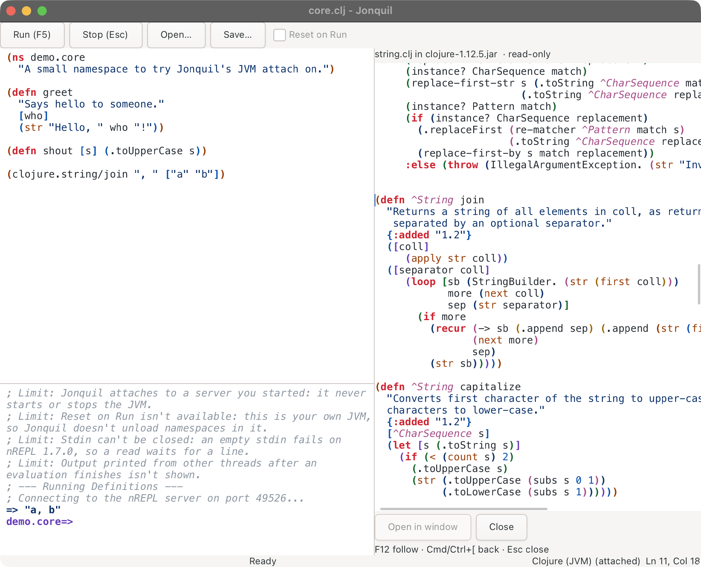
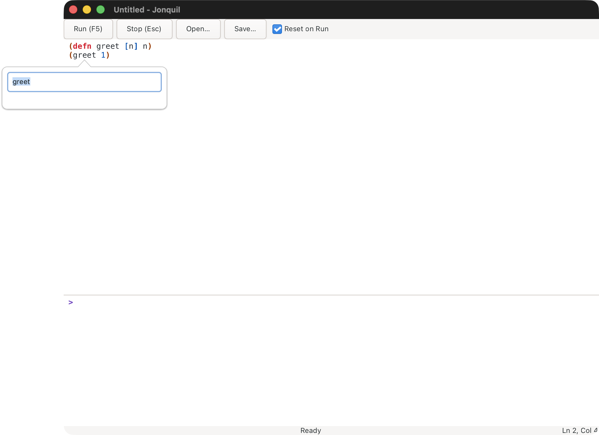
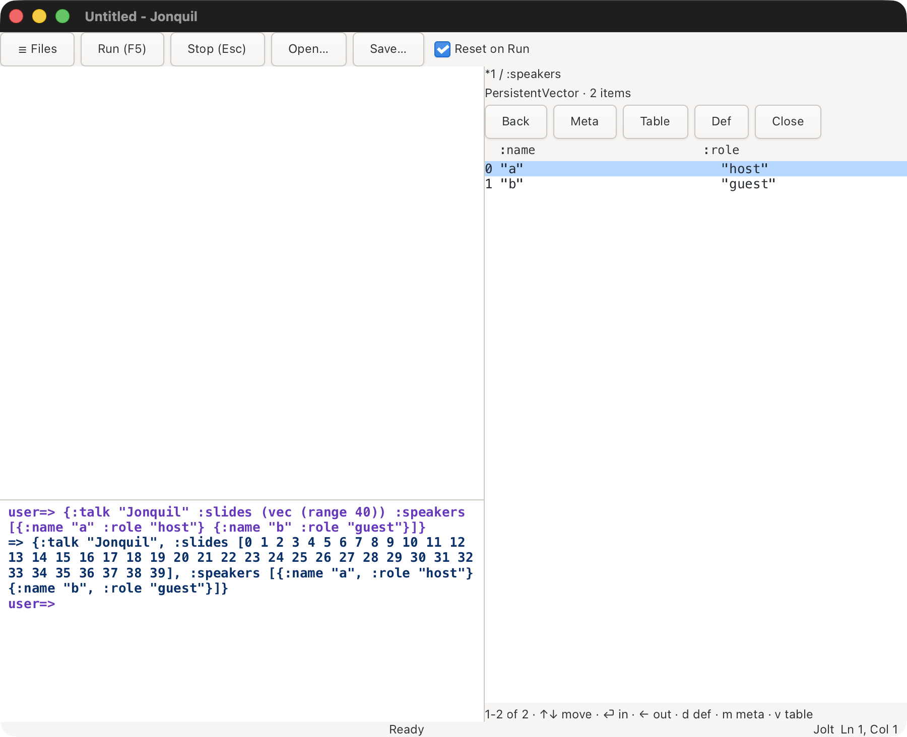
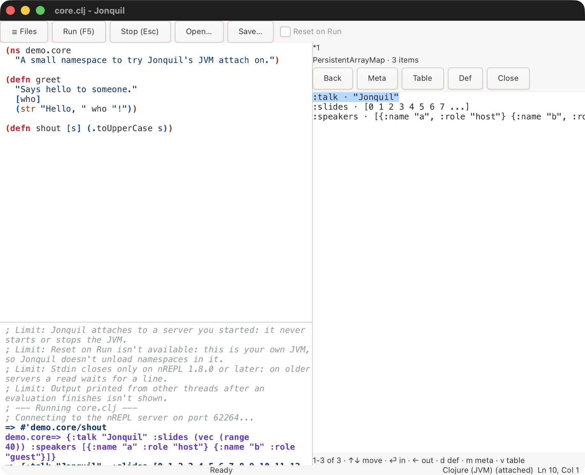

# Help and the inspector

Completion, quick doc, jump to definition, rename, the command palette, and the value inspector.

## Help

Help covers four things: completion with a doc preview, quick
documentation, jump to definition, and rename. A right-click menu and the
command palette reach all of them. Each one resolves in the
namespace your program actually runs in, so a function Run just defined
shows up the same way a core one does.

The Ctrl keys below (Ctrl+Space, Ctrl+Q and Ctrl+B) mean Control
specifically, even on a Mac, and the F-keys take no Control or Command: Cmd+Q
still means Quit, and Cmd+Space still does whatever Spotlight or your
input source switcher already has it bound to. Cmd+B, Cmd+F1, and
Command's usual companions to these keys do nothing here, on purpose.
F-keys need the Fn key held down too, on most Mac keyboards.

### Completion

Ctrl+Space, in either the Definitions editor or the console's input line.
With no prefix at the caret it does nothing; with exactly one match it
inserts that match right away; otherwise a popup opens below the caret
(above the input line in the console) with the candidate list on one side
and a documentation preview for whichever one is selected on the other.

<strong>Keys while the popup is open</strong>

While the popup is open, Up and Down move the selection one row, PageUp
and PageDown move it eight rows, Enter or Tab commits the selected
candidate, and Escape closes the popup without touching the buffer.
Typing keeps narrowing the list, and moving the caret out of the word
(an arrow key past its start, say) closes the popup the same way Escape
does. In the console's input line, the popup's own keys take over from
history and from evaluation while it's open: Up and Down move the list
instead of paging through history, and Enter commits the candidate
instead of running the line. Close the popup first, by committing
something or by Escape, to get history and evaluation back.

Candidates come from Clojure's special forms and core built-ins, whatever
the Definitions pane itself defines, and whatever your program has
defined by running or by typing at the prompt. Each row names where it
came from: `special`, `builtin`, `buffer` for a name this file defines,
`user` for the rest and, for launched ClojureScript's analyzer names,
`core` (a cljs.core public) or `remote` (a fully-qualified one). The list is as tall as its names, up to eight
rows, and scrolls past that. Caret-anchored popups (this one, quick and
full docs, and rename) follow the caret while the view scrolls, in the
editor and the console both, and hide once the caret scrolls out of view.

When a server answers completion (JVM Clojure, ClojureScript, any nREPL
server, Jolt out of process, jank), Jonquil asks it without making you
wait. A local server answers before the popup opens, so nothing changes
there. A slow one gets about a fortieth of a second: after that the popup
opens on the names Jonquil already knows (or "Asking the server..." when
it knows none), and the server's names join the list when they arrive,
with your selection kept. Keep typing and the list follows what you type;
an answer for text you've since changed is dropped. Quick documentation
and jump to definition work the same way, saying "Looking up X..." on the
status bar until the answer lands, and a jump to a definition in the file
never waits for the server at all.

### Quick documentation

Ctrl+Q or Shift+F1 opens a popup with the namespace, arglists, and
docstring for the symbol at the caret, or in the selection when the
selection is exactly one symbol. With no symbol there, the status bar
says so instead of opening anything. Escape, or moving the caret, closes
the popup.

### Jump to definition

F12 or Ctrl+B moves the caret to the symbol's own definition and scrolls
it into view, when Jonquil can find one in the buffer. It checks the
nearest enclosing local binding first (a function parameter, a `let`, or
anything else that can shadow a name), then a top-level `def`, `defn`, or
similar form anywhere in the file. When neither turns up but the symbol
resolves to a definition in another file, which JVM Clojure's server,
Jolt in or out of process, and an nREPL server whose files are on this
machine can tell Jonquil, Jonquil opens that file with the caret on the
definition. A file in your project opens in a tab, or brings forward the
tab that already has it, ready to edit; Cmd/Ctrl+[ then takes you back to
where you pressed F12, one jump at a time. Library code from a jar, and
any file outside your project, opens in a read-only source panel on the
right instead. With Jolt in process, a function another tab's Run
defined counts too, once that tab's file is saved and unchanged since the
Run: the Run records the file for the vars it defines, and F12 opens it
like any other file. In other
runtimes, which don't say where a definition lives (ClojureDart,
ClojureScript, jank), jump shows the var's documentation in the quick-doc
popup instead.
Functions built into Jolt itself, `clojure.core`'s among them, have no
source file to open, so they show their documentation too. When nothing matches at all, the status bar
says so.

<strong>The source panel</strong>

The panel shows library code and files outside your project, read-only.
Inside it, F12 or Ctrl+B follows a definition again, in the same file or
into another, and Cmd/Ctrl+[ goes back. A definition in one of your
project's files opens in its tab, as a jump from the editor does, and a
definition in the window's own file moves the window's caret to it and
puts focus back in the editor. Escape closes the panel, and Cmd/Ctrl+I
swaps it for the inspector. Should a project file ever land in the panel
(its tab couldn't be opened), the **Open in window** button
(Cmd/Ctrl+Shift+O while the panel has focus) tries again.

### Rename

Shift+F6 or F2 opens a small popup prefilled with the symbol at the
caret. Type a new name and press Enter to apply it, or press Escape to
cancel. A rename touches only code: every place the exact symbol appears
as its own token, never inside a comment, a string, a regex literal, or a
keyword, and never a longer name that merely contains it, so renaming
`greet` leaves `greeting` alone. If the new name is blank, isn't a valid
Clojure symbol, matches the old name, or there's nothing to rename, the
popup explains why instead of doing anything. Applying a rename is one
undo step, so Cmd/Ctrl+Z reverts it in a single press, and the status bar
reports how many occurrences changed.

### Right-click menus

Shift+F10, or a right click over the Definitions editor, opens a menu
led by Run Form, then Jump to Definition, Rename Symbol, Quick
Documentation, Inspect Last Result, Inspect Form, and Complete, alongside
Jonquil's other editing commands
(Toggle Comment, Format All, Format Selection, Indent, Unindent, Find,
Replace) and GTK's own Cut, Copy, and Paste. The same menu over the
console's input line carries Complete and Clear Last Output next to
GTK's own entries. Every item runs the exact function its key would.

### The command palette

Cmd/Ctrl+Shift+P opens a list of Jonquil's commands under the caret.
Each row shows what the command does, the keys that run it when it has
any, and where it comes from (built-in, or the plugin that added it). Typing narrows the
list to the rows that contain every word you type, matched against the
description and the command's id, so "toggle comment" finds Toggle
Comment even though its description says "Comment or uncomment the
lines." Up and Down move the selection, and Return or a click runs it on
the tab you opened the palette from, exactly as its key would. Escape
closes it. While you type in it, the window's own shortcuts wait, as they
do in the rename box, so Cmd/Ctrl+W or F5 can't fire mid-word. A few
commands that only make sense inside their own key, such as the steps
Escape walks through or "go to tab 3", aren't listed.

### Freeing Ctrl+Space on macOS

macOS reserves Ctrl+Space by default, under System Settings > Keyboard >
Keyboard Shortcuts > Input Sources > "Select the previous input source."
While that shortcut stays on, a real Ctrl+Space keypress goes to the
system first and never reaches Jonquil at all. Turn it off there (or
rebind it to something else) to free Ctrl+Space for completion.

<strong>Why Jonquil can't work around it</strong>

This
isn't something Jonquil can work around from inside the app: in testing,
a Ctrl+Space routed straight to Jonquil's own process by its pid reached
the completion handler without trouble, but an actual key press on the
keyboard still went to the system's input-source switch as long as that
shortcut was turned on.

## Inspecting values

Cmd/Ctrl+I opens the inspector panel on the last result, the value the
console itself would call `*1`. Cmd/Ctrl+Shift+I evaluates the form at
the caret first, the same form Run Form would, and opens the panel on
whatever it returns. Both are also on the Definitions editor's right-click
menu, as Inspect Last Result and Inspect Form. The panel takes focus the
moment it opens, so every key below reaches it directly: nothing you type
next lands in the editor until you close the panel again.

The panel sits on the right, in its own pane: a path at the top (`*1`, or
a level down, `*1 / :speakers`), a line naming the value's type and size,
a small toolbar (Back, Meta, Table, Def, Close), the rows themselves, and
a footer. A collection's rows read `label · preview`, one per entry, or,
when every entry is a map and they all share the same keys, one row per
entry in a table instead, a column per key. A leaf value, a string or a
number, shows its own printed form in place of rows.

<strong>The panel's keys and its footer</strong>

Up and Down move the selection. Return or Right goes in a level, onto
whatever's selected; Left or Backspace comes back out, landing on the row
you went in from. Page Up and Page Down page through a long collection,
and so does Down past the last visible row, or Up from the first row on
a page that isn't the first, landing on the new page's first or last row
in turn. `m` shows or hides the current value's metadata, and `v`
switches a table between its table and its plain list form. `d` opens a
small prompt: type a name and press Return to define that var from the
current value. Escape there closes only the prompt, leaving the panel
behind it untouched, and never Stops a program that happens to be
running. A successful def prints `; Defined #'ns/name` on the console and
leaves the panel exactly where it was, the same row still selected.
Escape anywhere else in the panel closes it and hands focus back to the
editor.

The footer names where you are and what the keys do, something like
`11-20 of 25 · ↑↓ move · ⏎ in · ← out · d def · m meta · v table`. An
empty collection reads `0 of 0` rather than a range it doesn't have. A
note from the last action, `no metadata`, `not tabular`, or an error,
shows there too for a few seconds and then clears on its own.

Jolt supports this in process and out of process alike. Out of process,
Jonquil loads the same inspector code into its Jolt child as nREPL
middleware, so stepping through a value never changes `*1`, `*2` or `*3`.
JVM Clojure does too, once its own server offers clojure-cli.repl's
inspector. ClojureDart doesn't, in this version: Cmd/Ctrl+I there puts a
short sentence in the status bar instead of opening anything. Opening a
file whose dialect or runtime differs from the one the panel opened
against hides the panel; Cmd/Ctrl+I on the new file opens a fresh one.

<strong>On the JVM, and the panel's size and limits</strong>

On the JVM, before your first Run, Cmd/Ctrl+I says "Nothing to inspect
yet: Jonquil isn't attached to the server. Run something first." After a
Run, the first Cmd/Ctrl+I already shows that Run's own value: Jonquil
registers with the server's inspector the moment it connects, invisibly,
so there's no extra step to remember. If the server dies, whether the
panel is open or a request of its own is still on the way, the footer
reads "Lost the connection to the nREPL server." and every action stays
disabled until you reopen the panel. Only one request is in flight at a
time either way, so a key pressed while one is still out does nothing at
all, rather than queuing up behind it.

The panel measures its own size, in rows and character columns, the
moment it opens; resizing the window changes that only the next time you
open it with Cmd/Ctrl+I, never while it's already showing. On the JVM,
the server keeps exactly one inspector view per connection, so it's
whichever client's action landed there last, Jonquil's own or another
tool attached to the same server. Either runtime caps a collection at
1000 entries: past that, the info line reads `1000+ items` instead of a
count, and paging still works over everything up to the cap.

