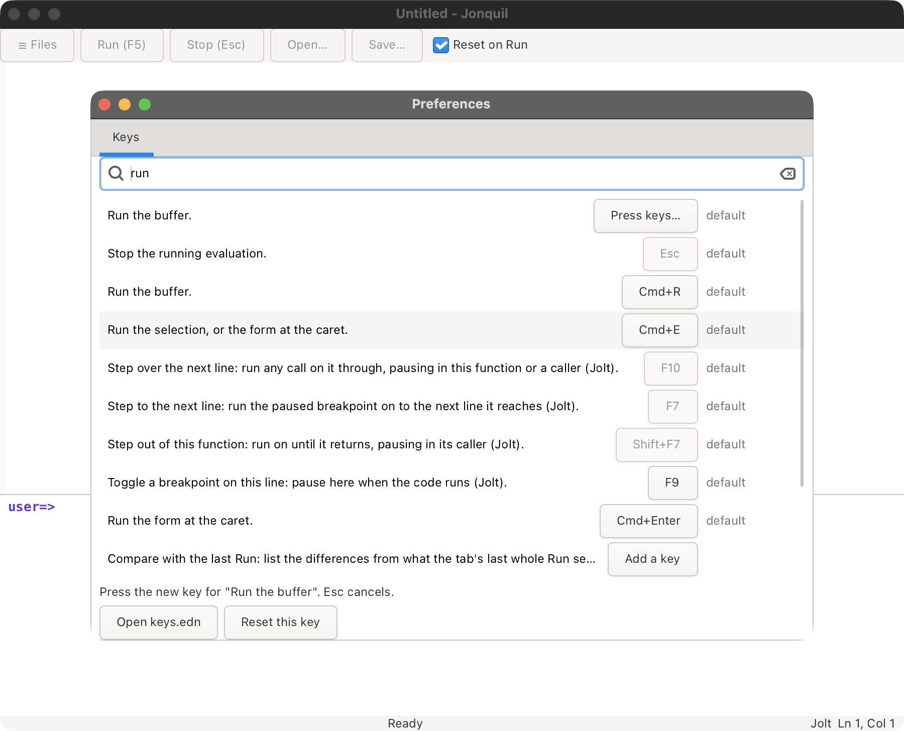

# Keys

Keys by purpose; click a group to open it.

On a Mac keyboard the top row sends media and brightness keys by default,
so every F-key here (F5 Run, F6, F8, F12 and the rest) needs fn held, unless
System Settings > Keyboard has "Use F1, F2, etc. keys as standard function
keys" turned on. F8 without fn plays or pauses Music, F7 without fn goes
to the previous track, and F10 without fn mutes the sound.

<details>
<summary><strong>Run, files and tabs</strong></summary>

| Key | Where | Does |
|---|---|---|
| F5 | anywhere in the window | Run |
| Cmd/Ctrl+R | anywhere in the window | Run |
| Esc | anywhere in the window | Stop, only while something is running |
| Cmd/Ctrl+O | anywhere in the window | Open |
| Cmd/Ctrl+S | anywhere in the window | Save |
| Cmd/Ctrl+Shift+S | anywhere in the window | Save As |
| Cmd/Ctrl+W | anywhere in the window | Close the tab (asks first over unsaved changes); on the last tab, close the window, which quits the app |
| Cmd/Ctrl+T | anywhere in the window | New Untitled tab |
| Cmd/Ctrl+Shift+] | anywhere in the window | Next tab (wraps) |
| Cmd/Ctrl+Shift+[ | anywhere in the window | Previous tab (wraps) |
| Cmd/Ctrl+1 to 8 | anywhere in the window | Go to that tab |
| Cmd/Ctrl+9 | anywhere in the window | Go to the last tab |
| Cmd/Ctrl+Shift+E | anywhere in the window | Show or hide the file tree |

</details>

<details>
<summary><strong>File tree</strong></summary>

| Key | Where | Does |
|---|---|---|
| Up/Down, Return | file tree | Move, and open a file or a folder |
| Right/Left | file tree | Open or close the selected folder |
| F2 | file tree | Rename the selected row |
| Delete, Cmd/Ctrl+Backspace | file tree | Move the selected row to the Trash |
| Shift+F10, Menu | file tree | Open the menu for the selected row |
| Escape | file tree | Give focus back to the editor |

</details>

<details>
<summary><strong>Editing, undo, zoom and themes</strong></summary>

| Key | Where | Does |
|---|---|---|
| ( [ { " | Definitions editor | Auto-pair the closer, or wrap the selection |
| Tab | Definitions editor | Indent the line or selection |
| Shift+Tab | Definitions editor | Unindent the line or selection |
| Cmd/Ctrl+/ | Definitions editor | Toggle line comments |
| Cmd/Ctrl+; | Definitions editor | Toggle line comments |
| Cmd/Ctrl+Shift+F | Definitions editor | Format the whole file |
| Cmd/Ctrl+Option(Alt)+F | Definitions editor | Format the selection or current line |
| Cmd/Ctrl+Option(Alt)+L | Definitions editor | Format the selection or current line |
| Cmd/Ctrl+Option(Alt)+P | anywhere in the window | Parinfer: next mode (Smart, Indent, Paren, off) |
| Cmd/Ctrl+Z | anywhere in the window | Undo |
| Cmd/Ctrl+Shift+Z | anywhere in the window | Redo (GTK's own binding) |
| Cmd/Ctrl+Y | Definitions editor | Redo |
| F6 | anywhere in the window | Move focus between the editor and the console |
| F8 | anywhere in the window | Go to the next place in the locations list |
| Shift+F8 | anywhere in the window | Go to the previous place in the locations list |
| F9 | anywhere in the window | Toggle a breakpoint on the caret's line ([Breakpoints](help-and-inspector.md#breakpoints)) |
| F7 | anywhere in the window | Step Into: the next line, while paused at a breakpoint ([Stepping](help-and-inspector.md#stepping)) |
| F10 | anywhere in the window | Step Over: the next line in this function, while paused at a breakpoint |
| Shift+F7 | anywhere in the window | Step Out: the caller's next line, while paused at a breakpoint |
| Cmd/Ctrl+. | anywhere in the window | Go to the next place in the locations list |
| Cmd/Ctrl+Shift+. | anywhere in the window | Go to the previous place in the locations list |
| Cmd/Ctrl+= (or +) | anywhere in the window | Zoom in |
| Cmd/Ctrl+- | anywhere in the window | Zoom out |
| Cmd/Ctrl+0 | anywhere in the window | Reset zoom |
| Cmd/Ctrl+Shift+M | anywhere in the window | Cycle the theme (light, dark, solarized, navy, the twelve popular themes, auto); the palette's Use theme entries pick one by name |
| Cmd/Ctrl+Shift+P | anywhere in the window | Open the command palette |
| Cmd/Ctrl+, | anywhere in the window | Open Preferences ([Your own keys](#your-own-keys)) |

To check a key from inside Jonquil, plugins' keys included, run **Describe
the next key you press** from the palette ([Describing keys](help-and-inspector.md#describing-keys)).

</details>

<details>
<summary><strong>Running code and the console</strong></summary>

| Key | Where | Does |
|---|---|---|
| Cmd/Ctrl+E | anywhere in the window | Run the editor's selection, or its current line, at the console prompt |
| Cmd/Ctrl+Enter | Definitions editor | Run the form at the caret (in a comment block, the form inside it) |
| Cmd/Ctrl+L | anywhere in the window | Clear the console's output history |
| Cmd/Ctrl+Shift+L | anywhere in the window | Clear the last entry's output (CIDER's C-c C-o) |
| Return | console prompt | Evaluate, send the line as stdin, or insert a newline for an unfinished multi-line entry |
| Shift+Return | console prompt | Always insert a newline |
| Up | console prompt, first line of input | Recall the previous history entry |
| Down | console prompt, last line of input | Recall the next history entry |
| Cmd/Ctrl+D | console prompt, while waiting on input | Send end-of-input |

</details>

<details>
<summary><strong>Structural editing</strong></summary>

These move brackets and whole forms, so the code stays balanced. They are
extra commands: nothing else changes, your arrow keys, Backspace and Delete
work as before, and Parinfer works with or without them. With Parinfer on,
the indentation follows the bracket a command moved, in every mode. A few have keys,
the ones Calva uses. The rest are in the command palette, and
[Preferences](#your-own-keys) can give any of them a key.

| Key | Command | Does |
|---|---|---|
| Ctrl+Alt+Right, or Ctrl+Alt+. | Slurp forward | The list around the caret takes in the next form: `(a\|) b` becomes `(a\| b)` |
| Ctrl+Alt+Left, or Ctrl+Alt+, | Barf forward | The list gives up its last form: `(a\| b)` becomes `(a\|) b` |
| Ctrl+Alt+Shift+Left | Slurp backward | The list takes in the form before it: `a (\|b)` becomes `(a \|b)` |
| Ctrl+Alt+Shift+Right | Barf backward | The list gives up its first form: `(a \|b)` becomes `a (\|b)` |
| Ctrl+Shift+Delete | Kill form | Removes the form at the caret and copies it to the clipboard |
| none | Raise | The form at the caret replaces the list around it: `(a \|b c)` becomes `\|b` |
| none | Splice | The list around the caret loses its brackets |
| none | Wrap in `()`, `[]` or `{}` | Wraps the form at the caret |
| none | Copy form | Copies the form at the caret |
| none | Move forward, backward, up, down by a form | Moves the caret over whole forms, out of a list, or into the next one |

In the examples `|` marks the caret. Each is one undo step. The keys are Control on every
system, never Cmd. On Linux, Ctrl+Alt+Right and Left often switch
workspaces, so Ctrl+Alt+. and Ctrl+Alt+, do the same job. Inside a list that
isn't closed yet, these commands do nothing.

</details>

<details>
<summary><strong>Find and replace</strong></summary>

| Key | Where | Does |
|---|---|---|
| Cmd/Ctrl+F | anywhere in the window | Open the find bar |
| Cmd/Ctrl+H | anywhere in the window | Open the find bar with replace showing |
| Return, F3 or Cmd/Ctrl+G | find bar (F3/Cmd+G also from the editor) | Next match |
| Shift+Return, Shift+F3 or Cmd/Ctrl+Shift+G | find bar | Previous match |
| Escape | find bar | Close the find bar |

</details>

<details>
<summary><strong>Completion, docs, jump and rename</strong></summary>

| Key | Where | Does |
|---|---|---|
| Escape | Definitions editor, console input | Close an open completion, quick doc or rename popover (before it would Stop) |
| Ctrl+Space | Definitions editor, console input | Open or commit completion |
| Ctrl+Q or Shift+F1 | Definitions editor | Quick documentation |
| Ctrl+Q or Shift+F1, pressed again on the same popover | Definitions editor | Full documentation (JVM Clojure, an nREPL server with a `doc` op, ClojureScript and jank; not Jolt or ClojureDart) |
| F12 or Ctrl+B | Definitions editor | Jump to definition |
| Shift+F6 or F2 | Definitions editor | Rename |
| Shift+F10 or right click | Definitions editor, console input | Open the context menu |

</details>

<details>
<summary><strong>Inspector and source panel</strong></summary>

| Key | Where | Does |
|---|---|---|
| Cmd/Ctrl+I | anywhere in the window | Inspect the last result |
| Cmd/Ctrl+Shift+I | anywhere in the window | Inspect the form at the caret |
| Up/Down | inspector panel | Move the selection |
| Return or Right | inspector panel | Go in on the selected row |
| Left or Backspace | inspector panel | Go out a level |
| Page Up/Page Down | inspector panel | Page |
| m | inspector panel | Toggle metadata |
| v | inspector panel | Toggle between the table and the list |
| [ or ] | inspector panel | Earlier or later object in the inspector's history (Jolt only) |
| d | inspector panel | Open the def prompt (nothing while the panel's actions are disabled, after a lost connection) |
| Escape | inspector panel | Close the panel and focus the editor |
| Cmd/Ctrl+[ | Source panel | Back to where the panel was |
| Cmd/Ctrl+[ | Elsewhere, after F12 opened a tab | Back to where F12 was pressed |
| Cmd/Ctrl+Shift+O | Source panel | Open the panel's project file in a tab |
| Escape | Source panel | Close the panel |
| Cmd/Ctrl+Alt+1 to 8 | anywhere in the window | Focus the Inspector, Source, Locations, Frames, Trace, Plugins, Messages or Processes panel, bring it back, or open it ([Switching panels](help-and-inspector.md#switching-panels), [Messages](help-and-inspector.md#messages), [Processes](help-and-inspector.md#the-processes-panel)) |
| Cmd/Ctrl+Alt+9 | anywhere in the window | Show the doc of the symbol at the caret in the docs panel, or focus the panel when there is none ([The docs panel](help-and-inspector.md#the-docs-panel)) |
| [ or ] | docs panel | Back or forward through the pages shown |
| Click on a symbol | docs panel | Open that symbol's doc as the next page |

</details>

## Your own keys

**Preferences** (Cmd/Ctrl+comma, or Open Preferences in the command palette)
has a Keys tab that lists every command with its key and where the key comes
from: `default`, a plugin's name, or `yours`.



- Type in the search box to narrow the list by command, key or source.
- Click a row's key, then press the new one. Esc cancels. A command with no
  key says **Add a key**.
- If another command has that key, the tab names it and asks before taking
  the key from it.
- A key that types needs a modifier other than Shift, so a binding can't
  replace typing. Function keys and Esc can stand alone.
- A greyed-out key belongs to a chain of keys, such as the steps Esc goes
  through, and can't be changed here.
- **Reset this key** puts the selected command back on its own keys, and
  **Open keys.edn** opens the file the tab writes.

The tab writes `keys.edn` for you, whole. If you have added comments to that
file by hand, it says so and asks before the first change, since a rewrite
drops them.

### The file

Your key bindings live in `keys.edn`, next to `settings.edn`
(`~/.config/jonquil/keys.edn`, or `$XDG_CONFIG_HOME/jonquil/keys.edn`).
**Open your key bindings file** in the command palette opens it in a tab,
and writes a commented starter file the first time.

```clojure
{:window [{:key "e" :mods #{:cmd :shift} :command :run/run}]
 :editor []
 :remove [{:key "r" :mods #{:cmd} :command :run/run}]}
```

- `:window` keys work anywhere in the window, and `:editor` keys while the
  editor has the focus. Yours are tried before a plugin's and before
  Jonquil's own, so yours win.
- `:remove` drops one of Jonquil's or a plugin's bindings. Name its key, its
  modifiers and its command. The example frees Cmd/Ctrl+R.
- A binding has the shape of the entries in `src/jonquil/keymap.edn`: `:key`
  (a lower-case letter, a digit, or a name such as `"F9"` or `"Return"`),
  `:mods` (`:cmd` is Cmd on a Mac and Ctrl elsewhere, then `:shift`, `:alt`,
  `:ctrl`, `:meta`, `:super`) and `:command`. Unlike a plugin's binding,
  yours needn't hold Cmd or Ctrl, so `"F9"` alone works. A key that
  types (a letter, a digit, Return, Space, punctuation) does need a modifier
  other than Shift, or the binding would run every time you typed it, so
  such an entry is skipped.
- **List every key binding** in the palette prints each command's id with
  its keys, yours included.

Saving the file in Jonquil reloads it at once, and **Reload your key
bindings** does the same after an edit made elsewhere. The console says how
many bindings loaded. An entry Jonquil can't use is skipped and named there
with its place in the file, and the rest still load. A file that doesn't
read as EDN loads nothing, and Jonquil starts as usual.
