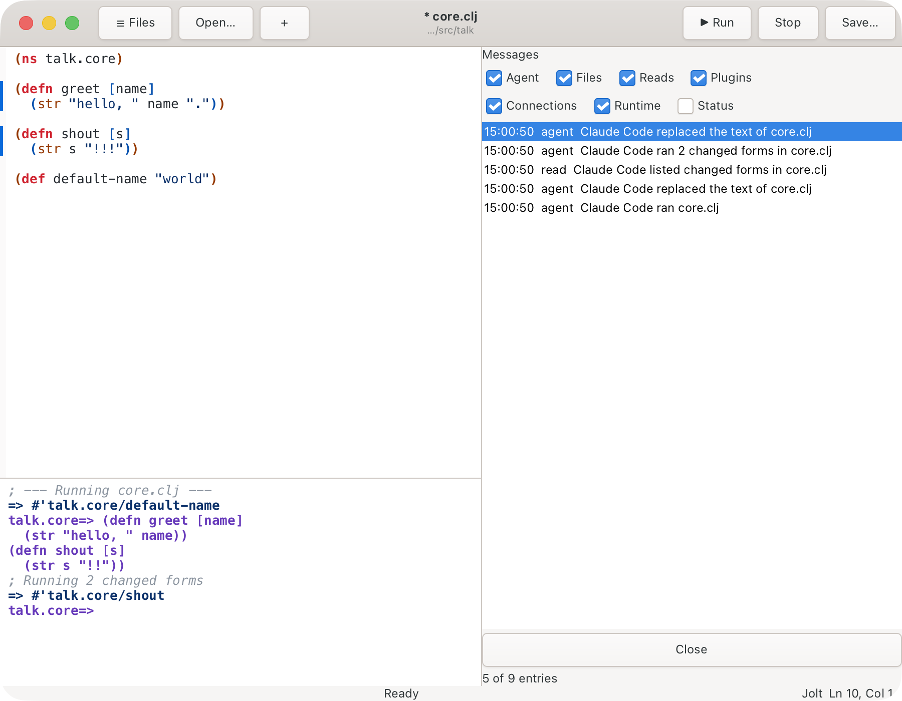
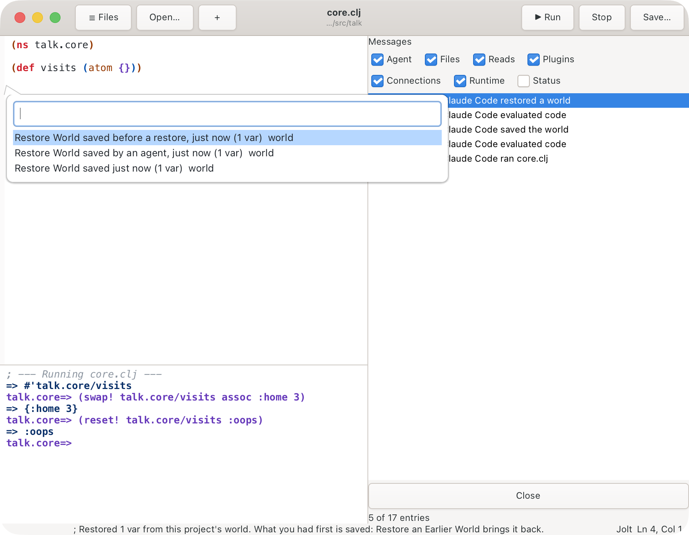

# Driving Jonquil from an agent (MCP)

`jonquil --mcp [DIR]` runs Jonquil with no window as an MCP server on stdio
(one JSON-RPC message per line). An agent evaluates code, runs files and looks
things up in the runtime a person would get in the IDE. `DIR` is the default
project directory (the working directory if omitted):

```bash
claude mcp add jonquil -- jonquil --mcp /path/to/project
# from a checkout:
claude mcp add jonquil -- jolt -M -m jonquil.main --mcp /path/to/project
```

Fifteen tools. Most take an optional `path` selecting the project (default
`DIR`); `jonquil_run_file` requires a file `path`, and `jonquil_check_brackets`
takes `text` or a `path`.

<details>
<summary><strong>The fifteen tools</strong></summary>

| Tool | What it does |
|---|---|
| `jonquil_eval` | Evaluates code as a REPL line; definitions persist |
| `jonquil_run_file` | Runs a file's text like the Run button |
| `jonquil_test` | Runs a namespace's `clojure.test` tests, or one test, and answers each failure as data |
| `jonquil_check_brackets` | Names the first unclosed or unmatched bracket |
| `jonquil_doc` | Documentation for a symbol |
| `jonquil_complete` | Up to 50 completion candidates for a prefix |
| `jonquil_namespaces` | The namespaces loaded in the runtime, the program's own first |
| `jonquil_vars` | A loaded namespace's vars, with arglists, first doc line, file and line |
| `jonquil_apropos` | Loaded vars whose name contains some text, the program's own first |
| `jonquil_frames` | The last error's call stack with each frame's locals; `jonquil_eval` can then run code in a frame |
| `jonquil_changed` | The top-level forms edited since they last ran, each with its name, lines and old and new text |
| `jonquil_run_changed` | Runs only those forms, in the file's namespace |
| `jonquil_world_save` | Saves the session's data to the project's world history, in the agent's own list, and answers its id |
| `jonquil_world_restore` | Brings back the agent's newest world, or the one an id names, after saving what's there |
| `jonquil_project` | The dialect, runtime and directory the other tools would use; starts nothing |

</details>

Dialect and runtime follow the IDE's own choice: the file's extension and the
project's `.jonquil.edn` (see [Choosing a dialect](dialects/index.md#choosing-a-dialect)
and [`.jonquil.edn`](dialects/index.md#jonquiledn)). A Jolt project with a
`deps.edn` evaluates in a Jolt child, `{:runtime :in-process}` in the server's
process, and `{:dialect :clj}` attaches to its nREPL server.

- `jonquil_eval` and `jonquil_run_file` take `timeout_ms` (default 30 s). On
  expiry the evaluation is interrupted and the tool errors; 5 s later, if it
  still runs, that runtime is stopped and the next call starts a fresh one.
- Both also take `max_output_chars` (default 100000, at most 1000000). When a
  program prints more, the answer keeps the last characters and starts with a
  line saying how many were dropped.
- Closing stdin ends the server and its runtimes.
- With an out-of-process runtime, `jonquil_doc` and `jonquil_complete` use the
  editor's offline tables until a first evaluation starts the runtime.

### Running tests

`jonquil_test` runs one test namespace in the project's runtime, the same one
`jonquil_eval` uses, so it sees what the agent has defined there. It works for
Jolt and JVM Clojure projects. Any other dialect gets the status `unsupported`.
A window serves it too, with no `path`: see the window tools below. For the
command a person uses, see [Running tests](using-jonquil.md#running-tests).

| Argument | What it does |
|---|---|
| `ns` | The test namespace. Leave it out when `path` is a test file; the file's `ns` form names it |
| `test` | One test's name. Without it every test in the namespace runs |
| `path` | A file or directory selecting the project, as in the other tools |
| `timeout_ms`, `max_output_chars` | As in `jonquil_eval` |

The test namespace is reloaded from disk before each run, so an edit to a
test file is always seen. A test you renamed or deleted in the file is
removed from the running namespace too, so it can't keep running under its
old name. Source namespaces are not reloaded: evaluate or run
what you changed first. The namespace has to be loadable by name, which means
the test folder is on the project's source paths (for a Jolt project,
`{:paths ["src" "test"]}` in `deps.edn`; for JVM Clojure, the classpath of
the nREPL server Jonquil attaches to).

The text answer is a summary line, three lines per failure, then whatever the
tests printed:

```
2 failures in demo.core-test: 3 tests, 3 assertions, 1 passed, 1 failed, 1 error
FAIL fails (/work/app/test/demo/core_test.clj:9) outer > inner: msg
  expected: (= 1 2)
  actual:   (not (= 1 2))
```

The same run comes as `structuredContent`:

| Field | What it holds |
|---|---|
| `status` | `ok` when everything passed, `failed`, `no-tests`, `error` (the namespace didn't load, or there is no test by that name), `timeout`, `interrupted`, `refused` or `unsupported` |
| `ns` | The namespace that ran |
| `counts` | `tests`, `assertions`, `pass`, `fail` and `error` |
| `failures` | One entry per failed assertion or thrown exception, sorted by file, line and test: `test`, `kind` (`fail` or `error`), `file`, `line`, `context` (the `testing` strings, outermost first), `message`, `expected`, `actual` |
| `failures_dropped` | How many failures past the first 100 were left out |
| `error` | For `error`: the `message`, and `type`, `line` and `column` when known |
| `output`, `err`, `ms`, `dropped_chars` | As in the next section |

A failing test is not a tool error. The answer is marked as an error only
when the tests couldn't run, so read `status` for pass or fail.

- `expected` and `actual` are printed text, at most 2000 characters each.
  Long collections print their first 100 items, so an endless sequence can't
  hang a run.
- `file` is absolute when Jonquil finds exactly one file under the project
  directory that matches the test's path. Otherwise it stays relative to the
  source root.
- On JVM Clojure an exception thrown inside library code reports the line
  of its `deftest`, since the throw itself is in another file.
- On a timeout the results of the tests that had already run are lost.
- A namespace with no file on the source paths (one defined in the session,
  or loaded with `jonquil_run_file` from another folder) can't be reloaded.
  Jolt runs its tests as they are. JVM Clojure answers `error`.
- On Jolt the run leaves the REPL alone. On JVM Clojure it shows in the
  session's history, and `*1` holds the run's data afterwards.

### Asking what's loaded

Three tools describe what the project's runtime has loaded, so an agent
doesn't have to evaluate `(all-ns)` and read the printout back. Like
`jonquil_test` they work for Jolt and JVM Clojure, and any other dialect gets
the status `unsupported`. Only loaded code counts: a file that never ran
doesn't show until it does. In a window, **Find a Var by Name…** in the Help
menu runs the same query for you and lists the vars in the palette (see
[Finding a var by name](help-and-inspector.md#finding-a-var-by-name)).

| Tool | Arguments |
|---|---|
| `jonquil_namespaces` | `all` (default false), `limit` (default 500), `path` |
| `jonquil_vars` | `ns`, `private` (default true), `limit` (default 500), `path` |
| `jonquil_apropos` | `query`, `all` (default true), `limit` (default 50), `path` |

A namespace counts as the program's own when its file is in the project
folder. Those come first in every answer. `jonquil_namespaces` only counts
Clojure's and libraries' namespaces unless you pass `all: true`, while
`jonquil_apropos` searches them too unless you pass `all: false`, since an
agent often wants a `clojure.core` function. The search matches any part of a
var's name, ignoring case.

```
demo.core/blank? [s]  src/demo/core.clj:12
clojure.string/blank? [s]  clojure/string.clj:288
```

The `structuredContent` holds the same rows, with `status`:

- `jonquil_namespaces`: `namespaces` (each `name`, `file`, `vars`, `own`),
  `hidden` and `dropped`.
- `jonquil_vars`: `ns` and `vars` (each `name`, `arglists`, `doc`, `file`,
  `line`, `private`, `macro`) and `dropped`. A namespace that isn't loaded
  answers `not-found`.
- `jonquil_apropos`: `query`, `matches` (each `ns`, `name`, `arglists`, `doc`,
  `file`, `line`) and `dropped`.

A few things to know about them:

- `doc` is the docstring's first line. `jonquil_doc` gives the whole of it.
- `file` is relative to the project when the file is in it, and the
  runtime's own path otherwise. A var defined at the prompt has none.
- `limit` can go up to 5000. `dropped` counts the rows past it, and the
  text ends with a line saying how many.
- On Jolt a macro has no file or line yet, because Jolt doesn't record them
  for `defmacro`. Its namespace's file still decides whether it's the
  program's own.
- On Jolt the queries leave the REPL alone. On JVM Clojure they show in the
  session's history and change `*1`.

### Reading the last error

When code fails, `jonquil_eval` answers the error's message and place.
`jonquil_frames` shows more: the last error's call stack, innermost first, as
the [Frames panel](help-and-inspector.md#the-last-errors-frames) lists it for
a person. Each frame has its fn, file and line, and its locals with a short
printed value (100 characters at most, 8 items, 3 levels deep). It reads the
last error of the project's runtime, whoever caused it, so right after a
failing `jonquil_eval` it shows that failure.

```
ArithmeticException: Divide by zero
error_id: 1b54ce73-dc00-46d8-8225-ed23f14ee8b9:1797999536
0  demo.core/ratio  src/demo/core.clj:12
     x = 7
     y = 0
Evaluate a local's name in its frame (jonquil_eval with frame) to see its whole value.
```

To see a whole value, call `jonquil_eval` with a `frame` such as
`{"index": 0, "error_id": "1b54ce73-…"}`, both taken from `jonquil_frames`.
The code runs in that frame's namespace with its locals bound, so a local's
name prints its full value, up to 100 items and 10 levels. The answer has the
usual [structured result](#structured-results) fields except `ns`. The
`error_id` is required because another error may have happened since you
read the frames, and then the call answers `stale` instead of running in the
wrong one.

Neither call changes the last error, `*1` or `*e`, even when the code in a
frame throws. Over a window they leave the console and the Frames panel as
they were, too.

| `status` | When |
|---|---|
| `ok` | The frames, or the frame evaluation's value |
| `no-error` | Nothing has failed in this runtime yet |
| `no-frames` | The error kept no frames from your code; the text says why |
| `stale` | `jonquil_eval` only: a newer error replaced the one `error_id` names, so call `jonquil_frames` again |
| `busy` | An evaluation is running. Wait for it, or stop it with `jonquil_stop` |
| `paused` | Over a window: an evaluation is paused in the Frames panel, for the person to Continue or Stop |
| `unsupported` | A dialect other than Jolt and JVM Clojure, or `jonquil_eval` with a frame on JVM Clojure |
| `timeout` | `jonquil_eval` only: the frame evaluation ran past `timeout_ms` |
| `error` | The runtime couldn't answer, or the code in the frame threw |

A few things to know about them:

- Jolt keeps every local only in debug mode. Without it a frame can come back
  with fewer locals or none, and the answer then suggests turning on **Debug
  Mode** in the Run menu and running the code again. The tools never turn it
  on themselves.
- JVM Clojure keeps no locals at all. `jonquil_frames` still lists its fns,
  files and lines, but code can't run in a frame there.
- Both calls take `timeout_ms` (default 30 s). A frame evaluation past it is
  interrupted, and only it: an evaluation the person started in the
  meantime keeps running.
- They only read a finished error. A paused evaluation (Break on error or a
  breakpoint) stays the person's to look at in the window.

### Running only what changed

After a file has run, an agent usually edits a form or two and only wants
those to run again. `jonquil_changed` lists the top-level forms edited since
they last ran, the same forms the [gutter marks](using-jonquil.md#changed-forms)
in a tab, and `jonquil_run_changed` runs just those.

Both take the file's `path`. `jonquil_changed` reads the file from disk on
every call, so it sees edits an agent made with its own file tools, and it
starts no runtime. Each form comes back with:

- `name`, the symbol a `def`, `defn` or other def form makes, or null for any
  other form
- `line` and `end_line`, counted from 1
- `text`, the form as it reads now
- `before`, its text at the last whole run, or null for a form that wasn't
  in the file then

The text answer shows each form as a diff against `before`:

```
f  line 2-3
- (defn f [] 1)
+ (defn f []
+   2)

g (new)  line 5
+ (defn g [] 3)
```

Reindenting a form or editing its comments doesn't count as a change, and
`(comment ...)` blocks are never listed.

`jonquil_run_changed` sends the forms to the runtime as one evaluation, in
the namespace of the file's `ns` form, and answers like `jonquil_eval` after
a first line such as `; Running 2 changed forms`. It takes `timeout_ms` and
`max_output_chars` too. When the forms run without an error they stop
counting as changed. Their `before` still comes from the last whole run, so it
only moves when `jonquil_run_file` runs the file again.

| `status` | When |
|---|---|
| `ok` | `jonquil_changed`: the forms. `jonquil_run_changed`: they ran, and the rest of the answer is `jonquil_eval`'s |
| `never-ran` | The file hasn't run in this runtime yet: run it once with `jonquil_run_file` |
| `no-changes` | Nothing has changed since the last run |
| `error`, `timeout`, ... | `jonquil_run_changed` only, as for `jonquil_eval` |

`never-ran` and `no-changes` aren't errors. A run that fails, of the whole
file or of the changed forms, leaves the record as it was, so the same forms
are listed next time. A runtime that's replaced, as after a timeout stopped a
stuck one, starts with no record, and the file reads as `never-ran` again.

Over a window both tools take a tab `id` instead (the active tab by default)
and compare against that tab's last Run, the way the gutter does, unsaved
edits included. `jonquil_changed` changes nothing in the window.
`jonquil_run_changed` does what Run Changed Forms does: the forms show on the
console with their `; Running` line and their gutter marks clear. A tab from
another project is refused, as `jonquil_run` refuses it, and a tab that
never ran answers "Run the tab once first (jonquil_run)."



### Saving and restoring the session's data

Before an experiment that could wreck the data an agent has built up at
the prompt, say an atom filled from a slow source, it can call
`jonquil_world_save`. That writes the session's data to the project's
world history, the way [Save World](using-jonquil.md#saving-the-world)
does for a person, and answers the world's `id`. If the experiment goes
wrong, `jonquil_world_restore` puts the data back.

```
Saved 2 vars as world 1795001234567.
```

With no `id`, `jonquil_world_restore` brings back the newest world an agent
saved; with one, that world. Before it restores anything it saves what's
there now, and answers that save's id as `undo_id`, so restoring that id
undoes the restore:

```
Restored 2 vars. What was there is saved as world 1795001290011: restore that id to undo this.
```

An agent's saves are kept in a list of their own, 10 at most, so they never
push out a save the person made, and Restore World in the window still
brings back the person's newest. An agent can't restore one of the person's
saves; `id` takes an agent's world or an `undo_id`. Restore an Earlier World
lists the agent's saves for the person, as "saved by an agent".

Both tools take `timeout_ms` (default 30 s), and headless `path` selects the
project. A world is data only, the same as for a person: functions aren't
saved, and something that can't be written as it is, an open file say,
comes back as a placeholder the answer names. It's Jolt only, in process or
in the Jolt child.

| `status` | When |
|---|---|
| `ok` | Saved (`id`, `saved`, `placeholders`) or restored (`restored`, `placeholders`, `undo_id`) |
| `no-world` | `jonquil_world_restore` with no `id`, and no agent has saved this project's world yet. Not an error |
| `unknown-id` | `id` names no world an agent can restore in this project, or that world is gone |
| `unsupported` | The project's dialect isn't Jolt |
| `timeout` | The runtime didn't finish in `timeout_ms`; the save or restore may still finish afterwards |
| `error` | Nothing was saved, because a var holds something that can't be written at all (listed under `unwritable`), or the restore failed. A restore whose first save fails restores nothing |

Over a window the person sees the same lines Save World and Restore World
print, in the status bar and the console, and Messages logs each call.



### Structured results

The tools that evaluate (`jonquil_eval` and `jonquil_run_file` here,
`jonquil_eval`, `jonquil_run` and `jonquil_run_selection` in a window) answer
with the same text as before, and with the parts of that text as
`structuredContent`, so an agent doesn't have to take the text apart:

| Field | What it holds |
|---|---|
| `status` | `ok`, `error`, `interrupted`, `timeout`, `waiting-for-input` (a window whose program reads stdin), `notice`, or `refused` (the evaluation never started) |
| `value` | The printed result, for `ok` |
| `output` | What the code printed, stdout and stderr in the order they arrived |
| `err` | The stderr part alone. Headless only; a window doesn't keep the two apart |
| `error` | For `error`: `message`, and `type`, `line` and `column` when the runtime gave them |
| `ns` | The namespace after the evaluation, when the runtime reports it |
| `ms` | Wall time in milliseconds, as the tool saw it |
| `dropped_chars` | How many characters `max_output_chars` cut from the front of `output` |

`structuredContent` belongs to MCP's 2025-06-18 revision. A client on an
older one ignores the field and reads the text.

## Window mode

`jonquil --mcp --window [DIR]` opens the normal window and serves the protocol
on stdio, so you watch the agent work:

```bash
claude mcp add jonquil -- jonquil --mcp --window /path/to/project
# from a checkout:
claude mcp add jonquil -- jolt -M -m jonquil.main --mcp --window /path/to/project
```

With `--window` the server offers twenty-nine tools (headless keeps fifteen), acting
on the live window:

<details>
<summary><strong>The twenty-nine window tools</strong></summary>

| Tool | What it does |
|---|---|
| `jonquil_eval` | Evaluates as a console entry: echoed, with `*1` and history |
| `jonquil_run` | Runs the active tab like the Run button |
| `jonquil_run_selection` | Selects `start`..`end` offsets (visibly) and runs them like Cmd/Ctrl+E |
| `jonquil_stop` | Interrupts the running evaluation; reports whether it stopped within 5 s |
| `jonquil_open` | Opens a file as a tab, or selects its tab; it becomes active |
| `jonquil_tabs` | One line per tab: id, active marker, dirty or saved, path or Untitled |
| `jonquil_select_tab` | Makes the tab `id` active |
| `jonquil_read_tab` | The tab's full text (active tab without `id`) |
| `jonquil_replace_text` | Replaces the tab's text as one undoable edit; the tab reads dirty. Text holding a NUL byte is refused with an error naming the line |
| `jonquil_save` | Saves the active tab to `path` or its own path |
| `jonquil_console` | `mark <N>` then the output since the `since` mark; pass back `N` to read only what's new |
| `jonquil_doc` | Documentation for a symbol, from the window's evaluator |
| `jonquil_complete` | Up to 50 completion candidates, one per line |
| `jonquil_namespaces`, `jonquil_vars`, `jonquil_apropos` | As [headless](#asking-whats-loaded), without `path`. They run quietly: nothing shows on the console |
| `jonquil_frames` | As [headless](#reading-the-last-error), without `path`, and quiet too. `jonquil_eval` with a `frame` runs quietly as well, unlike a plain `jonquil_eval` |
| `jonquil_changed`, `jonquil_run_changed` | As [headless](#running-only-what-changed), over a tab `id` (the active tab without it). `jonquil_run_changed` runs the forms on the console as Run Changed Forms does |
| `jonquil_world_save`, `jonquil_world_restore` | As [headless](#saving-and-restoring-the-sessions-data), without `path`. The status bar and console say what Save World and Restore World say |
| `jonquil_check_brackets` | "ok", or the sentence naming the first problem |
| `jonquil_project` | The window's live dialect selection: label, runtime, directory, source, warnings |
| `jonquil_plugins_list` | One line per plugin: version, loaded or disabled, effects, pending proposal, doc |
| `jonquil_plugin_read` | A plugin's live source and history, or one `version`'s source |
| `jonquil_plugin_propose` | Proposes whole new `source` for `id` with a `reason`; answers pending, rejected-by-checks or refused |
| `jonquil_plugin_status` | A proposal's status (latest without `n`) and your note if rejected |
| `jonquil_test` | Runs a namespace's tests, or one test, and answers as the headless tool does. Without `ns` it takes the active tab's namespace. When the namespace is open in a tab, that tab runs first, unsaved edits included, the way [Run Tests in This File](using-jonquil.md#running-tests) does; otherwise the namespace reloads from disk. The window shows the run: a line naming the client, the summary, and the failures in the Locations list. When an open tab holds forms edited since they last ran, or a file that never ran and has unsaved edits or was saved since the tests first ran, the answer starts with a line saying so and lists them under `warnings` |
| `jonquil_change_set_propose` | Saves a named list of `forms` (each a `path` and the form's `text`) as a change set marked as yours, for you to apply or revert |

</details>

Every call shows in the window's [Messages panel](help-and-inspector.md#messages), named by the client, so you can see afterwards what the agent did.

<details>
<summary><strong>Timeouts, other projects' tabs, disconnecting and trust</strong></summary>

`jonquil_eval`, `jonquil_run` and `jonquil_run_selection` take `timeout_ms`
(default 30000) and `max_output_chars` (default 100000), and answer with
[structured results](#structured-results). A program that stops to read stdin makes the call return early
with what it printed; type into the console or call `jonquil_stop`.

The window serves its launch project. Run on another project's tab is
refused, though `jonquil_run_selection` still moves the visible selection.

When the client disconnects (EOF on stdin) the window closes and unsaved edits
are discarded, so have the agent `jonquil_save` first. `jolt mcp:smoke --window`
exercises all of this end to end.

The trust boundary is the headless server's, plus the files the window can
reach: the agent can open, edit and save any file you can.

</details>

<details>
<summary><strong>An agent proposing a plugin</strong></summary>

`jonquil_plugin_propose` never runs the agent's code in Jonquil. It is checked
first in a separate jolt process (isolation, not a sandbox; see
[Plugins](plugins.md)), then waits as a pending proposal that you decide in
Review Plugin Proposals. No tool can accept or reject one; the agent reads your
decision, and your reject note, with `jonquil_plugin_status`.

A proposal is refused before any check when its id isn't a plugin id, its
reason is blank or over 4000 characters, its source is over 262144, or the
window runs with `--no-plugins` (the reading tools still answer). A propose can take most of a minute
(30 s check, busy window); if it doesn't finish, the answer is
`status: unknown` and `jonquil_plugin_status` says whether it was recorded. If
a newer proposal replaces the one you're reading, the next Accept is refused;
press it again after reading the new one.

</details>

<details>
<summary><strong>An agent proposing a change set</strong></summary>

`jonquil_change_set_propose` takes a `name` and `forms`, each form a `path`
(absolute, or relative to the window's folder) and the `text` of one
top-level form that replaces the form with the same first two elements in that
file (a later entry of the same two elements replaces the file's next such
form). Each path is resolved to its real path and must name an existing,
readable Clojure file (`.clj`, `.cljc`, `.cljs`, `.cljd` or `.bb`) inside the
window's folder, or the call is refused with the reason. The set is saved
beside the settings file, marked with the client's own name (control
characters dropped, at most 60 characters), and the window shows it as "a
client calling itself" that name. A line goes to the console and the status
bar. The call applies nothing and edits no file or tab: **Change Sets** in the
palette lists it, the panel shows each form as a diff of the file's current
form against the proposed text, and only you press Apply to REPL or Delete.
There is no Revert for a proposed set. A name that is already taken is
refused, and the file is created only if the name is free, so a proposal never
replaces one of your sets, even when two windows race. It is also refused when
`forms` is empty or holds more than 200 entries, an entry isn't exactly one
balanced form, or the texts together pass 262144 characters.

</details>

<details>
<summary><strong>A plugin's own tools</strong></summary>

A plugin gives agents tools in `:mcp-tools`:

```clojure
:mcp-tools [{:name "twice" :doc "The text twice."
             :args {"text" {:type "string" :doc "The text." :required? true}}
             :run (fn [ctx args] (str (get args "text") (get args "text")))}]
```

A window serving MCP (`--mcp --window`, or one you attach to) serves each live
plugin's tools as `plugin_<id>_<name>` after its twenty-nine: `plugin_smoke-t_twice`
for plugin `smoke-t` above.

- Argument types: `string`, `integer`, `number`, `boolean`. A missing or
  wrong-typed required argument is refused before `:run`.
- `:run` returns a string or `{:text "..." :error? true}`. It runs with only
  the plugin's declared effects, gets 30 s, and runs one call at a time per
  tool (a call still going at 30 s keeps the tool busy).
- Tool `:name`: lower-case letters, digits, `_`, starting with a letter; the
  served name is at most 50 characters. Argument names: 1 to 64 characters of
  letters, digits, `_`, `.`, `-`.

Jonquil sends `notifications/tools/list_changed` when a plugin's tools change;
a client that ignores it sees them on its next list or after reconnecting.
Accept refuses a plugin whose tools differ from what its check reported.

</details>

## Attaching to a window that is already open

To give an agent the window you already have, with its tabs and console, turn
listening on in `settings.edn`:

```edn
{:mcp-listen? true}
```

That window serves the same twenty-nine tools on a socket bound to 127.0.0.1, on
a port the OS picks, to one client at a time. It publishes the port in
`mcp/<pid>.edn` beside `settings.edn`. Then register the bridge:

```bash
claude mcp add jonquil -- jonquil --mcp-attach /path/to/project
```

`jonquil --mcp-attach [DIR]` finds the live window whose folder matches `DIR`
(the newest if several) and relays JSON-RPC between its stdio and that window.
Bare, it attaches only when exactly one window is listening; otherwise it
refuses and says why.

<details>
<summary><strong>Which folder it matches, and detaching</strong></summary>

A window registers the folder it opened on; Open Folder re-roots both.

Detaching leaves the window running with its tabs and unsaved edits, unlike
`--window`, where EOF closes it. If the relay loses its connection it writes a
line to stderr and exits. A crashed window's leftover entry is recognized by
its dead pid and skipped. `jolt mcp:smoke --attach` exercises all of this end to
end.

</details>

**Trust.** While `:mcp-listen?` is on, any local process that can reach the
loopback interface gets unauthenticated code execution in your account, plus
the window's file reach, the same exposure as any local nREPL server. It is off
by default and nothing listens unless you turn it on.

## Trust boundary

Whoever can start `jonquil --mcp` can run code as you; nothing authenticates
the caller, as with any MCP stdio server and `bb nrepl-server`. Don't put it
behind anything that lets someone else choose its command line or feed its
stdin.

What an agent evaluates in a window isn't recorded for the
[last session's replay](using-jonquil.md#last-sessions-replay), but the code
it sends does land in the console's Up/Down history, and that history is
saved to disk with the replay's record (owner-only, in `replays/` beside the
settings file). `:remember-session? false`, in the settings file or in the
project's `.jonquil.edn`, keeps it off disk.
