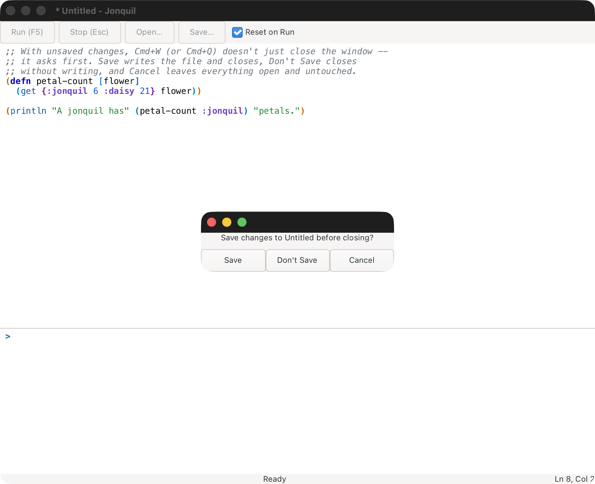
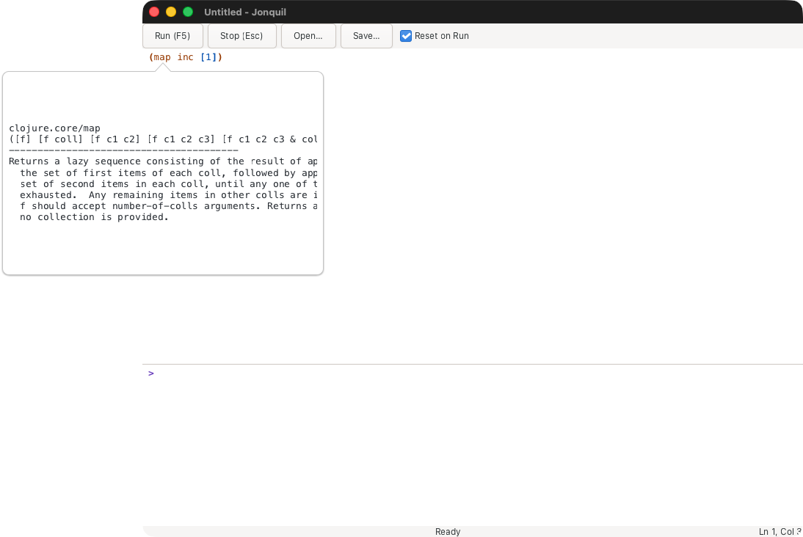
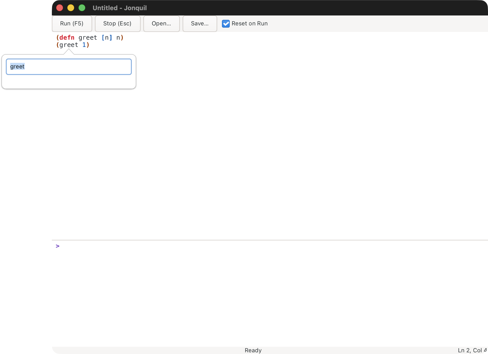

# Using Jonquil

Jonquil is a DrRacket-style IDE for Clojure: a Definitions editor above an
Interactions console, with a Run button that runs the top pane and a Stop
that actually stops it. This page walks through the window as it stands
after Phase 3, the Themes phase, and P4's help features.

## The window


Across the top sits a toolbar: **Run (F5)**, **Stop (Esc)**, **Open…**,
**Save…**, and a **Reset on Run** checkbox that starts checked. Below that,
a vertical split holds two panes you can resize by dragging the divider
between them: the **Definitions** editor on top, where you write a program,
and the **Interactions** console below, where output appears and where you
can type expressions directly at a `> ` prompt. A status label along the
bottom reads `Ready`, `Running…`, `Waiting for input`, or `Stopped`,
depending on what the last Run or REPL entry is doing. Beside it, the
dialect label says which runtime this window uses (see
[Dialects and runtimes](#dialects-and-runtimes)).

The console wraps a line that's wider than the pane onto the next row,
so a long path or a long printed value never pushes the rest of the
output sideways. The editor doesn't wrap: code keeps its own line breaks,
and the pane scrolls horizontally instead.

The window title names the open file, or `Untitled` when there isn't one,
and gains a leading `* ` the moment the editor has unsaved changes.

## Running a program

Press **Run**, **F5**, or **Cmd/Ctrl+R** to evaluate everything in the
Definitions pane, top to bottom. Before anything runs, Jonquil checks the
pane's brackets and refuses to run a broken one; see "The friendly
unclosed-bracket message" below for what that looks like. If a program is
already running, Run doesn't queue a second one; it just warns that one is
running already. Once the brackets check out, the console prints a `;
--- Running Definitions ---` banner (only when nothing else is already
running), then streams the program's own output as it prints, and
finishes with the result on its own line: `=> 3`, say, for whatever the
last form evaluates to. The status label tracks the run and settles back
on `Ready` when it's done.

`docs/demos/hello.clj` is the simplest case: it prints a line, leaves a
value behind, and shows exactly that shape.

You can also run just part of the Definitions pane: select some text (or
put the caret on a line with no selection) and press **Cmd/Ctrl+E** to
evaluate the selection, or the current line, at the console prompt. It
shows up there like anything else you typed, with its result, and joins
the REPL history.


Press Cmd/Ctrl+Enter, or pick Run Form from the editor's right-click menu,
to run just the form around the caret. It runs the top-level form the
caret sits in, or, when that form is a `(comment ...)` block, the form
inside the block that holds the caret rather than the whole block. The
form briefly flashes so you can see exactly what ran, then goes through
the same path Cmd/Ctrl+E does: it's echoed at the console prompt,
evaluated there, and joins the REPL history. With no form at the caret,
nothing runs and the status bar says "No form at the caret."

A form you've switched off with `#_` counts as no form, so Run Form won't
run code you've discarded (a stacked `#_ #_` discards both forms, the way
the reader does). Metadata in front of a form travels with it:
`^:private (defn f [] 1)` runs with its `^:private`. The flash is a real
selection for a quarter of a second, but a key pressed during it cancels
the flash first and puts the caret back, so it never types over the form.

## The REPL prompt, and how it differs from Run


The `> ` prompt at the bottom of the console takes one expression at a
time. Type something and press Return, and the result appears the same
way a Run's result does, `=> `-prefixed. Where Run always evaluates the
whole Definitions pane, and by default clears out whatever earlier
evaluations defined first, a REPL entry evaluates only what you typed, and
always builds on top of whatever is already there, including anything the
last Run left behind. That's what makes it useful for poking at a program
you just ran: define a function with Run, then call it a few different
ways at the prompt without re-running anything.

Up and Down recall earlier entries, but only from the first or last line
of what you're typing. On a multi-line entry, Up and Down move the caret
around inside it instead, the way you'd expect from any text editor.

If you try to submit while a program is running but not waiting on input,
the console holds your input and prints a one-time reminder instead:
"A program is running. Press Stop (Esc) to cancel it."

## `read-line` and stdin


When a running program calls `read-line`, the status label switches to
`Waiting for input` and whatever you type at the prompt goes straight to
the program as its input, line by line, rather than being evaluated as
Clojure. `docs/demos/greet.clj` shows the whole round trip: it asks a
question, waits, and prints the answer back once you press Return.

Cmd/Ctrl+D sends end-of-input while a program is waiting this way, the
same signal `read-line` would see from a closed pipe on the command line.

One thing worth knowing: whatever you've typed at the prompt but not yet
sent stays there after the program finishes, and it's then read as an
ordinary Clojure entry on your next Return rather than as stdin. If you
typed a partial answer and the program ended before you sent it, clear
the prompt before typing your next expression.

## Stop


Press **Stop** or **Esc** to interrupt whatever is running, whether it's
stuck in a loop or blocked on `read-line`. Either way the result is
`; interrupted`, and the window never freezes waiting for it.
`docs/demos/forever.clj` is built to demonstrate exactly this: it counts
forever until you stop it.


Esc only does this while something is actually running. The rest of the
time it's left alone, so it can still reach an IME composition or GTK's
own handling of the key.

An out-of-process runtime answers Stop the same way, with one twist: see
"Dialects and runtimes" below for when it restarts the child instead of
interrupting it.

## Reset on Run, versus accumulate

The **Reset on Run** checkbox in the toolbar starts checked. While it's
checked, each Run first removes every namespace that earlier Runs or REPL
entries created (libraries you've required stay loaded, since `require`
won't bring them back), then evaluates the Definitions pane fresh. Uncheck
it, and Run stops clearing first: later Runs build on whatever earlier
ones already defined, the same way the REPL prompt always does.

`docs/demos/reset.clj` walks through the difference with a small,
self-contained experiment: run it once with the box checked, delete a
definition it depends on, and watch the next Run fail because Reset on Run
cleared what the deleted line used to provide. Then uncheck the box and
repeat, and the same missing definition no longer matters, because nothing
got cleared.

## The friendly unclosed-bracket message


Forget a closing paren, and Jonquil doesn't hand you a raw reader
exception. Run checks the pane's brackets before it evaluates anything, so
an unclosed opener names itself and its line, something like "The ( on
line 6 is never closed.", and a stray closer with no opener to match does
the same, "The ) on line 1 has no matching opener." Either way, nothing
runs. `docs/demos/unbalanced.clj` is deliberately broken this way.

## Editing

Typing `(`, `[`, `{` or `"` inserts the matching closer right along with
it, or wraps a selection in the pair instead of replacing it. Type the
closing character yourself over one Jonquil already inserted and it steps
past the existing one rather than adding a second, and Backspace removes
an empty pair in a single press instead of leaving a stray opener behind.

Tab indents the current line, or every line in a selection, one level;
Shift+Tab unindents the same way. Cmd/Ctrl+/ or Cmd/Ctrl+; toggles line
comments on the line or selection. Cmd/Ctrl+Shift+F formats the whole
file, and Cmd/Ctrl+Option+F (Alt+F on Linux and Windows keyboards) or the
+L equivalent formats just the selection or the current line. A format is
one undo step, so a single Cmd/Ctrl+Z puts the file back the way it was.
Cmd/Ctrl+Z undoes more generally; Cmd/Ctrl+Shift+Z, GTK's own binding,
and Cmd/Ctrl+Y both redo.

F6 moves focus between the Definitions editor and the Interactions
console, so a keyboard-only user can reach the prompt without touching
the mouse. Cmd/Ctrl+L clears the console's output history while leaving
whatever's typed at the prompt alone. Cmd/Ctrl+= (or Cmd/Ctrl++) zooms
in, Cmd/Ctrl+- zooms out, and Cmd/Ctrl+0 resets the zoom, and all three
resize both panes together. The status bar tracks the editor caret as
`Ln L, Col C`, following clicks, the arrow keys and ordinary typing.

## Find and replace


Cmd/Ctrl+F opens the find bar. Cmd/Ctrl+H opens the same bar with its
replace field showing too. Select a single line of text first and the
bar opens prefilled with it. Every match in the pane highlights as you
type, and a count beside the field says where you stand, "2 of 5", or
"No matches" when there's nothing to find.

Return, F3 or Cmd/Ctrl+G moves to the next match; Shift+Return, Shift+F3
or Cmd/Ctrl+Shift+G moves to the previous one. F3 and Cmd/Ctrl+G also
work with focus back in the editor, not just while the find bar has it.
Replace swaps the current match and Replace All swaps every one, and
each of those is a single undo step. Escape closes the bar, but only
while the bar itself has focus; with focus somewhere else, Escape keeps
its usual job of stopping a running program.

## Unicode and IME


Names and output aren't limited to ASCII anywhere in Jonquil.
`docs/demos/unicode.clj` defines a function named 안녕 and prints an emoji
alongside it, in both the Definitions pane and the console. Typing Hangul,
Thai, or any other composed script works the same in both panes, and (like
everything else in the output history) you can't type into old console
output, only at the current prompt.

There's one documented quirk around Return while an input-method
composition is still in progress. If you press Return while the last
syllable is still underlined and uncommitted, Jonquil lets GTK handle the
key itself: the syllable commits, and a plain newline is inserted, with no
smart indent in the editor and no evaluation in the console. Press Return
again once the syllable has landed, and it does what you'd expect: the
editor indents, or the console evaluates. In testing with 2-Set Korean, a
syllable still underlined in the editor committed first and was followed by
a plain newline at column 0, and Hangul names worked end to end: typing
`(def 안녕 "...")` at the prompt returned `#'user/안녕`. Typing a closing
character such as `"` or `)` after a Hangul syllable commits the syllable
by itself, so an entry that ends that way needs only one Return.

## Open and Save

Cmd/Ctrl+O opens a file into the Definitions pane. If the pane has unsaved
changes, the first Open attempt refuses and prints a warning instead of
discarding your edits: "Unsaved changes. Save first, or Open again to
discard them." Pressing Open again goes ahead and discards them. Each new
round of unsaved edits gets its own warning, so a Save in between starts
the count over.

Opening a file that isn't valid UTF-8 doesn't fail either. Bytes that
can't be decoded turn into the replacement character, and the console
warns in grey: "This file isn't valid UTF-8; unreadable bytes show as �
and saving will replace them." The file on disk is left untouched until
you actually save.

Cmd/Ctrl+S saves to the file's remembered path, or opens a Save dialog if
there isn't one yet. Cmd/Ctrl+Shift+S always opens the Save dialog, even
for a file that already has a path. Either way, the save itself is atomic:
Jonquil writes to a hidden temporary file next to the target first, then
renames it into place, so a crash or a full disk mid-write can't leave a
half-written file behind. Saving through a symlink follows the link and
updates the file it points to, leaving the link itself in place; saving
through a symlink that points at nothing yet replaces the link with a
plain file at that name.



Closing with unsaved changes asks first, however you close: Cmd/Ctrl+W,
the window's own close button, Cmd+Q, Dock → Quit, or logging out all
raise the same prompt, offering Save, Don't Save and Cancel. Cancel, or
dismissing the prompt any other way, leaves everything open and
untouched. If a save fails or you cancel partway through it, the window
stays open too, so a bad save can't quietly close your work out from
under you. `docs/demos/close-prompt.clj` is there to try it on: make an
edit, then close the window.

## Themes

Cmd/Ctrl+Shift+M cycles through four themes, in order: light (the
default), dark, solarized, navy. The status bar names the current one,
`Theme: dark`, say, except while a program is running, when it's busy
showing that instead.


A theme recolours both panes: background, text, syntax highlighting,
rainbow brackets, the unmatched-bracket colour, the caret, selections,
the find highlight, and the different kinds of console output. GTK's own
chrome switches to its dark or light variant to match, and dark and navy
both count as dark for that purpose. Inside a find match, the text keeps
the theme's plain text colour instead of its syntax colour, so it stays
readable against the highlight.

Solarized keeps the lower contrast of the a-sibling-cljd-app palette it's
drawn from. Dark and navy are built for night use.

The choice sticks: it's saved to
`$XDG_CONFIG_HOME/jonquil/settings.edn` (or `~/.config/jonquil/settings.edn`
when that variable isn't set) as `{:theme :navy}`, or whichever theme you
picked. A missing settings file starts Jonquil in light, with nothing
said about it; a file that can't be read, or that names a theme Jonquil
doesn't know, also starts it in light, but says so once in the console.
A settings file that's a symlink stays a symlink after Jonquil saves
through it. To go back to light, delete the file.

## Help

P4 adds four features on top of everything above: completion with a doc
preview, quick documentation, jump to definition, and rename, plus a
right-click menu that reaches all of them. Each one resolves in the
namespace your program actually runs in, so a function Run just defined
shows up the same way a core one does.

Every key below checks the Control key specifically, not Command: Cmd+Q
still means Quit, and Cmd+Space still does whatever Spotlight or your
input source switcher already has it bound to. Cmd+B, Cmd+F1, and
Command's usual companions to these keys do nothing here, on purpose.
F-keys need the Fn key held down too, on most Mac keyboards.

### Completion

Ctrl+Space, in either the Definitions editor or the console's input line.
With no prefix at the caret it does nothing; with exactly one match it
inserts that match right away; otherwise a popup opens below the caret
(above the input line in the console) with the candidate list on one side
and a documentation preview for whichever one is selected on the other.


While the popup is open, Up and Down move the selection one row, PageUp
and PageDown move it eight rows, Enter or Tab commits the selected
candidate, and Escape closes the popup without touching the buffer.
Typing keeps narrowing the list, and moving the caret out of the word
(an arrow key past its start, say) closes the popup the same way Escape
does. In the console's input line, the popup's own keys take over from
history and from evaluation while it's open: Up and Down move the list
instead of paging through history, and Enter commits the candidate
instead of running the line. Close the popup first, by committing
something or by Escape, to get history and evaluation back.

Candidates come from Clojure's special forms and core built-ins, whatever
the Definitions pane itself defines, and whatever your program has
defined by running or by typing at the prompt.

### Quick documentation

Ctrl+Q or Shift+F1 opens a popup with the namespace, arglists, and
docstring for the symbol at the caret, or in the selection when the
selection is exactly one symbol. With no symbol there, the status bar
says so instead of opening anything. Escape, or moving the caret, closes
the popup.



### Jump to definition

F12 or Ctrl+B moves the caret to the symbol's own definition and scrolls
it into view, when Jonquil can find one in the buffer. It checks the
nearest enclosing local binding first (a function parameter, a `let`, or
anything else that can shadow a name), then a top-level `def`, `defn`, or
similar form anywhere in the file. When neither turns up but the symbol
still resolves to something outside the buffer, jump shows that var's
documentation in the quick-doc popup instead of moving the caret. When
nothing matches at all, the status bar says so.

### Rename

Shift+F6 or F2 opens a small popup prefilled with the symbol at the
caret. Type a new name and press Enter to apply it, or press Escape to
cancel. A rename touches only code: every place the exact symbol appears
as its own token, never inside a comment, a string, a regex literal, or a
keyword, and never a longer name that merely contains it, so renaming
`greet` leaves `greeting` alone. If the new name is blank, isn't a valid
Clojure symbol, matches the old name, or there's nothing to rename, the
popup explains why instead of doing anything. Applying a rename is one
undo step, so Cmd/Ctrl+Z reverts it in a single press, and the status bar
reports how many occurrences changed.



### Right-click menus

Shift+F10, or a right click over the Definitions editor, opens a menu
led by Run Form, then Jump to Definition, Rename Symbol, Quick
Documentation, and Complete, alongside Jonquil's other editing commands
(Toggle Comment, Format All, Format Selection, Indent, Unindent, Find,
Replace) and GTK's own Cut, Copy, and Paste. The same menu over the
console's input line carries Complete next to GTK's own entries. Every
item runs the exact function its key would.

### Freeing Ctrl+Space on macOS

macOS reserves Ctrl+Space by default, under System Settings > Keyboard >
Keyboard Shortcuts > Input Sources > "Select the previous input source."
While that shortcut stays on, a real Ctrl+Space keypress goes to the
system first and never reaches Jonquil at all. Turn it off there (or
rebind it to something else) to free Ctrl+Space for completion. This
isn't something Jonquil can work around from inside the app: in testing,
a Ctrl+Space routed straight to Jonquil's own process by its pid reached
the completion handler without trouble, but an actual key press on the
keyboard still went to the system's input-source switch as long as that
shortcut was turned on.

## Dialects and runtimes

Jonquil evaluates through a dialect profile: what a language's files look
like, how they're painted, and which evaluator runs them. Two profiles
exist today, Jolt and ClojureDart (experimental), and selection and the
evaluator seam underneath both are generic enough for a third. The status
bar's dialect label reads `Jolt` most of the time, or `Jolt (nREPL)` when
this window's Jolt is running out of process rather than inside Jonquil
itself. For ClojureDart it reads `ClojureDart (attached)` while Jonquil
holds a live connection to the app, and `ClojureDart (not running)` the
rest of the time.

### Choosing a dialect

Jonquil picks a dialect and a runtime for each window, in this order:

1. `.jonquil.edn` in the project, if it names one.
2. A single profile marker in the project (Jolt's is `deps.edn`).
3. The open file's extension.
4. The `:dialect` saved in `settings.edn`.
5. Jolt, when none of the above decides.

The project is the nearest directory, at or above the open file, holding
`.jonquil.edn` or a profile marker. A loose file with nothing like that
above it, or an unsaved window, has no project, so only the extension and
the settings default are left to decide.

ClojureDart's own marker is `pubspec.yaml`. A ClojureDart app commonly
carries a `deps.edn` too, for `bb` tasks, say, so both markers can be
present in the same project at once: rule 2 only decides when exactly one
marker hits, so the file's extension breaks the tie instead. `.cljd`
opens as ClojureDart, `.clj` and `.cljc` stay Jolt's, and a file neither
extension claims, `bb.edn` say, falls back to Jolt.

### `.jonquil.edn`

A `.jonquil.edn` at the project root pins the dialect and, for Jolt,
chooses the runtime:

```clojure
{:dialect :jolt :runtime :nrepl}
```

Both keys default independently, so either can be left out. A file that
isn't valid EDN, or that doesn't hold a map, never blocks Jonquil from
opening anything: the console prints a line like `; project: .jonquil.edn
isn't valid EDN, so it is ignored`, and selection falls through to the
next rule as though the file weren't there at all.

### Running Jolt out of process

`{:runtime :nrepl}` moves your program out of Jonquil's own process.
Jonquil starts a separate `jolt nrepl-server` in the project directory and
talks to it over a socket instead of evaluating inline. That's the whole
point: a program that segfaults, calls `System/exit`, or otherwise takes
Jolt down with it takes down that child, not the window running it.

At start, the console reports the child's pid, its port, and which
project directory it's running in, then lists what this particular
runtime can't do (three of those are below). Stop still interrupts a
running evaluation first; if the child doesn't answer within about a
second, Stop kills and restarts it instead, and says so, rather than
leaving you to notice your definitions vanished for no visible reason.
Reset on Run works the same way it does in-process, clearing earlier Run
and REPL definitions before evaluating fresh, just by sending a reset form
over the wire instead of removing namespaces locally.

Opening a file from a different project switches the whole session: the
old evaluator is interrupted and stopped off to the side, a new one
starts for the new project, and the console says something like
`Switched to Jolt (nREPL). The previous session is gone.` The same switch
happens if the new file's project asks for a different runtime, or none
at all.

Three limits are worth knowing going in. There's no stdin: a program that
calls `read-line` or `read` gets nil or an EOF straight away. Output
appears only once an evaluation finishes rather than as it prints
(the jolt-lang/nrepl middleware sends it at the end), so a program that prints once a second for ten
seconds shows nothing for those ten seconds and then everything at once.
And jump to definition can't leave the buffer, because the wire op it
would need for that (`info`) isn't there yet, only `lookup`, which
carries no file or line to jump to.

### The jolt-lang/nrepl checkout

Interrupt and lookup both need Jonquil to inject middleware from a
jolt-lang/nrepl checkout when it starts the child, found at
`$JONQUIL_JOLT_NREPL`, or `~/dev/jolt-lang/nrepl` when that variable isn't
set. Without either one in place, the child runs a vanilla nREPL server
with neither op, so Stop always falls back to killing and restarting it,
even on a program that would otherwise have interrupted cleanly.

### `.nrepl-port`

While the child runs, `jolt nrepl-server` writes its port into the
project's `.nrepl-port`, the file any nREPL-aware editor already looks
for. Jonquil restores whatever was there before the child started, or
deletes the file if nothing was, once the child stops, so a project that
already used that file for something else gets it back exactly as it was.

### ClojureDart (experimental): attaching to a running app

ClojureDart support is experimental. Where the out-of-process Jolt
runtime starts and owns its own child, this dialect works the other way
round: Jonquil attaches to a ClojureDart app you already have running,
the way CIDER attaches to a live Clojure process. Connect, load the
file, then evaluate forms one at a time from a `(comment ...)` block.
Jonquil never starts the app, stops it, or sends it any signal at all.

Attaching needs the app running under `bb dev:macos` (or
`clj -M:cljd flutter`), on the `nrepl-poc` ClojureDart fork at
`199d173d` or later. That fork writes its port to `NREPL.lock` in the
app directory, which is how Jonquil finds it; upstream ClojureDart
carries no nREPL server of its own, so there's nothing there for
Jonquil to attach to.

Jonquil connects the first time you Run, or on any evaluation while it
holds no live connection, and prints "; Connecting to the app on port
N..." while it does. A fresh session's first answer takes a few seconds
and brings the ClojureDart banner along with it. If nothing's running
yet, the console says so instead: "; ClojureDart app isn't running
here. Start it with `bb dev:macos` (or `clj -M:cljd flutter`)." A port
that refuses the connection answers "; NREPL.lock says port N, but
nothing answers there. The app may have quit; restart it.", and a port
that answers but isn't a ClojureDart server at all gets "; Port N isn't
a ClojureDart nREPL server." Jonquil only ever reads `NREPL.lock`: it
never writes to the file or deletes it.

Run loads the buffer's own text, unsaved edits and all, the way
CIDER's C-c C-k loads a file, and leaves the session sitting in the
file's namespace afterward. Rather than a value per form, it prints one
quiet line when it's done, "; Loaded <ns> (<n> forms)", or, if a form
fails, "Load stopped at form <n> of <ns>" with the app's own error in
place of it. An untitled buffer has no path for the app's error
messages or its watcher to follow, so Run refuses first: "Save the file
first: the app's error messages and its watcher both go by the file's
path."

Cmd/Ctrl+E and Cmd/Ctrl+Enter (Run Form) both run in the buffer's own
namespace. Since the app's nREPL server has no `in-ns`, Jonquil
evaluates the buffer's `ns` form first whenever the session is sitting
somewhere else, then sends your code. A REPL entry typed at the console
prompt runs wherever the session already happens to be.

Stop detaches rather than interrupting anything: it closes the
connection at once, even one that's still mid-handshake, and prints
"; Detached from the app. The app wasn't touched; a change already sent
may still land." The next evaluation reconnects with a fresh session.
An evaluation that's still waiting past 30 seconds gets one more line,
"; Still waiting on the app...", and after that Jonquil just keeps
waiting: there's no timeout of its own.

Reset on Run is greyed out for this dialect, with a tooltip that says
why: "Hot reload can't unload a namespace, so every Run adds to the
running app." Every Run builds on what's already there instead of
clearing it first.

Completion stays offline here: candidates come from the buffer's own
definitions, the aliases its `ns` form declares, and ClojureDart's own
special forms and built-ins, never anything the running app itself
knows about. Quick documentation does ask the app, and answers one of
four ways: the symbol's own docs when the app has them, "Not attached;
Run first" with no live connection, "No docs: the app didn't answer in
time" once its own budget runs out, or, only on a fork older than
`199d173d`, "No docs for ClojureDart symbols yet (the app's ClojureDart
fork doesn't answer lookup)".

## Keys

| Key | Where | Does |
|---|---|---|
| F5 | anywhere in the window | Run |
| Cmd/Ctrl+R | anywhere in the window | Run |
| Esc | anywhere in the window | Stop, only while something is running |
| Cmd/Ctrl+O | anywhere in the window | Open |
| Cmd/Ctrl+S | anywhere in the window | Save |
| Cmd/Ctrl+Shift+S | anywhere in the window | Save As |
| Cmd/Ctrl+W | anywhere in the window | Close the window (asks first over unsaved changes), which quits the app |
| ( [ { " | Definitions editor | Auto-pair the closer, or wrap the selection |
| Tab | Definitions editor | Indent the line or selection |
| Shift+Tab | Definitions editor | Unindent the line or selection |
| Cmd/Ctrl+/ | Definitions editor | Toggle line comments |
| Cmd/Ctrl+; | Definitions editor | Toggle line comments |
| Cmd/Ctrl+Shift+F | Definitions editor | Format the whole file |
| Cmd/Ctrl+Option(Alt)+F | Definitions editor | Format the selection or current line |
| Cmd/Ctrl+Option(Alt)+L | Definitions editor | Format the selection or current line |
| Cmd/Ctrl+Z | anywhere in the window | Undo |
| Cmd/Ctrl+Shift+Z | anywhere in the window | Redo (GTK's own binding) |
| Cmd/Ctrl+Y | anywhere in the window | Redo |
| Cmd/Ctrl+E | Definitions editor | Run the selection, or the current line, at the console prompt |
| Cmd/Ctrl+Enter | Definitions editor | Run the form at the caret (in a comment block, the form inside it) |
| F6 | anywhere in the window | Move focus between the editor and the console |
| Cmd/Ctrl+L | Interactions console | Clear the console's output history |
| Cmd/Ctrl+= (or +) | anywhere in the window | Zoom in |
| Cmd/Ctrl+- | anywhere in the window | Zoom out |
| Cmd/Ctrl+0 | anywhere in the window | Reset zoom |
| Cmd/Ctrl+F | anywhere in the window | Open the find bar |
| Cmd/Ctrl+H | anywhere in the window | Open the find bar with replace showing |
| Return, F3 or Cmd/Ctrl+G | find bar (F3/Cmd+G also from the editor) | Next match |
| Shift+Return, Shift+F3 or Cmd/Ctrl+Shift+G | find bar | Previous match |
| Escape | find bar | Close the find bar |
| Cmd/Ctrl+Shift+M | anywhere in the window | Cycle the theme |
| Return | console prompt | Evaluate, send the line as stdin, or insert a newline for an unfinished multi-line entry |
| Shift+Return | console prompt | Always insert a newline |
| Up | console prompt, first line of input | Recall the previous history entry |
| Down | console prompt, last line of input | Recall the next history entry |
| Cmd/Ctrl+D | console prompt, while waiting on input | Send end-of-input |
| Ctrl+Space | Definitions editor, console input | Open or commit completion |
| Ctrl+Q or Shift+F1 | Definitions editor | Quick documentation |
| F12 or Ctrl+B | Definitions editor | Jump to definition |
| Shift+F6 or F2 | Definitions editor | Rename |
| Shift+F10 or right click | Definitions editor, console input | Open the context menu |

## Known limits

A few rough edges are already known and parked for a later phase, rather
than being surprises you'd otherwise have to rediscover:

- Return during an IME composition commits the syllable and inserts a
  plain newline rather than acting on it; a second Return does the rest.
  See the Unicode section above.
- Closing the window, or Cmd/Ctrl+W, while a program runs quits Jonquil
  at once, which ends the program too. It isn't a Stop: nothing is printed,
  and the program gets no chance to finish what it was doing.
- Text left at the prompt after a program stops waiting on it is read as
  a Clojure entry on your next Return, not as leftover stdin.
- Saving through a symlink that points at nothing replaces the link with
  a regular file.
- Typing in a very large Definitions pane can lag: repainting the whole
  buffer measured about 29ms at 200 lines, 144ms at 1,000 lines, and 3.4
  seconds at 20,000 lines. Most programs never get close to that size.
- An unresolved symbol evaluates to an `Unbound` var rather than an error,
  when Jonquil is running Jolt out of process.
- A hard kill of Jonquil (a signal it can't catch, or a crash) leaves its
  out-of-process Jolt child running. Ordinary Quit, Cmd/Ctrl+W, and
  closing the window all stop the child first.
- A wedged out-of-process child can hold a completion or quick-doc lookup
  for up to 300 ms before Jonquil falls back to its own offline answer.
- Stop against an unresponsive out-of-process child takes about 2.2
  seconds: a second waiting for it to answer the interrupt, a second more
  for it to exit once killed, and a little overhead either side.
- Stop against a ClojureDart app detaches instead of interrupting: the
  app keeps whatever it already has.
- No stdin, for the ClojureDart dialect.
- ClojureDart needs the `nrepl-poc` fork at `199d173d` or later; upstream
  ClojureDart carries no nREPL server to attach to.
- `println` output arrives for ClojureDart too, but is lost once the form
  that printed it throws.
- Jonquil never re-sends what you actually ran against ClojureDart: only
  its own `(+ 1 2)` wake-up probe repeats, and if the app's REPL still
  doesn't answer it, Jonquil says so instead of sending your code.
- No server-side completion for ClojureDart: only this buffer's own
  symbols and ClojureDart's own forms.
- Jump to definition for ClojureDart stays inside the buffer: the fork's
  `lookup` carries no file or line to jump to.
- Reset on Run isn't available for ClojureDart: hot reload can't unload a
  namespace, so every Run adds to the app instead of replacing it.
- A ClojureDart load stops at the first form the app's REPL compiler
  rejects, even though the app's own watcher still compiles the saved
  file.
- The console prompt reads `> ` for ClojureDart the same as every other
  runtime: it doesn't show which namespace the session is actually in.
