# Using Jonquil

Jonquil is a DrRacket-style IDE for Clojure: a Definitions editor above an
Interactions console, with a Run button that runs the top pane and a Stop
that actually stops it. This page covers the window, Run and the REPL
prompt, stdin, Stop, editing, find and replace, and themes. The rest of
the guide has its own pages: [Files and tabs](files-and-tabs.md),
[Help and the inspector](help-and-inspector.md),
[Dialects and runtimes](dialects/index.md), [Plugins](plugins.md),
[Driving Jonquil from an agent](mcp.md), [Keys](keys.md) and
[Known limits](known-limits.md).

Edge cases sit in folded blocks: click a bold line to open one.

## The window

- The toolbar holds **☰ Files** (the [file tree](files-and-tabs.md#file-tree)),
  **Run (F5)**, **Stop (Esc)**, **Open…**, **Save…** and a **Reset on Run**
  checkbox.
- The **Definitions** editor is where you write a program. The
  **Interactions** console below it shows output and takes expressions at a
  `user=> ` prompt. Drag the divider to resize.
- The status label reads `Ready`, `Running…`, `Waiting for input` or
  `Stopped`. The dialect label beside it names the runtime (see
  [Dialects and runtimes](dialects/index.md)).
- The window title shows the open file (or `Untitled`) and a leading `* `
  for unsaved changes.

## Running a program

**Run**, **F5** or **Cmd/Ctrl+R** evaluates the whole Definitions pane. The
console prints a `; --- Running core.clj ---` banner, streams the output and
ends with the result, such as `=> 3`. Jonquil checks brackets first and
refuses to run a broken pane. A second Run during a run just warns.

![A second Run while (loop [] (recur)) is still running: the console warns that an evaluation is already in progress](../images/run-while-running.png)

`docs/demos/hello.clj` is the simplest example.

- **Cmd/Ctrl+E** evaluates the selection (or current line) at the console
  prompt, echoed there and added to the REPL history.
- **Cmd/Ctrl+Enter**, or Run Form in the right-click menu, runs the
  top-level form around the caret (inside `(comment ...)`, the form that
  holds the caret). With no form there, the status bar says so.

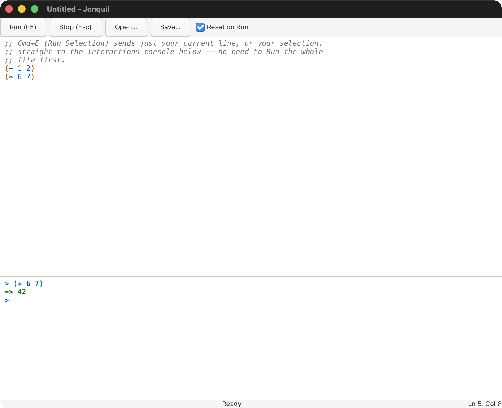

<strong>Run Form's details: discarded forms, metadata and the flash</strong>

A form switched off with `#_` counts as no form. Metadata in front of a form
runs with it. The form flashes briefly; a key pressed during the flash
cancels it, so it never types over your code.

## The REPL prompt, and how it differs from Run

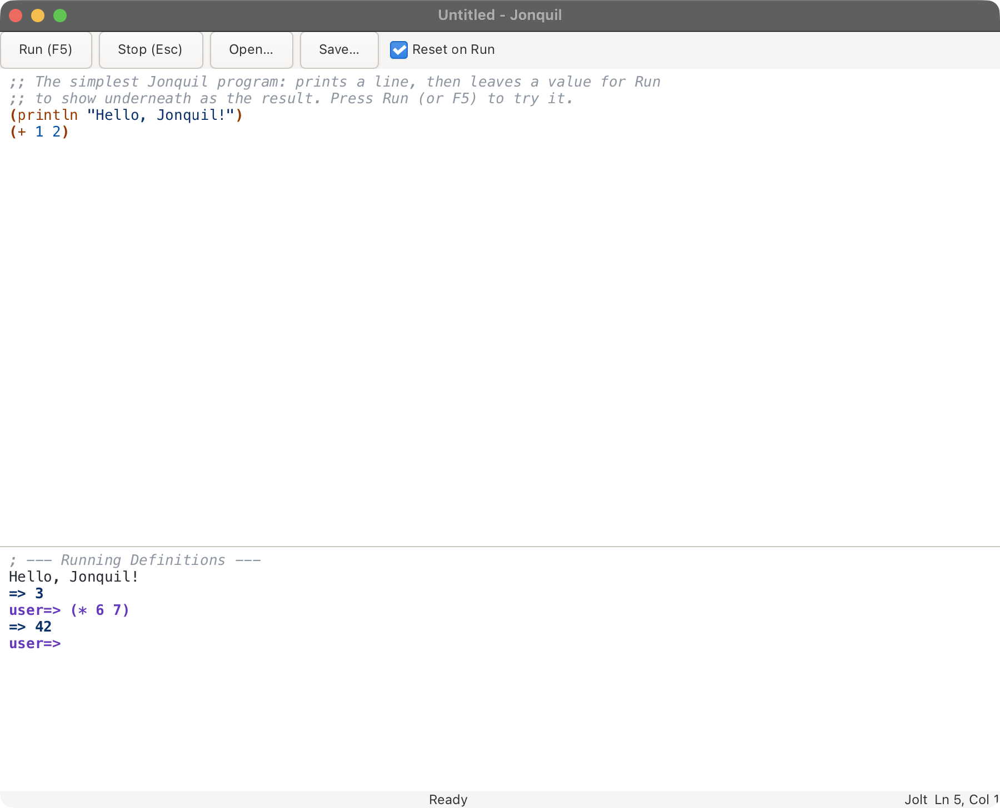

The prompt evaluates one expression at a time and shows its namespace
(`user=> `, or `demo.core=> ` after an `(ns demo.core)`).

- Run evaluates the whole pane and, by default, clears earlier definitions
  first. A REPL entry evaluates only what you typed and builds on whatever
  exists, including what the last Run left. So Run a program, then call its
  functions at the prompt.
- `doc`, `find-doc`, `apropos`, `dir`, `pprint` and `pp` are available
  without a `require`. A file starting with its own `ns` form requires them
  itself.
- `*1`, `*2`, `*3` and `*e` work. Out of process, a Stop that restarts Jolt
  clears them along with every definition.
- Up and Down recall history from the first or last line of the entry; on a
  multi-line entry they move the caret.
- Submitting while a program is running (and not reading input) holds your
  text and reminds you to press Stop.

## `read-line` and stdin

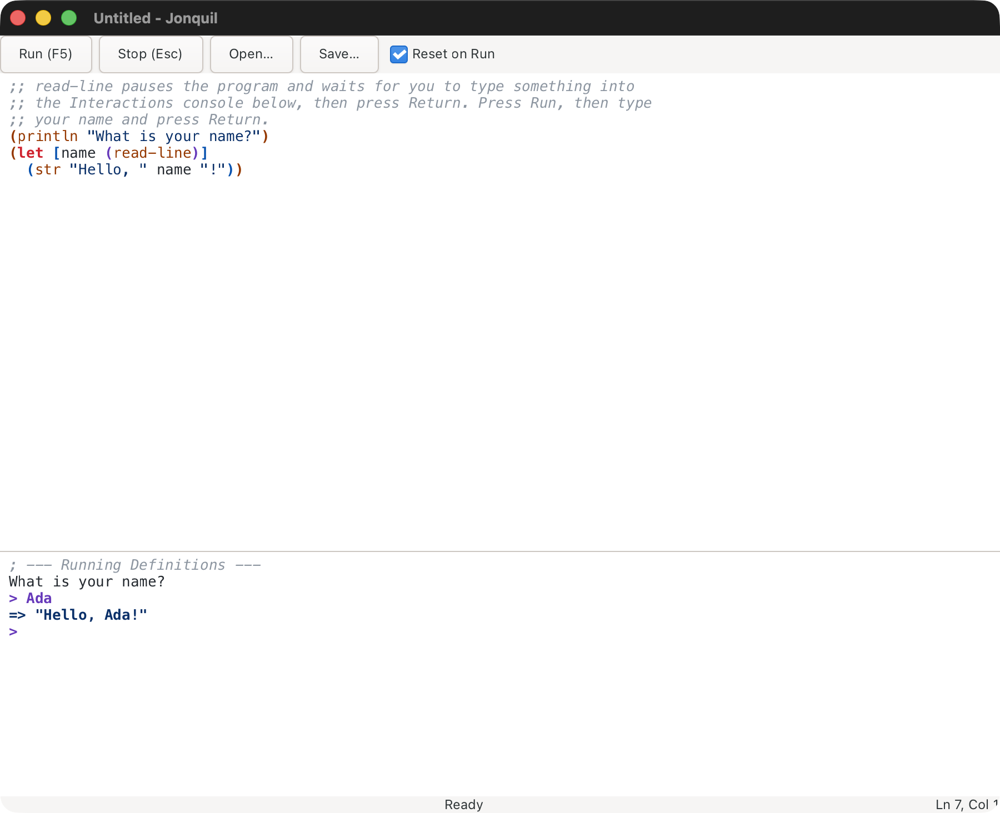

When a program calls `read-line`, the status reads `Waiting for input` and
what you type at the prompt goes to the program, not the evaluator.
**Cmd/Ctrl+D** sends end-of-input. `docs/demos/greet.clj` shows it.

Stdin works with Jolt (in or out of process), JVM Clojure (see
[JVM Clojure](dialects/jvm-clojure.md)) and launched ClojureScript on node;
ClojureDart has none. In process, Cmd/Ctrl+D closes input for the rest of
the run. Elsewhere it ends only the waiting read. See
[Running Jolt out of process](dialects/index.md#running-jolt-out-of-process).

<strong>Text you typed while the program was running</strong>

Unsent text stays at the prompt after the program finishes. The next Return
asks you to press Return again to evaluate it; edit the text and Return
behaves normally. Nothing is deleted.

## Stop

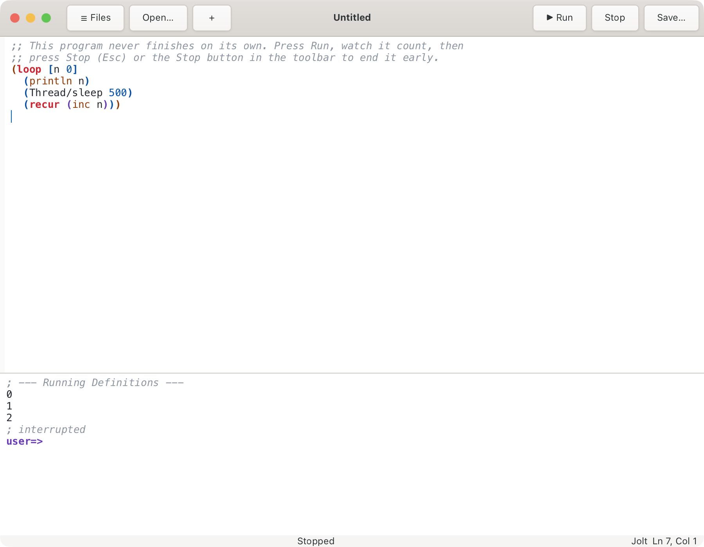

**Stop** or **Esc** interrupts a loop or a blocked `read-line`, prints
`; interrupted`, and the window never freezes. Esc only acts while something
runs. Some out-of-process runtimes restart instead of interrupting (see
[Dialects and runtimes](dialects/index.md)). `docs/demos/forever.clj`
demonstrates it.

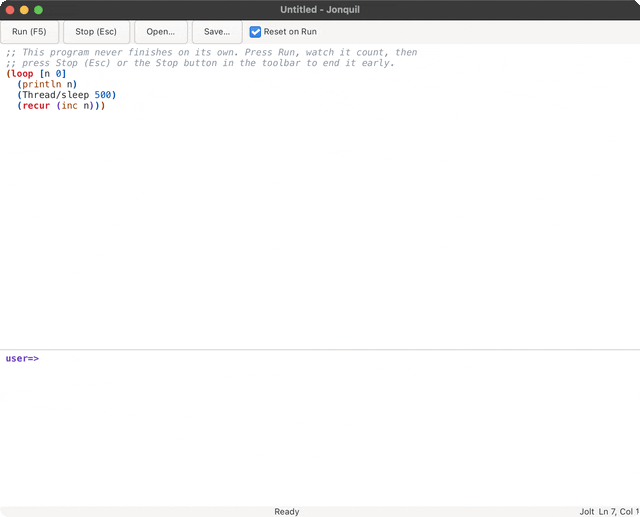

## Reset on Run, versus accumulate

Checked (the default), each Run first removes the namespaces earlier Runs and
REPL entries created, then evaluates fresh. Required libraries stay loaded.
Unchecked, Runs build on each other, as the REPL does.

For runtimes you started yourself (ClojureDart, JVM Clojure, shadow-cljs, an
nREPL server) the box is greyed out, because Jonquil can't clear a process
it doesn't own. Launched ClojureScript starts unticked; ticking it restarts
ClojureScript on each Run, which takes a few seconds.
`docs/demos/reset.clj` shows the difference.

## The friendly unclosed-bracket message

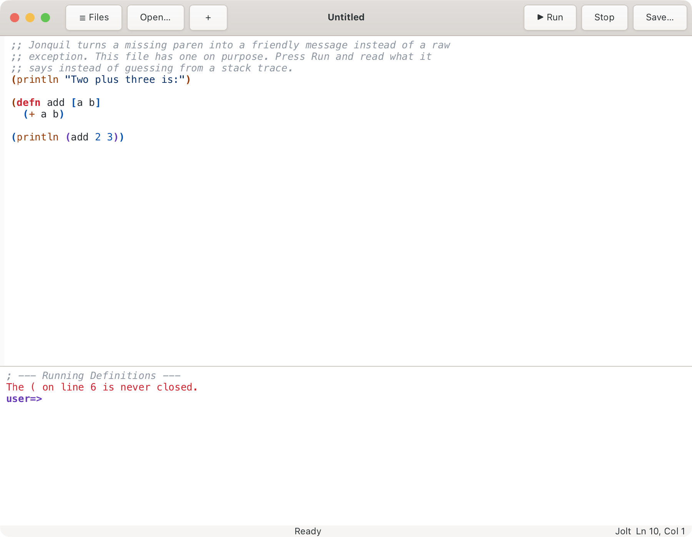

Before evaluating, Run names an unclosed bracket and its line ("The ( on
line 6 is never closed.") or a stray closer ("The ) on line 1 has no
matching opener."). Nothing runs. `docs/demos/unbalanced.clj` is broken on
purpose.

## Editing

- Typing `(`, `[`, `{` or `"` inserts the closer or wraps a selection;
  typing the closer steps past it, and Backspace removes an empty pair.
- Tab and Shift+Tab indent and unindent. Cmd/Ctrl+/ or Cmd/Ctrl+; toggles
  line comments.
- Cmd/Ctrl+Shift+F formats the file; Cmd+Option+F (Ctrl+Alt+F on Linux)
  formats the selection or line. A format is one undo step.
- Undo is Cmd/Ctrl+Z; redo is Cmd/Ctrl+Shift+Z or Cmd/Ctrl+Y.
- F6 switches focus between editor and console. Cmd/Ctrl+L clears the
  console; Cmd/Ctrl+Shift+L clears only the last entry.
- Cmd/Ctrl+= , - and 0 zoom in, out and reset.

All keys are in [Keys](keys.md).

## Parinfer

Parinfer keeps brackets and indentation in step as you type. It's off by
default. Cmd/Ctrl+Option(Alt)+P cycles the mode, the palette has one
command per mode, and the choice is saved in `settings.edn`. The status
bar shows the label whenever a mode is on for the tab you're in, or the
tab's project overrides your setting either way.

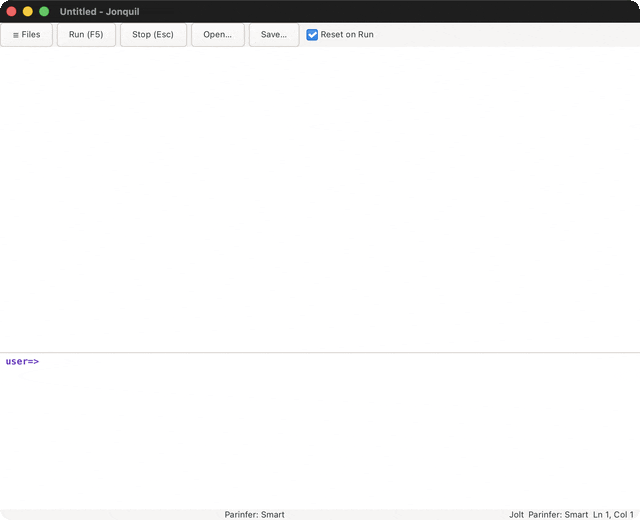

- **Smart** (the usual choice) balances brackets from your indentation:
  typing `(` closes it, and dedenting a line moves its closer up.
- **Indent** is Smart without the edit tracking that protects the form
  you're typing in.
- **Paren** goes the other way: it re-indents from the brackets you type.

A project can choose for its own files: `.jonquil.edn {:parinfer :smart}`
turns Parinfer on for that project's tabs, and `{:parinfer :off}` keeps
them off even when your setting is on. The label then says
`Parinfer: Smart (project)`, and the key and palette keep changing the
global setting. Like the other `.jonquil.edn` keys, it applies to tabs
you open after editing the file.

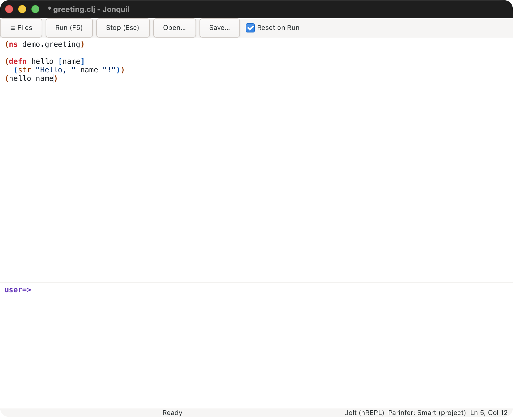

Parinfer works on the top-level form you're editing, never the whole file.
Opening a file changes nothing. A form whose indentation disagrees with
its brackets is re-indented the first time you edit it, as part of that
edit, so one undo reverts your keystroke and the fix together. In Smart and
Indent modes, bracket auto-close and pair Backspace step aside, since
Parinfer balances for you (the quote keeps pairing, and Backspace still
removes an empty pair of quotes); in an edited form, tabs become two
spaces and line endings follow the form's first. Reloads, agent (MCP) edits, and forms
over 300 lines are left alone; skipping a long form is named in the
status bar.

Format All and Format Selection land exactly what they made, with no
skip and no status note. While Parinfer is on, the formatter's output
takes Paren mode's indentation per touched top-level form as a last
step, so the two styles agree and the next keystroke has nothing to
re-indent: a second format changes nothing, and formatting again after
an edit is whitespace-stable. On Jonquil's own sources the two styles
disagreed on 80 of 2,421 forms before this pass, each a one-space shift
on a wrapped line (measured 2026-10-29). With Parinfer off, a format is
the formatter's output alone, unchanged.

Since the output depends on the mode, a repo whose people differ on it
would see those lines flip between formats. A project can pin one style
for everyone with `.jonquil.edn {:format-style :paren-stable}` (or
`:plain`), which decides every format in that project's tabs whatever
the mode. Pinning `:plain` while typing with Parinfer on re-accepts the
first-edit re-indent the Paren-stable output exists to remove.

## Find and replace

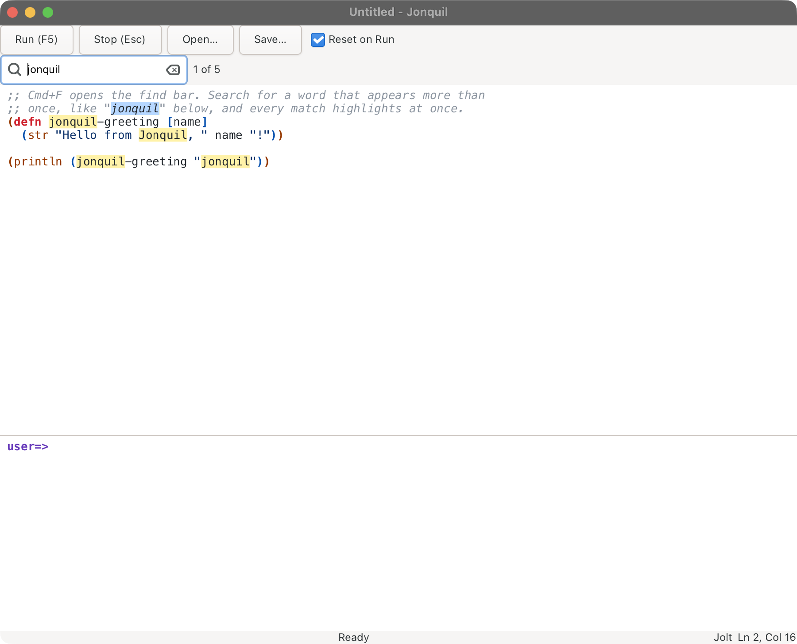

Cmd/Ctrl+F opens the find bar, Cmd/Ctrl+H adds the replace field. Matches
highlight as you type, with a count ("2 of 5"). Return, F3 or Cmd/Ctrl+G
goes to the next match, and the Shift variants go back. Replace and Replace
All are each one undo step. Escape closes the bar only while it has focus;
elsewhere it still stops a running program.

## Unicode and IME

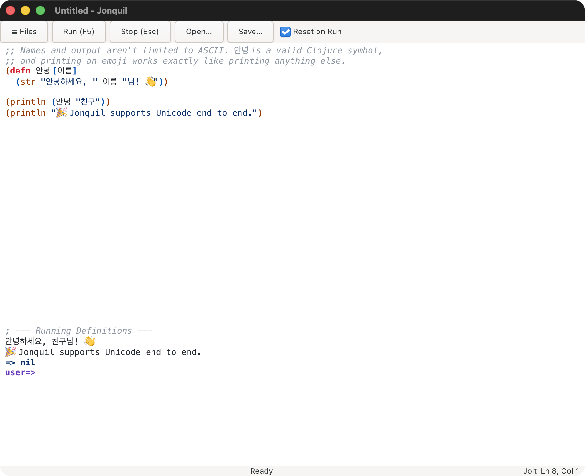

Names and output aren't limited to ASCII; Hangul, Thai and other composed
scripts work in both panes. See `docs/demos/unicode.clj`.

<strong>Return during an input-method composition</strong>

Return while a syllable is still underlined commits it and inserts a plain
newline, with no smart indent or evaluation. Press Return again for the
normal behavior.

## Themes

Cmd/Ctrl+Shift+M cycles light (the default), dark, solarized, navy and auto.
The status bar shows the current one.

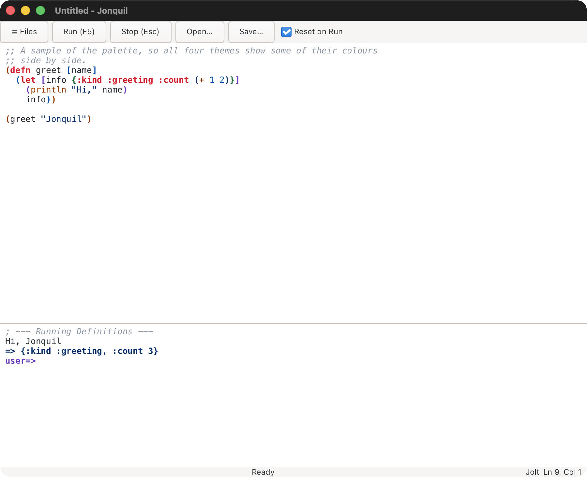

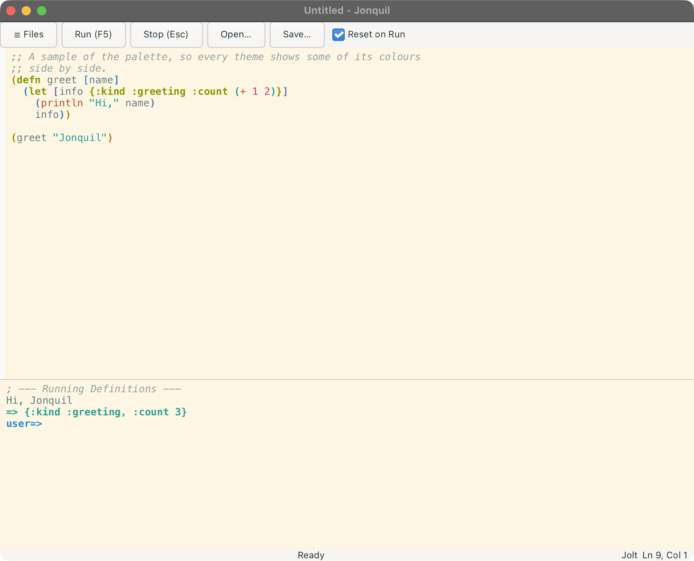
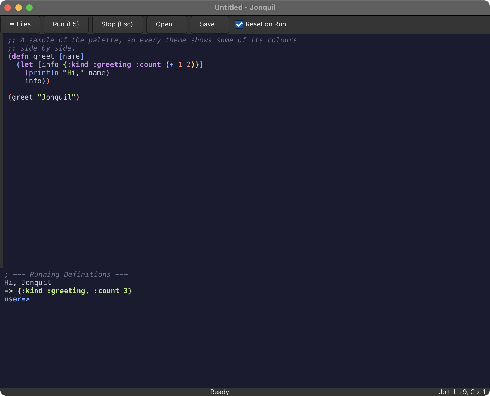

A theme recolours both panes and GTK's chrome. Auto follows the system's
Light or Dark mode on macOS; elsewhere it shows light.

<strong>Where the choice is saved</strong>

The choice is saved to `$XDG_CONFIG_HOME/jonquil/settings.edn` (or
`~/.config/jonquil/settings.edn`) as `{:theme :navy}`, or `{:theme :auto}`
for auto. A missing file starts in light silently; an unreadable file or an
unknown theme also starts in light but says so once in the console. Delete
the file to go back to light.

