# Using Jonquil

Jonquil is a DrRacket-style IDE for Clojure: a Definitions editor above an
Interactions console, with a Run button that runs the top pane and a Stop
that actually stops it. This page covers the window, Run and the REPL
prompt, stdin, Stop, editing, find and replace, and themes. The rest of
the guide has its own pages: [Files and tabs](files-and-tabs.md),
[Help and the inspector](help-and-inspector.md),
[Dialects and runtimes](dialects/index.md), [Plugins](plugins.md),
[Driving Jonquil from an agent](mcp.md), [Keys](keys.md) and
[Known limits](known-limits.md).

Edge cases sit in folded blocks: click a bold line to open one.

## The window

- The toolbar holds **☰ Files** (the [file tree](files-and-tabs.md#file-tree)),
  **Run (F5)**, **Stop (Esc)**, **Open…**, **Save…** and a **Reset on Run**
  checkbox.
- The **Definitions** editor is where you write a program. The
  **Interactions** console below it shows output and takes expressions at a
  `user=> ` prompt. Drag the divider to resize.
- The status label reads `Ready`, `Running…`, `Waiting for input` or
  `Stopped`. The dialect label beside it names the runtime (see
  [Dialects and runtimes](dialects/index.md)).
- The window title shows the open file (or `Untitled`) and a leading `* `
  for unsaved changes.

To see which version you run, use **Show Jonquil's version** in the command
palette, which prints it to the console, or run `jonquil --version` in a
terminal, which prints it and exits without opening a window. For the
downloaded app that is `/Applications/Jonquil.app/Contents/MacOS/Jonquil --version`.

## Running a program

**Run**, **F5** or **Cmd/Ctrl+R** evaluates the whole Definitions pane. The
console prints a `; --- Running core.clj ---` banner, streams the output and
ends with the result, such as `=> 3`. Jonquil checks brackets first and
refuses to run a broken pane. A second Run during a run just warns.

![A second Run while (loop [] (recur)) is still running: the console warns that an evaluation is already in progress](../images/run-while-running.png)

`docs/demos/hello.clj` is the simplest example.

- **Cmd/Ctrl+E** evaluates the selection (or current line) at the console
  prompt, echoed there and added to the REPL history.
- **Cmd/Ctrl+Enter**, or Run Form in the right-click menu, runs the
  top-level form around the caret (inside `(comment ...)`, the form that
  holds the caret). With no form there, the status bar says so.

<strong>Run Form's details: discarded forms, metadata and the flash</strong>

A form switched off with `#_` counts as no form. Metadata in front of a form
runs with it. The form flashes briefly; a key pressed during the flash
cancels it, so it never types over your code.

### Changed forms

Once a tab has run, a thin bar in the Definitions editor's left gutter marks
each top-level form you've edited since it last ran. **Run the forms changed
since they last ran**, in the palette, sends just those, in order, as one
evaluation the way Run Selection does, and the console says how many. With
nothing marked it says so, and in a tab that hasn't run yet it asks you to run
it once first.

A form counts as changed when its code changed: reindenting, formatting and
editing a comment don't mark it, but any change to a symbol, a number or a
string's text does. `(comment ...)` blocks are never marked. A Run that ends
without an error records every form as run; Run Form and Run Selection record
the forms they sent. An evaluation that fails or is stopped records nothing,
so its forms stay marked. A file reloaded from disk keeps its record, so
the forms that differ from what last ran show up marked.

### Change sets

A change set holds the forms you changed for one idea, so you can look at
them together, send them to the running program in one go, or put them all
back. **Make a Change Set** (type "change set from the forms" in the palette) gathers
the active tab's changed forms, the ones the gutter marks, and opens the
Change Sets panel on the right with one section per form: its file, its name
(`defn f`) and a diff of the text it had at the last Run that ended well
against the text it has now. A form that is new since then reads "(new)" and
shows as all added. Type a name and press **Save Set**. The panel needs a
saved tab that has run once; with nothing changed the status bar says so.

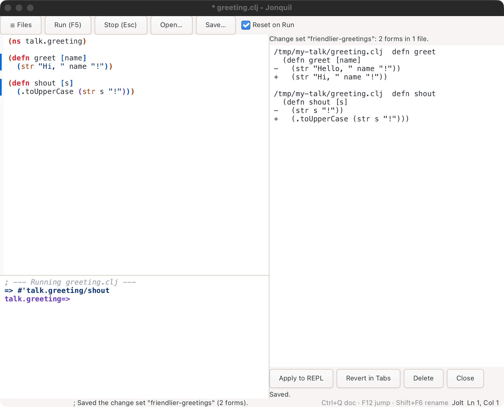

**Change Sets** in the palette lists the project's kept sets, each with its
form count and, for an agent's, who proposed it. Opening one shows its
diffs and three buttons:

- **Apply to REPL** sends each form in order, evaluated in the namespace its
  file's `ns` form names, while the console's prompt stays in the namespace it
  was in. Every form is echoed and its result lands in the console. The first
  form that ends with an error stops the rest, and the console names it. In
  the in-process session and the Jolt child, a namespace that isn't loaded
  stops the apply with "my.app isn't loaded: Run its file first" (the child
  is asked once, before anything is sent). A runtime that can't evaluate in
  another namespace (JVM Clojure over nREPL, ClojureScript) refuses a file that
  has an `ns` form instead of sending its forms to the wrong place. Apply
  doesn't mark the forms as run.
- **Revert in Tabs** puts each form's last-run text back in its open tab (it
  opens the file when no tab shows it) as one undo step per tab. A form is
  found by its first two elements and its place among forms that share them,
  as in the one-form compare. One that is gone, is new since the last Run, or
  already reads as it did is skipped and named in the console, and so is one
  you have edited since you made the set (its text no longer matches what the
  set holds). An agent's set has no Revert button, since its forms were never
  in your tabs.
- **Delete** removes the set.

Sets are plain EDN files in `change-sets/<folder>-<hash>/` beside the
settings file, one per set, so they survive a restart and stay out of the
project's tree. A set that isn't valid EDN, or doesn't have the shape of one,
is listed as broken, can only be deleted, and is never applied. Saving under
a name that exists replaces that set. Sets are written to a temporary file and
moved into place, and a file over 1 MB is listed as broken without being read.

An agent can propose a set with `jonquil_change_set_propose` (see
[MCP](mcp.md)). It lands in the same list, marked as proposed by a client
calling itself by the name the client gave, and only you can apply or delete it.

### Timing a form

**Time the form at the caret (about a second)**, in the palette, runs that
form over and over in batches for about a second, each batch against the
same number of empty calls, then prints one line in the console:
`; Time: 12.3 ns per call (± 0.4 ns over 10 batches of 1048576; an empty
call's 1.1 ns taken off)`. A slow form still stops near the second, after
at least 3 batches, and one slower than the whole second is timed once. A
form too fast to tell apart from an empty call says so instead: a time counts
only when it is larger than both spreads added together and at least 5% of
an empty call. A lazy form is timed as building the sequence, not walking it, so
wrap it in `doall` to time the work.

The form runs thousands of times, often millions, so time only code without
side effects. A form that writes a file, swaps an atom, prints or calls a
server does that on every run. So Jonquil asks before it starts, and the
alert says why. **Time It, Don't Ask Again** stops the question until the
window closes, and the console still repeats the warning each time timing
starts.

It runs in the window's own runtime, so it times the code where it really
runs: Jolt, JVM Clojure, or another nREPL server that has
`System/nanoTime`, such as babashka's (a Basilisp server answers with an
error). ClojureScript, ClojureDart and jank say timing needs Jolt or JVM
Clojure.

### Saving the world

**Save World** writes your session's data to a file, and **Restore World**
brings it back: the values of your vars, so an atom you filled from a slow
source, or the rows you built up at the prompt, survive closing Jonquil or
an experiment that went wrong. It's Jolt only, in process or in the Jolt
child, through Jolt's `jolt.image`.

Each project keeps your last 10 saves, beside Jonquil's settings rather than
in the project, so they never land in git. The project is the window's
folder; a window with no folder shares one history with every other. Before either restore command
runs, the data you have now is saved first, and up to 10 of those are kept
apart from yours, so restoring never pushes out a save you made. Restore
World brings back the newest save you made. **Restore an Earlier World**
lists them all in the palette ("Restore World saved 12 minutes ago (3
vars)", or "saved before a restore, ...") to pick one, which is how you
undo a restore you didn't mean. What the save before a restore could only
keep as a placeholder, an open file say, is named in the console, since
undoing the restore can't bring that back either.

Which namespaces a world holds depends on where Jolt runs. In process, it's
`user` and the namespaces your Runs and the prompt created, not the
libraries they required, and never Jonquil's own. In the Jolt child, it's
`user` and every namespace loaded after the child started, libraries your
code required included, but not one a `user.clj` loaded at startup, and
never a namespace named `clojure.*`, `jolt.*`, `jonquil.*` or `nrepl.*`.
A library var holding something that can't be written stops the save the
same as one of yours does. Before writing, Save World checks each var:
something that can't be written as it is, such as an open file or a future
that hasn't finished, is saved as a placeholder, and the console names each
one. If a var holds something that can't be written at all, nothing is
saved and the console names it. Restore World names the placeholders it
brought back, which you replace yourself.

A world is data, not code. Functions aren't saved, since Run defines them,
so restoring doesn't bring back code you've changed since, and a var you
defined after the save keeps its value. A var that held data when you
saved and that you've since redefined as a function gets the data back,
so Run its code again after restoring. To roll back an experiment
cleanly, put the code back first (with git, say), Run it, then restore.
And a world reads back only on the Chez Scheme runtime it was saved on, so
a Jolt upgrade that changes it can leave Restore World unable to read an
old one: save again.

### Last session's replay

Jonquil records what each project evaluated, so that next time you can look
at it and run it again. When you open a project that has a record from before,
the console offers it: `; Last session (Jolt, 14 hours ago): 2 files, 31
definitions, 4 other forms. Open last session's replay from the palette to
review it.` If the record was made in another dialect than the window's, the
line adds which one. Open Folder gets the same offer for the new folder.
**Open last session's replay** in the palette puts a script in a new Untitled
tab, and nothing runs until you press Run. Times are relative ("from 3 days
ago to 14 hours ago"), not clock times.

What gets recorded:

- A Run of a saved file records the file. Run Form, Run Selection and Run
  Changed in a saved file record their forms with that file as their source,
  and the replay drops those forms when it loads the file.
- A Run of an Untitled tab and every console entry record each top-level
  form with its namespace. `(load-file "/abs/path")` counts as a file.
- An evaluation that threw records nothing.
- What an agent evaluates through MCP isn't recorded. The code it sends does
  land in the Up/Down history, and that history is saved with the record.

The script has three groups. Files come first, as `load-file` lines that load
them as they are on disk now. Definitions follow, each once at its last
position, with setup forms such as `ns` and `require` ahead of them, grouped
by namespace. Every other form comes last behind `#_`, so it's skipped until
you remove the `#_`. A setup form you ran again later (a second
`(refer 'lib)`) keeps its first position, which is a known limit.

The replay tab counts as typed at the console, so its Run never resets
earlier definitions. A second Open selects the replay tab that's already open
for the same folder, and after Open Folder it opens a new tab for the new
folder. Running the replay records its files and definitions again, and the
skipped forms still in the tab behind `#_` come back in the next replay, with
their old namespace and time. They're matched by their exact text. A skipped
form you delete from the tab before Run, or reindent or edit, is dropped, and
one whose `#_` you take off runs and is recorded like any other form. Forget
last session clears everything, skipped forms included.

The record keeps growing across days until you run the replay or choose
**Forget last session** in the palette. It's one file per project in
`replays/`, beside `settings.edn`, kept to 2,000 evaluations and 500 history
entries, and written owner-only (`0600`, in a `0700` folder). It's plain text
and holds whatever you typed, secrets included. Two Jonquil processes on one
project aren't guarded against each other, so the later write wins.

Replay runs in Jolt (in process and in the child) and JVM Clojure. The other
dialects still record, and their Up/Down history comes back, but the console
says replay isn't available for them yet. That history also survives a
dialect switch. `:remember-session? false` in `settings.edn` turns off the
recording, the offer, loading the history and Forget, and leaves any file
already written alone. A project can decide for itself with
`:remember-session?` in its `.jonquil.edn`: `false` keeps that project off
disk while the others record, and `true` records it even with the setting
off.

## The REPL prompt, and how it differs from Run

The prompt evaluates one expression at a time and shows its namespace
(`user=> `, or `demo.core=> ` after an `(ns demo.core)`).

- Run evaluates the whole pane and, by default, clears earlier definitions
  first. A REPL entry evaluates only what you typed and builds on whatever
  exists, including what the last Run left. So Run a program, then call its
  functions at the prompt.
- `doc`, `find-doc`, `apropos`, `dir`, `pprint` and `pp` are available
  without a `require`. A file starting with its own `ns` form requires them
  itself.
- `*1`, `*2`, `*3` and `*e` work. Out of process, a Stop that restarts Jolt
  clears them along with every definition.
- Up and Down recall history from the first or last line of the entry; on a
  multi-line entry they move the caret.
- Submitting while a program is running (and not reading input) holds your
  text and reminds you to press Stop.

## `read-line` and stdin

When a program calls `read-line`, the status reads `Waiting for input` and
what you type at the prompt goes to the program, not the evaluator.
**Cmd/Ctrl+D** sends end-of-input. `docs/demos/greet.clj` shows it.

Stdin works with Jolt (in or out of process), JVM Clojure (see
[JVM Clojure](dialects/jvm-clojure.md)) and launched ClojureScript on node;
ClojureDart has none. In process, Cmd/Ctrl+D closes input for the rest of
the run. Elsewhere it ends only the waiting read. See
[Running Jolt out of process](dialects/index.md#running-jolt-out-of-process).

<strong>Text you typed while the program was running</strong>

Unsent text stays at the prompt after the program finishes. The next Return
asks you to press Return again to evaluate it; edit the text and Return
behaves normally. Nothing is deleted.

## Stop

**Stop** or **Esc** interrupts a loop or a blocked `read-line`, prints
`; interrupted`, and the window never freezes. Esc only acts while something
runs. Some out-of-process runtimes restart instead of interrupting (see
[Dialects and runtimes](dialects/index.md)). `docs/demos/forever.clj`
demonstrates it.

## Reset on Run, versus accumulate

Checked (the default), each Run first removes the namespaces earlier Runs and
REPL entries created, then evaluates fresh. Required libraries stay loaded.
Unchecked, Runs build on each other, as the REPL does.

For runtimes you started yourself (ClojureDart, JVM Clojure, shadow-cljs, an
nREPL server) the box is greyed out, because Jonquil can't clear a process
it doesn't own. Launched ClojureScript starts unticked; ticking it restarts
ClojureScript on each Run, which takes a few seconds.
`docs/demos/reset.clj` shows the difference.

## The friendly unclosed-bracket message

Before evaluating, Run names an unclosed bracket and its line ("The ( on
line 6 is never closed.") or a stray closer ("The ) on line 1 has no
matching opener."). Nothing runs. `docs/demos/unbalanced.clj` is broken on
purpose.

## Editing

- Typing `(`, `[`, `{` or `"` inserts the closer or wraps a selection;
  typing the closer steps past it, and Backspace removes an empty pair.
- Tab and Shift+Tab indent and unindent. Cmd/Ctrl+/ or Cmd/Ctrl+; toggles
  line comments.
- Cmd/Ctrl+Shift+F formats the file; Cmd+Option+F (Ctrl+Alt+F on Linux)
  formats the selection or line. A format is one undo step.
- Undo is Cmd/Ctrl+Z; redo is Cmd/Ctrl+Shift+Z or Cmd/Ctrl+Y.
- F6 switches focus between editor and console. Cmd/Ctrl+L clears the
  console; Cmd/Ctrl+Shift+L clears only the last entry.
- Cmd/Ctrl+= , - and 0 zoom in, out and reset.

All keys are in [Keys](keys.md).

## Parinfer

Parinfer keeps brackets and indentation in step as you type. It's off by
default. Cmd/Ctrl+Option(Alt)+P cycles the mode, the palette has one
command per mode, and the choice is saved in `settings.edn`. The status
bar shows the label whenever a mode is on for the tab you're in, or the
tab's project overrides your setting either way.

- **Smart** (the usual choice) balances brackets from your indentation:
  typing `(` closes it, and dedenting a line moves its closer up.
- **Indent** is Smart without the edit tracking that protects the form
  you're typing in.
- **Paren** goes the other way: it re-indents from the brackets you type.

A project can choose for its own files: `.jonquil.edn {:parinfer :smart}`
turns Parinfer on for that project's tabs, and `{:parinfer :off}` keeps
them off even when your setting is on. The label then says
`Parinfer: Smart (project)`, and the key and palette keep changing the
global setting. Like the other `.jonquil.edn` keys, it applies to tabs
you open after editing the file.

Parinfer works on the top-level form you're editing, never the whole file.
Opening a file changes nothing. A form whose indentation disagrees with
its brackets is re-indented the first time you edit it, as part of that
edit, so one undo reverts your keystroke and the fix together. In Smart and
Indent modes, bracket auto-close and pair Backspace step aside, since
Parinfer balances for you (the quote keeps pairing, and Backspace still
removes an empty pair of quotes); in an edited form, tabs become two
spaces and line endings follow the form's first. Reloads, agent (MCP) edits, and forms
over 300 lines are left alone; skipping a long form is named in the
status bar.

Format All and Format Selection land exactly what they made, with no
skip and no status note. Without a `:format-style` pin (below), while
Parinfer is on the formatter's output takes Paren mode's indentation
per touched top-level form as a last step, so the two styles agree and
the next keystroke has nothing to re-indent: a second format changes
nothing, and formatting again after an edit is whitespace-stable. On
Jonquil's own sources the two styles disagreed on 80 of 2,421 forms
before this pass, each a one-space shift on a wrapped line (measured
2026-10-29). With Parinfer off, a format is the formatter's output
alone, unchanged.

Since the output depends on the mode, a repo whose people differ on it
would see those lines flip between formats. A project can pin one style
for everyone with `.jonquil.edn {:format-style :paren-stable}` (or
`:plain`), which decides every format in that project's tabs whatever
the mode. Pinning `:plain` while typing with Parinfer on re-accepts the
first-edit re-indent the Paren-stable output exists to remove.

## Find and replace

Cmd/Ctrl+F opens the find bar, Cmd/Ctrl+H adds the replace field. Matches
highlight as you type, with a count ("2 of 5"). Return, F3 or Cmd/Ctrl+G
goes to the next match, and the Shift variants go back. Replace and Replace
All are each one undo step. Escape closes the bar only while it has focus;
elsewhere it still stops a running program.

## Unicode and IME

Names and output aren't limited to ASCII; Hangul, Thai and other composed
scripts work in both panes. See `docs/demos/unicode.clj`.

<strong>Return during an input-method composition</strong>

Return while a syllable is still underlined commits it and inserts a plain
newline, with no smart indent or evaluation. Press Return again for the
normal behavior.

## Themes

Jonquil has sixteen themes: light (the default), dark, solarized and navy, and
twelve popular ones from other editors, Gruvbox Dark, Gruvbox Light, Dracula,
Nord, Zenburn, Monokai, Tokyo Night, Catppuccin Mocha, Catppuccin Latte, One
Dark, Kanagawa and Rosé Pine. To pick one by name, open the command palette
(Cmd/Ctrl+Shift+P) and type "theme": each has a Use theme entry, and so does
auto. Cmd/Ctrl+Shift+M cycles through them all in that order, ending with
auto. The status bar shows the current one, and your choice is saved.

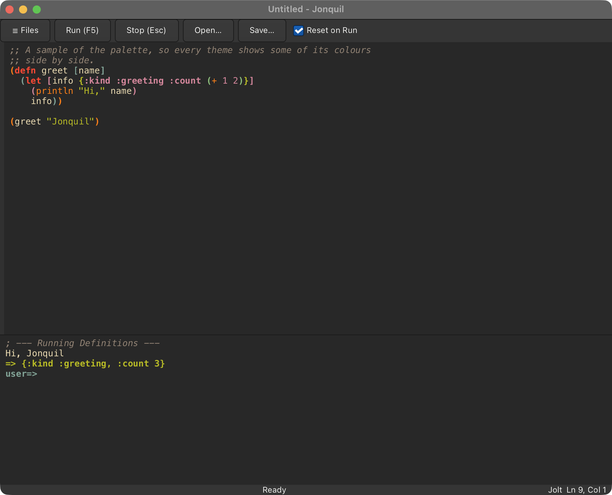
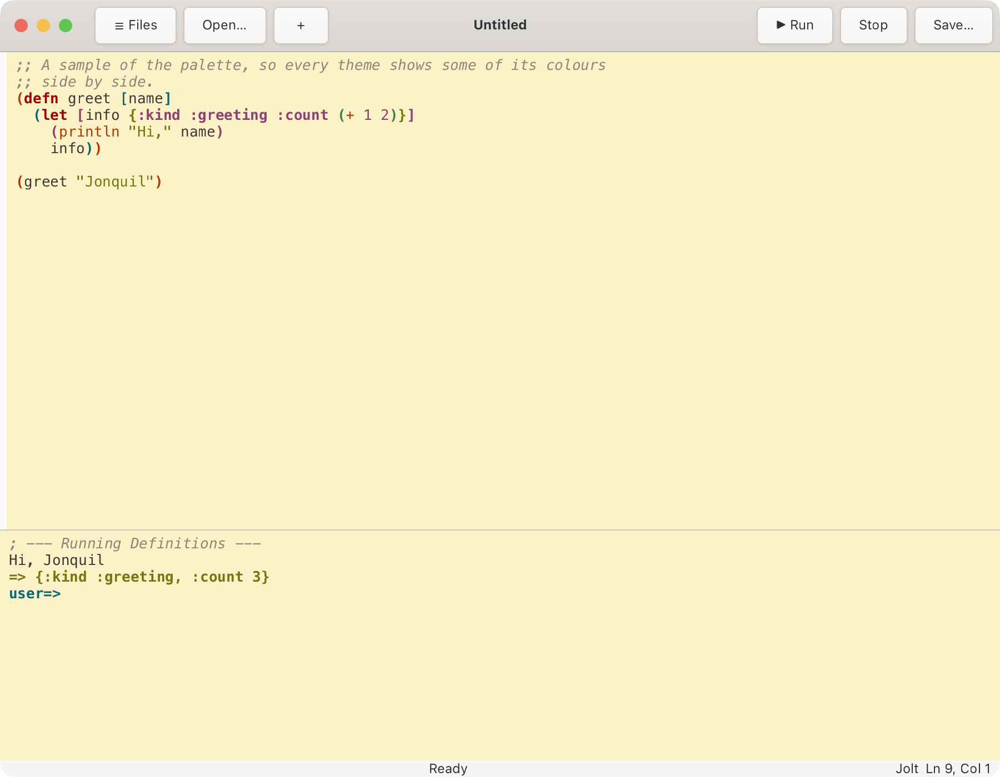
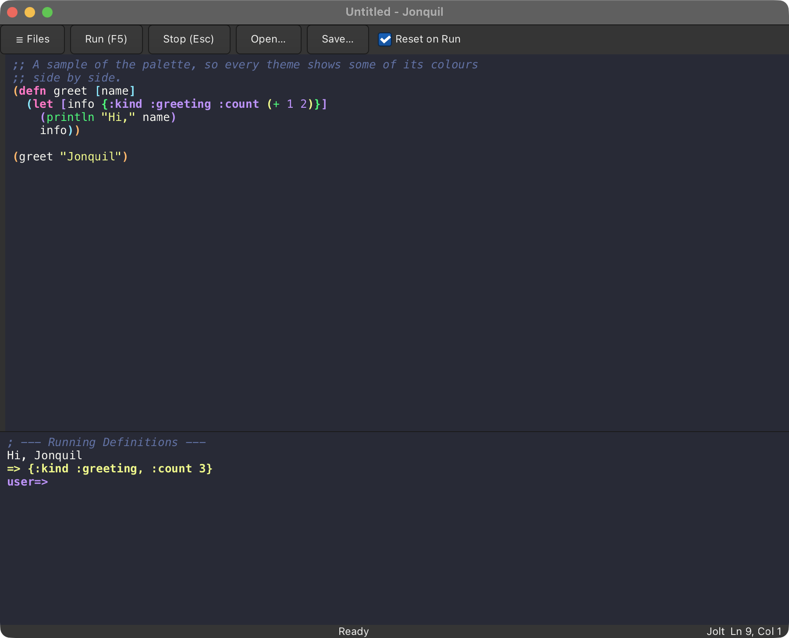
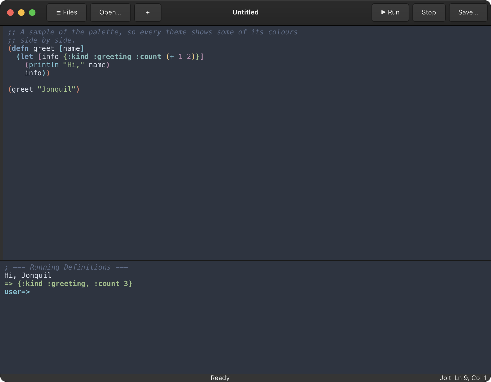
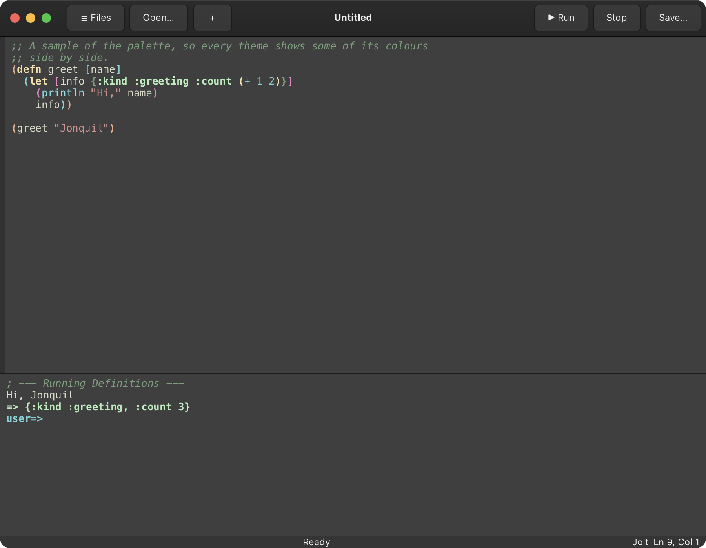
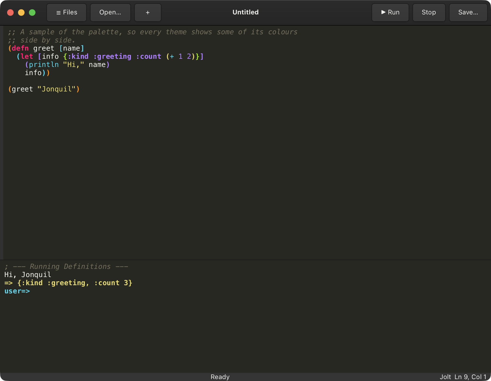
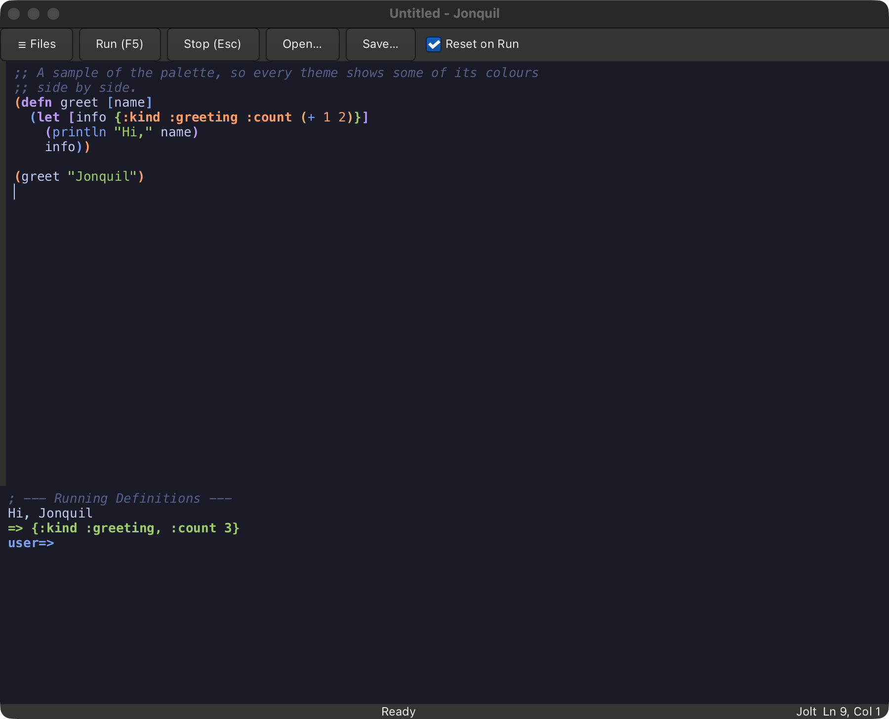
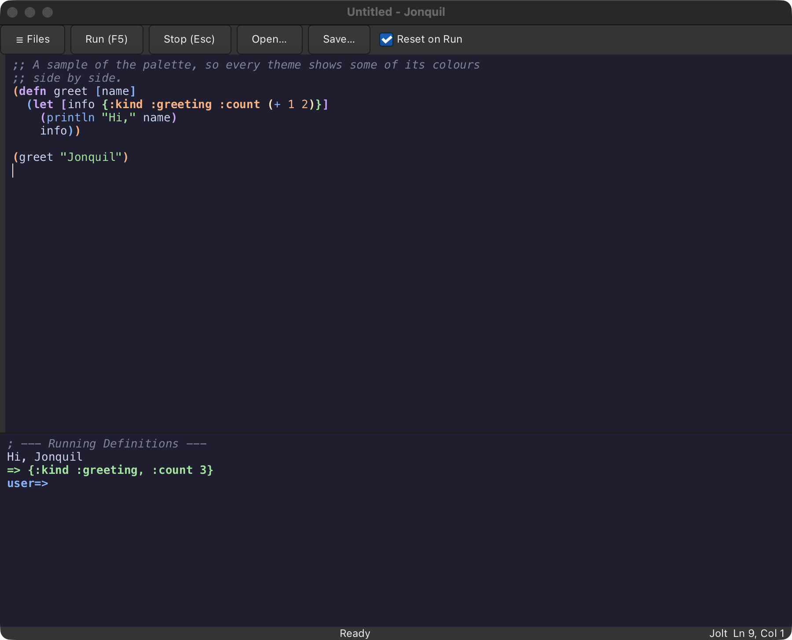
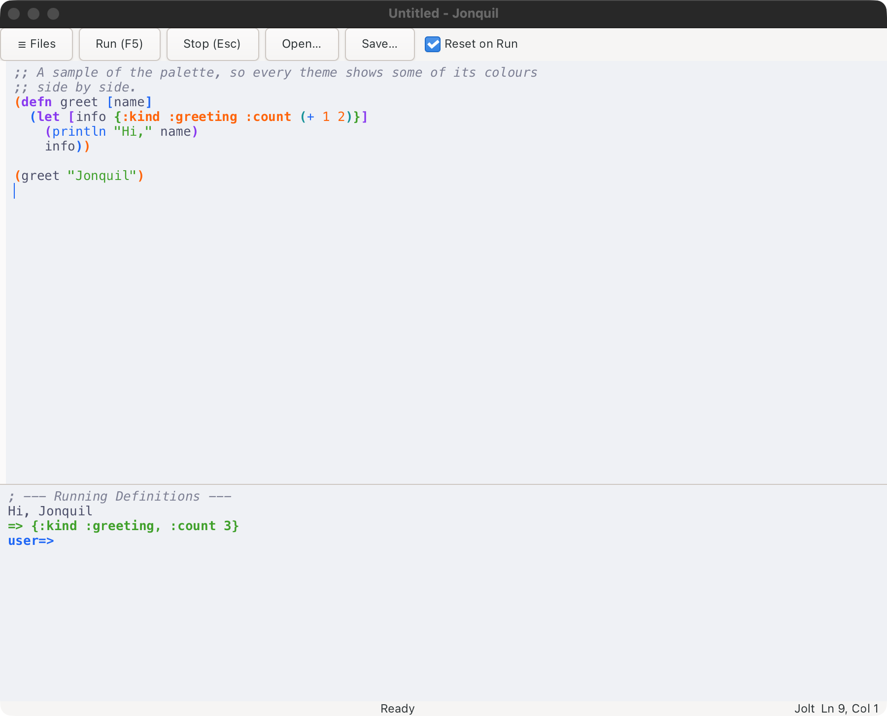
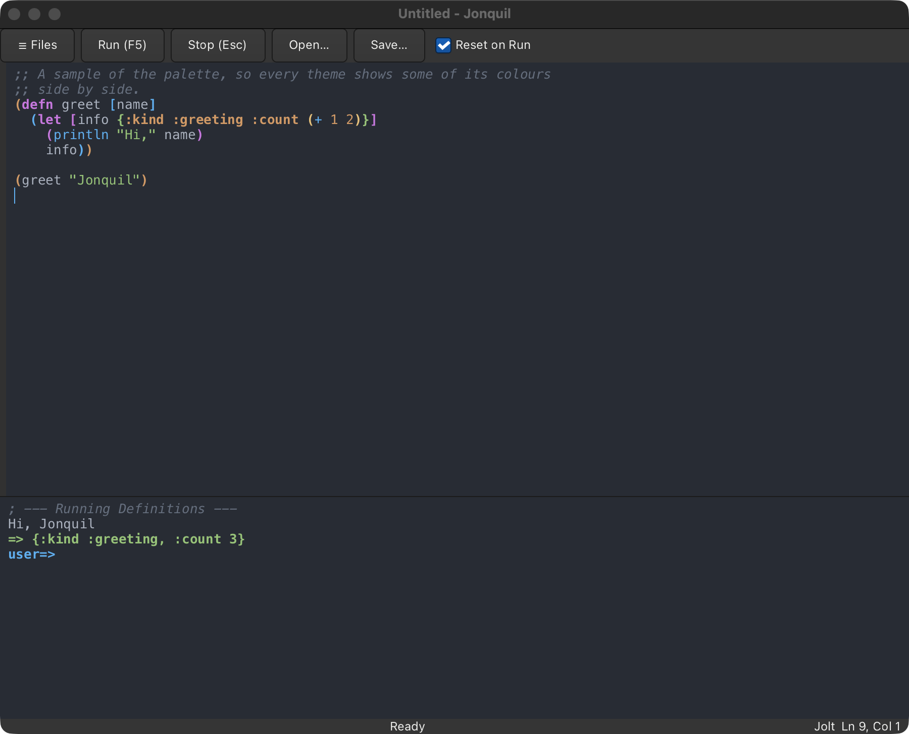
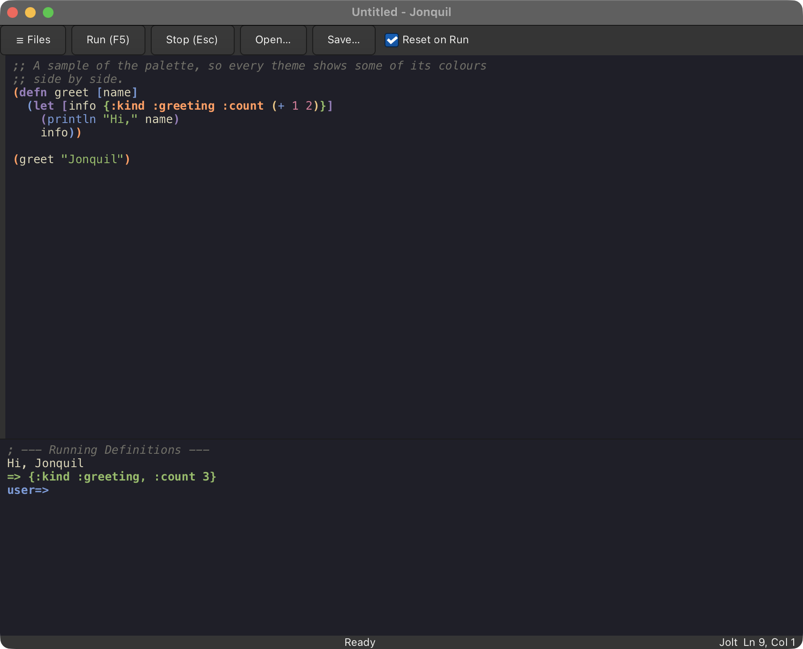
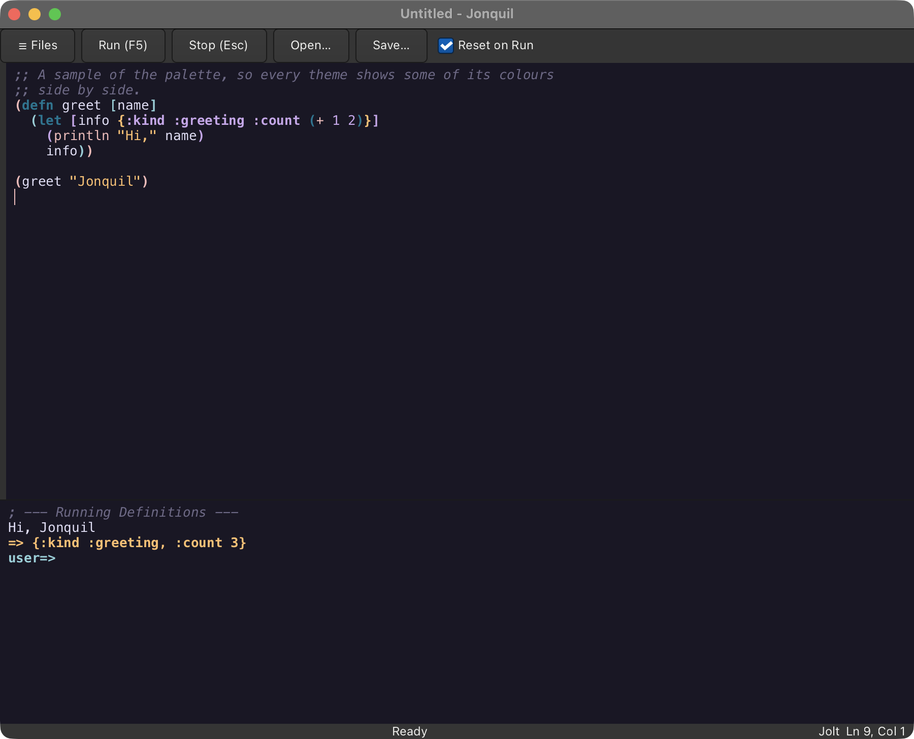

A theme recolours both panes and GTK's chrome. Auto follows the system's
Light or Dark mode on macOS; elsewhere it shows light.

<strong>Where the choice is saved</strong>

The choice is saved to `$XDG_CONFIG_HOME/jonquil/settings.edn` (or
`~/.config/jonquil/settings.edn`) as `{:theme :navy}`, or `{:theme :auto}`
for auto. A missing file starts in light silently; an unreadable file or an
unknown theme also starts in light but says so once in the console. Delete
the file to go back to light.

