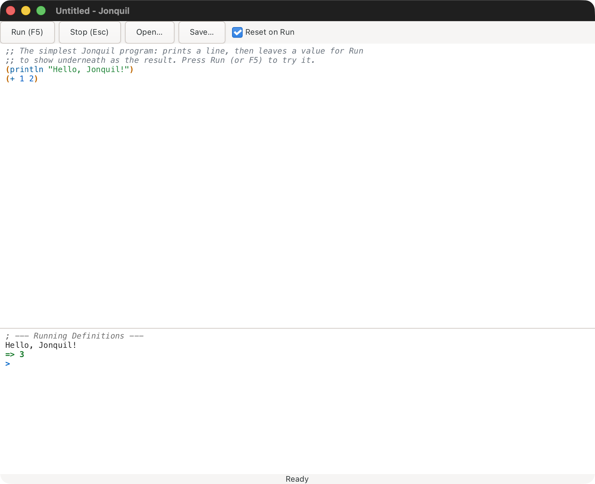
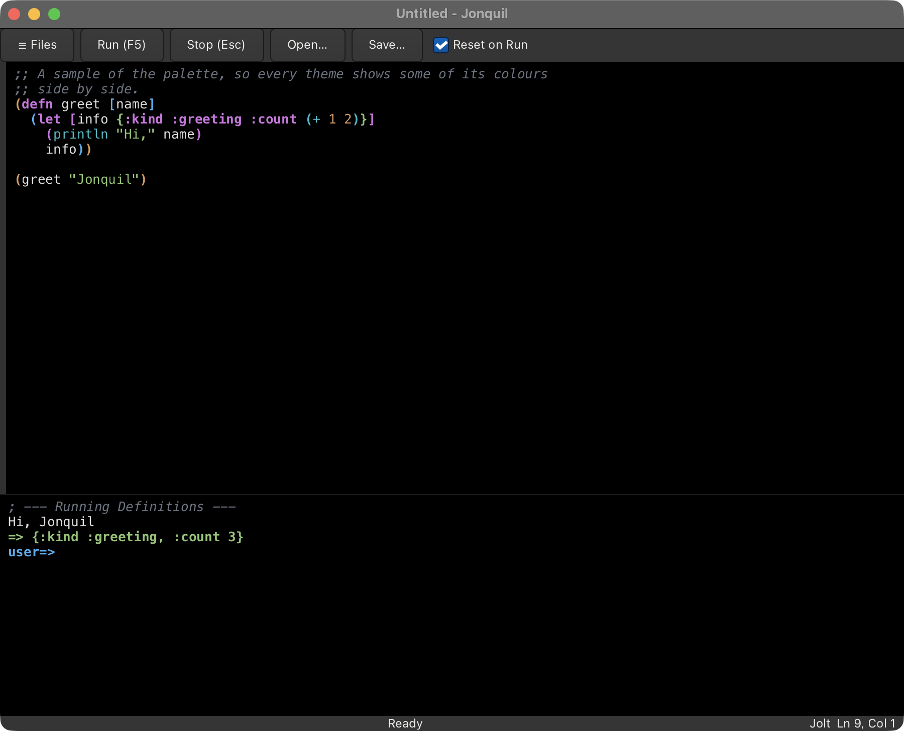
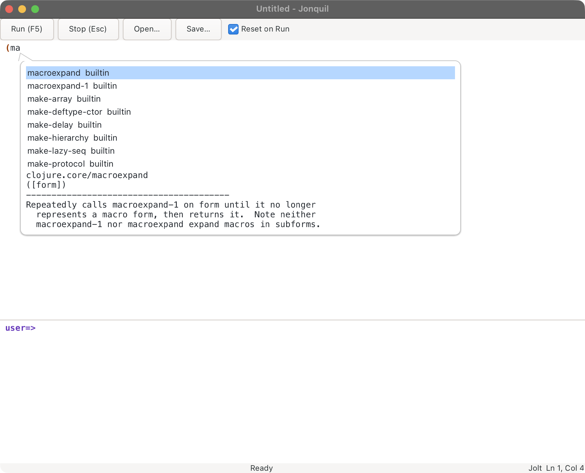
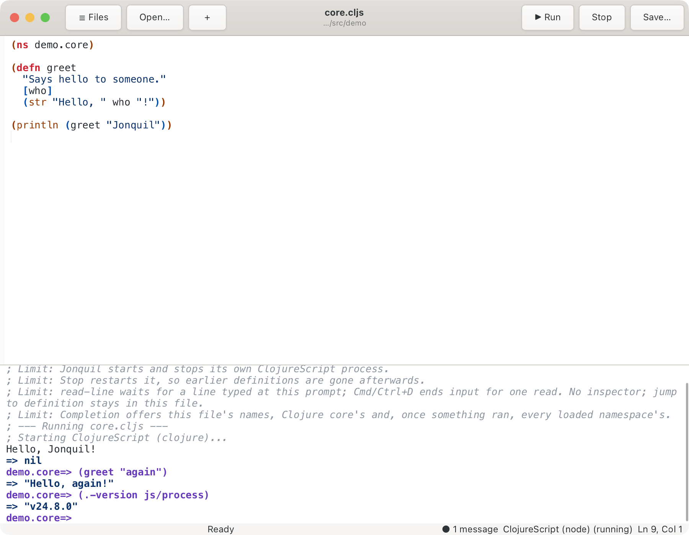
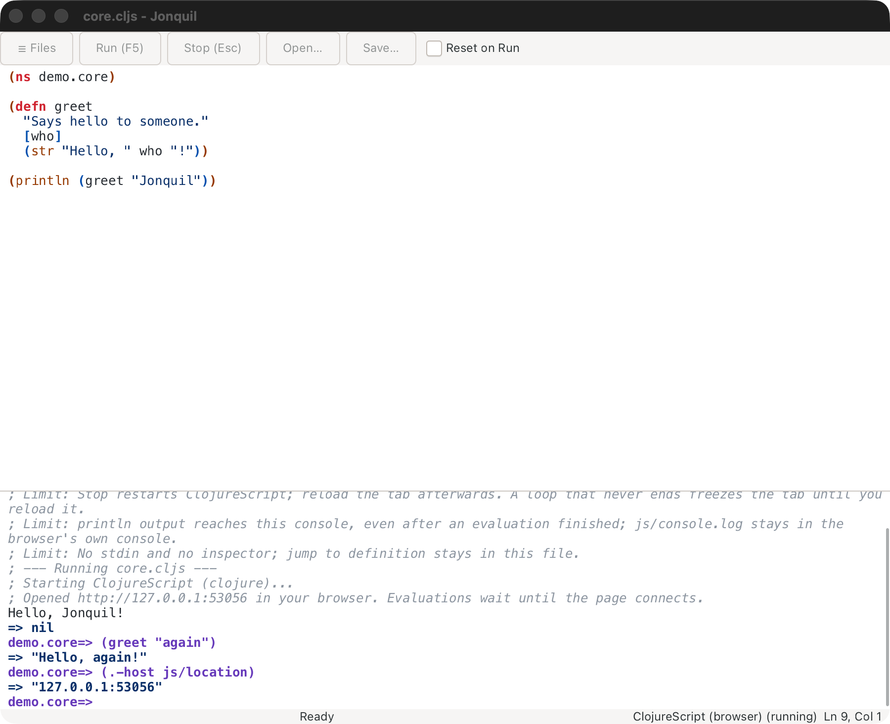
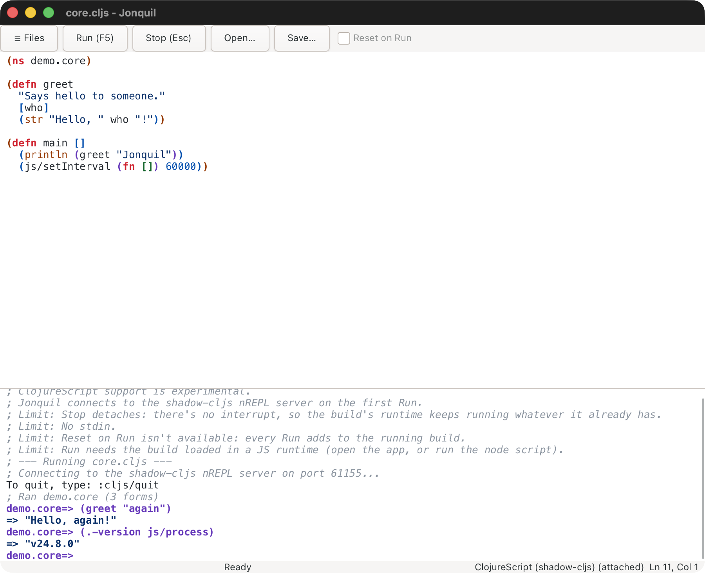
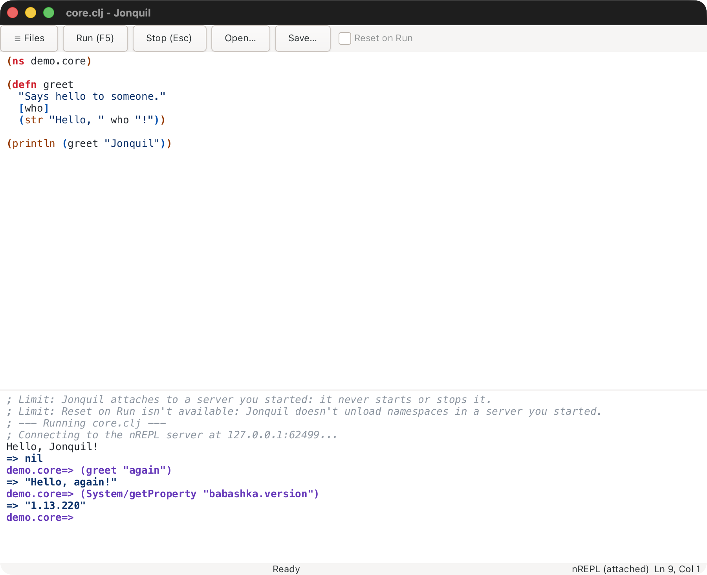

# Using Jonquil

Jonquil is a DrRacket-style IDE for Clojure: a Definitions editor above an
Interactions console, with a Run button that runs the top pane and a Stop
that actually stops it. This page walks through the window, the editor
and console, the file tree and tabs, themes, the dialects Jonquil can run,
and the limits that still apply.

Each section starts with what you need day to day. Edge cases, exact
messages and per-server detail sit in folded blocks below it: click a
bold line to open one.

## The window



Across the top sits a toolbar: **☰ Files** (the [file tree](#file-tree)), **Run (F5)**, **Stop (Esc)**, **Open…**,
**Save…**, and a **Reset on Run** checkbox that starts checked. Below that,
a vertical split holds two panes you can resize by dragging the divider
between them: the **Definitions** editor on top, where you write a program,
and the **Interactions** console below, where output appears and where you
can type expressions directly at a `user=> ` prompt. A status label along the
bottom reads `Ready`, `Running…`, `Waiting for input`, or `Stopped`,
depending on what the last Run or REPL entry is doing. Beside it, the
dialect label says which runtime this window uses (see
[Dialects and runtimes](#dialects-and-runtimes)).

The console wraps a line that's wider than the pane onto the next row,
so a long path or a long printed value never pushes the rest of the
output sideways. The editor doesn't wrap: code keeps its own line breaks,
and the pane scrolls horizontally instead.

The window title names the open file, or `Untitled` when there isn't one,
and gains a leading `* ` the moment the editor has unsaved changes.

## Running a program

Press **Run**, **F5**, or **Cmd/Ctrl+R** to evaluate everything in the
Definitions pane, top to bottom. Before anything runs, Jonquil checks the
pane's brackets and refuses to run a broken one; see "The friendly
unclosed-bracket message" below for what that looks like. If a program is
already running, Run doesn't queue a second one; it just warns that one is
running already. Once the brackets check out, the console prints a `;
--- Running core.clj ---` banner, naming the tab's file, or `Definitions`
for an Untitled tab (only when nothing else is already running), then streams the program's own output as it prints, and
finishes with the result on its own line: `=> 3`, say, for whatever the
last form evaluates to. The status label tracks the run and settles back
on `Ready` when it's done.

![A second Run while (loop [] (recur)) is still running: the console warns that an evaluation is already in progress](../images/run-while-running.png)

`docs/demos/hello.clj` is the simplest case: it prints a line, leaves a
value behind, and shows exactly that shape.

You can also run just part of the Definitions pane: select some text (or
put the caret on a line with no selection) and press **Cmd/Ctrl+E** to
evaluate the selection, or the current line, at the console prompt. It
shows up there like anything else you typed, with its result, and joins
the REPL history.


Press Cmd/Ctrl+Enter, or pick Run Form from the editor's right-click menu,
to run just the form around the caret. It runs the top-level form the
caret sits in, or, when that form is a `(comment ...)` block, the form
inside the block that holds the caret rather than the whole block. The
form briefly flashes so you can see exactly what ran, then goes through
the same path Cmd/Ctrl+E does: it's echoed at the console prompt,
evaluated there, and joins the REPL history. With no form at the caret,
nothing runs and the status bar says "No form at the caret."

<details>
<summary><strong>Run Form's details: discarded forms, metadata and the flash</strong></summary>

A form you've switched off with `#_` counts as no form, so Run Form won't
run code you've discarded (a stacked `#_ #_` discards both forms, the way
the reader does). Metadata in front of a form travels with it:
`^:private (defn f [] 1)` runs with its `^:private`. The flash is a real
selection for a quarter of a second, but a key pressed during it cancels
the flash first and puts the caret back, so it never types over the form.

</details>

## The REPL prompt, and how it differs from Run


The prompt at the bottom of the console takes one expression at a time.
It names the namespace your entry will evaluate in, the way `clj` does, so a
new window reads `user=> `. It follows that namespace as it moves: an
`(ns demo.core)` typed at the prompt, or a Run of a buffer that starts with
one, turns it into `demo.core=> `, and whatever you've typed behind it
stays put. Type something and press Return, and the result appears the same
way a Run's result does, `=> `-prefixed. Where Run always evaluates the
whole Definitions pane, and by default clears out whatever earlier
evaluations defined first, a REPL entry evaluates only what you typed, and
always builds on top of whatever is already there, including anything the
last Run left behind. That's what makes it useful for poking at a program
you just ran: define a function with Run, then call it a few different
ways at the prompt without re-running anything.

A few REPL helpers are there without a `require` in the namespace the
prompt shows: `doc`, `find-doc`, `apropos` and `dir` from `clojure.repl`,
and `pprint` and `pp` from `clojure.pprint`, whose output lands in the
console like any `println`. `(pp)` pretty-prints `*1`, the last value. A program that defines its own `pprint` or `doc` keeps its
own. A file that starts with its own `ns` form gets a fresh namespace,
though, so it requires them the way it would under `clj`.

`*1`, `*2` and `*3` hold the last three values, and `*e` the last
error, so `(ex-data *e)` right after a failure shows what it carried. A
Run counts as well as a prompt entry, the way an nREPL editor's load-file
does, for Jolt in process and out of process. In process, a Stop leaves
them as they were. Out of process, a Stop that has to restart Jolt clears
them along with every definition.

Up and Down recall earlier entries, but only from the first or last line
of what you're typing. On a multi-line entry, Up and Down move the caret
around inside it instead, the way you'd expect from any text editor.

If you try to submit while a program is running but not waiting on input,
the console holds your input and prints a one-time reminder instead:
"A program is running. Press Stop (Esc) to cancel it."

## `read-line` and stdin


When a running program calls `read-line`, the status label switches to
`Waiting for input` and whatever you type at the prompt goes straight to
the program as its input, line by line, rather than being evaluated as
Clojure. `docs/demos/greet.clj` shows the whole round trip: it asks a
question, waits, and prints the answer back once you press Return.

Cmd/Ctrl+D sends end-of-input while a program is waiting this way, the
same signal `read-line` would see from a closed pipe on the command line.

This works with Jolt in process and out of process, and with launched
ClojureScript on node. Out of process,
Jonquil's own nREPL middleware in the Jolt child asks for each line, a
`print`ed prompt shows before the wait, and Stop frees a read that's
waiting (see [Running Jolt out of process](#running-jolt-out-of-process)).
One difference: in process, Cmd/Ctrl+D closes input for the rest of the
run; out of process it ends only the read that's waiting, and the next
`read-line` waits again, as JVM nREPL does. ClojureScript on node follows
the out-of-process shape: Cmd/Ctrl+D ends one read, the next one waits,
and Stop frees a waiting read by restarting the process, as Stop on that
dialect always does.

<details>
<summary><strong>Text you typed while the program was running</strong></summary>

One thing worth knowing: whatever you've typed at the prompt but not yet
sent stays there after the program finishes. If the program ended while
that text was waiting for it, your next Return doesn't evaluate it. It
prints "This was typed while the program ran. Press Return again to
evaluate it." and a second Return evaluates it. Edit the text first and
Return behaves normally. Nothing is deleted either way.

</details>

## Stop


Press **Stop** or **Esc** to interrupt whatever is running, whether it's
stuck in a loop or blocked on `read-line`. Either way the result is
`; interrupted`, and the window never freezes waiting for it.
`docs/demos/forever.clj` is built to demonstrate exactly this: it counts
forever until you stop it.


Esc only does this while something is running. The rest of the
time it's left alone, so it can still reach an IME composition or GTK's
own handling of the key.

An out-of-process runtime answers Stop the same way, with one twist: see
"Dialects and runtimes" below for when it restarts the child instead of
interrupting it.

## Reset on Run, versus accumulate

The **Reset on Run** checkbox in the toolbar starts checked. While it's
checked, each Run first removes every namespace that earlier Runs of the
same tab, or REPL entries, created (libraries you've required stay loaded, since `require`
won't bring them back), then evaluates the Definitions pane fresh. Uncheck
it, and Run stops clearing first: later Runs build on whatever earlier
ones already defined, the same way the REPL prompt always does. In a
window attached to a runtime you started (ClojureDart, JVM Clojure,
shadow-cljs or an nREPL server) the box shows unticked and greyed out,
since Jonquil can't clear namespaces out of an app or a process it doesn't
own. ClojureScript that Jonquil launches, on node or in the browser, starts
unticked too but you can tick it, because a reset there restarts
ClojureScript and that takes a few seconds. Switch back to a Jolt file and
your own setting returns.

`docs/demos/reset.clj` walks through the difference with a small,
self-contained experiment: run it once with the box checked, delete a
definition it depends on, and watch the next Run fail because Reset on Run
cleared what the deleted line used to provide. Then uncheck the box and
repeat, and the same missing definition no longer matters, because nothing
got cleared.

## The friendly unclosed-bracket message


Forget a closing paren, and Jonquil doesn't hand you a raw reader
exception. Run checks the pane's brackets before it evaluates anything, so
an unclosed opener names itself and its line, something like "The ( on
line 6 is never closed.", and a stray closer with no opener to match does
the same, "The ) on line 1 has no matching opener." Either way, nothing
runs. `docs/demos/unbalanced.clj` is deliberately broken this way.

## Editing

Typing `(`, `[`, `{` or `"` inserts the matching closer right along with
it, or wraps a selection in the pair instead of replacing it. Type the
closing character yourself over one Jonquil already inserted and it steps
past the existing one rather than adding a second, and Backspace removes
an empty pair in a single press instead of leaving a stray opener behind.

Tab indents the current line, or every line in a selection, one level;
Shift+Tab unindents the same way. Cmd/Ctrl+/ or Cmd/Ctrl+; toggles line
comments on the line or selection. Cmd/Ctrl+Shift+F formats the whole
file, and Cmd/Ctrl+Option+F (Alt+F on Linux and Windows keyboards) or the
+L equivalent formats just the selection or the current line. A format is
one undo step, so a single Cmd/Ctrl+Z puts the file back the way it was.
The caret stays on the same code it was on, wherever the new indentation
moves it, and the view scrolls to it.
Cmd/Ctrl+Z undoes more generally; Cmd/Ctrl+Shift+Z, GTK's own binding,
and Cmd/Ctrl+Y both redo.

F6 moves focus between the Definitions editor and the Interactions
console, so a keyboard-only user can reach the prompt without touching the
mouse. Cmd/Ctrl+L clears the console's output history while leaving
whatever's typed at the prompt alone. Cmd/Ctrl+Shift+L, CIDER's C-c C-o,
clears only the most recent entry instead: its echoed input, everything it
printed, and its result or error line, leaving every earlier entry and the
live prompt untouched. Pressing it again right after does nothing, since
there's nothing left of that entry to clear. Cmd/Ctrl+= (or Cmd/Ctrl++)
zooms in, Cmd/Ctrl+- zooms out, and Cmd/Ctrl+0 resets the zoom, and all
three resize both panes together. The status bar tracks the editor caret
as `Ln L, Col C`, following clicks, the arrow keys and ordinary typing.

## Find and replace


Cmd/Ctrl+F opens the find bar. Cmd/Ctrl+H opens the same bar with its
replace field showing too. Select a single line of text first and the
bar opens prefilled with it. Every match in the pane highlights as you
type, and a count beside the field says where you stand, "2 of 5", or
"No matches" when there's nothing to find.

Return, F3 or Cmd/Ctrl+G moves to the next match; Shift+Return, Shift+F3
or Cmd/Ctrl+Shift+G moves to the previous one. F3 and Cmd/Ctrl+G also
work with focus back in the editor, not just while the find bar has it.
Replace swaps the current match and Replace All swaps every one, and
each of those is a single undo step. With Tab moved onto either button,
Return presses it. Escape closes the bar, but only
while the bar itself has focus; with focus somewhere else, Escape keeps
its usual job of stopping a running program.

## Unicode and IME


Names and output aren't limited to ASCII anywhere in Jonquil.
`docs/demos/unicode.clj` defines a function named 안녕 and prints an emoji
alongside it, in both the Definitions pane and the console. Typing Hangul,
Thai, or any other composed script works the same in both panes, and (like
everything else in the output history) you can't type into old console
output, only at the current prompt.

<details>
<summary><strong>Return during an input-method composition</strong></summary>

There's one documented quirk around Return while an input-method
composition is still in progress. If you press Return while the last
syllable is still underlined and uncommitted, Jonquil lets GTK handle the
key itself: the syllable commits, and a plain newline is inserted, with no
smart indent in the editor and no evaluation in the console. Press Return
again once the syllable has landed, and it does what you'd expect: the
editor indents, or the console evaluates. In testing with 2-Set Korean, a
syllable still underlined in the editor committed first and was followed by
a plain newline at column 0, and Hangul names worked end to end: typing
`(def 안녕 "...")` at the prompt returned `#'user/안녕`. Typing a closing
character such as `"` or `)` after a Hangul syllable commits the syllable
by itself, so an entry that ends that way needs only one Return.

</details>

## Open and Save

Cmd/Ctrl+O opens a file in a new tab, next to the one you're in (see
[Tabs](#tabs), below). Nothing you've typed is ever replaced by an Open.
The one exception is a fresh, empty Untitled tab: Open fills that tab
instead of leaving it behind. A file that's already open in a tab, even
when you pick it through a symlink, just brings that tab forward.

Opening a file that isn't valid UTF-8 doesn't fail either. Bytes that
can't be decoded turn into the replacement character, and the console
warns in grey: "This file isn't valid UTF-8; unreadable bytes show as �
and saving will replace them." The file on disk is left untouched until
you save.

Cmd/Ctrl+S saves to the file's remembered path, or opens a Save dialog if
there isn't one yet. Cmd/Ctrl+Shift+S always opens the Save dialog, even
for a file that already has a path.

<details>
<summary><strong>How a save stays safe: atomic writes, symlinks and permissions</strong></summary>

Either way, the save itself is atomic:
Jonquil writes to a hidden temporary file next to the target first, then
renames it into place, so a crash or a full disk mid-write can't leave a
half-written file behind. Saving through a symlink follows the link and
updates the file it points to, leaving the link itself in place. That
holds even when the link points at nothing yet: the save creates the file
the link names, and a relative link is resolved against the real location
of its folder. A chain of more than 40 links prints "; save: too many
levels of symbolic links". When the file already exists, the temporary
file is created private (mode 600) before the new text goes in and only
then gets the file's own permissions, so a private file's content is never
written into a more open file.

</details>


Closing with unsaved changes asks first, however you close: Cmd/Ctrl+W on
the last tab, the window's own close button, Cmd+Q, Dock → Quit, or
logging out all raise the same prompt, offering Save, Don't Save and
Cancel. With several tabs holding unsaved changes you get one prompt that
names them all, and its first button is Save All. Cancel, or dismissing
the prompt any other way, leaves everything open and untouched. If a save
fails or you cancel partway through, the window stays open and the tab
that didn't save comes to the front, so a failed save never closes a tab
that still has unsaved work in it. `docs/demos/close-prompt.clj` is there to
try it on: make an edit, then close the window.

## Tabs


One window holds as many files as you like, one per tab. Cmd/Ctrl+T opens
an empty Untitled tab, and Open puts each file in a tab of its own. The
tab strip only appears once there are two tabs, so a one-file session
looks exactly as it always did. A second Untitled tab is labelled
`Untitled 2`, and so on. A tab's label carries a dot while it has
unsaved changes. When two open files share a name, each label adds its
folder (`core.clj · talk`). Cmd/Ctrl+Shift+] and Cmd/Ctrl+Shift+[ step
through the tabs, wrapping round at either end, and Cmd/Ctrl+1 to 8 jump
straight to a tab, with Cmd/Ctrl+9 for the last. Cmd/Ctrl+W, or a tab's
×, closes that tab, asking first when it has unsaved changes.

Every tab shares the window's one evaluator and its one console, the way
a project REPL in CIDER or Calva does. So `demo.clj` can call what
`core.clj` defined, and the prompt follows whichever tab ran last.

<details>
<summary><strong>Reset on Run with several tabs</strong></summary>

Reset on Run works per tab. Each tab owns the namespaces its own Runs
created, and a Run with the box ticked removes only that tab's
namespaces, plus anything you created at the prompt, plus `user`.
Running `demo.clj` leaves `talk.core` alone. Closing a tab hands its
namespaces back to the prompt's pile, so the next Run from any tab
clears them. Two things follow from sharing one session, and they're
worth knowing:

- Running `core.clj` again removes and recreates `talk.core`, but
  `talk.demo` still holds its alias to the old namespace until you run
  `demo.clj` again too. That's ordinary Clojure reloading. Tabs just make
  it come up more often.
- Every Run still starts from a fresh `user`, so two Untitled tabs without
  an `ns` form overwrite each other's definitions.

</details>

<details>
<summary><strong>Files from another project, and loose Jolt files</strong></summary>

A window belongs to one project, the one its first file came from. Open a
file from somewhere else and it still gets a tab you can edit and save,
but Run, Run Selection, Run Form and Inspect Form refuse in that tab, and
the console says which project the file belongs to and which one the
window runs. A Jolt file outside any project is the exception: it runs in
whatever Jolt the window has, so a scratch file opened next to a `deps.edn`
project's tabs runs in that project's Jolt process, with its classpath,
and a relative path or `load` in it resolves from the project folder
rather than the file's own.
With only one tab open, opening a file from another project switches the
window over as it always did, and closing tabs until the one left belongs
elsewhere switches it too. A loose Jolt file keeps the window's Jolt even
on its own: when tabs close down to it, and when the only tab is saved
under a new name outside any project.

</details>

### Tabs from last time

Jonquil remembers which files have tabs in the window, in order, and
which one is selected. It saves that list each time you open, close or
switch a tab, and again when you quit, so a crash or a force quit
doesn't lose it. It keeps that list per project folder,
the folder the file tree is rooted at, for the 20 most recent folders.
Start Jonquil again in the same folder without naming a file (`jonquil`
from that folder, or `jonquil` with the folder as its argument) and those
tabs come back, with the selected one selected again. The window shows
straight away and the tabs open into it. A start from the
Dock or Finder has no folder of its own, so it goes back to the project
you quit most recently and roots the file tree there.

<details>
<summary><strong>What isn't reopened, and turning it off</strong></summary>

Only files are remembered. Untitled tabs, and text you didn't save, are
not: quitting already asks about those, and a file you chose not to save
reopens as it is on disk. Naming a file at launch (`jonquil core.clj`)
opens just that file. A remembered file that's been deleted or moved is
skipped, and the console names it: `; Couldn't reopen notes.clj from last
time.`, or `; Couldn't reopen 3 files from last time:` followed by their
names. If `sessions.edn` itself can't be read, the console says `;
Couldn't read sessions.edn, so no tabs were reopened.` The list lives in `sessions.edn`, next to `settings.edn` (see
[Themes](#themes) for where that is). To turn the whole thing off, put
`:reopen-tabs? false` in `settings.edn`; Jonquil then neither saves nor
reopens anything.

</details>

## Opening from Finder and the Dock

With the macOS app installed (see [Getting started](getting-started.md#the-macos-app)),
Open With on a Clojure file in Finder, or dropping files on Jonquil's Dock
icon, opens each file in a tab. On Linux, a file manager's Open With on an
installed Jonquil does the same (see [Linux](getting-started.md#linux)), and
so does giving several files on the command line: `jonquil a.clj b.clj` opens
two tabs on either system.

<details>
<summary><strong>Tab rules, folders, and files that can't be opened</strong></summary>

The usual tab rules apply: a file that's
already open just selects its tab, an untouched Untitled tab is filled
first, and a file from another project than the window's gets an editable
tab that refuses Run (see [Tabs](#tabs)). A folder, from Open With, a
drop or the command line, roots the file tree there and shows it, even if
you'd hidden it. When a command line mixes a folder and files, the first
argument sets the window's project the way a single argument always has, and
the others open as tabs. A file manager on Linux doesn't offer Jonquil for
folders, because the MIME package has no `inode/directory` entry. Pass the
folder on the command line instead, to `~/.local/share/jonquil/jonquil` or
to `gtk4-launch net.b12n.jonquil <folder>` (from `libgtk-4-bin`).

A file Jonquil can't honour says so on the status line: a path it can't read
is named with the reason, and a file that isn't local (a URI) is reported as
"not a local file". The rest of a batch still opens. When several fail, only
the last failure stays on the status line.

</details>

## File tree


Launch Jonquil on a folder and you get a tree of it on the left:

```bash
jonquil ~/dev/my-talk          # the built binary
bb app:run ~/dev/my-talk       # from a checkout
```

The window then runs that folder's project (its `deps.edn`, `pubspec.yaml`
or `.jonquil.edn` decides the dialect, as it would for a file inside it)
and reopens the tabs you had there last time (see
[Tabs from last time](#tabs-from-last-time)), or starts with one empty
Untitled tab when there are none. Launched on a file instead, the
tree is rooted at that file's project folder, or at the file's own folder
when it isn't in a project. With no argument from a terminal it's the
current directory. From Finder or the Dock there's no useful current
directory, so the tree starts empty and offers **Open Folder…**.

**☰ Files** in the toolbar, or Cmd/Ctrl+Shift+E, shows and hides it.
Hidden, the window looks exactly as it does without a tree. The tree
starts shown when you launched on a folder and hidden otherwise; after
that, whatever you last chose is remembered in the settings file, along
with the tree's width (drag its edge).

A click on a folder opens or closes it. A click on a file opens it in a
tab, or brings forward the tab that already has it. With the tree focused,
the arrow keys move, Right and Left open and close a folder, Return opens,
and Escape hands focus back to the editor. The active tab's file is
highlighted when its row is showing. Switching tabs never opens folders by
itself, but saving a file somewhere under the root, or opening one into a
tab, does: a new file you just saved shows up in the tree right away.

<details>
<summary><strong>What the tree hides, and refreshing it</strong></summary>

Dotfiles and dot-folders (`.git`, `.cpcache`, `.clj-kondo`…) and the
folders `target` and `node_modules` are hidden, along with whatever the root's `.gitignore`
names, as long as the line is a plain name (`out`), a `*` pattern (`*.log`)
or a folder (`classes/`). Lines with `!`, `**` or a `/` in them are left
out rather than half-applied, and nested `.gitignore` files aren't read.
Folders come first, then files, alphabetically. Anything that isn't a
Clojure-family file (`.clj`, `.cljc`, `.cljs`, `.cljd`, `.edn`, `.bb`) is
dimmed, but still opens. A symlinked folder opens like any other, and a
link that loops back to one of its own parents shows up but won't open
into itself.

The tree doesn't watch the disk. ⟳ in its header re-reads every open
folder, and opening a folder always reads it fresh. **Open Folder…**, also
in the header, roots the tree somewhere else; it doesn't open or close any
tab, and only changes which project the window runs while the window holds
nothing but one empty Untitled tab.

</details>

### Files and folders

Right-click a row for **New File…**, **New Folder…**, **Rename…** and **Move to
Trash**. Right-click the empty space under the rows for the first two, which
then go in the tree's root folder. With a row selected, Shift+F10 or the Menu
key opens the same menu. On a file row, New File and New Folder go in the
folder that file is listed in. The "(can't read)" row has no menu.

F2 renames the selected row. Delete, or Cmd+Backspace (Ctrl+Backspace on
Linux), moves it to the Trash. Return still opens a file or toggles a folder.

<details>
<summary><strong>Naming rules, open tabs after a rename, and the Trash</strong></summary>

The menu swaps to a name box. Return accepts the name, while Escape or a
click outside cancels. Escape on the menu itself closes it. Rename pre-selects the
part of the name before the extension. A name that won't do keeps the box open
and says why: it's blank, contains `/` or a NUL character, is `.` or `..`, is already used in
that folder, or is held by an open tab (a tab can outlive its file after a
trip to the Trash). Rename never overwrites anything. Changing only the case
of a name (core.clj to Core.clj) works.

Open tabs follow a rename: a tab on the renamed file, or on a file under a
renamed folder, now points at the new path, and its unsaved text and dirty
mark stay as they were. Expanded folders stay expanded. On a link, Rename and
Move to Trash act on the link itself, the way Finder does, and leave whatever
it points to alone.

Move to Trash always asks first, with Cancel as the default button, and uses
the system Trash (`~/.Trash` on macOS, the freedesktop trash on Linux).
Nothing is ever deleted permanently, so the Trash is the undo. If the move
fails, the console says so and nothing is deleted. Tabs on a trashed file
stay open with their text, and the console tells you that Save writes the file
back. For a trashed folder it says to use Save As instead, because Save can't
recreate the folder.

A new file whose name the tree hides (a dotfile, or a `.gitignore` match) is
still created and opened, and the console says it's hidden. Dragging rows to
move them isn't supported yet.

</details>

## Themes

Cmd/Ctrl+Shift+M cycles through five choices, in order: light (the
default), dark, solarized, navy, auto, and then back to light. The status
bar names the current one, `Theme: dark`, say, except while a program is
running, when it's busy showing that instead.





A theme recolours both panes: background, text, syntax highlighting,
rainbow brackets, the unmatched-bracket colour, the caret, selections,
the find highlight, and the different kinds of console output. GTK's own
chrome switches to its dark or light variant to match, and dark and navy
both count as dark for that purpose. Inside a find match, the text keeps
the theme's plain text colour instead of its syntax colour, so it stays
readable against the highlight.

Solarized keeps the lower contrast of the deck-app palette it's
drawn from. Dark and navy are built for night use.

Auto isn't a palette of its own. On macOS it shows the light theme while the
system is in Light mode and the dark theme while it's in Dark mode, and it
follows a change in System Settings within about a second. When you pick it
the status bar says which one it landed on, `Theme: auto (dark)` or
`Theme: auto (light)`; that text stays as it was if the system flips later,
though the window itself changes. Off macOS, auto shows light for now.

<details>
<summary><strong>Where the choice is saved</strong></summary>

The choice sticks: it's saved to `$XDG_CONFIG_HOME/jonquil/settings.edn` (or
`~/.config/jonquil/settings.edn` when that variable isn't set) as
`{:theme :navy}`, or whichever theme you picked (`{:theme :auto}` for auto,
which is saved as the choice and not as the light or dark it resolved to). A
missing settings file starts Jonquil in light, with nothing said about it; a
file that can't be read, or that names a theme Jonquil doesn't know, also
starts it in light, but says so once in the console. A settings file that's
a symlink stays a symlink after Jonquil saves through it. To go back to
light, delete the file.

</details>

## Help

P4 adds four features on top of everything above: completion with a doc
preview, quick documentation, jump to definition, and rename, plus a
right-click menu that reaches all of them. Each one resolves in the
namespace your program actually runs in, so a function Run just defined
shows up the same way a core one does.

Every key below checks the Control key specifically, not Command: Cmd+Q
still means Quit, and Cmd+Space still does whatever Spotlight or your
input source switcher already has it bound to. Cmd+B, Cmd+F1, and
Command's usual companions to these keys do nothing here, on purpose.
F-keys need the Fn key held down too, on most Mac keyboards.

### Completion

Ctrl+Space, in either the Definitions editor or the console's input line.
With no prefix at the caret it does nothing; with exactly one match it
inserts that match right away; otherwise a popup opens below the caret
(above the input line in the console) with the candidate list on one side
and a documentation preview for whichever one is selected on the other.



<details>
<summary><strong>Keys while the popup is open</strong></summary>

While the popup is open, Up and Down move the selection one row, PageUp
and PageDown move it eight rows, Enter or Tab commits the selected
candidate, and Escape closes the popup without touching the buffer.
Typing keeps narrowing the list, and moving the caret out of the word
(an arrow key past its start, say) closes the popup the same way Escape
does. In the console's input line, the popup's own keys take over from
history and from evaluation while it's open: Up and Down move the list
instead of paging through history, and Enter commits the candidate
instead of running the line. Close the popup first, by committing
something or by Escape, to get history and evaluation back.

</details>

Candidates come from Clojure's special forms and core built-ins, whatever
the Definitions pane itself defines, and whatever your program has
defined by running or by typing at the prompt. Each row names where it
came from: `special`, `builtin`, `buffer` for a name this file defines,
`user` for the rest and, for launched ClojureScript's analyzer names,
`core` (a cljs.core public) or `remote` (a fully-qualified one). The list is as tall as its names, up to eight
rows, and scrolls past that. Caret-anchored popups (this one, quick and
full docs, and rename) follow the caret while the view scrolls, in the
editor and the console both, and hide once the caret scrolls out of view.

When a server answers completion (JVM Clojure, ClojureScript, any nREPL
server, Jolt out of process, jank), Jonquil asks it without making you
wait. A local server answers before the popup opens, so nothing changes
there. A slow one gets about a fortieth of a second: after that the popup
opens on the names Jonquil already knows (or "Asking the server..." when
it knows none), and the server's names join the list when they arrive,
with your selection kept. Keep typing and the list follows what you type;
an answer for text you've since changed is dropped. Quick documentation
and jump to definition work the same way, saying "Looking up X..." on the
status bar until the answer lands, and a jump to a definition in the file
never waits for the server at all.

### Quick documentation

Ctrl+Q or Shift+F1 opens a popup with the namespace, arglists, and
docstring for the symbol at the caret, or in the selection when the
selection is exactly one symbol. With no symbol there, the status bar
says so instead of opening anything. Escape, or moving the caret, closes
the popup.


### Jump to definition

F12 or Ctrl+B moves the caret to the symbol's own definition and scrolls
it into view, when Jonquil can find one in the buffer. It checks the
nearest enclosing local binding first (a function parameter, a `let`, or
anything else that can shadow a name), then a top-level `def`, `defn`, or
similar form anywhere in the file. When neither turns up but the symbol
resolves to a definition in another file, which JVM Clojure's server,
Jolt in or out of process, and an nREPL server whose files are on this
machine can tell Jonquil, Jonquil opens that file with the caret on the
definition. A file in your project opens in a tab, or brings forward the
tab that already has it, ready to edit; Cmd/Ctrl+[ then takes you back to
where you pressed F12, one jump at a time. Library code from a jar, and
any file outside your project, opens in a read-only source panel on the
right instead. With Jolt in process, a function another tab's Run
defined counts too, once that tab's file is saved and unchanged since the
Run: the Run records the file for the vars it defines, and F12 opens it
like any other file. In other
runtimes, which don't say where a definition lives (ClojureDart,
ClojureScript, jank), jump shows the var's documentation in the quick-doc
popup instead.
Functions built into Jolt itself, `clojure.core`'s among them, have no
source file to open, so they show their documentation too. When nothing matches at all, the status bar
says so.

<details>
<summary><strong>The source panel</strong></summary>

The panel shows library code and files outside your project, read-only.
Inside it, F12 or Ctrl+B follows a definition again, in the same file or
into another, and Cmd/Ctrl+[ goes back. A definition in one of your
project's files opens in its tab, as a jump from the editor does, and a
definition in the window's own file moves the window's caret to it and
puts focus back in the editor. Escape closes the panel, and Cmd/Ctrl+I
swaps it for the inspector. Should a project file ever land in the panel
(its tab couldn't be opened), the **Open in window** button
(Cmd/Ctrl+Shift+O while the panel has focus) tries again.

</details>


### Rename

Shift+F6 or F2 opens a small popup prefilled with the symbol at the
caret. Type a new name and press Enter to apply it, or press Escape to
cancel. A rename touches only code: every place the exact symbol appears
as its own token, never inside a comment, a string, a regex literal, or a
keyword, and never a longer name that merely contains it, so renaming
`greet` leaves `greeting` alone. If the new name is blank, isn't a valid
Clojure symbol, matches the old name, or there's nothing to rename, the
popup explains why instead of doing anything. Applying a rename is one
undo step, so Cmd/Ctrl+Z reverts it in a single press, and the status bar
reports how many occurrences changed.


### Right-click menus

Shift+F10, or a right click over the Definitions editor, opens a menu
led by Run Form, then Jump to Definition, Rename Symbol, Quick
Documentation, Inspect Last Result, Inspect Form, and Complete, alongside
Jonquil's other editing commands
(Toggle Comment, Format All, Format Selection, Indent, Unindent, Find,
Replace) and GTK's own Cut, Copy, and Paste. The same menu over the
console's input line carries Complete and Clear Last Output next to
GTK's own entries. Every item runs the exact function its key would.

### The command palette

Cmd/Ctrl+Shift+P opens a list of Jonquil's commands under the caret.
Each row shows what the command does, the keys that run it when it has
any, and where it comes from (built-in, for now). Typing narrows the
list to the rows that contain every word you type, matched against the
description and the command's id, so "toggle comment" finds Toggle
Comment even though its description says "Comment or uncomment the
lines." Up and Down move the selection, and Return or a click runs it on
the tab you opened the palette from, exactly as its key would. Escape
closes it. While you type in it, the window's own shortcuts wait, as they
do in the rename box, so Cmd/Ctrl+W or F5 can't fire mid-word. A few
commands that only make sense inside their own key, such as the steps
Escape walks through or "go to tab 3", aren't listed.

### Freeing Ctrl+Space on macOS

macOS reserves Ctrl+Space by default, under System Settings > Keyboard >
Keyboard Shortcuts > Input Sources > "Select the previous input source."
While that shortcut stays on, a real Ctrl+Space keypress goes to the
system first and never reaches Jonquil at all. Turn it off there (or
rebind it to something else) to free Ctrl+Space for completion.

<details>
<summary><strong>Why Jonquil can't work around it</strong></summary>

This
isn't something Jonquil can work around from inside the app: in testing,
a Ctrl+Space routed straight to Jonquil's own process by its pid reached
the completion handler without trouble, but an actual key press on the
keyboard still went to the system's input-source switch as long as that
shortcut was turned on.

</details>

## Inspecting values

Cmd/Ctrl+I opens the inspector panel on the last result, the value the
console itself would call `*1`. Cmd/Ctrl+Shift+I evaluates the form at
the caret first, the same form Run Form would, and opens the panel on
whatever it returns. Both are also on the Definitions editor's right-click
menu, as Inspect Last Result and Inspect Form. The panel takes focus the
moment it opens, so every key below reaches it directly: nothing you type
next lands in the editor until you close the panel again.


The panel sits on the right, in its own pane: a path at the top (`*1`, or
a level down, `*1 / :speakers`), a line naming the value's type and size,
a small toolbar (Back, Meta, Table, Def, Close), the rows themselves, and
a footer. A collection's rows read `label · preview`, one per entry, or,
when every entry is a map and they all share the same keys, one row per
entry in a table instead, a column per key. A leaf value, a string or a
number, shows its own printed form in place of rows.

<details>
<summary><strong>The panel's keys and its footer</strong></summary>

Up and Down move the selection. Return or Right goes in a level, onto
whatever's selected; Left or Backspace comes back out, landing on the row
you went in from. Page Up and Page Down page through a long collection,
and so does Down past the last visible row, or Up from the first row on
a page that isn't the first, landing on the new page's first or last row
in turn. `m` shows or hides the current value's metadata, and `v`
switches a table between its table and its plain list form. `d` opens a
small prompt: type a name and press Return to define that var from the
current value. Escape there closes only the prompt, leaving the panel
behind it untouched, and never Stops a program that happens to be
running. A successful def prints `; Defined #'ns/name` on the console and
leaves the panel exactly where it was, the same row still selected.
Escape anywhere else in the panel closes it and hands focus back to the
editor.

The footer names where you are and what the keys do, something like
`11-20 of 25 · ↑↓ move · ⏎ in · ← out · d def · m meta · v table`. An
empty collection reads `0 of 0` rather than a range it doesn't have. A
note from the last action, `no metadata`, `not tabular`, or an error,
shows there too for a few seconds and then clears on its own.

</details>

Jolt supports this in process and out of process alike. Out of process,
Jonquil loads the same inspector code into its Jolt child as nREPL
middleware, so stepping through a value never changes `*1`, `*2` or `*3`.
JVM Clojure does too, once its own server offers clojure-cli.repl's
inspector. ClojureDart doesn't, in this version: Cmd/Ctrl+I there puts a
short sentence in the status bar instead of opening anything. Opening a
file whose dialect or runtime differs from the one the panel opened
against hides the panel; Cmd/Ctrl+I on the new file opens a fresh one.

<details>
<summary><strong>On the JVM, and the panel's size and limits</strong></summary>

On the JVM, before your first Run, Cmd/Ctrl+I says "Nothing to inspect
yet: Jonquil isn't attached to the server. Run something first." After a
Run, the first Cmd/Ctrl+I already shows that Run's own value: Jonquil
registers with the server's inspector the moment it connects, invisibly,
so there's no extra step to remember. If the server dies, whether the
panel is open or a request of its own is still on the way, the footer
reads "Lost the connection to the nREPL server." and every action stays
disabled until you reopen the panel. Only one request is in flight at a
time either way, so a key pressed while one is still out does nothing at
all, rather than queuing up behind it.


The panel measures its own size, in rows and character columns, the
moment it opens; resizing the window changes that only the next time you
open it with Cmd/Ctrl+I, never while it's already showing. On the JVM,
the server keeps exactly one inspector view per connection, so it's
whichever client's action landed there last, Jonquil's own or another
tool attached to the same server. Either runtime caps a collection at
1000 entries: past that, the info line reads `1000+ items` instead of a
count, and paging still works over everything up to the cap.

</details>

## Dialects and runtimes

Jonquil evaluates through a dialect profile: what a language's files look
like, how they're painted, and which evaluator runs them. Six profiles
exist today: Jolt, ClojureDart (experimental), JVM Clojure, ClojureScript
(experimental), jank (experimental) and nREPL, which attaches to any nREPL
server you started. The way Jonquil picks a profile, and the evaluator
protocol under it, are general enough to take more. The status
bar's dialect label reads `Jolt` most of the time, or `Jolt (nREPL)` when
this window's Jolt is running out of process rather than inside Jonquil
itself. For ClojureDart it reads `ClojureDart (attached)` while Jonquil
holds a live connection to the app, and `ClojureDart (not running)` the
rest of the time. JVM Clojure reads the same way, `Clojure (JVM) (attached)`
or `Clojure (JVM) (not running)`, and ClojureScript reads
`ClojureScript (shadow-cljs) (attached)` or `ClojureScript (shadow-cljs)
(not running)`, or `ClojureScript (node) (running)` and `ClojureScript (node)
(not running)` when Jonquil runs its own ClojureScript on node (or
`ClojureScript (browser)` with the same two endings, for the browser). For jank it
reads `jank (running)` while Jonquil's own jank process is
up, and `jank (not running)` until the first evaluation starts one. The
nREPL dialect reads `nREPL (attached)` or `nREPL (not running)`.

### Choosing a dialect

Jonquil picks a dialect and a runtime for each window, in this order:

1. `.jonquil.edn` in the project, if it names one.
2. A single profile marker in the project (Jolt's is `deps.edn`).
3. The open file's extension.
4. The `:dialect` saved in `settings.edn`.
5. Jolt, when none of the above decides.

The project is the nearest directory, at or above the open file, holding
`.jonquil.edn` or a profile marker. A loose file with nothing like that
above it, or an unsaved window, has no project, so only the extension and
the settings default are left to decide.

<details>
<summary><strong>How each dialect gets picked: ClojureDart, JVM Clojure, ClojureScript, jank and nREPL</strong></summary>

ClojureDart's own marker is `pubspec.yaml`. A ClojureDart app commonly
carries a `deps.edn` too, for `bb` tasks, say, so both markers can be
present in the same project at once: rule 2 only decides when exactly one
marker hits, so the file's extension breaks the tie instead. `.cljd`
opens as ClojureDart, `.clj` and `.cljc` stay Jolt's, and a file neither
extension claims, `bb.edn` say, falls back to Jolt.

JVM Clojure has no marker of its own: its `.clj` and `.cljc` extensions,
and the `deps.edn` a JVM project usually has too, both already belong to
Jolt. So only rule 1 ever picks it inside a project, by naming
`{:dialect :clj}` in that project's own `.jonquil.edn`. Rule 4's settings
default can still choose JVM Clojure, but only for a loose or unsaved
file with no project at all; inside a project, a marker-less default like
this one is skipped, and selection falls through to whichever rule comes
next.

ClojureScript's marker is `shadow-cljs.edn`, and a `.cljs` file selects the
dialect by its extension as well. Which runtime it gets depends on the
project. A project with a `shadow-cljs.edn` attaches to your shadow-cljs
server, as it always did. A `.cljs` file in any other project, or a loose
`.cljs` file with no project at all, runs "ClojureScript (node)": Jonquil
starts ClojureScript on node itself. (Before this runtime existed, such a
file fell back to in-process Jolt, and later got a Run notice saying there
was no shadow-cljs project to attach to.) `{:dialect :cljs}` in a
project's `.jonquil.edn` forces the dialect for files with other
extensions, and `{:runtime :launch}` or `{:runtime :attach}` there forces
the runtime, say to launch node inside a shadow-cljs project. A project
without `shadow-cljs.edn` can run the launched ClojureScript in a browser
instead of node with `{:cljs {:target :browser}}`; see
[running in the browser](#clojurescript-experimental-running-in-the-browser).

jank has no project marker either. A `.jank` file opens as jank by its
extension, and a project can name it with `{:dialect :jank}` in its
`.jonquil.edn`, the same way as JVM Clojure.

The nREPL dialect has neither a marker nor an extension, so only
`{:dialect :nrepl}` in a project's `.jonquil.edn` picks it. A babashka
project with a `bb.edn`, or a Basilisp one, stays Jolt's until you say so, since the dialect
needs a server you start yourself (see
[Any nREPL server](#any-nrepl-server-babashka-other-clojures-other-hosts)).

</details>

### `.jonquil.edn`

A `.jonquil.edn` at the project root pins the dialect and, for Jolt,
chooses the runtime:

```clojure
{:dialect :jolt :runtime :in-process}
```

Both keys default independently, so either can be left out. A file that
isn't valid EDN, or that doesn't hold a map, never blocks Jonquil from
opening anything: the console prints a line like `; project: .jonquil.edn
isn't valid EDN, so it is ignored`, and selection falls through to the
next rule as though the file weren't there at all.

`{:dialect :jank}` pins jank for a project whose files aren't all `.jank`
(see [jank](#jank-experimental)).

`{:dialect :nrepl}` attaches to any nREPL server, and `:nrepl` says where
it is: `{:port 1667}`, `{:host "box" :port 1667}`, or `{:port-file
"path/to/port"}` (see
[Any nREPL server](#any-nrepl-server-babashka-other-clojures-other-hosts)).

`{:dialect :clj}` is the only way to reach JVM Clojure: a project with
just that one line in its `.jonquil.edn` attaches to its own nREPL server
instead of running under Jolt (see below). A JVM project can also list
namespaces under `:auto-require` for Jonquil to load as it connects (see
[Auto-require](#auto-require)), and a Jolt project can too. Any other
dialect ignores that key, and the console says so.

### Running Jolt out of process

In a project with a `deps.edn`, Jolt runs out of process: Jonquil starts a
separate Jolt nREPL server in the project directory and talks to it over
a socket instead of evaluating inline. A program that calls `System/exit`,
calls `shutdown-agents`, redefines something in `clojure.core` or
otherwise takes Jolt down with it takes down that child, not the window
running it, and the project's own `deps.edn` is the child's classpath.
`.jonquil.edn` `{:runtime :in-process}` keeps a project inside Jonquil's
process instead. Its `deps.edn` is resolved there the way the `jolt`
command resolves it, `:paths` (`src` when it names none) and the
libraries under `:deps` alike, so a file can require another of the
project's files or a dependency, and F12 opens either. A git or Maven
dependency is fetched the first time a Run or REPL entry needs it: the
console says "Resolving deps.edn..." and the evaluation shows as running,
and Stop stops it. If it can't be fetched, the Run goes ahead on `:paths`
alone, the console says why, and a Run half a minute later tries again.
Jonquil resolves again after an edit to the project's `deps.edn`, but not
after one to a `:local/root` dependency's own; touch the project's file
for that. Jonquil and your
program share that process, so a library Jonquil has already loaded
keeps Jonquil's copy. `{:runtime :nrepl}` asks for a child in a folder
without a `deps.edn`. A file outside any project folder has nowhere to
start a child, so it always runs in process. An untitled tab follows the
window's folder: in a window opened on a `deps.edn` project it runs out of
process with the rest of that project, and in a window with no folder it
runs in process.

<details>
<summary><strong>Start lines, Stop, switching projects, and stdin and the inspector</strong></summary>

At start, the console reports the child's pid, its port, and which
project directory it's running in, then lists what this particular
runtime can't do (three of those are below). Stop still interrupts a
running evaluation first; if the child doesn't answer within about a
second, Stop kills and restarts it instead, and says so, rather than
leaving you to notice your definitions vanished for no visible reason.
Reset on Run works the same way it does in-process, clearing earlier Run
and REPL definitions before evaluating fresh, just by sending a reset form
over the wire instead of removing namespaces locally.

Opening a file from a different project switches the whole session: the
old evaluator is interrupted and stopped off to the side, a new one
starts for the new project, and the console says something like
`Switched to Jolt (nREPL). The previous session is gone.` The same switch
happens if the new file's project asks for a different runtime, or none
at all.

stdin, the inspector, and jump to definition into the project's other
files and its jar dependencies all work, through Jonquil's own nREPL
middleware: Jonquil
writes it under `~/.cache/jonquil/nrepl-middleware` (or
`$XDG_CACHE_HOME/jonquil/nrepl-middleware`) and the child loads it from
there. A plain nREPL server, the fallback when jolt-lang/nrepl couldn't be
fetched, gets the inspector and jump to definition but not stdin, since it runs each evaluation
on the thread that would have to read your input; `read-line` there
returns nil and the console says so. If that folder can't be written, or
the child can't load what's in it, Jolt starts without either and the
start lines say why; `{:runtime :in-process}` is the way back.
Output streams as the program prints, with jolt-lang/nrepl v0.4.0 or
later; an older checkout sends it all at once when the evaluation
finishes, so a program that prints once a second for ten seconds and
then shows everything in one burst is the sign to update the checkout.

</details>

### Where the nREPL middleware comes from

Interrupt needs Jonquil to inject jolt-lang/nrepl's middleware when it
starts the child. A checkout comes first, found at
`$JONQUIL_JOLT_NREPL`, or `~/dev/jolt-lang/nrepl` when that variable isn't
set; keep it at v0.4.0 or later so output streams as it prints. With no
checkout, Jonquil asks Jolt for jolt-lang/nrepl v0.4.0 as a git
dependency. The first start clones it into `~/.gitlibs`, which took about
3 seconds here, and needs `git` on `PATH` and a network connection; later
starts take about a third of a second, the same as a checkout. If that
fetch fails, Jonquil starts a plain nREPL server instead and says so in
the console. A plain server has no `interrupt`, so Stop falls back to
killing and restarting the child, even on a program that would otherwise
have interrupted cleanly. Quick doc, jump to definition and the inspector
still work there, through Jonquil's own middleware, but `read-line` has no
stdin. The next
start tries the fetch again.

### `.nrepl-port`

Jonquil's Jolt child writes no `.nrepl-port`. Jonquil picks the child's
port itself, so nothing needs the file, and a `.nrepl-port` your project
already has (from your own server, say) is never touched. It also means
another nREPL-aware editor, or a JVM Clojure window on the same project,
can't mistake Jonquil's child for your project's server. Running your own
`jolt nrepl-server` beside it works as usual: that one writes the file.
The child uses Jonquil's own middleware list, so a `:nrepl/middleware`
in your `deps.edn` isn't loaded there; it wasn't before either, since
Jonquil's list replaced it.

### ClojureDart (experimental): attaching to a running app

ClojureDart support is experimental. Where the out-of-process Jolt
runtime starts and owns its own child, this dialect works the other way
round: Jonquil attaches to a ClojureDart app you already have running,
the way CIDER attaches to a live Clojure process. Connect, load the
file, then evaluate forms one at a time from a `(comment ...)` block.
Jonquil never starts the app, stops it, or sends it any signal at all.

Attaching needs the app running under `bb dev:macos` (or
`clj -M:cljd flutter`), on a ClojureDart fork that adds an nREPL
server. That fork writes its port to `NREPL.lock` in the app
directory, which is how Jonquil finds it; upstream ClojureDart
carries no nREPL server of its own, so there's nothing there for
Jonquil to attach to. The fork isn't published yet.

<details>
<summary><strong>Connecting, Run, Stop, Reset on Run and docs</strong></summary>

Jonquil connects the first time you Run, or on any evaluation while it
holds no live connection, and prints "; Connecting to the app on port
N..." while it does. A fresh session's first answer takes a few seconds
and brings the ClojureDart banner along with it. If nothing's running
yet, the console says so instead: "; ClojureDart app isn't running
here. Start it with `bb dev:macos` (or `clj -M:cljd flutter`)." A port
that refuses the connection answers "; NREPL.lock says port N, but
nothing answers there. The app may have quit; restart it.", and a port
that answers but isn't a ClojureDart server at all gets "; Port N isn't
a ClojureDart nREPL server." Jonquil only ever reads `NREPL.lock`: it
never writes to the file or deletes it.

Run loads the buffer's own text, unsaved edits and all, the way
CIDER's C-c C-k loads a file, and leaves the session sitting in the
file's namespace afterward. Rather than a value per form, it prints one
quiet line when it's done, "; Loaded <ns> (<n> forms)", or, if a form
fails, "Load stopped at form <n> of <ns>" with the app's own error in
place of it. An untitled buffer has no path for the app's error
messages or its watcher to follow, so Run refuses first: "Save the file
first: the app's error messages and its watcher both go by the file's
path."

Cmd/Ctrl+E and Cmd/Ctrl+Enter (Run Form) both run in the buffer's own
namespace. Since the app's nREPL server has no `in-ns`, Jonquil
evaluates the buffer's `ns` form first whenever the session is sitting
somewhere else, then sends your code. A REPL entry typed at the console
prompt runs wherever the session already happens to be.

Stop detaches rather than interrupting anything: it closes the
connection at once, even one that's still mid-handshake, and prints
"; Detached from the app. The app wasn't touched; a change already sent
may still land." The next evaluation reconnects with a fresh session.
An evaluation that's still waiting past 30 seconds gets one more line,
"; Still waiting on the app...", and after that Jonquil just keeps
waiting: there's no timeout of its own.

Reset on Run is unticked and greyed out for this dialect, with a tooltip
that says why: "Hot reload can't unload a namespace, so every Run adds to
the running app." Every Run builds on what's already there instead of
clearing it first. Your own tick isn't lost: open a Jolt file in the same
window and the box comes back the way you left it.

Completion stays offline here: candidates come from the buffer's own
definitions, the aliases its `ns` form declares, and ClojureDart's own
special forms and built-ins, never anything the running app itself
knows about. Quick documentation does ask the app, and answers one of
four ways: the symbol's own docs when the app has them, "Not attached;
Run first" with no live connection, "No docs: the app didn't answer in
time" once its own budget runs out, or, only on a fork build that
predates symbol lookup, "No docs for ClojureDart symbols yet (the app's
ClojureDart fork doesn't answer lookup)".

</details>

### JVM Clojure: attaching to your own nREPL server

JVM Clojure attaches the same way ClojureDart does: Jonquil never starts
anything, only connects to a server you already have running. Start one
yourself, most simply `clojure -M:serve` from
[clojure-cli.repl](https://github.com/clojure/clojure-cli.repl)'s own
`:serve` alias, or any nREPL server that writes its port to `.nrepl-port`
in the project directory. Then add `{:dialect :clj}` to that project's
`.jonquil.edn` and open a `.clj` or `.cljc` file under it; nothing else
picks this dialect (see [Choosing a dialect](#choosing-a-dialect) above).

If the project doesn't have a server alias yet, this is the one Jonquil's
own `bb test:clj` uses. It needs Java 17 or later and the `clojure` CLI:

```clojure
;; deps.edn
{:paths ["src"]
 :aliases {:serve {:extra-deps {io.github.clojure/clojure-cli.repl-server {:mvn/version "0.1.0"}}
                   :main-opts ["-m" "clojure-cli.repl.server"]}}}
```

```clojure
;; .jonquil.edn
{:dialect :clj}
```

Run `clojure -M:serve` in the project directory and wait for
`nREPL server listening on port N`, then open a source file in Jonquil
and press Run. Stopping the server with Ctrl+C removes its
`.nrepl-port`, and the status bar drops back to `(not running)`; start it
again and the next Run reconnects.


<details>
<summary><strong>What the console says when it can't connect</strong></summary>

Jonquil connects the first time you Run, or on any evaluation while it
holds no live connection, printing "; Connecting to the nREPL server on
port N..." while it does. If nothing's listening yet, the console says
so instead: "; No nREPL server here. Start one in `<dir>` with
`clojure -M:serve` (clojure-cli.repl), or any nREPL server that writes
`.nrepl-port`." A stale `.nrepl-port` naming a port nothing answers gets
"; .nrepl-port says port N, but nothing answers there. The server may
have stopped.", and a port that answers but isn't nREPL at all gets
"; Port N isn't an nREPL server Jonquil can use." Jonquil only ever
reads `.nrepl-port`: since it never started the server that owns the
file, it never writes to it or deletes it either.

</details>

#### Auto-require

A project's usual namespaces can load on their own, so the first line you
type at the prompt can call into them without a `require` first. List them
in the project's `.jonquil.edn`:

```clojure
;; .jonquil.edn
{:dialect :clj
 :auto-require [my.app.core my.app.dev]}
```

Each time Jonquil connects, it prints `; auto-require: my.app.core
my.app.dev` and sends one `(require 'my.app.core 'my.app.dev)` on its
session before whatever you asked to run. That means the first Run or REPL
entry, and again after a reconnect, because a restarted server has
forgotten everything. It isn't sent twice on the same connection.

A Jolt project takes the same key, without the `:dialect` line (any
project Jonquil runs under Jolt, which a `deps.edn` makes the default). Out of
process, the list is required in the Jolt child before its first
evaluation, and again whenever that child restarts. In process, it's
required once per window, before the first evaluation and after the
project's `:deps` are loaded, so a dependency's namespace can be in it.
Reset on Run keeps those namespaces, since they're libraries rather than
something your program defined.

<details>
<summary><strong>When the require fails, and the list's format</strong></summary>

If the require fails, a namespace that isn't on the classpath for example,
the server's own error shows in the console, followed by "; auto-require
failed (the error is above), so carrying on without it." and when it will
run again: on the next connect for JVM Clojure, when the Jolt runtime
restarts out of process, and in a new window in process. Your own Run or
REPL line still goes out after it.
Stop during a slow require ends that evaluation as usual, and your request
isn't sent; for Jolt, the next evaluation then tries the list again.

The list has to be a vector of namespace symbols. Anything else is
ignored, with a line like `; project: .jonquil.edn :auto-require should be
a vector of namespace symbols, like [my.app.core], not my.app.core, so it
is ignored`. Jonquil reads `.jonquil.edn` when a window chooses its
dialect, so an edit to the list takes effect in a new window.

</details>

#### Run, Stop, stdin and docs

Run sends the whole Definitions pane as a `load-file`, without naming a
namespace itself: the file's own `ns` form is what decides where the
server evaluates it, the same as any nREPL client's load-file. A
successful Run then moves the prompt to that namespace afterward. A REPL
entry typed at the prompt evaluates in the prompt's own current
namespace, and the prompt moves again if the reply itself names a
different one, after an `in-ns` call, say.

Cmd/Ctrl+E and Cmd/Ctrl+Enter (Run Form) both evaluate in the buffer's
own namespace instead, sent explicitly alongside the code rather than by
switching the session there first: Jonquil never sends a buffer's `ns`
form on its own. When the server hasn't loaded that namespace yet,
typically because the file hasn't been Run, the console says so instead
of guessing: "; demo.core isn't loaded in the server yet. Run the file
first." Running the file first, so the server knows the
namespace, clears it.

Stop sends the server's own `interrupt` and waits up to a second for the
evaluation to end. When it does, the result reads
`; interrupted`, the same as every other runtime. When it doesn't,
Jonquil falls back the way ClojureDart's Stop always works: "; The
server didn't stop the evaluation, so Jonquil detached. It may still be
running." The next evaluation reconnects with a fresh session. Switching
to a different file, or closing the window, while an evaluation is
running sends the same interrupt first, best effort.

`read-line` and other stdin reads work the way they do everywhere else
in Jonquil: type at the prompt while the status bar reads "Waiting for
input", and the line goes straight to the program. Cmd/Ctrl+D at that
prompt sends end-of-input when the server runs nREPL 1.8.0 or later, so
`read-line` returns nil. It sends only while a read is waiting, because
1.8.0 queues an early EOF and would end your next read with it. The EOF
doesn't stick: the next `read-line` waits for a line again.

<details>
<summary><strong>End-of-input on an older nREPL</strong></summary>

On an older server nothing is sent and the read keeps waiting for an
actual line. The console says why, once per connection, the first time
you press Cmd/Ctrl+D. nREPL 1.7.0 fails an empty `stdin` op rather than
answering EOF, and the `clojure-cli.repl-server` 0.1.0 release brings in
1.7.0. To get 1.8.0 from it, add nREPL to the `:serve` alias:

```clojure
:serve {:extra-deps {io.github.clojure/clojure-cli.repl-server {:mvn/version "0.1.0"}
                     nrepl/nrepl {:mvn/version "1.8.0"}}
        :main-opts ["-m" "clojure-cli.repl.server"]}
```

</details>

Completion and quick documentation both ask the server, not just this
buffer. Ctrl+Space merges the server's own candidates in with the
offline ones, and Ctrl+Q or Shift+F1 shows a symbol's real docstring and
arglists, wherever it's defined. A definition outside the
buffer ends with a `Defined in` line naming the file and line number
and F12 opens it in the source panel (see Jump to definition), `Defined in clojure-1.12.5.jar!/clojure/core.clj:2748`
for something inside a jar, or a plain path and line for project code.
Before the buffer's own namespace has been loaded, quick doc and
completion still answer for names the prompt's own namespace already
knows, `clojure.core` functions before the file's first Run, say;
anything only the buffer's (not yet loaded) namespace would resolve
says so instead of guessing: "No docs: demo.core isn't loaded in the
server yet. Run the file first."


<details>
<summary><strong>Full documentation from ClojureDocs</strong></summary>

Press Ctrl+Q or Shift+F1 a second time on the same popover, and Jonquil
asks the server for full documentation instead of the short quick-doc
text: clojure-cli.repl's own `doc` op, which returns ClojureDocs' full
entry, examples included, for a symbol that has one. The status bar
reads "Loading full docs for X..." while it waits, off the GTK thread,
so typing elsewhere isn't blocked. The very first full-doc request
downloads ClojureDocs' whole export, a few megabytes, into the server's
own config directory, which can take several seconds; every later
request, in that session or a later one, answers in milliseconds once
the server already has it. Full docs are only ever fetched for a symbol
quick doc already found, so pressing it twice on a name Jonquil couldn't
resolve tells you so again in the status bar, rather than asking the
server for a doc it already knows nothing useful about.


</details>

### ClojureScript (experimental): running on node

A `.cljs` file outside a shadow-cljs project (see
[Choosing a dialect](#choosing-a-dialect)) runs on node. Like jank, Jonquil
starts the runtime itself, on the window's first Run, so there's no build
to start and nothing to open in a browser. The status bar reads
`ClojureScript (node) (not running)` until then, and `(running)` after.
ClojureScript support is experimental, and the console says so once when
the window opens.



You need two tools on the login shell's `PATH`: the Clojure CLI
(`clojure`, or point `JONQUIL_CLOJURE` at it) and `node`. If `clojure` is
missing, Run says so and names `JONQUIL_CLOJURE`. Jonquil adds ClojureScript
1.12.42 to the command line with `-Sdeps`, but only when the project's
`deps.edn` doesn't already name `org.clojure/clojurescript`; a project that
does gets its own version. The first start on a machine can download the
Closure Compiler and ClojureScript, so Jonquil gives it 60 seconds before
it gives up. The child runs in the project directory when there is one, so
the project's `deps.edn` and paths apply.

Run evaluates every top-level form in the buffer, in order, and output
streams to the console as it happens. A JavaScript exception prints as one
error line and the session carries on, so the next form (and the next Run)
still runs in the same process. Input that ends inside a form, such as an
unterminated string or a trailing `#_`, `'` or `@`, is refused with an error
instead of being sent, because the process would wait for the rest of the
form until you pressed Stop.

Stop and Reset on Run both restart the process, because nothing in this
runtime can interrupt a running evaluation. Earlier definitions are gone
afterwards, and the console says so. Since a restart takes a few seconds,
Reset on Run starts unticked in a ClojureScript-on-node window, so your
definitions carry from one Run to the next; tick it when you want each Run
to start clean. Switching the window back to another dialect puts your
earlier choice back. Closing the window or quitting kills
the Clojure process and node with it. If Jonquil itself crashes, the
child's stdin ends, its JVM exits, and node goes down with it.

Two listeners make this work, and both are loopback-only and
unauthenticated. The ClojureScript process serves a prepl on `127.0.0.1`
at a port the OS picks, and the node process it drives listens on a second
socket. ClojureScript's stock node script (`cljs/repl/node_repl.js`)
listens on every network interface, so Jonquil's launcher rewrites that one
line at run time, in a copy it writes to a temporary folder and removes on
exit, and the socket then listens on `127.0.0.1` only, on a port node gets
from the OS and reports back, so no other program can take it first. If a ClojureScript
version changes that line, the launcher refuses to start rather than leave
the socket open, and the console says why. Neither listener checks who's
connecting, which is the same exposure as Jonquil's own nREPL children: while
the window is open, any user on this machine could send code to the process.

Completion offers the buffer's names and Clojure core's, and once
something ran, the publics of every namespace the session loaded, asked
from the compiler's analyzer. Names arrive spelled the way this buffer can
use them: `str/upper-case` when the ns form aliases `clojure.string` as
`str`, bare names for the current namespace and anything referred, and a
full `some.ns/name` once the prefix contains a `.` or `/`. The list
refreshes on the first completion after each evaluation, and today's
candidates keep their order: the analyzer's extras append (rows labelled
`core` for cljs.core names, `remote` for fully-qualified ones). Quick
documentation comes from `cljs.repl/doc` while the process is idle. F12
jumps to a definition in the same buffer only. `read-line` works the way
it does on Jolt: the status label switches to `Waiting for input`, the
next line you type at the prompt answers the read instead of being
evaluated, Cmd/Ctrl+D ends input for that one read (`read-line` answers
nil and a later read waits again), and Stop frees a waiting read by
restarting the process. Under the hood the launcher relays Jonquil's
lines into a pipe in its own temp folder and the session defines
`cljs.core/read-line` to read it, so plain `(read-line)` compiles with no
warning in any namespace. There is no inspector. Output the program
prints after an evaluation has answered (a
timer that fires later, say) still reaches the console, above the prompt,
including while quick docs are being fetched.

### ClojureScript (experimental): running in the browser

Node stays the default. To run your ClojureScript in a browser tab instead,
put `{:cljs {:target :browser}}` in the project's `.jonquil.edn`. It needs a
project, so a loose `.cljs` file keeps running on node. The status bar then
reads `ClojureScript (browser) (not running)` until the first Run, and
`(running)` after. In a project with a `shadow-cljs.edn` the `:target` is
ignored with a warning, since Jonquil attaches there (unless
`{:runtime :launch}` is set too). An unknown value, such as `:target :foo`,
warns and uses node. The tools are the same as for node, except that you
need a browser in place of `node`.



On the first Run, Jonquil starts ClojureScript and opens the page in your
default browser: `open` on macOS, `xdg-open` on Linux, or the command named
by `JONQUIL_OPEN_URL`, which gets the URL as its only argument. Then it waits
up to 60 seconds for the page to connect. If none does (the opener failed,
or you use another browser), the console tells you the URL and that you can
open it yourself. The process keeps running, so the next Run carries on as
soon as a page has connected. Evaluation, errors and output work as they do
on node, with your code running in the tab.

Each window gets one URL, `http://127.0.0.1:` with a port Jonquil picks the
first time and keeps, plus a `?t=` token naming the window, so a leftover
tab from an older session can't wander into a new one that reuses the
port: it gets a plain page saying the session is over and to close the
tab. (Retyping the address by hand without the token still works.) Stop
and Reset on Run restart ClojureScript, because
nothing can interrupt the page, and the tab reloads itself once the new
process is listening: the page pings the server every five seconds while
healthy (once a second for the first half minute after it stops answering)
and reloads when a different process answers, giving up after about an
hour without one. A tab that can't run its ping, frozen in an endless
loop or closed, still needs a reload or reopen by hand, as does one whose
server stayed gone past that hour. Reset on Run starts unticked, as it does on node. If something else took that port meanwhile, Jonquil
picks another and says so. A loop that never ends freezes the tab until you
reload it. An evaluation sent after you closed the tab fails within a couple
of seconds with an error that names the URL to reload, and works again once
the page is back. A tab closed while a long evaluation is still running
leaves that evaluation waiting until you press Stop, because the page can't
say it's leaving until its code finishes.

`println` output reaches Jonquil's console, including output printed after an
evaluation finished (a timer that fires later), as on node. So does
`js/console.log` (and `info`, `warn`, `error`, `debug`): it still logs in
the browser's devtools, and its arguments also print to Jonquil's console,
joined by spaces, with a non-string printed as `pr-str` would. It arrives
in batches a tenth of a second apart, at most 100,000 characters each (a
note counts what was dropped). Format strings such as `%s` aren't applied
on Jonquil's side, and in devtools each log's source link now points at
Jonquil's wrapper instead of the line that logged. When that gets in the
way of debugging through devtools, `:forward-console? false` in
`.jonquil.edn`'s `:cljs` map (`{:cljs {:target :browser :forward-console? false}}`)
turns the forwarding off: `console.log` then stays in the
browser with its real source links, and `println` still reaches Jonquil. As with node, there is no
stdin and no inspector, F12 stays in the buffer, and completion and quick
docs work the same way.

Two listeners make this work, and both are loopback-only and
unauthenticated: the prepl, and the HTTP server that serves the page and
carries the browser connection. ClojureScript's browser REPL server binds
every network interface by default and ignores `:host` for listening, so
Jonquil's launcher binds the port itself, to `127.0.0.1`, before ClojureScript
starts, and replaces the server's start function with one that uses that
socket. If a ClojureScript version changes that function's shape, the
launcher refuses to start. While the window is open, any user on this
machine could send code to the page's REPL, the same exposure as the node
runtime.

### ClojureScript (experimental): attaching to a shadow-cljs build

ClojureScript support is experimental. It attaches the way ClojureDart and
JVM Clojure do: Jonquil never starts shadow-cljs, never starts a JS runtime,
and never signals either one. You start the watch yourself, and Jonquil
connects to the nREPL server it already runs.

Start `npx shadow-cljs watch <build>` in the project, then load the build in
a JS runtime: open the app in a browser, or run the node script the build
writes. Shadow-cljs writes its port to `.shadow-cljs/nrepl.port`, which is
how Jonquil finds the server. Open a `.cljs` file under the project and
press Run. Jonquil connects on the first Run, or on any evaluation while it
holds no live connection, prints "; Connecting to the shadow-cljs nREPL
server on port N..." while it does, and then selects the build with
`nrepl-select`, which moves the session from Clojure to ClojureScript.
Typing `:cljs/quit` or `:repl/quit` at the prompt leaves the ClojureScript
session; the next entry selects the build again.



A `.cljs` file selects this dialect by its extension and by the
`shadow-cljs.edn` project marker, and `{:dialect :cljs}` in `.jonquil.edn`
forces it (see [Choosing a dialect](#choosing-a-dialect), which also covers
the one behavior change that came with this dialect).

Jonquil picks the build in this order:

1. `{:cljs {:shadow-build :app}}` in the project's `.jonquil.edn`.
2. The only build in `shadow-cljs.edn`.

```clojure
;; .jonquil.edn
{:cljs {:shadow-build :app}}
```

When `.jonquil.edn` names none and `shadow-cljs.edn` has several builds, or
none, the Run ends with a notice that names them: "; Several shadow-cljs
builds: :app :test. Pick one with {:cljs {:shadow-build :app}} in
.jonquil.edn." `shadow-cljs.edn` is read again on every connect, so an edit
there takes effect on the next one, while a `.jonquil.edn` edit takes effect
when the file is reopened.

<details>
<summary><strong>What the console says when it can't connect</strong></summary>

If nothing's listening yet, the console says so: "; No shadow-cljs server
here. Start one in `<dir>` with npx shadow-cljs watch app." A stale
`.shadow-cljs/nrepl.port` naming a port nothing answers gets
"; .shadow-cljs/nrepl.port says port N, but nothing answers there. The
server may have stopped.", and a port that answers but isn't a shadow-cljs
nREPL server gets "; Port N isn't a shadow-cljs nREPL server Jonquil can
use." A file with no project around it, when you've forced
`{:runtime :attach}`, gets "; This file isn't in a project, so there's no
shadow-cljs.edn to read. Save it inside the project that has
shadow-cljs.edn." Jonquil only ever reads
`.shadow-cljs/nrepl.port`; it never writes to the file or deletes it.

</details>

When the server is up but no JS runtime has loaded the build, Run says so:
"; The build isn't loaded in any JS runtime. Open the app (or run the node
script) and Run again."

Run sends the whole buffer as one evaluation, so every form runs, and the
console ends with one line, "; Ran <ns> (N forms)". An error in one form
doesn't stop the rest of the file: the errors stream to the console as they
happen, and the summary then reads "; Ran <ns> (N forms, M errors; an error
doesn't stop the rest of the file)". Run Selection and Run Form
(Cmd/Ctrl+E and Cmd/Ctrl+Enter) evaluate in the buffer's own namespace.

Completion and quick documentation come from the server's cider ops when it
has them (shadow-cljs bundles cider-nrepl), and from Jonquil's offline
tables when it doesn't. Jump to definition stays inside the buffer.

Stop detaches rather than interrupting anything. Shadow-cljs's interrupt
stops nothing, because the work is running in the JS runtime, so Jonquil
closes the connection and prints "; Detached from the shadow-cljs server.
The watch and the app weren't touched." The runtime keeps running whatever
it already had, and the next evaluation reconnects and selects the build
again. Reset on Run is unticked and greyed out, as for the other attach
dialects.

Two things behave differently from what a JVM habit suggests. First,
`js/console.log` output goes to the JS runtime's own console (the browser's
devtools, or the node process's stdout), not to Jonquil's; `println` does
reach Jonquil. Second, requiring a namespace that the watched build doesn't
include compiles but never loads into the runtime, so its first use throws a
ReferenceError. Keep the requires of a file you Run within the build.
Namespaces the buffer itself defines are fine.

### Any nREPL server: babashka, other Clojures, other hosts

`{:dialect :nrepl}` in a project's `.jonquil.edn` attaches to an nREPL
server you started, whatever language it runs: babashka, Basilisp (Clojure
on Python), or a server on another machine. Jonquil connects on the
first Run and never starts or stops the server. It assumes nothing about
the server beyond what its `describe` reply says, so a feature works when
the server offers the op behind it and the start lines say which ones it
lacks.

`:nrepl` in the same file says where to connect:

```clojure
{:dialect :nrepl :nrepl {:port 1667}}                 ; this machine
{:dialect :nrepl :nrepl {:host "box" :port 1667}}     ; another one
{:dialect :nrepl :nrepl {:port-file "tmp/nrepl.port"}} ; read the port from a file
```

With no `:port`, Jonquil reads the port from `:port-file`, or from
`.nrepl-port` in the project when that's left out too. The host is
`127.0.0.1` unless `:host` names another. A value Jonquil can't use, such
as a port outside 1-65535 or an absolute `:port-file`, is a warning in the
console, and that key falls back to its default.

For babashka, start the server in the project and name its port, since
`bb nrepl-server` writes no port file:

```bash
bb nrepl-server 1667
```



<details>
<summary><strong>What to expect from babashka</strong></summary>

Measured against babashka's server, here's what to expect. Run, the REPL,
quick docs and completion all work (Jonquil keeps only completion names
that start with what you typed, since babashka's matching is looser). Its server has no `interrupt` op, so Stop
can't end a running evaluation: it disconnects instead, the evaluation
keeps running inside babashka, and the next Run connects a fresh session.
It has no `stdin` op either, so a `read-line` waits until Stop; the console
says so before the evaluation starts. Jump to definition stays in the
buffer for library functions, because babashka names a file that isn't on
this disk, and Jonquil only follows a `:file` it can open.

</details>

Basilisp's server writes `.nrepl-port` in the folder you start it in, so
start it in the project and `{:dialect :nrepl}` is all `.jonquil.edn`
needs:

```bash
basilisp nrepl-server
```

<details>
<summary><strong>What to expect from Basilisp</strong></summary>

Measured against Basilisp 0.5.1: Run, the REPL and completion work, and
the error line is the exception Python names last
(`ZeroDivisionError: Fraction(1, 0)`), or the message of a compile error.
Quick docs come from its `info` op, since it has no `lookup`, and for
Basilisp's core functions they name its own `core.lpy` on this disk. Like
babashka it has no `interrupt` op, so Stop disconnects. It has no `stdin`
op either, but its `read-line` reads the server's own stdin, so type the
line in the terminal you started the server in. The console says that
too, before the evaluation starts.

</details>

A server on another host is the same unauthenticated code execution as
one on this machine, now reachable over the network. Keep it on a network
you trust, or tunnel it: `ssh -L 1667:localhost:1667 box`, then
`{:port 1667}` here.

Over a slow link, completion and quick docs arrive a moment after you ask
rather than holding up typing (see [Completion](#completion)). A babashka
server on a distant host measured 300 to 400 ms a round trip through an
ssh tunnel: the popup opened in about 30 ms on the names Jonquil knew, and
the server's own names followed. Run, the REPL, errors and Stop worked the
same there as on this machine.

### jank (experimental)

Jonquil supports jank as an experimental dialect. Unlike ClojureDart and JVM Clojure, you don't start
anything yourself: Jonquil launches a `jank repl` for the window.

A window picks jank when the open file is a `.jank` file, or when the
project's `.jonquil.edn` says `{:dialect :jank}`. There is no project
marker for it. The status bar reads `jank (not running)` until the first
evaluation, then `jank (running)`.


#### Installing jank

Install jank with `brew install jank-lang/jank/jank`, or point the
`JONQUIL_JANK` environment variable at a jank binary you already have.
Jonquil looks for the binary in this order: `JONQUIL_JANK`, `jank` on your
`PATH`, `/opt/homebrew/bin/jank`, then `~/.local/bin/jank`. With none of
them present, the first Run says so, naming both ways to fix it.

#### How it runs

Jonquil starts one jank per window, on the first evaluation, and not when
the window opens. It runs `jank repl` from a private temporary folder with
`--module-path <project>/src`, or the project folder when there's no
`src`. For a loose file with no project, the module path is the folder its
`ns` implies: `talk.core` saved as `…/src/talk/core.jank` gives `…/src`, so
a sibling such as `talk.util` loads. A file whose `ns` doesn't match its
path falls back to its own folder. jank
writes its `.nrepl-port` into that private folder, so your project's
`.nrepl-port`, if it has one, is never touched. Closing the window, or
quitting while jank is still starting, stops the process and removes the
folder.

Run sends the whole file as a `load-file`, and the prompt then moves to the
file's namespace. A REPL line evaluates in the prompt's namespace. Run
Selection and Run Form evaluate in the buffer's namespace, and when jank
hasn't loaded it yet they say "; demo.core isn't loaded in jank yet. Run
the file first." rather than running the code in `user`.

jank has no interrupt, so Stop kills the process and starts a fresh one:
"; Stopped. jank restarted, so earlier definitions are gone." Reset on
Run is on by default here, as it is for Jolt. With it ticked, a
Run restarts jank first ("; Reset: restarted jank."), but only when the
process has already served a request: the first Run just starts jank and
prints no Reset line. Uncheck it and Run builds on whatever the process
already has.

<details>
<summary><strong>A loose file whose first evaluation isn't a Run</strong></summary>

One caveat for a loose `.jank` file with no project: when the first
evaluation is a REPL line or Run Selection rather than Run, jank starts
without that module path, so a `require` of a sibling namespace fails. It lasts until a Run starts jank: a Run after a Stop, or any
Run with Reset on Run ticked. Stop alone doesn't help, because a REPL line
still starts jank without the path. Run the file first to avoid it.

</details>

#### Docs and completion

Quick documentation reads the var's own metadata, through an ordinary
eval, because nREPL's `lookup` op hangs on current jank. Jonquil never
sends it. While an evaluation is running there are no docs, since jank
answers one request at a time: the popover says "No docs while jank is
running."

Completion merges jank's own candidates with the offline ones. Homebrew's
jank 0.1 lists only the prompt namespace's own vars and the builtins, not
the vars a namespace referred from another one, so those names come from
the words in your buffer instead.

#### Limits

The console prints these when a jank window opens:

- jank is experimental, and Jonquil starts and stops its own jank process.
- Stop restarts jank, so earlier definitions are gone afterwards.
- Programs can't read input: jank hasn't implemented read-line yet.
- Jump to definition outside this file and the inspector aren't available.

Jonquil can't attach to a jank you started yourself yet, and F12 works
only inside the buffer.

jank also holds a program's printed output until the evaluation ends, so a
`println` inside a long loop shows nothing while it runs, and an evaluation
you Stop never shows its output at all. While something runs, the status
bar reads "Running…"; that's the signal to watch before pressing Stop.

Some loops don't compile in jank yet: `(loop [] (recur))`, and a `recur`
that follows a `when` in the loop body, fail with
`codegen/internal-failure`. Writing every `recur` inside an `if` branch
works, for example
`(loop [i 0] (if (< i n) (recur (inc i)) i))`.

## Plugins (early)

A plugin is one Clojure file that adds editor commands and the keys that
run them. This is the first part of plugin support: a plugin's `:edit`
commands work now, and reloading, hooks, effects and agent proposals come
later.

Plugin files live in a `plugins` folder beside the settings file, so
`~/.config/jonquil/plugins/` (or `$XDG_CONFIG_HOME/jonquil/plugins/`). A
file is `<id>.clj`, where the id is lower-case letters, digits and `-`,
starting with a letter, and its namespace is `jonquil.plugins.<id>`. It
calls `defplugin` once:

```clojure
(ns jonquil.plugins.wrap-when
  (:require [jonquil.plugin :as p]))

(p/defplugin
  {:id      :wrap-when
   :doc     "Wrap the form at the caret in (when ...)."
   :effects #{}
   :commands
   [{:id :wrap-when/wrap :doc "Wrap the form at the caret in (when ...)."
     :scope :editor
     :edit (fn [snapshot] (p/wrap-form snapshot "(when " ")"))}]
   :bindings
   [{:key "j" :mods #{:cmd :alt} :command :wrap-when/wrap}]})
```

An `:edit` command gets a snapshot of the buffer, `{:text :caret
:sel-start :sel-end}`, and returns the change to make as
`{:edits [[start end replacement] ...] :caret n}`, with `:edits` a vector
in ascending order, or `nil` when it doesn't apply here (the key then
goes on as usual). `p/form-at-caret` and `p/wrap-form` are there to build
on. `:effects #{}` says the plugin is pure. Commands that do more than
edit the buffer (`:run`) are accepted but don't run yet, and the console
says so.

Plugins load when Jonquil starts, one file at a time, so a broken file is
skipped while the others load, and the console names what's wrong,
with its line when the reader or compiler gave one. A file gets 10
seconds to load; one that loops at top level, or whose first compile of
what it requires is very slow, is skipped with that reason (a slow
compile usually gets through at the next start). Before anything goes
live, each `:edit` command is tried on a few sample buffers (empty, a
form with the caret at its start, middle and end, a selection, two
forms), each for at most 2 seconds, and its answer's shape is checked.
The same check runs on your real buffer each time the key runs it, so a
wrong answer is refused with the plugin's name on the status bar instead
of editing the wrong text.

A binding must hold Cmd/Ctrl. A bare letter, Return, Tab or Backspace
would take a key you type, so it's refused with that reason, and so is an
editor binding the window always takes first (Cmd+Alt+W is the window's
Cmd+W, which ignores Alt). A chord a built-in already uses loads with a
warning naming that command. Plugins load, and take their keys, in id
order, so when two share a chord the one whose id sorts first gets it
first, and the other loads with a warning: that its binding never fires,
or, when the first one's binding is guarded or can pass the key on, that
it fires only when the first doesn't. Plugin bindings
come ahead of the built-in ones, and their commands show in the command
palette with the plugin's id as the source.

Until Reload Plugins exists, a change to a plugin file takes effect at
the next start. `--no-plugins`, or `JONQUIL_NO_PLUGINS=1` for a launch
from the Dock or Finder, starts with none.

## Driving Jonquil from an agent (MCP)

`jonquil --mcp [DIR]` runs Jonquil with no window as an MCP server on stdio,
one JSON-RPC message per line. An agent evaluates code, runs files and looks
things up in the same runtime a person would get in the IDE. `DIR` is the
default project directory (the working directory when you leave it out).
Register it with Claude Code:

```bash
claude mcp add jonquil -- jonquil --mcp /path/to/project
# from a checkout:
claude mcp add jonquil -- jolt -M -m jonquil.main --mcp /path/to/project
```

Six tools. Most take an optional `path` (a file or directory) that selects
the project, defaulting to `DIR`. `jonquil_run_file` requires its file `path`,
and `jonquil_check_brackets` takes either `text` or a `path` naming the file
to check:

<details>
<summary><strong>The six tools</strong></summary>

| Tool | What it does |
|---|---|
| `jonquil_eval` | Evaluates code as a REPL line; definitions persist between calls |
| `jonquil_run_file` | Runs a file's text the way the Run button does |
| `jonquil_check_brackets` | Checks brackets in text or a file; names the first unclosed or unmatched one |
| `jonquil_doc` | Documentation for a symbol in the project's runtime |
| `jonquil_complete` | Up to 50 completion candidates for a prefix |
| `jonquil_project` | The dialect, runtime and directory the other tools would use; starts nothing |

</details>

The dialect and runtime come from the IDE's own choice: the file's extension
and the project's `.jonquil.edn` (see [Choosing a dialect](#choosing-a-dialect)
and [`.jonquil.edn`](#jonquiledn)), so a Jolt project with a `deps.edn`
evaluates in a Jolt child, one with `{:runtime :in-process}` inside the
server's own process, and one with `{:dialect :clj}` attaches to its nREPL
server. `jonquil_eval` and `jonquil_run_file` take a `timeout_ms`; the default
deadline is 30 s, after which the evaluation is interrupted and the tool
answers with an error. Closing stdin ends the server and stops every runtime
it started. On a project with an out-of-process runtime, `jonquil_doc` and
`jonquil_complete` answer from the editor's offline tables until the first
evaluation has started the runtime, so evaluate once first to get
project-aware answers.

### Window mode

`jonquil --mcp --window [DIR]` opens the normal window and serves the same
protocol on stdio, so you watch the agent work. Register it the same way:

```bash
claude mcp add jonquil -- jonquil --mcp --window /path/to/project
# from a checkout:
claude mcp add jonquil -- jolt -M -m jonquil.main --mcp --window /path/to/project
```

Headless `jonquil --mcp` keeps its six tools unchanged. With `--window` the
server offers fifteen, and they act on the live window rather than on private
evaluators:

<details>
<summary><strong>The fifteen window tools</strong></summary>

| Tool | What it does |
|---|---|
| `jonquil_eval` | Evaluates code as a REPL entry at the console prompt: echoed, visible, with `*1` and history as if you had typed it |
| `jonquil_run` | Runs the active tab the way the Run button does: banner, bracket check, reset-on-run as configured |
| `jonquil_run_selection` | Takes `start` and `end` character offsets, selects that range in the active tab (visibly) and runs it as Cmd/Ctrl+E does |
| `jonquil_stop` | Interrupts the running evaluation and reports whether it stopped within 5 s |
| `jonquil_open` | Opens a file as a tab, or selects the tab already showing it; it becomes the active tab |
| `jonquil_tabs` | One line per tab: id, an active marker, dirty or saved, the path or Untitled |
| `jonquil_select_tab` | Makes the tab with the given `id` active |
| `jonquil_read_tab` | The tab's full text (the active tab when you leave `id` out) |
| `jonquil_replace_text` | Replaces the tab's text as one undoable edit; the tab reads dirty until saved |
| `jonquil_save` | Saves the active tab to `path`, or to its own path |
| `jonquil_console` | First line `mark <N>`, then the console output since the `since` mark (pass back the last `N` to read only what is new) |
| `jonquil_doc` | Documentation for a symbol, from the window's evaluator |
| `jonquil_complete` | Completion candidates for a prefix, one per line, at most 50 |
| `jonquil_check_brackets` | "ok", or the sentence naming the first problem, for `text` or a file `path` |
| `jonquil_project` | The window's live dialect selection: label, runtime, project directory, source, warnings |

</details>

<details>
<summary><strong>Timeouts, other projects' tabs, disconnecting and trust</strong></summary>

`jonquil_eval`, `jonquil_run` and `jonquil_run_selection` take a `timeout_ms`
(default 30000) and interrupt the evaluation when it expires. A program that
stops to read from stdin makes the call return early with what it printed so
far, and you can type into the console yourself or call `jonquil_stop`.

The window serves its launch project. Tabs from a foreign project open and
edit like any others, but Run on one is refused with the window's usual
message, so the agent can't quietly evaluate in the wrong runtime. A
`jonquil_run_selection` call moves the visible selection even when the run is
then refused or busy, because the selection is applied first by design.

When the client disconnects (EOF on stdin), the window closes and any unsaved
edits are discarded, so have the agent call `jonquil_save` first. A failure in
the serve loop writes a line to stderr and closes the window the same way.
`bb mcp:smoke --window` exercises all of this end to end.

The trust boundary is the headless server's, plus the files the window can
reach: the agent can open, edit and save any file you can.

</details>

### Attaching to a window that is already open

`--window` starts a new window for each agent session. To hand an agent the
window you already have, with its tabs and its console, turn listening on in
`settings.edn`:

```edn
{:mcp-listen? true}
```

A window started with that setting serves the same fifteen tools on a socket
bound to 127.0.0.1, on a port the operating system picks, to one client at a
time. It publishes the port in `mcp/<pid>.edn` inside the settings directory
(next to `settings.edn`), one file per window. Then register the bridge:

```bash
claude mcp add jonquil -- jonquil --mcp-attach /path/to/project
```

`jonquil --mcp-attach [DIR]` finds the live window whose registered folder
matches `DIR` and relays JSON-RPC lines between its own stdio and that window.
Left bare, `jonquil --mcp-attach` attaches when exactly one window is
listening. With none, or with several and no `DIR` to choose between them, it
refuses and says why, listing the live windows when there is more than one.

<details>
<summary><strong>Which folder it matches, and detaching</strong></summary>

The folder a window registers is the one it opened on. A window with no file
tree root registers its working directory. Open Folder re-roots the window and
its registration together, so attach matches the folder the window shows now,
and a client that attaches after the move is served that folder.

Detaching leaves the window running, with its tabs and unsaved edits as they
were, which is the difference from `--window`, where EOF closes the window. If
the relay loses its connection mid-stream it writes one line to stderr and
exits. The window removes its entry when it quits, and an entry left behind by
a crash is recognized by its dead pid and skipped. `bb mcp:smoke --attach`
exercises all of this end to end.

</details>

**Trust.** While `:mcp-listen?` is on, any local process that can reach the
loopback interface gets unauthenticated code execution in your account, plus
the window's file reach. That is the same family of exposure as running any
local nREPL server. The default is off, and nothing listens unless you turn it
on.

### Trust boundary

Whoever can start `jonquil --mcp` can run code as you. Evaluating is the point
of the tools, and nothing authenticates the caller. That is the model of MCP
over stdio: the client controls what it spawns, so you already decide who gets
to launch the server. It is also the same reach `bb nrepl-server` gives today. Don't
put it behind anything that lets someone else choose its command line or feed
its stdin.

## Keys

The keys, grouped by what they're for. Each group opens on a click.

<details>
<summary><strong>Run, files and tabs</strong></summary>

| Key | Where | Does |
|---|---|---|
| F5 | anywhere in the window | Run |
| Cmd/Ctrl+R | anywhere in the window | Run |
| Esc | anywhere in the window | Stop, only while something is running |
| Cmd/Ctrl+O | anywhere in the window | Open |
| Cmd/Ctrl+S | anywhere in the window | Save |
| Cmd/Ctrl+Shift+S | anywhere in the window | Save As |
| Cmd/Ctrl+W | anywhere in the window | Close the tab (asks first over unsaved changes); on the last tab, close the window, which quits the app |
| Cmd/Ctrl+T | anywhere in the window | New Untitled tab |
| Cmd/Ctrl+Shift+] | anywhere in the window | Next tab (wraps) |
| Cmd/Ctrl+Shift+[ | anywhere in the window | Previous tab (wraps) |
| Cmd/Ctrl+1 to 8 | anywhere in the window | Go to that tab |
| Cmd/Ctrl+9 | anywhere in the window | Go to the last tab |
| Cmd/Ctrl+Shift+E | anywhere in the window | Show or hide the file tree |

</details>

<details>
<summary><strong>File tree</strong></summary>

| Key | Where | Does |
|---|---|---|
| Up/Down, Return | file tree | Move, and open a file or a folder |
| Right/Left | file tree | Open or close the selected folder |
| F2 | file tree | Rename the selected row |
| Delete, Cmd/Ctrl+Backspace | file tree | Move the selected row to the Trash |
| Shift+F10, Menu | file tree | Open the menu for the selected row |
| Escape | file tree | Give focus back to the editor |

</details>

<details>
<summary><strong>Editing, undo, zoom and themes</strong></summary>

| Key | Where | Does |
|---|---|---|
| ( [ { " | Definitions editor | Auto-pair the closer, or wrap the selection |
| Tab | Definitions editor | Indent the line or selection |
| Shift+Tab | Definitions editor | Unindent the line or selection |
| Cmd/Ctrl+/ | Definitions editor | Toggle line comments |
| Cmd/Ctrl+; | Definitions editor | Toggle line comments |
| Cmd/Ctrl+Shift+F | Definitions editor | Format the whole file |
| Cmd/Ctrl+Option(Alt)+F | Definitions editor | Format the selection or current line |
| Cmd/Ctrl+Option(Alt)+L | Definitions editor | Format the selection or current line |
| Cmd/Ctrl+Z | anywhere in the window | Undo |
| Cmd/Ctrl+Shift+Z | anywhere in the window | Redo (GTK's own binding) |
| Cmd/Ctrl+Y | anywhere in the window | Redo |
| F6 | anywhere in the window | Move focus between the editor and the console |
| Cmd/Ctrl+= (or +) | anywhere in the window | Zoom in |
| Cmd/Ctrl+- | anywhere in the window | Zoom out |
| Cmd/Ctrl+0 | anywhere in the window | Reset zoom |
| Cmd/Ctrl+Shift+M | anywhere in the window | Cycle the theme (light, dark, solarized, navy, auto) |
| Cmd/Ctrl+Shift+P | anywhere in the window | Open the command palette |

</details>

<details>
<summary><strong>Running code and the console</strong></summary>

| Key | Where | Does |
|---|---|---|
| Cmd/Ctrl+E | anywhere in the window | Run the editor's selection, or its current line, at the console prompt |
| Cmd/Ctrl+Enter | Definitions editor | Run the form at the caret (in a comment block, the form inside it) |
| Cmd/Ctrl+L | anywhere in the window | Clear the console's output history |
| Cmd/Ctrl+Shift+L | anywhere in the window | Clear the last entry's output (CIDER's C-c C-o) |
| Return | console prompt | Evaluate, send the line as stdin, or insert a newline for an unfinished multi-line entry |
| Shift+Return | console prompt | Always insert a newline |
| Up | console prompt, first line of input | Recall the previous history entry |
| Down | console prompt, last line of input | Recall the next history entry |
| Cmd/Ctrl+D | console prompt, while waiting on input | Send end-of-input |

</details>

<details>
<summary><strong>Find and replace</strong></summary>

| Key | Where | Does |
|---|---|---|
| Cmd/Ctrl+F | anywhere in the window | Open the find bar |
| Cmd/Ctrl+H | anywhere in the window | Open the find bar with replace showing |
| Return, F3 or Cmd/Ctrl+G | find bar (F3/Cmd+G also from the editor) | Next match |
| Shift+Return, Shift+F3 or Cmd/Ctrl+Shift+G | find bar | Previous match |
| Escape | find bar | Close the find bar |

</details>

<details>
<summary><strong>Completion, docs, jump and rename</strong></summary>

| Key | Where | Does |
|---|---|---|
| Escape | Definitions editor, console input | Close an open completion, quick doc or rename popover (before it would Stop) |
| Ctrl+Space | Definitions editor, console input | Open or commit completion |
| Ctrl+Q or Shift+F1 | Definitions editor | Quick documentation |
| Ctrl+Q or Shift+F1, pressed again on the same popover | Definitions editor | Full documentation (JVM Clojure, an nREPL server with a `doc` op, ClojureScript and jank; not Jolt or ClojureDart) |
| F12 or Ctrl+B | Definitions editor | Jump to definition |
| Shift+F6 or F2 | Definitions editor | Rename |
| Shift+F10 or right click | Definitions editor, console input | Open the context menu |

</details>

<details>
<summary><strong>Inspector and source panel</strong></summary>

| Key | Where | Does |
|---|---|---|
| Cmd/Ctrl+I | anywhere in the window | Inspect the last result |
| Cmd/Ctrl+Shift+I | anywhere in the window | Inspect the form at the caret |
| Up/Down | inspector panel | Move the selection |
| Return or Right | inspector panel | Go in on the selected row |
| Left or Backspace | inspector panel | Go out a level |
| Page Up/Page Down | inspector panel | Page |
| m | inspector panel | Toggle metadata |
| v | inspector panel | Toggle between the table and the list |
| d | inspector panel | Open the def prompt (nothing while the panel's actions are disabled, after a lost connection) |
| Escape | inspector panel | Close the panel and focus the editor |
| Cmd/Ctrl+[ | Source panel | Back to where the panel was |
| Cmd/Ctrl+[ | Elsewhere, after F12 opened a tab | Back to where F12 was pressed |
| Cmd/Ctrl+Shift+O | Source panel | Open the panel's project file in a tab |
| Escape | Source panel | Close the panel |

</details>

## Known limits

A few rough edges are already known and parked for a later phase, rather
than being surprises you'd otherwise have to rediscover:

<details>
<summary><strong>The window and editing</strong> (3)</summary>

- Return during an IME composition commits the syllable and inserts a
  plain newline rather than acting on it; a second Return does the rest.
  See the Unicode section above.
- Closing the window, or Cmd/Ctrl+W, while a program runs quits Jonquil
  at once, which ends the program too. It isn't a Stop: nothing is printed,
  and the program gets no chance to finish what it was doing.
- A keystroke in a very large Definitions pane can stall briefly. At
  20,000 lines the worst stall measured about 69 ms, and the colours catch
  up within about 0.7 s. At 2,000 lines it's about 10 ms. The benchmark is
  in [Development](development.md#benchmark).

</details>

<details>
<summary><strong>Jolt, in or out of process</strong> (6)</summary>

- An unresolved symbol evaluates to an `Unbound` var rather than an error,
  when Jonquil is running Jolt out of process.
- Exiting can take a while when an out-of-process Jolt child is still
  starting: stop waits up to about 16 seconds for each start in flight.
  Ordinary Quit, Cmd/Ctrl+W, closing the window, and SIGTERM, SIGHUP or
  SIGINT stop the child first; after a crash or a SIGKILL of Jonquil the
  child notices its parent is gone and exits on its own within a few
  seconds.
- A wedged out-of-process child no longer holds a key: completion and
  quick doc go on after about 25 ms with Jonquil's own offline answer, and
  give up on the child's after 3 seconds.
- Stop against an unresponsive out-of-process child takes about 2.2
  seconds: a second waiting for it to answer the interrupt, a second more
  for it to exit once killed, and a little overhead either side.
- A project kept in process (`{:runtime :in-process}`) shares Jonquil's
  process, so a library Jonquil itself has already loaded (`clojure.data.json`,
  say) stays at Jonquil's version whatever `:deps` asks for. Run it out of
  process when the version matters.
- With Jolt v0.8.23 and earlier, two projects holding a byte-for-byte
  identical namespace file can make F12 open the other project's copy:
  Jolt caches compiled code by its text, and a cached file keeps the place
  it was first loaded from (jolt-lang/jolt#1404). Jolt's main branch
  fixed it on 2026-10-19, after v0.8.23; no release has the fix yet.

</details>

<details>
<summary><strong>ClojureDart</strong> (9)</summary>

- Stop against a ClojureDart app detaches instead of interrupting: the
  app keeps whatever it already has.
- No stdin, for the ClojureDart dialect.
- ClojureDart needs the fork that adds an nREPL server; upstream
  ClojureDart carries none to attach to.
- `println` output arrives for ClojureDart too, but is lost once the form
  that printed it throws.
- Jonquil never re-sends what you ran against ClojureDart: only
  its own `(+ 1 2)` wake-up probe repeats, and if the app's REPL still
  doesn't answer it, Jonquil says so instead of sending your code.
- No server-side completion for ClojureDart: only this buffer's own
  symbols and ClojureDart's own forms.
- Jump to definition for ClojureDart stays inside the buffer: the fork's
  `lookup` carries no file or line to jump to.
- Reset on Run isn't available for ClojureDart: hot reload can't unload a
  namespace, so every Run adds to the app instead of replacing it.
- A ClojureDart load stops at the first form the app's REPL compiler
  rejects, even though the app's own watcher still compiles the saved
  file.

</details>

<details>
<summary><strong>JVM Clojure</strong> (5)</summary>

- JVM Clojure attaches to a server you started, and never starts or stops
  the JVM itself.
- Reset on Run isn't available for JVM Clojure either: it's your own JVM,
  so Jonquil doesn't unload namespaces in it.
- Stdin closes only on nREPL 1.8.0 or later: on older servers a read
  waits for a line.
- Output JVM Clojure prints from a thread other than the one an
  evaluation ran on, after that evaluation finishes, isn't shown.
- Stop can't end a JVM Clojure loop that never checks for interruption,
  such as `(loop [] (recur))`, on nREPL 1.7 with JDK 20 or later. The
  server answers that it was interrupted and the console prints
  `; interrupted`, but the loop keeps running in your JVM. A sleep,
  blocking I/O and `read-line` do stop. Jonquil never kills the JVM, so
  the way out is to restart the server yourself.

</details>

<details>
<summary><strong>ClojureScript on node</strong> (5)</summary>

- Jonquil starts and stops its own process, which needs the Clojure CLI
  and `node` on the login shell's `PATH`. Its prepl and node socket are
  unauthenticated loopback listeners.
- Stop and Reset on Run restart the process, so earlier definitions are
  gone afterwards.
- `read-line` waits for a line typed at the console prompt; Cmd/Ctrl+D
  ends input for one read. No inspector.
- F12 stays in the buffer.
- Completion offers the buffer and Clojure core names and, once something
  ran, every loaded namespace's publics, spelled by the buffer's ns form;
  quick docs come from `cljs.repl/doc` while the process is idle.

</details>

<details>
<summary><strong>ClojureScript in the browser</strong> (6)</summary>

- Jonquil starts and stops its own process, which needs the Clojure CLI on
  the login shell's `PATH`, and your code runs in a browser tab it opens
  through `open`, `xdg-open` or `JONQUIL_OPEN_URL`. Its prepl and page
  server are unauthenticated loopback listeners.
- Stop and Reset on Run restart ClojureScript, so earlier definitions are
  gone; the tab reloads itself once the new process is listening (a frozen
  or closed tab still needs a hand). A tab from an older session that
  finds its port reused by a new one is turned away with a "close this
  tab" page instead of joining it.
- A loop that never ends freezes the tab until you reload it, and an
  evaluation sent after the tab closed fails until you reload it. One
  still running when the tab closed waits until Stop.
- `println` and `js/console.log` output reach Jonquil's console, even after
  an evaluation finished; `console.log` still logs in the browser too
  (`:forward-console? false` in the `:cljs` map keeps it there alone, with
  devtools' real source links).
- No stdin and no inspector; F12 stays in the buffer.
- Completion offers the buffer and Clojure core names and, once something
  ran, every loaded namespace's publics, spelled by the buffer's ns form;
  quick docs come from `cljs.repl/doc` while the process is idle.

</details>

<details>
<summary><strong>ClojureScript with shadow-cljs</strong> (7)</summary>

- ClojureScript attaches to a shadow-cljs server you started, and never
  starts or stops the watch or the JS runtime.
- Stop against ClojureScript detaches instead of interrupting: the
  shadow-cljs interrupt stops nothing, since the work is in the JS runtime,
  and the runtime keeps running what it has.
- No stdin, for the ClojureScript dialect.
- Reset on Run isn't available for ClojureScript attached to shadow-cljs.
- `js/console.log` output goes to the JS runtime's own console, not
  Jonquil's. `println` does reach Jonquil.
- A namespace the watched build doesn't include can be required and
  compiles, but never loads into the runtime, so its first use throws a
  ReferenceError. Keep a Run'd file's requires within the build; namespaces
  the buffer itself defines are fine.
- With no JS runtime connected, Run says the build isn't loaded in any JS
  runtime.

</details>

<details>
<summary><strong>The nREPL dialect (babashka, Basilisp, other servers)</strong> (1)</summary>

- The nREPL dialect does what the server offers: with no `interrupt` op,
  Stop disconnects and leaves the evaluation running in the server; with
  no `stdin` op, a read waits until Stop on babashka, and reads the server's
  own terminal on Basilisp. Reset on Run isn't available, and
  jump to definition follows only a file that exists on this machine.

</details>

<details>
<summary><strong>The inspector</strong> (5)</summary>

- The inspector panel never refreshes itself: a later evaluation leaves
  it showing whatever it had until you open it again.
- A collection in the inspector panel shows at most 1000 entries.
- On JVM Clojure, the server keeps one inspector view per connection. If
  another client inspects on the same server, it replaces Jonquil's own
  view, and Jonquil's next move in the panel continues from whatever
  that other client left.
- Resizing the inspector panel doesn't reflow the rows already on
  screen; the new width only takes effect the next time you open it.
- No inspector for ClojureDart or ClojureScript, in this version.

</details>

<details>
<summary><strong>MCP</strong> (2)</summary>

- An MCP eval, run or run-selection against a window that is already
  evaluating answers busy instead of queueing. `jonquil_run_selection`
  still moves the visible selection first, by design.
- A listening window (`:mcp-listen?`) serves one MCP client at a time:
  a second attach waits until the first detaches.

</details>
